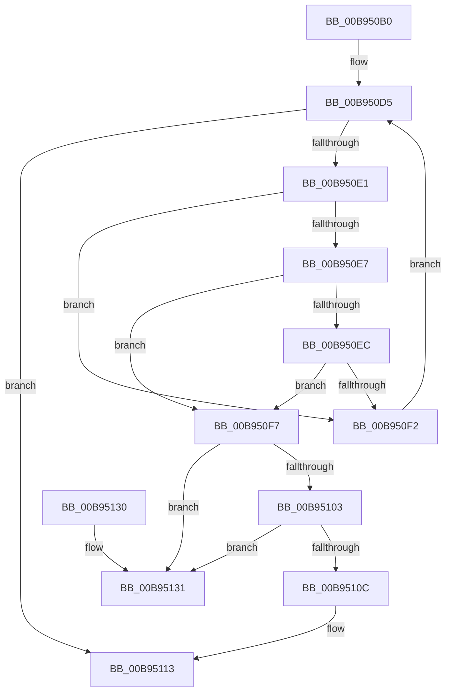

# VF_FIND_INACTIVE_ADAPTER_AND_REMOVE

- RVA: `0x00B950B0`–`0x00B95138` (길이 `136` bytes)
- VA: `0x0000000140B950B0`
- 실행 섹션: `PAGEVRFY`
- PDB 이름 있음: `예`; PDB Function 태그: `아니요`
- unwind 정보 RVA: `0x0006CF28`
- 디코드: `40`개 명령, `136/136` bytes 표시
- 미해석 바이트: `0` (있으면 어셈블리에 `.byte`로 보존)

> 이 문서는 커널 이미지의 기계어와 PDB 기호를 분석해 생성했습니다. 4번과 5번은 함수 원형과 자료형을 바이너리 사용 방식에서 추정한 C 해석이며 원본 소스 복구 결과는 아닙니다.

## 1. Dependencies

- 직접 호출 지점: **2**; 고유 호출 대상: **2**
- 직접 호출자로 확인된 함수: **1**
- RIP 상대 이미지 참조: **2**

### Outgoing calls
- `0x00B950C6` → [KeAcquireSpinLockRaiseToDpc](../../text/20/KeAcquireSpinLockRaiseToDpc_function_00208470.md) (function, `0x00208470`)
- `0x00B9511D` → [KeReleaseSpinLock](../../text/39/KeReleaseSpinLock_function_00392BA0.md) (function, `0x00392BA0`)

### Direct callers
- [VfGetDmaAdapter](VfGetDmaAdapter_function_00B96930.md) at `0x00B969A1`

### Static image references
- `0x00B950BF` → RVA `0x00F03FD0` (`.data`; read)
- `0x00B950CE` → RVA `0x00F03FC0` (`.data`; read)

## 2. Other-region calls and transfers

- 다른 실행 섹션으로 향하는 call: **2**
  - `0x00B950C6` → [KeAcquireSpinLockRaiseToDpc](../../text/20/KeAcquireSpinLockRaiseToDpc_function_00208470.md) (`PAGEVRFY` → `.text`)
  - `0x00B9511D` → [KeReleaseSpinLock](../../text/39/KeReleaseSpinLock_function_00392BA0.md) (`PAGEVRFY` → `.text`)
- 별도 외부 분기/꼬리 이동을 확인하지 못했습니다.

## 3. Assembly (complete function range)

```asm
00B950B0  48 89 5C 24 08                  mov qword ptr [rsp + 8], rbx
00B950B5  57                              push rdi
00B950B6  48 83 EC 20                     sub rsp, 0x20
00B950BA  48 8B F9                        mov rdi, rcx
00B950BD  33 DB                           xor ebx, ebx
00B950BF  48 8D 0D 0A EF 36 00            lea rcx, [rip + 0x36ef0a]
00B950C6  E8 A5 33 67 FF                  call 0x140208470
00B950CB  44 8A C0                        mov r8b, al
00B950CE  48 8B 05 EB EE 36 00            mov rax, qword ptr [rip + 0x36eeeb]
00B950D5  48 8D 0D E4 EE 36 00            lea rcx, [rip + 0x36eee4]
00B950DC  48 3B C8                        cmp rcx, rax
00B950DF  74 32                           je 0x140b95113
00B950E1  48 39 78 40                     cmp qword ptr [rax + 0x40], rdi
00B950E5  75 0B                           jne 0x140b950f2
00B950E7  39 58 4C                        cmp dword ptr [rax + 0x4c], ebx
00B950EA  7E 0B                           jle 0x140b950f7
00B950EC  80 78 48 01                     cmp byte ptr [rax + 0x48], 1
00B950F0  74 05                           je 0x140b950f7
00B950F2  48 8B 00                        mov rax, qword ptr [rax]
00B950F5  EB DE                           jmp 0x140b950d5
00B950F7  48 8B 10                        mov rdx, qword ptr [rax]
00B950FA  48 8B D8                        mov rbx, rax
00B950FD  48 39 42 08                     cmp qword ptr [rdx + 8], rax
00B95101  75 2E                           jne 0x140b95131
00B95103  48 8B 48 08                     mov rcx, qword ptr [rax + 8]
00B95107  48 39 01                        cmp qword ptr [rcx], rax
00B9510A  75 25                           jne 0x140b95131
00B9510C  48 89 11                        mov qword ptr [rcx], rdx
00B9510F  48 89 4A 08                     mov qword ptr [rdx + 8], rcx
00B95113  41 8A D0                        mov dl, r8b
00B95116  48 8D 0D B3 EE 36 00            lea rcx, [rip + 0x36eeb3]
00B9511D  E8 7E DA 7F FF                  call 0x140392ba0
00B95122  48 8B C3                        mov rax, rbx
00B95125  48 8B 5C 24 30                  mov rbx, qword ptr [rsp + 0x30]
00B9512A  48 83 C4 20                     add rsp, 0x20
00B9512E  5F                              pop rdi
00B9512F  C3                              ret
00B95130  CC                              int3
00B95131  B9 03 00 00 00                  mov ecx, 3
00B95136  CD 29                           int 0x29
```

## 4. C-style interpretation (structured pseudocode)

```c
__int64 __fastcall VF_FIND_INACTIVE_ADAPTER_AND_REMOVE(__int64 a1)
{
    __int64 result;
    __int64 v_rbx;
    __int64 v_rsp;
    unsigned __int64 v_stack_p8;

    v_stack_p8 = v_rbx;
    v_rsp = (v_rsp) - (32);
    v_rbx = 0;
    result = KeAcquireSpinLockRaiseToDpc(v_rip + 3600138, a2, a3, a4);
loc_00B950D5:
    if ((v_rip + 3600100) == (*(unsigned __int64 *)(v_rip + 3600107))) goto loc_00B95113;
    if ((*(unsigned __int64 *)(*(unsigned __int64 *)(v_rip + 3600107) + 64)) != a1) goto loc_00B950F2;
    if ((*(unsigned int *)(*(unsigned __int64 *)(v_rip + 3600107) + 76)) <= 0) goto loc_00B950F7;
    if ((*(unsigned __int8 *)(*(unsigned __int64 *)(v_rip + 3600107) + 72)) == 1) goto loc_00B950F7;
loc_00B950F2:
    goto loc_00B950D5;
loc_00B950F7:
    if ((*(unsigned __int64 *)(*(unsigned __int64 *)(*(unsigned __int64 *)(*(unsigned __int64 *)(v_rip + 3600107))) + 8)) != (*(unsigned __int64 *)(*(unsigned __int64 *)(v_rip + 3600107)))) goto loc_00B95131;
    if ((*(unsigned __int64 *)(*(unsigned __int64 *)(*(unsigned __int64 *)(*(unsigned __int64 *)(v_rip + 3600107)) + 8))) != (*(unsigned __int64 *)(*(unsigned __int64 *)(v_rip + 3600107)))) goto loc_00B95131;
    *(unsigned __int64 *)(*(unsigned __int64 *)(*(unsigned __int64 *)(*(unsigned __int64 *)(v_rip + 3600107)) + 8)) = *(unsigned __int64 *)(*(unsigned __int64 *)(*(unsigned __int64 *)(v_rip + 3600107)));
    *(unsigned __int64 *)(*(unsigned __int64 *)(*(unsigned __int64 *)(*(unsigned __int64 *)(v_rip + 3600107))) + 8) = *(unsigned __int64 *)(*(unsigned __int64 *)(*(unsigned __int64 *)(v_rip + 3600107)) + 8);
loc_00B95113:
    result = KeReleaseSpinLock(v_rip + 3600051, (unsigned __int8)((unsigned __int8)(result)), (unsigned __int8)(result), a4);
    v_rsp = (v_rsp) + (32);
    return *(unsigned __int64 *)(*(unsigned __int64 *)(v_rip + 3600107));
loc_00B95131:
    return *(unsigned __int64 *)(*(unsigned __int64 *)(v_rip + 3600107));
}
```

## 5. (Beta) C Style

```c
int64_t VF_FIND_INACTIVE_ADAPTER_AND_REMOVE(int64_t Arg1)
{
    int64_t result;
    int64_t local_rbx;
    int64_t local_rsp;
    uint64_t v_stack_p8;

    v_stack_p8 = local_rbx;
    local_rsp = (local_rsp) - (32);
    local_rbx = 0;
    result = KeAcquireSpinLockRaiseToDpc(v_rip + 3600138, a2, a3, a4);
loc_00B950D5:
    if ((v_rip + 3600100) == (*(uint64_t *)(v_rip + 0x36EEEB))) goto loc_00B95113;
    if ((*(uint64_t *)(*(uint64_t *)(v_rip + 0x36EEEB) + 0x40)) != Arg1) goto loc_00B950F2;
    if ((*(uint32_t *)(*(uint64_t *)(v_rip + 0x36EEEB) + 0x4C)) <= 0) goto loc_00B950F7;
    if ((*(uint8_t *)(*(uint64_t *)(v_rip + 0x36EEEB) + 0x48)) == 1) goto loc_00B950F7;
loc_00B950F2:
    goto loc_00B950D5;
loc_00B950F7:
    if ((*(uint64_t *)(*(uint64_t *)(*(uint64_t *)(*(uint64_t *)(v_rip + 0x36EEEB))) + 0x8)) != (*(uint64_t *)(*(uint64_t *)(v_rip + 0x36EEEB)))) goto loc_00B95131;
    if ((*(uint64_t *)(*(uint64_t *)(*(uint64_t *)(*(uint64_t *)(v_rip + 0x36EEEB)) + 0x8))) != (*(uint64_t *)(*(uint64_t *)(v_rip + 0x36EEEB)))) goto loc_00B95131;
    *(uint64_t *)(*(uint64_t *)(*(uint64_t *)(*(uint64_t *)(v_rip + 0x36EEEB)) + 0x8)) = *(uint64_t *)(*(uint64_t *)(*(uint64_t *)(v_rip + 0x36EEEB)));
    *(uint64_t *)(*(uint64_t *)(*(uint64_t *)(*(uint64_t *)(v_rip + 0x36EEEB))) + 0x8) = *(uint64_t *)(*(uint64_t *)(*(uint64_t *)(v_rip + 0x36EEEB)) + 0x8);
loc_00B95113:
    result = KeReleaseSpinLock(v_rip + 3600051, (uint8_t)((uint8_t)(result)), (uint8_t)(result), a4);
    local_rsp = (local_rsp) + (32);
    return *(uint64_t *)(*(uint64_t *)(v_rip + 0x36EEEB));
loc_00B95131:
    return *(uint64_t *)(*(uint64_t *)(v_rip + 0x36EEEB));
}
```

## 6. Execution-region graph

[열기: 2D/3D 그래프와 함수 탐색 컨트롤 패널](../../../control-panel.html?section=pagevrfy&rva=0x00B950B0&view=graph)

- 2D 그래프는 위에서 아래로 흐르고, 3D 그래프는 빈 공간을 드래그해 회전합니다. Shift+드래그는 이동, 휠은 확대·축소, 함수 노드 선택은 대상 보고서 이동입니다.

### Static fallback


