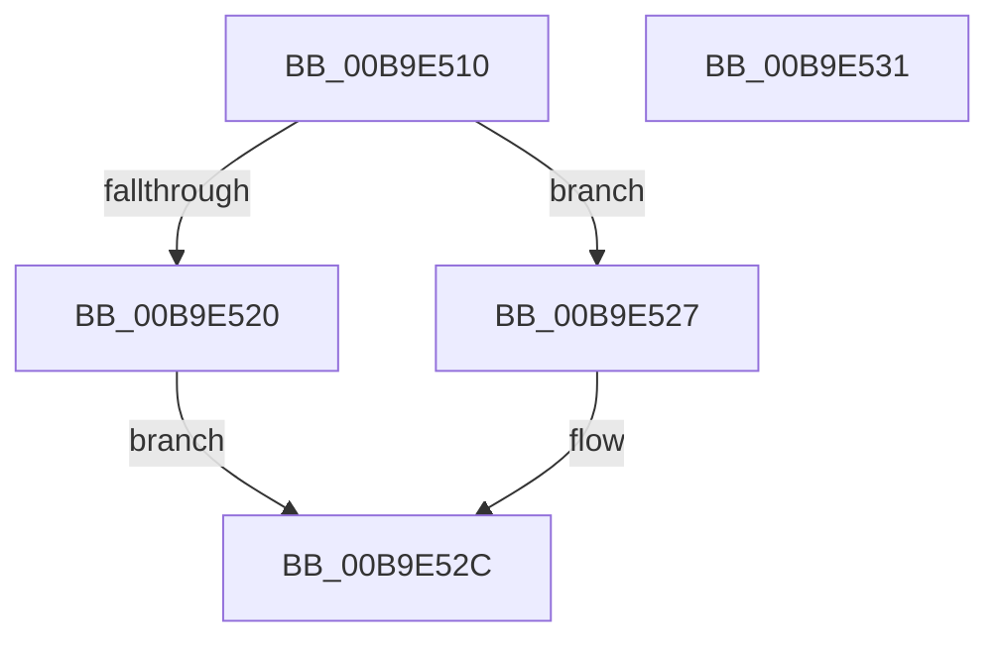

# VerifierExEnterCriticalRegionAndAcquireSharedWaitForExclusive

- RVA: `0x00B9E510`–`0x00B9E532` (길이 `34` bytes)
- VA: `0x0000000140B9E510`
- 실행 섹션: `PAGEVRFY`
- PDB 이름 있음: `예`; PDB Function 태그: `아니요`
- unwind 정보 RVA: `0x0005C788`
- 디코드: `10`개 명령, `34/34` bytes 표시
- 미해석 바이트: `0` (있으면 어셈블리에 `.byte`로 보존)

> 이 문서는 커널 이미지의 기계어와 PDB 기호를 분석해 생성했습니다. 4번과 5번은 함수 원형과 자료형을 바이너리 사용 방식에서 추정한 C 해석이며 원본 소스 복구 결과는 아닙니다.

## 1. Dependencies

- 직접 호출 지점: **2**; 고유 호출 대상: **2**
- 직접 호출자로 확인된 함수: **0**
- RIP 상대 이미지 참조: **1**

### Outgoing calls
- `0x00B9E520` → [ExEnterCriticalRegionAndAcquireSharedWaitForExclusive](../../text/3D/ExEnterCriticalRegionAndAcquireSharedWaitForExclusive_function_003D43B0.md) (function, `0x003D43B0`)
- `0x00B9E527` → [guard_dispatch_icall](../../text/6B/guard_dispatch_icall_function_006BAAD0.md) (function, `0x006BAAD0`)

### Direct callers
- 이 함수 시작 RVA로 연결되는 직접 call은 확인되지 않았습니다. 간접 호출은 완전히 역산할 수 없습니다.

### Static image references
- `0x00B9E514` → RVA `0x00FFDC50` (`PAGEVRFD`; read)

## 2. Other-region calls and transfers

- 다른 실행 섹션으로 향하는 call: **2**
  - `0x00B9E520` → [ExEnterCriticalRegionAndAcquireSharedWaitForExclusive](../../text/3D/ExEnterCriticalRegionAndAcquireSharedWaitForExclusive_function_003D43B0.md) (`PAGEVRFY` → `.text`)
  - `0x00B9E527` → [guard_dispatch_icall](../../text/6B/guard_dispatch_icall_function_006BAAD0.md) (`PAGEVRFY` → `.text`)
- 별도 외부 분기/꼬리 이동을 확인하지 못했습니다.

## 3. Assembly (complete function range)

```asm
00B9E510  48 83 EC 28                     sub rsp, 0x28
00B9E514  48 8B 05 35 F7 45 00            mov rax, qword ptr [rip + 0x45f735]
00B9E51B  48 85 C0                        test rax, rax
00B9E51E  75 07                           jne 0x140b9e527
00B9E520  E8 8B 5E 83 FF                  call 0x1403d43b0
00B9E525  EB 05                           jmp 0x140b9e52c
00B9E527  E8 A4 C5 B1 FF                  call 0x1406baad0
00B9E52C  48 83 C4 28                     add rsp, 0x28
00B9E530  C3                              ret
00B9E531  CC                              int3
```

## 4. C-style interpretation (structured pseudocode)

```c
__int64 __fastcall VerifierExEnterCriticalRegionAndAcquireSharedWaitForExclusive(void)
{
    __int64 result;
    __int64 v_rsp;

    v_rsp = (v_rsp) - (40);
    if (*(unsigned __int64 *)(v_rip + 4585269) != 0) goto loc_00B9E527;
    result = ExEnterCriticalRegionAndAcquireSharedWaitForExclusive(a1, a2, a3, a4);
    goto loc_00B9E52C;
loc_00B9E527:
    result = guard_dispatch_icall(a1, a2, a3, a4);
loc_00B9E52C:
    v_rsp = (v_rsp) + (40);
    return result;
}
```

## 5. (Beta) C Style

```c
void VerifierExEnterCriticalRegionAndAcquireSharedWaitForExclusive(void)
{
    int64_t result;
    int64_t local_rsp;

    local_rsp = (local_rsp) - (40);
    if (*(uint64_t *)(v_rip + 0x45F735) != 0) goto loc_00B9E527;
    result = ExEnterCriticalRegionAndAcquireSharedWaitForExclusive(a1, a2, a3, a4);
    goto loc_00B9E52C;
loc_00B9E527:
    result = guard_dispatch_icall(a1, a2, a3, a4);
loc_00B9E52C:
    local_rsp = (local_rsp) + (40);
    return result;
}
```

## 6. Execution-region graph

[열기: 2D/3D 그래프와 함수 탐색 컨트롤 패널](../../../control-panel.html?section=pagevrfy&rva=0x00B9E510&view=graph)

- 2D 그래프는 위에서 아래로 흐르고, 3D 그래프는 빈 공간을 드래그해 회전합니다. Shift+드래그는 이동, 휠은 확대·축소, 함수 노드 선택은 대상 보고서 이동입니다.

### Static fallback


