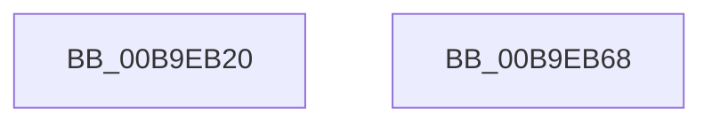

# VerifierFsRtlFastUnlockSingle

- RVA: `0x00B9EB20`–`0x00B9EB69` (길이 `73` bytes)
- VA: `0x0000000140B9EB20`
- 실행 섹션: `PAGEVRFY`
- PDB 이름 있음: `예`; PDB Function 태그: `아니요`
- unwind 정보 RVA: `0x0005CC98`
- 디코드: `15`개 명령, `73/73` bytes 표시
- 미해석 바이트: `0` (있으면 어셈블리에 `.byte`로 보존)

> 이 문서는 커널 이미지의 기계어와 PDB 기호를 분석해 생성했습니다. 4번과 5번은 함수 원형과 자료형을 바이너리 사용 방식에서 추정한 C 해석이며 원본 소스 복구 결과는 아닙니다.

## 1. Dependencies

- 직접 호출 지점: **1**; 고유 호출 대상: **1**
- 직접 호출자로 확인된 함수: **0**
- RIP 상대 이미지 참조: **1**

### Outgoing calls
- `0x00B9EB5E` → [guard_dispatch_icall](../../text/6B/guard_dispatch_icall_function_006BAAD0.md) (function, `0x006BAAD0`)

### Direct callers
- 이 함수 시작 RVA로 연결되는 직접 call은 확인되지 않았습니다. 간접 호출은 완전히 역산할 수 없습니다.

### Static image references
- `0x00B9EB2F` → RVA `0x00FFE820` (`PAGEVRFD`; read)

## 2. Other-region calls and transfers

- 다른 실행 섹션으로 향하는 call: **1**
  - `0x00B9EB5E` → [guard_dispatch_icall](../../text/6B/guard_dispatch_icall_function_006BAAD0.md) (`PAGEVRFY` → `.text`)
- 별도 외부 분기/꼬리 이동을 확인하지 못했습니다.

## 3. Assembly (complete function range)

```asm
00B9EB20  4C 8B DC                        mov r11, rsp
00B9EB23  48 83 EC 58                     sub rsp, 0x58
00B9EB27  44 8A 94 24 98 00 00 00         mov r10b, byte ptr [rsp + 0x98]
00B9EB2F  48 8B 05 EA FC 45 00            mov rax, qword ptr [rip + 0x45fcea]
00B9EB36  45 88 53 E0                     mov byte ptr [r11 - 0x20], r10b
00B9EB3A  4C 8B 94 24 90 00 00 00         mov r10, qword ptr [rsp + 0x90]
00B9EB42  4D 89 53 D8                     mov qword ptr [r11 - 0x28], r10
00B9EB46  44 8B 94 24 88 00 00 00         mov r10d, dword ptr [rsp + 0x88]
00B9EB4E  45 89 53 D0                     mov dword ptr [r11 - 0x30], r10d
00B9EB52  4C 8B 94 24 80 00 00 00         mov r10, qword ptr [rsp + 0x80]
00B9EB5A  4D 89 53 C8                     mov qword ptr [r11 - 0x38], r10
00B9EB5E  E8 6D BF B1 FF                  call 0x1406baad0
00B9EB63  48 83 C4 58                     add rsp, 0x58
00B9EB67  C3                              ret
00B9EB68  CC                              int3
```

## 4. C-style interpretation (structured pseudocode)

```c
__int64 __fastcall VerifierFsRtlFastUnlockSingle(__int64 a1, __int64 a2, __int64 a3, __int64 a4, __int64 a5, unsigned int a6, __int64 a7, unsigned __int8 a8)
{
    __int64 result;
    __int64 v_rsp;

    v_rsp = (v_rsp) - (88);
    *(unsigned __int8 *)(v_rsp - 32) = a8;
    *(unsigned __int64 *)(v_rsp - 40) = a7;
    *(unsigned int *)(v_rsp - 48) = (unsigned int)((unsigned int)(a6));
    *(unsigned __int64 *)(v_rsp - 56) = a5;
    result = guard_dispatch_icall(a1, a2, a3, a4);
    v_rsp = (v_rsp) + (88);
    return result;
}
```

## 5. (Beta) C Style

```c
int64_t VerifierFsRtlFastUnlockSingle(int64_t Arg1, int64_t Arg2, int64_t Arg3, int64_t Arg4, int64_t Arg5, uint32_t Arg6, int64_t Arg7, uint8_t Arg8)
{
    int64_t result;
    int64_t local_rsp;

    local_rsp = (local_rsp) - (88);
    *(uint8_t *)(local_rsp - 0x20) = Arg8;
    *(uint64_t *)(local_rsp - 0x28) = Arg7;
    *(uint32_t *)(local_rsp - 0x30) = (uint32_t)((uint32_t)(Arg6));
    *(uint64_t *)(local_rsp - 0x38) = Arg5;
    result = guard_dispatch_icall(Arg1, Arg2, Arg3, Arg4);
    local_rsp = (local_rsp) + (88);
    return result;
}
```

## 6. Execution-region graph

[열기: 2D/3D 그래프와 함수 탐색 컨트롤 패널](../../../control-panel.html?section=pagevrfy&rva=0x00B9EB20&view=graph)

- 2D 그래프는 위에서 아래로 흐르고, 3D 그래프는 빈 공간을 드래그해 회전합니다. Shift+드래그는 이동, 휠은 확대·축소, 함수 노드 선택은 대상 보고서 이동입니다.

### Static fallback


