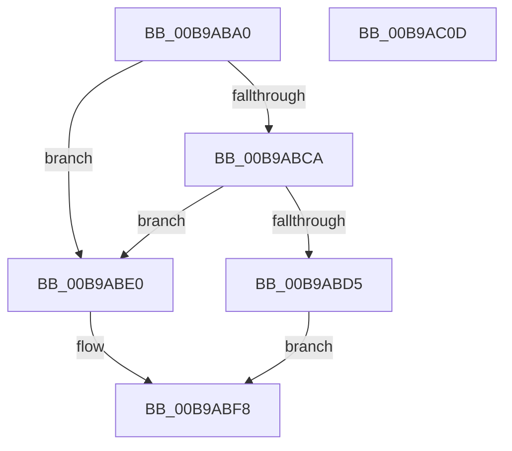

# VerifierIoAllocateDriverObjectExtension

- RVA: `0x00B9ABA0`–`0x00B9AC0E` (길이 `110` bytes)
- VA: `0x0000000140B9ABA0`
- 실행 섹션: `PAGEVRFY`
- PDB 이름 있음: `예`; PDB Function 태그: `아니요`
- unwind 정보 RVA: `0x00066400`
- 디코드: `32`개 명령, `110/110` bytes 표시
- 미해석 바이트: `0` (있으면 어셈블리에 `.byte`로 보존)

> 이 문서는 커널 이미지의 기계어와 PDB 기호를 분석해 생성했습니다. 4번과 5번은 함수 원형과 자료형을 바이너리 사용 방식에서 추정한 C 해석이며 원본 소스 복구 결과는 아닙니다.

## 1. Dependencies

- 직접 호출 지점: **2**; 고유 호출 대상: **2**
- 직접 호출자로 확인된 함수: **0**
- RIP 상대 이미지 참조: **2**

### Outgoing calls
- `0x00B9ABCC` → [VfFaultsInjectResourceFailure](../BA/VfFaultsInjectResourceFailure_function_00BA6558.md) (function, `0x00BA6558`)
- `0x00B9ABF3` → [guard_dispatch_icall](../../text/6B/guard_dispatch_icall_function_006BAAD0.md) (function, `0x006BAAD0`)

### Direct callers
- 이 함수 시작 RVA로 연결되는 직접 call은 확인되지 않았습니다. 간접 호출은 완전히 역산할 수 없습니다.

### Static image references
- `0x00B9ABB4` → RVA `0x00E681A0` (`.data`; read)
- `0x00B9ABE0` → RVA `0x00FFE6B8` (`PAGEVRFD`; read)

## 2. Other-region calls and transfers

- 다른 실행 섹션으로 향하는 call: **1**
  - `0x00B9ABF3` → [guard_dispatch_icall](../../text/6B/guard_dispatch_icall_function_006BAAD0.md) (`PAGEVRFY` → `.text`)
- 별도 외부 분기/꼬리 이동을 확인하지 못했습니다.

## 3. Assembly (complete function range)

```asm
00B9ABA0  48 89 5C 24 08                  mov qword ptr [rsp + 8], rbx
00B9ABA5  48 89 6C 24 10                  mov qword ptr [rsp + 0x10], rbp
00B9ABAA  48 89 74 24 18                  mov qword ptr [rsp + 0x18], rsi
00B9ABAF  57                              push rdi
00B9ABB0  48 83 EC 30                     sub rsp, 0x30
00B9ABB4  8B 05 E6 D5 2C 00               mov eax, dword ptr [rip + 0x2cd5e6]
00B9ABBA  49 8B D9                        mov rbx, r9
00B9ABBD  41 8B F8                        mov edi, r8d
00B9ABC0  48 8B F2                        mov rsi, rdx
00B9ABC3  48 8B E9                        mov rbp, rcx
00B9ABC6  A8 04                           test al, 4
00B9ABC8  74 16                           je 0x140b9abe0
00B9ABCA  33 C9                           xor ecx, ecx
00B9ABCC  E8 87 B9 00 00                  call 0x140ba6558
00B9ABD1  85 C0                           test eax, eax
00B9ABD3  74 0B                           je 0x140b9abe0
00B9ABD5  48 83 23 00                     and qword ptr [rbx], 0
00B9ABD9  B8 9A 00 00 C0                  mov eax, 0xc000009a
00B9ABDE  EB 18                           jmp 0x140b9abf8
00B9ABE0  48 8B 05 D1 3A 46 00            mov rax, qword ptr [rip + 0x463ad1]
00B9ABE7  4C 8B CB                        mov r9, rbx
00B9ABEA  44 8B C7                        mov r8d, edi
00B9ABED  48 8B D6                        mov rdx, rsi
00B9ABF0  48 8B CD                        mov rcx, rbp
00B9ABF3  E8 D8 FE B1 FF                  call 0x1406baad0
00B9ABF8  48 8B 5C 24 40                  mov rbx, qword ptr [rsp + 0x40]
00B9ABFD  48 8B 6C 24 48                  mov rbp, qword ptr [rsp + 0x48]
00B9AC02  48 8B 74 24 50                  mov rsi, qword ptr [rsp + 0x50]
00B9AC07  48 83 C4 30                     add rsp, 0x30
00B9AC0B  5F                              pop rdi
00B9AC0C  C3                              ret
00B9AC0D  CC                              int3
```

## 4. C-style interpretation (structured pseudocode)

```c
__int64 __fastcall VerifierIoAllocateDriverObjectExtension(__int64 a1, __int64 a2, int a3, __int64 a4)
{
    __int64 result;
    __int64 v_rsp;
    unsigned __int64 v_stack_p10;
    unsigned __int64 v_stack_p18;
    unsigned __int64 v_stack_p8;

    v_stack_p8 = v_rbx;
    v_stack_p10 = v_rbp;
    v_stack_p18 = v_rsi;
    v_rsp = (v_rsp) - (48);
    if ((((unsigned __int8)((unsigned int)(*(unsigned int *)(v_rip + 2938342)))) & (4)) == 0) goto loc_00B9ABE0;
    a1 = 0;
    result = VfFaultsInjectResourceFailure(a1, a2, a3, a4);
    if ((unsigned int)(result) == 0) goto loc_00B9ABE0;
    goto loc_00B9ABF8;
loc_00B9ABE0:
    result = guard_dispatch_icall(0, a2, (unsigned int)((unsigned int)((unsigned int)(a3))), a4);
loc_00B9ABF8:
    v_rsp = (v_rsp) + (48);
    return result;
}
```

## 5. (Beta) C Style

```c
int64_t VerifierIoAllocateDriverObjectExtension(int64_t Arg1, int64_t Arg2, int32_t Arg3, void *Arg4)
{
    uint8_t *arg4 = (uint8_t *)Arg4;

    int64_t result;
    int64_t local_rsp;
    uint64_t v_stack_p10;
    uint64_t v_stack_p18;
    uint64_t v_stack_p8;

    v_stack_p8 = local_rbx;
    v_stack_p10 = local_rbp;
    v_stack_p18 = local_rsi;
    local_rsp = (local_rsp) - (48);
    if ((((uint8_t)((uint32_t)(*(uint32_t *)(v_rip + 0x2CD5E6)))) & (4)) == 0) goto loc_00B9ABE0;
    Arg1 = 0;
    result = VfFaultsInjectResourceFailure(Arg1, Arg2, Arg3, Arg4);
    if ((uint32_t)(result) == 0) goto loc_00B9ABE0;
    goto loc_00B9ABF8;
loc_00B9ABE0:
    result = guard_dispatch_icall(0, Arg2, (uint32_t)((uint32_t)((uint32_t)(Arg3))), Arg4);
loc_00B9ABF8:
    local_rsp = (local_rsp) + (48);
    return result;
}
```

### 관측된 메모리 오프셋

구조체 형식이 확인되지 않은 접근은 인자 기준의 오프셋으로만 기록했습니다.

| 기준 인자 | 오프셋 표현 | 폭 (bit) | 접근 |
|---|---:|---:|---|
| `Arg4` | `+ 0x0` | `64` | `R/W` |

## 6. Execution-region graph

[열기: 2D/3D 그래프와 함수 탐색 컨트롤 패널](../../../control-panel.html?section=pagevrfy&rva=0x00B9ABA0&view=graph)

- 2D 그래프는 위에서 아래로 흐르고, 3D 그래프는 빈 공간을 드래그해 회전합니다. Shift+드래그는 이동, 휠은 확대·축소, 함수 노드 선택은 대상 보고서 이동입니다.

### Static fallback


