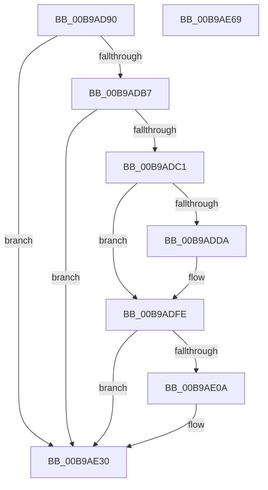

# VerifierIoAllocateIrpEx

- RVA: `0x00B9AD90`–`0x00B9AE6A` (길이 `218` bytes)
- VA: `0x0000000140B9AD90`
- 실행 섹션: `PAGEVRFY`
- PDB 이름 있음: `예`; PDB Function 태그: `아니요`
- unwind 정보 RVA: `0x0007D3C0`
- 디코드: `53`개 명령, `218/218` bytes 표시
- 미해석 바이트: `0` (있으면 어셈블리에 `.byte`로 보존)

> 이 문서는 커널 이미지의 기계어와 PDB 기호를 분석해 생성했습니다. 4번과 5번은 함수 원형과 자료형을 바이너리 사용 방식에서 추정한 C 해석이며 원본 소스 복구 결과는 아닙니다.

## 1. Dependencies

- 직접 호출 지점: **3**; 고유 호출 대상: **2**
- 직접 호출자로 확인된 함수: **0**
- RIP 상대 이미지 참조: **4**

### Outgoing calls
- `0x00B9ADF9` → [CarReportRuleViolationFromNt](CarReportRuleViolationFromNt_function_00B9D904.md) (function, `0x00B9D904`)
- `0x00B9AE2B` → [CarReportRuleViolationFromNt](CarReportRuleViolationFromNt_function_00B9D904.md) (function, `0x00B9D904`)
- `0x00B9AE4F` → [guard_dispatch_icall](../../text/6B/guard_dispatch_icall_function_006BAAD0.md) (function, `0x006BAAD0`)

### Direct callers
- 이 함수 시작 RVA로 연결되는 직접 call은 확인되지 않았습니다. 간접 호출은 완전히 역산할 수 없습니다.

### Static image references
- `0x00B9ADB7` → RVA `0x00F04A20` (`.data`; read)
- `0x00B9ADCA` → RVA `0x00FC6B70` (`ALMOSTRO`; read)
- `0x00B9AE30` → RVA `0x00FF4140` (`PAGEVRFD`; read)
- `0x00B9AE37` → RVA `0x00BB9540` (`IovAllocateIrp`; read)

## 2. Other-region calls and transfers

- 다른 실행 섹션으로 향하는 call: **1**
  - `0x00B9AE4F` → [guard_dispatch_icall](../../text/6B/guard_dispatch_icall_function_006BAAD0.md) (`PAGEVRFY` → `.text`)
- 별도 외부 분기/꼬리 이동을 확인하지 못했습니다.

## 3. Assembly (complete function range)

```asm
00B9AD90  4C 8B DC                        mov r11, rsp
00B9AD93  49 89 5B 08                     mov qword ptr [r11 + 8], rbx
00B9AD97  49 89 6B 10                     mov qword ptr [r11 + 0x10], rbp
00B9AD9B  49 89 73 18                     mov qword ptr [r11 + 0x18], rsi
00B9AD9F  57                              push rdi
00B9ADA0  48 83 EC 40                     sub rsp, 0x40
00B9ADA4  48 8B 5C 24 48                  mov rbx, qword ptr [rsp + 0x48]
00B9ADA9  41 8A F8                        mov dil, r8b
00B9ADAC  40 8A F2                        mov sil, dl
00B9ADAF  48 8B E9                        mov rbp, rcx
00B9ADB2  45 84 C0                        test r8b, r8b
00B9ADB5  74 79                           je 0x140b9ae30
00B9ADB7  8B 05 63 9C 36 00               mov eax, dword ptr [rip + 0x369c63]
00B9ADBD  A8 08                           test al, 8
00B9ADBF  74 6F                           je 0x140b9ae30
00B9ADC1  65 4C 8B 0C 25 88 01 00 00      mov r9, qword ptr gs:[0x188]
00B9ADCA  48 8B 05 9F BD 42 00            mov rax, qword ptr [rip + 0x42bd9f]
00B9ADD1  49 39 81 B8 00 00 00            cmp qword ptr [r9 + 0xb8], rax
00B9ADD8  75 24                           jne 0x140b9adfe
00B9ADDA  49 89 5B E8                     mov qword ptr [r11 - 0x18], rbx
00B9ADDE  BA 0A 01 00 00                  mov edx, 0x10a
00B9ADE3  C7 44 24 28 03 00 00 00         mov dword ptr [rsp + 0x28], 3
00B9ADEB  45 33 C9                        xor r9d, r9d
00B9ADEE  49 83 63 D8 00                  and qword ptr [r11 - 0x28], 0
00B9ADF3  45 33 C0                        xor r8d, r8d
00B9ADF6  8D 4A BA                        lea ecx, [rdx - 0x46]
00B9ADF9  E8 06 2B 00 00                  call 0x140b9d904
00B9ADFE  65 8A 04 25 3C 3A 00 00         mov al, byte ptr gs:[0x3a3c]
00B9AE06  A8 01                           test al, 1
00B9AE08  74 26                           je 0x140b9ae30
00B9AE0A  BA 0B 01 00 00                  mov edx, 0x10b
00B9AE0F  48 89 5C 24 30                  mov qword ptr [rsp + 0x30], rbx
00B9AE14  C7 44 24 28 03 00 00 00         mov dword ptr [rsp + 0x28], 3
00B9AE1C  45 33 C9                        xor r9d, r9d
00B9AE1F  48 83 64 24 20 00               and qword ptr [rsp + 0x20], 0
00B9AE25  45 33 C0                        xor r8d, r8d
00B9AE28  8D 4A B9                        lea ecx, [rdx - 0x47]
00B9AE2B  E8 D4 2A 00 00                  call 0x140b9d904
00B9AE30  48 8B 05 09 93 45 00            mov rax, qword ptr [rip + 0x459309]
00B9AE37  48 8D 0D 02 E7 01 00            lea rcx, [rip + 0x1e702]
00B9AE3E  48 89 4C 24 20                  mov qword ptr [rsp + 0x20], rcx
00B9AE43  4C 8B CB                        mov r9, rbx
00B9AE46  48 8B CD                        mov rcx, rbp
00B9AE49  44 8A C7                        mov r8b, dil
00B9AE4C  40 8A D6                        mov dl, sil
00B9AE4F  E8 7C FC B1 FF                  call 0x1406baad0
00B9AE54  48 8B 5C 24 50                  mov rbx, qword ptr [rsp + 0x50]
00B9AE59  48 8B 6C 24 58                  mov rbp, qword ptr [rsp + 0x58]
00B9AE5E  48 8B 74 24 60                  mov rsi, qword ptr [rsp + 0x60]
00B9AE63  48 83 C4 40                     add rsp, 0x40
00B9AE67  5F                              pop rdi
00B9AE68  C3                              ret
00B9AE69  CC                              int3
```

## 4. C-style interpretation (structured pseudocode)

```c
__int64 __fastcall VerifierIoAllocateIrpEx(__int64 a1, unsigned __int8 a2, int a3)
{
    __int64 result;
    __int64 v_rsp;
    unsigned __int64 v_stack_m18;
    unsigned int v_stack_m20;
    unsigned __int64 v_stack_m28;
    unsigned __int64 v_stack_p0;
    unsigned __int64 v_stack_p10;
    unsigned __int64 v_stack_p18;
    unsigned __int64 v_stack_p8;

    *(unsigned __int64 *)(v_rsp + 8) = v_rbx;
    *(unsigned __int64 *)(v_rsp + 16) = v_rbp;
    *(unsigned __int64 *)(v_rsp + 24) = v_rsi;
    v_rsp = (v_rsp) - (64);
    if ((unsigned __int8)(a3) == 0) goto loc_00B9AE30;
    if ((((unsigned __int8)((unsigned int)(*(unsigned int *)(v_rip + 3578979)))) & (8)) == 0) goto loc_00B9AE30;
    result = *(unsigned __int64 *)(v_rip + 4373919);
    if ((*(unsigned __int64 *)(*(unsigned __int64 *)(gs_base + (0 + 392)) + 184)) == (*(unsigned __int64 *)(v_rip + 4373919))) {
        *(unsigned __int64 *)(v_rsp - 24) = v_stack_p0;
        a2 = 266;
        v_stack_m20 = 3;
        a4 = 0;
        a3 = 0;
        a1 = a2 - 70;
        result = CarReportRuleViolationFromNt(a1, a2, a3, a4);
    }
    result = *(unsigned __int8 *)(gs_base + (0 + 14908));
    if ((((unsigned __int8)(*(unsigned __int8 *)(gs_base + (0 + 14908)))) & (1)) != 0) {
        a2 = 267;
        v_stack_m18 = v_stack_p0;
        v_stack_m20 = 3;
        a4 = 0;
        a3 = 0;
        a1 = a2 - 71;
        result = CarReportRuleViolationFromNt(a1, a2, a3, a4);
    }
    v_stack_m28 = v_rip + 124674;
    result = guard_dispatch_icall(a1, a2, (unsigned __int8)((unsigned __int8)(a3)), v_stack_p0);
    v_rsp = (v_rsp) + (64);
    return result;
}
```

## 5. (Beta) C Style

```c
int64_t VerifierIoAllocateIrpEx(int64_t Arg1, uint8_t Arg2, int32_t Arg3)
{
    int64_t result;
    int64_t local_rsp;
    uint64_t v_stack_m18;
    uint32_t v_stack_m20;
    uint64_t v_stack_m28;
    uint64_t v_stack_p0;
    uint64_t v_stack_p10;
    uint64_t v_stack_p18;
    uint64_t v_stack_p8;

    *(uint64_t *)(local_rsp + 0x8) = local_rbx;
    *(uint64_t *)(local_rsp + 0x10) = local_rbp;
    *(uint64_t *)(local_rsp + 0x18) = local_rsi;
    local_rsp = (local_rsp) - (64);
    if ((uint8_t)(Arg3) == 0) goto loc_00B9AE30;
    if ((((uint8_t)((uint32_t)(*(uint32_t *)(v_rip + 0x369C63)))) & (8)) == 0) goto loc_00B9AE30;
    result = *(uint64_t *)(v_rip + 0x42BD9F);
    if ((*(uint64_t *)(*(uint64_t *)(gs_base + (0 + 0x188)) + 0xB8)) == (*(uint64_t *)(v_rip + 0x42BD9F))) {
        *(uint64_t *)(local_rsp - 0x18) = v_stack_p0;
        Arg2 = 266;
        v_stack_m20 = 3;
        a4 = 0;
        Arg3 = 0;
        Arg1 = Arg2 - 70;
        result = CarReportRuleViolationFromNt(Arg1, Arg2, Arg3, a4);
    }
    result = *(uint8_t *)(gs_base + (0 + 0x3A3C));
    if ((((uint8_t)(*(uint8_t *)(gs_base + (0 + 0x3A3C)))) & (1)) != 0) {
        Arg2 = 267;
        v_stack_m18 = v_stack_p0;
        v_stack_m20 = 3;
        a4 = 0;
        Arg3 = 0;
        Arg1 = Arg2 - 71;
        result = CarReportRuleViolationFromNt(Arg1, Arg2, Arg3, a4);
    }
    v_stack_m28 = v_rip + 124674;
    result = guard_dispatch_icall(Arg1, Arg2, (uint8_t)((uint8_t)(Arg3)), v_stack_p0);
    local_rsp = (local_rsp) + (64);
    return result;
}
```

## 6. Execution-region graph

[열기: 2D/3D 그래프와 함수 탐색 컨트롤 패널](../../../control-panel.html?section=pagevrfy&rva=0x00B9AD90&view=graph)

- 2D 그래프는 위에서 아래로 흐르고, 3D 그래프는 빈 공간을 드래그해 회전합니다. Shift+드래그는 이동, 휠은 확대·축소, 함수 노드 선택은 대상 보고서 이동입니다.

### Static fallback


