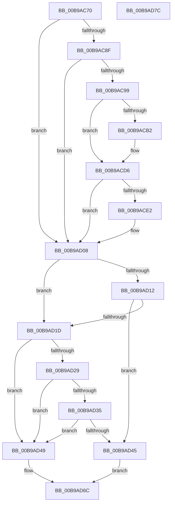

# VerifierIoAllocateIrp

- RVA: `0x00B9AC70`–`0x00B9AD7D` (길이 `269` bytes)
- VA: `0x0000000140B9AC70`
- 실행 섹션: `PAGEVRFY`
- PDB 이름 있음: `예`; PDB Function 태그: `아니요`
- unwind 정보 RVA: `0x000718AC`
- 디코드: `68`개 명령, `269/269` bytes 표시
- 미해석 바이트: `0` (있으면 어셈블리에 `.byte`로 보존)

> 이 문서는 커널 이미지의 기계어와 PDB 기호를 분석해 생성했습니다. 4번과 5번은 함수 원형과 자료형을 바이너리 사용 방식에서 추정한 C 해석이며 원본 소스 복구 결과는 아닙니다.

## 1. Dependencies

- 직접 호출 지점: **5**; 고유 호출 대상: **3**
- 직접 호출자로 확인된 함수: **0**
- RIP 상대 이미지 참조: **7**

### Outgoing calls
- `0x00B9ACD1` → [CarReportRuleViolationFromNt](CarReportRuleViolationFromNt_function_00B9D904.md) (function, `0x00B9D904`)
- `0x00B9AD03` → [CarReportRuleViolationFromNt](CarReportRuleViolationFromNt_function_00B9D904.md) (function, `0x00B9D904`)
- `0x00B9AD14` → [VfFaultsInjectResourceFailure](../BA/VfFaultsInjectResourceFailure_function_00BA6558.md) (function, `0x00BA6558`)
- `0x00B9AD3C` → [guard_dispatch_icall](../../text/6B/guard_dispatch_icall_function_006BAAD0.md) (function, `0x006BAAD0`)
- `0x00B9AD67` → [guard_dispatch_icall](../../text/6B/guard_dispatch_icall_function_006BAAD0.md) (function, `0x006BAAD0`)

### Direct callers
- 이 함수 시작 RVA로 연결되는 직접 call은 확인되지 않았습니다. 간접 호출은 완전히 역산할 수 없습니다.

### Static image references
- `0x00B9AC8F` → RVA `0x00F04A20` (`.data`; read)
- `0x00B9ACA2` → RVA `0x00FC6B70` (`ALMOSTRO`; read)
- `0x00B9AD08` → RVA `0x00E681A0` (`.data`; read)
- `0x00B9AD29` → RVA `0x00FFDA10` (`PAGEVRFD`; read)
- `0x00B9AD35` → RVA `0x00BBA820` (` ?? ::JKADOLAD::`string'`; read)
- `0x00B9AD49` → RVA `0x00FF4068` (`PAGEVRFD`; read)
- `0x00B9AD50` → RVA `0x00BB9540` (`IovAllocateIrp`; read)

## 2. Other-region calls and transfers

- 다른 실행 섹션으로 향하는 call: **2**
  - `0x00B9AD3C` → [guard_dispatch_icall](../../text/6B/guard_dispatch_icall_function_006BAAD0.md) (`PAGEVRFY` → `.text`)
  - `0x00B9AD67` → [guard_dispatch_icall](../../text/6B/guard_dispatch_icall_function_006BAAD0.md) (`PAGEVRFY` → `.text`)
- 별도 외부 분기/꼬리 이동을 확인하지 못했습니다.

## 3. Assembly (complete function range)

```asm
00B9AC70  4C 8B DC                        mov r11, rsp
00B9AC73  49 89 5B 08                     mov qword ptr [r11 + 8], rbx
00B9AC77  49 89 73 10                     mov qword ptr [r11 + 0x10], rsi
00B9AC7B  57                              push rdi
00B9AC7C  48 83 EC 40                     sub rsp, 0x40
00B9AC80  48 8B 5C 24 48                  mov rbx, qword ptr [rsp + 0x48]
00B9AC85  40 8A FA                        mov dil, dl
00B9AC88  40 8A F1                        mov sil, cl
00B9AC8B  84 D2                           test dl, dl
00B9AC8D  74 79                           je 0x140b9ad08
00B9AC8F  8B 05 8B 9D 36 00               mov eax, dword ptr [rip + 0x369d8b]
00B9AC95  A8 08                           test al, 8
00B9AC97  74 6F                           je 0x140b9ad08
00B9AC99  65 4C 8B 04 25 88 01 00 00      mov r8, qword ptr gs:[0x188]
00B9ACA2  48 8B 05 C7 BE 42 00            mov rax, qword ptr [rip + 0x42bec7]
00B9ACA9  49 39 80 B8 00 00 00            cmp qword ptr [r8 + 0xb8], rax
00B9ACB0  75 24                           jne 0x140b9acd6
00B9ACB2  49 89 5B E8                     mov qword ptr [r11 - 0x18], rbx
00B9ACB6  BA 0A 01 00 00                  mov edx, 0x10a
00B9ACBB  C7 44 24 28 03 00 00 00         mov dword ptr [rsp + 0x28], 3
00B9ACC3  45 33 C9                        xor r9d, r9d
00B9ACC6  49 83 63 D8 00                  and qword ptr [r11 - 0x28], 0
00B9ACCB  45 33 C0                        xor r8d, r8d
00B9ACCE  8D 4A BA                        lea ecx, [rdx - 0x46]
00B9ACD1  E8 2E 2C 00 00                  call 0x140b9d904
00B9ACD6  65 8A 04 25 3C 3A 00 00         mov al, byte ptr gs:[0x3a3c]
00B9ACDE  A8 01                           test al, 1
00B9ACE0  74 26                           je 0x140b9ad08
00B9ACE2  BA 0B 01 00 00                  mov edx, 0x10b
00B9ACE7  48 89 5C 24 30                  mov qword ptr [rsp + 0x30], rbx
00B9ACEC  C7 44 24 28 03 00 00 00         mov dword ptr [rsp + 0x28], 3
00B9ACF4  45 33 C9                        xor r9d, r9d
00B9ACF7  48 83 64 24 20 00               and qword ptr [rsp + 0x20], 0
00B9ACFD  45 33 C0                        xor r8d, r8d
00B9AD00  8D 4A B9                        lea ecx, [rdx - 0x47]
00B9AD03  E8 FC 2B 00 00                  call 0x140b9d904
00B9AD08  8B 05 92 D4 2C 00               mov eax, dword ptr [rip + 0x2cd492]
00B9AD0E  A8 04                           test al, 4
00B9AD10  74 0B                           je 0x140b9ad1d
00B9AD12  33 C9                           xor ecx, ecx
00B9AD14  E8 3F B8 00 00                  call 0x140ba6558
00B9AD19  85 C0                           test eax, eax
00B9AD1B  75 28                           jne 0x140b9ad45
00B9AD1D  F7 05 79 D4 2C 00 00 00 04 00   test dword ptr [rip + 0x2cd479], 0x40000
00B9AD27  74 20                           je 0x140b9ad49
00B9AD29  48 8B 05 E0 2C 46 00            mov rax, qword ptr [rip + 0x462ce0]
00B9AD30  48 85 C0                        test rax, rax
00B9AD33  74 14                           je 0x140b9ad49
00B9AD35  48 8D 0D E4 FA 01 00            lea rcx, [rip + 0x1fae4]
00B9AD3C  E8 8F FD B1 FF                  call 0x1406baad0
00B9AD41  84 C0                           test al, al
00B9AD43  74 04                           je 0x140b9ad49
00B9AD45  33 C0                           xor eax, eax
00B9AD47  EB 23                           jmp 0x140b9ad6c
00B9AD49  48 8B 05 18 93 45 00            mov rax, qword ptr [rip + 0x459318]
00B9AD50  48 8D 0D E9 E7 01 00            lea rcx, [rip + 0x1e7e9]
00B9AD57  48 89 4C 24 20                  mov qword ptr [rsp + 0x20], rcx
00B9AD5C  4C 8B CB                        mov r9, rbx
00B9AD5F  33 C9                           xor ecx, ecx
00B9AD61  44 8A C7                        mov r8b, dil
00B9AD64  40 8A D6                        mov dl, sil
00B9AD67  E8 64 FD B1 FF                  call 0x1406baad0
00B9AD6C  48 8B 5C 24 50                  mov rbx, qword ptr [rsp + 0x50]
00B9AD71  48 8B 74 24 58                  mov rsi, qword ptr [rsp + 0x58]
00B9AD76  48 83 C4 40                     add rsp, 0x40
00B9AD7A  5F                              pop rdi
00B9AD7B  C3                              ret
00B9AD7C  CC                              int3
```

## 4. C-style interpretation (structured pseudocode)

```c
__int64 __fastcall VerifierIoAllocateIrp(unsigned __int8 a1, unsigned __int8 a2, __int64 a3, int a4)
{
    __int64 result;
    __int64 v_rsp;
    unsigned __int64 v_stack_m18;
    unsigned int v_stack_m20;
    unsigned __int64 v_stack_m28;
    unsigned __int64 v_stack_p0;
    unsigned __int64 v_stack_p10;
    unsigned __int64 v_stack_p8;

    *(unsigned __int64 *)(v_rsp + 8) = v_rbx;
    *(unsigned __int64 *)(v_rsp + 16) = v_rsi;
    v_rsp = (v_rsp) - (64);
    if (a2 == 0) goto loc_00B9AD08;
    if ((((unsigned __int8)((unsigned int)(*(unsigned int *)(v_rip + 3579275)))) & (8)) == 0) goto loc_00B9AD08;
    result = *(unsigned __int64 *)(v_rip + 4374215);
    if ((*(unsigned __int64 *)(*(unsigned __int64 *)(gs_base + (0 + 392)) + 184)) == (*(unsigned __int64 *)(v_rip + 4374215))) {
        *(unsigned __int64 *)(v_rsp - 24) = v_stack_p0;
        a2 = 266;
        v_stack_m20 = 3;
        a4 = 0;
        a3 = 0;
        a1 = a2 - 70;
        result = CarReportRuleViolationFromNt(a1, a2, a3, a4);
    }
    result = *(unsigned __int8 *)(gs_base + (0 + 14908));
    if ((((unsigned __int8)(*(unsigned __int8 *)(gs_base + (0 + 14908)))) & (1)) != 0) {
        a2 = 267;
        v_stack_m18 = v_stack_p0;
        v_stack_m20 = 3;
        a4 = 0;
        a3 = 0;
        a1 = a2 - 71;
        result = CarReportRuleViolationFromNt(a1, a2, a3, a4);
    }
    if ((((unsigned __int8)((unsigned int)(*(unsigned int *)(v_rip + 2938002)))) & (4)) == 0) goto loc_00B9AD1D;
    a1 = 0;
    result = VfFaultsInjectResourceFailure(a1, a2, a3, a4);
    if ((unsigned int)(result) != 0) goto loc_00B9AD45;
loc_00B9AD1D:
    if (((*(unsigned int *)(v_rip + 2937977)) & (0x40000ULL)) == 0) goto loc_00B9AD49;
    if (*(unsigned __int64 *)(v_rip + 4599008) == 0) goto loc_00B9AD49;
    result = guard_dispatch_icall(v_rip + 129764, a2, a3, a4);
    if ((unsigned __int8)(result) == 0) goto loc_00B9AD49;
loc_00B9AD45:
    result = 0;
    goto loc_00B9AD6C;
loc_00B9AD49:
    v_stack_m28 = v_rip + 124905;
    a1 = 0;
    result = guard_dispatch_icall(a1, 0, a2, v_stack_p0);
loc_00B9AD6C:
    v_rsp = (v_rsp) + (64);
    return result;
}
```

## 5. (Beta) C Style

```c
int64_t VerifierIoAllocateIrp(uint8_t Arg1, uint8_t Arg2, int64_t Arg3, int32_t Arg4)
{
    int64_t result;
    int64_t local_rsp;
    uint64_t v_stack_m18;
    uint32_t v_stack_m20;
    uint64_t v_stack_m28;
    uint64_t v_stack_p0;
    uint64_t v_stack_p10;
    uint64_t v_stack_p8;

    *(uint64_t *)(local_rsp + 0x8) = local_rbx;
    *(uint64_t *)(local_rsp + 0x10) = local_rsi;
    local_rsp = (local_rsp) - (64);
    if (Arg2 == 0) goto loc_00B9AD08;
    if ((((uint8_t)((uint32_t)(*(uint32_t *)(v_rip + 0x369D8B)))) & (8)) == 0) goto loc_00B9AD08;
    result = *(uint64_t *)(v_rip + 0x42BEC7);
    if ((*(uint64_t *)(*(uint64_t *)(gs_base + (0 + 0x188)) + 0xB8)) == (*(uint64_t *)(v_rip + 0x42BEC7))) {
        *(uint64_t *)(local_rsp - 0x18) = v_stack_p0;
        Arg2 = 266;
        v_stack_m20 = 3;
        Arg4 = 0;
        Arg3 = 0;
        Arg1 = Arg2 - 70;
        result = CarReportRuleViolationFromNt(Arg1, Arg2, Arg3, Arg4);
    }
    result = *(uint8_t *)(gs_base + (0 + 0x3A3C));
    if ((((uint8_t)(*(uint8_t *)(gs_base + (0 + 0x3A3C)))) & (1)) != 0) {
        Arg2 = 267;
        v_stack_m18 = v_stack_p0;
        v_stack_m20 = 3;
        Arg4 = 0;
        Arg3 = 0;
        Arg1 = Arg2 - 71;
        result = CarReportRuleViolationFromNt(Arg1, Arg2, Arg3, Arg4);
    }
    if ((((uint8_t)((uint32_t)(*(uint32_t *)(v_rip + 0x2CD492)))) & (4)) == 0) goto loc_00B9AD1D;
    Arg1 = 0;
    result = VfFaultsInjectResourceFailure(Arg1, Arg2, Arg3, Arg4);
    if ((uint32_t)(result) != 0) goto loc_00B9AD45;
loc_00B9AD1D:
    if (((*(uint32_t *)(v_rip + 0x2CD479)) & (0x40000ULL)) == 0) goto loc_00B9AD49;
    if (*(uint64_t *)(v_rip + 0x462CE0) == 0) goto loc_00B9AD49;
    result = guard_dispatch_icall(v_rip + 129764, Arg2, Arg3, Arg4);
    if ((uint8_t)(result) == 0) goto loc_00B9AD49;
loc_00B9AD45:
    result = 0;
    goto loc_00B9AD6C;
loc_00B9AD49:
    v_stack_m28 = v_rip + 124905;
    Arg1 = 0;
    result = guard_dispatch_icall(Arg1, 0, Arg2, v_stack_p0);
loc_00B9AD6C:
    local_rsp = (local_rsp) + (64);
    return result;
}
```

## 6. Execution-region graph

[열기: 2D/3D 그래프와 함수 탐색 컨트롤 패널](../../../control-panel.html?section=pagevrfy&rva=0x00B9AC70&view=graph)

- 2D 그래프는 위에서 아래로 흐르고, 3D 그래프는 빈 공간을 드래그해 회전합니다. Shift+드래그는 이동, 휠은 확대·축소, 함수 노드 선택은 대상 보고서 이동입니다.

### Static fallback


