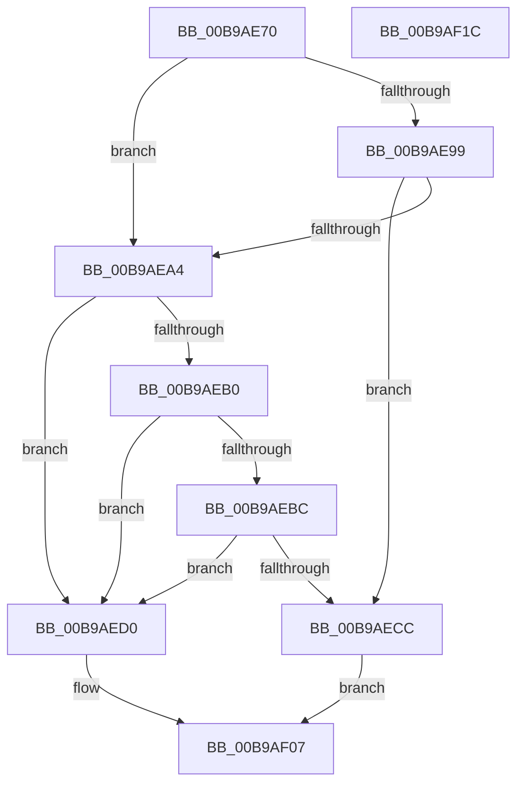

# VerifierIoAllocateMdl

- RVA: `0x00B9AE70`–`0x00B9AF1D` (길이 `173` bytes)
- VA: `0x0000000140B9AE70`
- 실행 섹션: `PAGEVRFY`
- PDB 이름 있음: `예`; PDB Function 태그: `아니요`
- unwind 정보 RVA: `0x0007D3C0`
- 디코드: `46`개 명령, `173/173` bytes 표시
- 미해석 바이트: `0` (있으면 어셈블리에 `.byte`로 보존)

> 이 문서는 커널 이미지의 기계어와 PDB 기호를 분석해 생성했습니다. 4번과 5번은 함수 원형과 자료형을 바이너리 사용 방식에서 추정한 C 해석이며 원본 소스 복구 결과는 아닙니다.

## 1. Dependencies

- 직접 호출 지점: **3**; 고유 호출 대상: **2**
- 직접 호출자로 확인된 함수: **0**
- RIP 상대 이미지 참조: **5**

### Outgoing calls
- `0x00B9AE9B` → [VfFaultsInjectResourceFailure](../BA/VfFaultsInjectResourceFailure_function_00BA6558.md) (function, `0x00BA6558`)
- `0x00B9AEC3` → [guard_dispatch_icall](../../text/6B/guard_dispatch_icall_function_006BAAD0.md) (function, `0x006BAAD0`)
- `0x00B9AF02` → [guard_dispatch_icall](../../text/6B/guard_dispatch_icall_function_006BAAD0.md) (function, `0x006BAAD0`)

### Direct callers
- 이 함수 시작 RVA로 연결되는 직접 call은 확인되지 않았습니다. 간접 호출은 완전히 역산할 수 없습니다.

### Static image references
- `0x00B9AE84` → RVA `0x00E681A0` (`.data`; read)
- `0x00B9AEB0` → RVA `0x00FFDA10` (`PAGEVRFD`; read)
- `0x00B9AEBC` → RVA `0x00BBA830` (` ?? ::JKADOLAD::`string'`; read)
- `0x00B9AED5` → RVA `0x00B92350` (`IovAllocateMdl`; read)
- `0x00B9AEDC` → RVA `0x00FF4070` (`PAGEVRFD`; read)

## 2. Other-region calls and transfers

- 다른 실행 섹션으로 향하는 call: **2**
  - `0x00B9AEC3` → [guard_dispatch_icall](../../text/6B/guard_dispatch_icall_function_006BAAD0.md) (`PAGEVRFY` → `.text`)
  - `0x00B9AF02` → [guard_dispatch_icall](../../text/6B/guard_dispatch_icall_function_006BAAD0.md) (`PAGEVRFY` → `.text`)
- 별도 외부 분기/꼬리 이동을 확인하지 못했습니다.

## 3. Assembly (complete function range)

```asm
00B9AE70  48 89 5C 24 08                  mov qword ptr [rsp + 8], rbx
00B9AE75  48 89 6C 24 10                  mov qword ptr [rsp + 0x10], rbp
00B9AE7A  48 89 74 24 18                  mov qword ptr [rsp + 0x18], rsi
00B9AE7F  57                              push rdi
00B9AE80  48 83 EC 40                     sub rsp, 0x40
00B9AE84  8B 05 16 D3 2C 00               mov eax, dword ptr [rip + 0x2cd316]
00B9AE8A  41 8A D9                        mov bl, r9b
00B9AE8D  41 8A F8                        mov dil, r8b
00B9AE90  8B F2                           mov esi, edx
00B9AE92  48 8B E9                        mov rbp, rcx
00B9AE95  A8 04                           test al, 4
00B9AE97  74 0B                           je 0x140b9aea4
00B9AE99  33 C9                           xor ecx, ecx
00B9AE9B  E8 B8 B6 00 00                  call 0x140ba6558
00B9AEA0  85 C0                           test eax, eax
00B9AEA2  75 28                           jne 0x140b9aecc
00B9AEA4  F7 05 F2 D2 2C 00 00 00 04 00   test dword ptr [rip + 0x2cd2f2], 0x40000
00B9AEAE  74 20                           je 0x140b9aed0
00B9AEB0  48 8B 05 59 2B 46 00            mov rax, qword ptr [rip + 0x462b59]
00B9AEB7  48 85 C0                        test rax, rax
00B9AEBA  74 14                           je 0x140b9aed0
00B9AEBC  48 8D 0D 6D F9 01 00            lea rcx, [rip + 0x1f96d]
00B9AEC3  E8 08 FC B1 FF                  call 0x1406baad0
00B9AEC8  84 C0                           test al, al
00B9AECA  74 04                           je 0x140b9aed0
00B9AECC  33 C0                           xor eax, eax
00B9AECE  EB 37                           jmp 0x140b9af07
00B9AED0  48 8B 4C 24 48                  mov rcx, qword ptr [rsp + 0x48]
00B9AED5  48 8D 15 74 74 FF FF            lea rdx, [rip - 0x8b8c]
00B9AEDC  48 8B 05 8D 91 45 00            mov rax, qword ptr [rip + 0x45918d]
00B9AEE3  44 8A CB                        mov r9b, bl
00B9AEE6  48 89 54 24 30                  mov qword ptr [rsp + 0x30], rdx
00B9AEEB  44 8A C7                        mov r8b, dil
00B9AEEE  48 89 4C 24 28                  mov qword ptr [rsp + 0x28], rcx
00B9AEF3  8B D6                           mov edx, esi
00B9AEF5  48 8B 4C 24 70                  mov rcx, qword ptr [rsp + 0x70]
00B9AEFA  48 89 4C 24 20                  mov qword ptr [rsp + 0x20], rcx
00B9AEFF  48 8B CD                        mov rcx, rbp
00B9AF02  E8 C9 FB B1 FF                  call 0x1406baad0
00B9AF07  48 8B 5C 24 50                  mov rbx, qword ptr [rsp + 0x50]
00B9AF0C  48 8B 6C 24 58                  mov rbp, qword ptr [rsp + 0x58]
00B9AF11  48 8B 74 24 60                  mov rsi, qword ptr [rsp + 0x60]
00B9AF16  48 83 C4 40                     add rsp, 0x40
00B9AF1A  5F                              pop rdi
00B9AF1B  C3                              ret
00B9AF1C  CC                              int3
```

## 4. C-style interpretation (structured pseudocode)

```c
__int64 __fastcall VerifierIoAllocateMdl(__int64 a1, int a2, unsigned __int8 a3, unsigned __int8 a4, __int64 a5)
{
    __int64 result;
    __int64 v_rsp;
    unsigned __int64 v_stack_m18;
    unsigned __int64 v_stack_m20;
    unsigned __int64 v_stack_m28;
    unsigned __int64 v_stack_p0;
    unsigned __int64 v_stack_p10;
    unsigned __int64 v_stack_p18;
    unsigned __int64 v_stack_p8;

    v_stack_p8 = v_rbx;
    v_stack_p10 = v_rbp;
    v_stack_p18 = v_rsi;
    v_rsp = (v_rsp) - (64);
    if ((((unsigned __int8)((unsigned int)(*(unsigned int *)(v_rip + 2937622)))) & (4)) == 0) goto loc_00B9AEA4;
    a1 = 0;
    result = VfFaultsInjectResourceFailure(a1, a2, a3, a4);
    if ((unsigned int)(result) != 0) goto loc_00B9AECC;
loc_00B9AEA4:
    if (((*(unsigned int *)(v_rip + 2937586)) & (0x40000ULL)) == 0) goto loc_00B9AED0;
    if (*(unsigned __int64 *)(v_rip + 4598617) == 0) goto loc_00B9AED0;
    result = guard_dispatch_icall(v_rip + 129389, a2, a3, a4);
    if ((unsigned __int8)(result) == 0) goto loc_00B9AED0;
loc_00B9AECC:
    result = 0;
    goto loc_00B9AF07;
loc_00B9AED0:
    v_stack_m18 = v_rip - 35724;
    v_stack_m20 = v_stack_p0;
    v_stack_m28 = a5;
    result = guard_dispatch_icall(0, (unsigned int)((unsigned int)((unsigned int)(a2))), a3, a4);
loc_00B9AF07:
    v_rsp = (v_rsp) + (64);
    return result;
}
```

## 5. (Beta) C Style

```c
int64_t VerifierIoAllocateMdl(int64_t Arg1, int32_t Arg2, uint8_t Arg3, uint8_t Arg4, int64_t Arg5)
{
    int64_t result;
    int64_t local_rsp;
    uint64_t v_stack_m18;
    uint64_t v_stack_m20;
    uint64_t v_stack_m28;
    uint64_t v_stack_p0;
    uint64_t v_stack_p10;
    uint64_t v_stack_p18;
    uint64_t v_stack_p8;

    v_stack_p8 = local_rbx;
    v_stack_p10 = local_rbp;
    v_stack_p18 = local_rsi;
    local_rsp = (local_rsp) - (64);
    if ((((uint8_t)((uint32_t)(*(uint32_t *)(v_rip + 0x2CD316)))) & (4)) == 0) goto loc_00B9AEA4;
    Arg1 = 0;
    result = VfFaultsInjectResourceFailure(Arg1, Arg2, Arg3, Arg4);
    if ((uint32_t)(result) != 0) goto loc_00B9AECC;
loc_00B9AEA4:
    if (((*(uint32_t *)(v_rip + 0x2CD2F2)) & (0x40000ULL)) == 0) goto loc_00B9AED0;
    if (*(uint64_t *)(v_rip + 0x462B59) == 0) goto loc_00B9AED0;
    result = guard_dispatch_icall(v_rip + 129389, Arg2, Arg3, Arg4);
    if ((uint8_t)(result) == 0) goto loc_00B9AED0;
loc_00B9AECC:
    result = 0;
    goto loc_00B9AF07;
loc_00B9AED0:
    v_stack_m18 = v_rip - 35724;
    v_stack_m20 = v_stack_p0;
    v_stack_m28 = Arg5;
    result = guard_dispatch_icall(0, (uint32_t)((uint32_t)((uint32_t)(Arg2))), Arg3, Arg4);
loc_00B9AF07:
    local_rsp = (local_rsp) + (64);
    return result;
}
```

## 6. Execution-region graph

[열기: 2D/3D 그래프와 함수 탐색 컨트롤 패널](../../../control-panel.html?section=pagevrfy&rva=0x00B9AE70&view=graph)

- 2D 그래프는 위에서 아래로 흐르고, 3D 그래프는 빈 공간을 드래그해 회전합니다. Shift+드래그는 이동, 휠은 확대·축소, 함수 노드 선택은 대상 보고서 이동입니다.

### Static fallback


