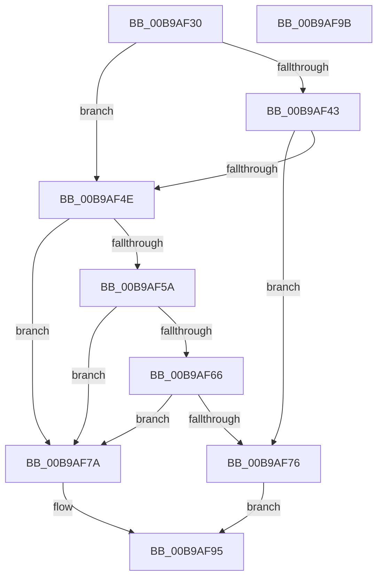

# VerifierIoAllocateWorkItem

- RVA: `0x00B9AF30`–`0x00B9AF9C` (길이 `108` bytes)
- VA: `0x0000000140B9AF30`
- 실행 섹션: `PAGEVRFY`
- PDB 이름 있음: `예`; PDB Function 태그: `아니요`
- unwind 정보 RVA: `0x0005CF00`
- 디코드: `30`개 명령, `108/108` bytes 표시
- 미해석 바이트: `0` (있으면 어셈블리에 `.byte`로 보존)

> 이 문서는 커널 이미지의 기계어와 PDB 기호를 분석해 생성했습니다. 4번과 5번은 함수 원형과 자료형을 바이너리 사용 방식에서 추정한 C 해석이며 원본 소스 복구 결과는 아닙니다.

## 1. Dependencies

- 직접 호출 지점: **3**; 고유 호출 대상: **2**
- 직접 호출자로 확인된 함수: **0**
- RIP 상대 이미지 참조: **5**

### Outgoing calls
- `0x00B9AF45` → [VfFaultsInjectResourceFailure](../BA/VfFaultsInjectResourceFailure_function_00BA6558.md) (function, `0x00BA6558`)
- `0x00B9AF6D` → [guard_dispatch_icall](../../text/6B/guard_dispatch_icall_function_006BAAD0.md) (function, `0x006BAAD0`)
- `0x00B9AF90` → [guard_dispatch_icall](../../text/6B/guard_dispatch_icall_function_006BAAD0.md) (function, `0x006BAAD0`)

### Direct callers
- 이 함수 시작 RVA로 연결되는 직접 call은 확인되지 않았습니다. 간접 호출은 완전히 역산할 수 없습니다.

### Static image references
- `0x00B9AF36` → RVA `0x00E681A0` (`.data`; read)
- `0x00B9AF5A` → RVA `0x00FFDA10` (`PAGEVRFD`; read)
- `0x00B9AF66` → RVA `0x00BBA800` (` ?? ::JKADOLAD::`string'`; read)
- `0x00B9AF7F` → RVA `0x00B92490` (`IovAllocateWorkItem`; read)
- `0x00B9AF86` → RVA `0x00FF4060` (`PAGEVRFD`; read)

## 2. Other-region calls and transfers

- 다른 실행 섹션으로 향하는 call: **2**
  - `0x00B9AF6D` → [guard_dispatch_icall](../../text/6B/guard_dispatch_icall_function_006BAAD0.md) (`PAGEVRFY` → `.text`)
  - `0x00B9AF90` → [guard_dispatch_icall](../../text/6B/guard_dispatch_icall_function_006BAAD0.md) (`PAGEVRFY` → `.text`)
- 별도 외부 분기/꼬리 이동을 확인하지 못했습니다.

## 3. Assembly (complete function range)

```asm
00B9AF30  40 53                           push rbx
00B9AF32  48 83 EC 20                     sub rsp, 0x20
00B9AF36  8B 05 64 D2 2C 00               mov eax, dword ptr [rip + 0x2cd264]
00B9AF3C  48 8B D9                        mov rbx, rcx
00B9AF3F  A8 04                           test al, 4
00B9AF41  74 0B                           je 0x140b9af4e
00B9AF43  33 C9                           xor ecx, ecx
00B9AF45  E8 0E B6 00 00                  call 0x140ba6558
00B9AF4A  85 C0                           test eax, eax
00B9AF4C  75 28                           jne 0x140b9af76
00B9AF4E  F7 05 48 D2 2C 00 00 00 04 00   test dword ptr [rip + 0x2cd248], 0x40000
00B9AF58  74 20                           je 0x140b9af7a
00B9AF5A  48 8B 05 AF 2A 46 00            mov rax, qword ptr [rip + 0x462aaf]
00B9AF61  48 85 C0                        test rax, rax
00B9AF64  74 14                           je 0x140b9af7a
00B9AF66  48 8D 0D 93 F8 01 00            lea rcx, [rip + 0x1f893]
00B9AF6D  E8 5E FB B1 FF                  call 0x1406baad0
00B9AF72  84 C0                           test al, al
00B9AF74  74 04                           je 0x140b9af7a
00B9AF76  33 C0                           xor eax, eax
00B9AF78  EB 1B                           jmp 0x140b9af95
00B9AF7A  48 8B 54 24 28                  mov rdx, qword ptr [rsp + 0x28]
00B9AF7F  4C 8D 05 0A 75 FF FF            lea r8, [rip - 0x8af6]
00B9AF86  48 8B 05 D3 90 45 00            mov rax, qword ptr [rip + 0x4590d3]
00B9AF8D  48 8B CB                        mov rcx, rbx
00B9AF90  E8 3B FB B1 FF                  call 0x1406baad0
00B9AF95  48 83 C4 20                     add rsp, 0x20
00B9AF99  5B                              pop rbx
00B9AF9A  C3                              ret
00B9AF9B  CC                              int3
```

## 4. C-style interpretation (structured pseudocode)

```c
__int64 __fastcall VerifierIoAllocateWorkItem(__int64 a1)
{
    __int64 result;
    __int64 v_rsp;
    unsigned __int64 v_stack_p0;

    v_rsp = (v_rsp) - (32);
    if ((((unsigned __int8)((unsigned int)(*(unsigned int *)(v_rip + 2937444)))) & (4)) == 0) goto loc_00B9AF4E;
    a1 = 0;
    result = VfFaultsInjectResourceFailure(a1, a2, a3, a4);
    if ((unsigned int)(result) != 0) goto loc_00B9AF76;
loc_00B9AF4E:
    if (((*(unsigned int *)(v_rip + 2937416)) & (0x40000ULL)) == 0) goto loc_00B9AF7A;
    if (*(unsigned __int64 *)(v_rip + 4598447) == 0) goto loc_00B9AF7A;
    result = guard_dispatch_icall(v_rip + 129171, a2, a3, a4);
    if ((unsigned __int8)(result) == 0) goto loc_00B9AF7A;
loc_00B9AF76:
    result = 0;
    goto loc_00B9AF95;
loc_00B9AF7A:
    result = guard_dispatch_icall(0, v_stack_p0, v_rip - 35574, a4);
loc_00B9AF95:
    v_rsp = (v_rsp) + (32);
    return result;
}
```

## 5. (Beta) C Style

```c
int64_t VerifierIoAllocateWorkItem(int64_t Arg1)
{
    int64_t result;
    int64_t local_rsp;
    uint64_t v_stack_p0;

    local_rsp = (local_rsp) - (32);
    if ((((uint8_t)((uint32_t)(*(uint32_t *)(v_rip + 0x2CD264)))) & (4)) == 0) goto loc_00B9AF4E;
    Arg1 = 0;
    result = VfFaultsInjectResourceFailure(Arg1, a2, a3, a4);
    if ((uint32_t)(result) != 0) goto loc_00B9AF76;
loc_00B9AF4E:
    if (((*(uint32_t *)(v_rip + 0x2CD248)) & (0x40000ULL)) == 0) goto loc_00B9AF7A;
    if (*(uint64_t *)(v_rip + 0x462AAF) == 0) goto loc_00B9AF7A;
    result = guard_dispatch_icall(v_rip + 129171, a2, a3, a4);
    if ((uint8_t)(result) == 0) goto loc_00B9AF7A;
loc_00B9AF76:
    result = 0;
    goto loc_00B9AF95;
loc_00B9AF7A:
    result = guard_dispatch_icall(0, v_stack_p0, v_rip - 35574, a4);
loc_00B9AF95:
    local_rsp = (local_rsp) + (32);
    return result;
}
```

## 6. Execution-region graph

[열기: 2D/3D 그래프와 함수 탐색 컨트롤 패널](../../../control-panel.html?section=pagevrfy&rva=0x00B9AF30&view=graph)

- 2D 그래프는 위에서 아래로 흐르고, 3D 그래프는 빈 공간을 드래그해 회전합니다. Shift+드래그는 이동, 휠은 확대·축소, 함수 노드 선택은 대상 보고서 이동입니다.

### Static fallback


