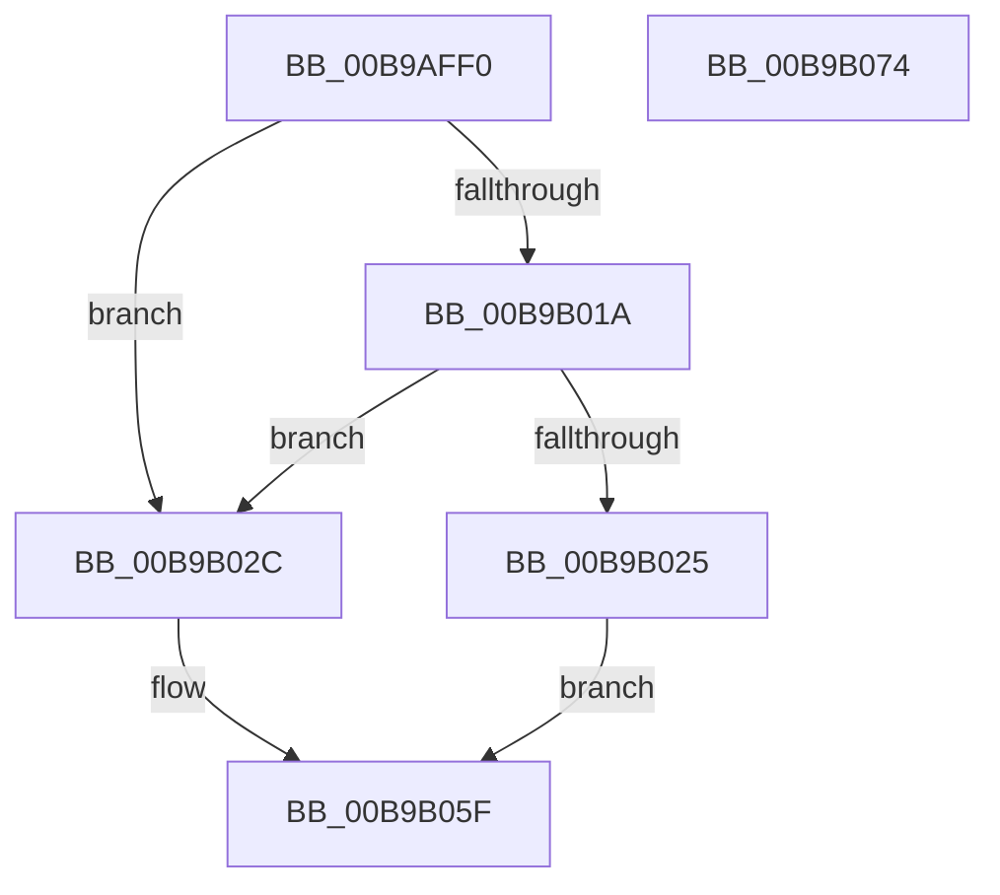

# VerifierIoSetCompletionRoutineEx

- RVA: `0x00B9AFF0`–`0x00B9B075` (길이 `133` bytes)
- VA: `0x0000000140B9AFF0`
- 실행 섹션: `PAGEVRFY`
- PDB 이름 있음: `예`; PDB Function 태그: `아니요`
- unwind 정보 RVA: `0x0007D3C0`
- 디코드: `37`개 명령, `133/133` bytes 표시
- 미해석 바이트: `0` (있으면 어셈블리에 `.byte`로 보존)

> 이 문서는 커널 이미지의 기계어와 PDB 기호를 분석해 생성했습니다. 4번과 5번은 함수 원형과 자료형을 바이너리 사용 방식에서 추정한 C 해석이며 원본 소스 복구 결과는 아닙니다.

## 1. Dependencies

- 직접 호출 지점: **2**; 고유 호출 대상: **2**
- 직접 호출자로 확인된 함수: **0**
- RIP 상대 이미지 참조: **2**

### Outgoing calls
- `0x00B9B01C` → [VfFaultsInjectResourceFailure](../BA/VfFaultsInjectResourceFailure_function_00BA6558.md) (function, `0x00BA6558`)
- `0x00B9B05A` → [guard_dispatch_icall](../../text/6B/guard_dispatch_icall_function_006BAAD0.md) (function, `0x006BAAD0`)

### Direct callers
- 이 함수 시작 RVA로 연결되는 직접 call은 확인되지 않았습니다. 간접 호출은 완전히 역산할 수 없습니다.

### Static image references
- `0x00B9B004` → RVA `0x00E681A0` (`.data`; read)
- `0x00B9B036` → RVA `0x00FFE6D0` (`PAGEVRFD`; read)

## 2. Other-region calls and transfers

- 다른 실행 섹션으로 향하는 call: **1**
  - `0x00B9B05A` → [guard_dispatch_icall](../../text/6B/guard_dispatch_icall_function_006BAAD0.md) (`PAGEVRFY` → `.text`)
- 별도 외부 분기/꼬리 이동을 확인하지 못했습니다.

## 3. Assembly (complete function range)

```asm
00B9AFF0  48 89 5C 24 08                  mov qword ptr [rsp + 8], rbx
00B9AFF5  48 89 6C 24 10                  mov qword ptr [rsp + 0x10], rbp
00B9AFFA  48 89 74 24 18                  mov qword ptr [rsp + 0x18], rsi
00B9AFFF  57                              push rdi
00B9B000  48 83 EC 40                     sub rsp, 0x40
00B9B004  8B 05 96 D1 2C 00               mov eax, dword ptr [rip + 0x2cd196]
00B9B00A  49 8B D9                        mov rbx, r9
00B9B00D  49 8B F8                        mov rdi, r8
00B9B010  48 8B F2                        mov rsi, rdx
00B9B013  48 8B E9                        mov rbp, rcx
00B9B016  A8 04                           test al, 4
00B9B018  74 12                           je 0x140b9b02c
00B9B01A  33 C9                           xor ecx, ecx
00B9B01C  E8 37 B5 00 00                  call 0x140ba6558
00B9B021  85 C0                           test eax, eax
00B9B023  74 07                           je 0x140b9b02c
00B9B025  B8 9A 00 00 C0                  mov eax, 0xc000009a
00B9B02A  EB 33                           jmp 0x140b9b05f
00B9B02C  8A 8C 24 80 00 00 00            mov cl, byte ptr [rsp + 0x80]
00B9B033  4C 8B CB                        mov r9, rbx
00B9B036  48 8B 05 93 36 46 00            mov rax, qword ptr [rip + 0x463693]
00B9B03D  4C 8B C7                        mov r8, rdi
00B9B040  88 4C 24 30                     mov byte ptr [rsp + 0x30], cl
00B9B044  48 8B D6                        mov rdx, rsi
00B9B047  8A 4C 24 78                     mov cl, byte ptr [rsp + 0x78]
00B9B04B  88 4C 24 28                     mov byte ptr [rsp + 0x28], cl
00B9B04F  8A 4C 24 70                     mov cl, byte ptr [rsp + 0x70]
00B9B053  88 4C 24 20                     mov byte ptr [rsp + 0x20], cl
00B9B057  48 8B CD                        mov rcx, rbp
00B9B05A  E8 71 FA B1 FF                  call 0x1406baad0
00B9B05F  48 8B 5C 24 50                  mov rbx, qword ptr [rsp + 0x50]
00B9B064  48 8B 6C 24 58                  mov rbp, qword ptr [rsp + 0x58]
00B9B069  48 8B 74 24 60                  mov rsi, qword ptr [rsp + 0x60]
00B9B06E  48 83 C4 40                     add rsp, 0x40
00B9B072  5F                              pop rdi
00B9B073  C3                              ret
00B9B074  CC                              int3
```

## 4. C-style interpretation (structured pseudocode)

```c
__int64 __fastcall VerifierIoSetCompletionRoutineEx(__int64 a1, __int64 a2, __int64 a3, __int64 a4, unsigned __int8 a5, unsigned __int8 a6, unsigned __int8 a7)
{
    __int64 result;
    __int64 v_rsp;
    unsigned __int8 v_stack_m18;
    unsigned __int8 v_stack_m20;
    unsigned __int8 v_stack_m28;
    unsigned __int64 v_stack_p10;
    unsigned __int64 v_stack_p18;
    unsigned __int64 v_stack_p8;

    v_stack_p8 = v_rbx;
    v_stack_p10 = v_rbp;
    v_stack_p18 = v_rsi;
    v_rsp = (v_rsp) - (64);
    if ((((unsigned __int8)((unsigned int)(*(unsigned int *)(v_rip + 2937238)))) & (4)) == 0) goto loc_00B9B02C;
    a1 = 0;
    result = VfFaultsInjectResourceFailure(a1, a2, a3, a4);
    if ((unsigned int)(result) == 0) goto loc_00B9B02C;
    goto loc_00B9B05F;
loc_00B9B02C:
    v_stack_m18 = a7;
    v_stack_m20 = a6;
    v_stack_m28 = a5;
    result = guard_dispatch_icall(0, a2, a3, a4);
loc_00B9B05F:
    v_rsp = (v_rsp) + (64);
    return result;
}
```

## 5. (Beta) C Style

```c
int64_t VerifierIoSetCompletionRoutineEx(int64_t Arg1, int64_t Arg2, int64_t Arg3, int64_t Arg4, uint8_t Arg5, uint8_t Arg6, uint8_t Arg7)
{
    int64_t result;
    int64_t local_rsp;
    uint8_t v_stack_m18;
    uint8_t v_stack_m20;
    uint8_t v_stack_m28;
    uint64_t v_stack_p10;
    uint64_t v_stack_p18;
    uint64_t v_stack_p8;

    v_stack_p8 = local_rbx;
    v_stack_p10 = local_rbp;
    v_stack_p18 = local_rsi;
    local_rsp = (local_rsp) - (64);
    if ((((uint8_t)((uint32_t)(*(uint32_t *)(v_rip + 0x2CD196)))) & (4)) == 0) goto loc_00B9B02C;
    Arg1 = 0;
    result = VfFaultsInjectResourceFailure(Arg1, Arg2, Arg3, Arg4);
    if ((uint32_t)(result) == 0) goto loc_00B9B02C;
    goto loc_00B9B05F;
loc_00B9B02C:
    v_stack_m18 = Arg7;
    v_stack_m20 = Arg6;
    v_stack_m28 = Arg5;
    result = guard_dispatch_icall(0, Arg2, Arg3, Arg4);
loc_00B9B05F:
    local_rsp = (local_rsp) + (64);
    return result;
}
```

## 6. Execution-region graph

[열기: 2D/3D 그래프와 함수 탐색 컨트롤 패널](../../../control-panel.html?section=pagevrfy&rva=0x00B9AFF0&view=graph)

- 2D 그래프는 위에서 아래로 흐르고, 3D 그래프는 빈 공간을 드래그해 회전합니다. Shift+드래그는 이동, 휠은 확대·축소, 함수 노드 선택은 대상 보고서 이동입니다.

### Static fallback


