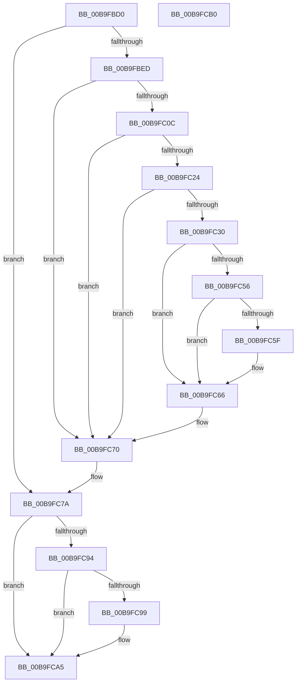

# VerifierKeAcquireQueuedSpinLock

- RVA: `0x00B9FBD0`–`0x00B9FCB1` (길이 `225` bytes)
- VA: `0x0000000140B9FBD0`
- 실행 섹션: `PAGEVRFY`
- PDB 이름 있음: `예`; PDB Function 태그: `아니요`
- unwind 정보 RVA: `0x00065960`
- 디코드: `58`개 명령, `225/225` bytes 표시
- 미해석 바이트: `0` (있으면 어셈블리에 `.byte`로 보존)

> 이 문서는 커널 이미지의 기계어와 PDB 기호를 분석해 생성했습니다. 4번과 5번은 함수 원형과 자료형을 바이너리 사용 방식에서 추정한 C 해석이며 원본 소스 복구 결과는 아닙니다.

## 1. Dependencies

- 직접 호출 지점: **7**; 고유 호출 대상: **7**
- 직접 호출자로 확인된 함수: **0**
- RIP 상대 이미지 참조: **5**

### Outgoing calls
- `0x00B9FC1B` → [ViTargetUpdateTreeAllowed](ViTargetUpdateTreeAllowed_function_00B9BC04.md) (function, `0x00B9BC04`)
- `0x00B9FC27` → [VfDriverIsKernelImageAddress](../BB/VfDriverIsKernelImageAddress_function_00BB7EBC.md) (function, `0x00BB7EBC`)
- `0x00B9FC38` → [VfAvlInitializeLockContext](../../text/4A/VfAvlInitializeLockContext_function_004A686C.md) (function, `0x004A686C`)
- `0x00B9FC4C` → [VfAvlLookupTreeNode](../../text/3E/VfAvlLookupTreeNode_function_003EF1B4.md) (function, `0x003EF1B4`)
- `0x00B9FC6B` → [VfAvlCleanupLockContext](../../text/3E/VfAvlCleanupLockContext_function_003EF56C.md) (function, `0x003EF56C`)
- `0x00B9FC72` → [ViKeIrqlLogAndTrimMemory](../BB/ViKeIrqlLogAndTrimMemory_function_00BB7F58.md) (function, `0x00BB7F58`)
- `0x00B9FC84` → [guard_dispatch_icall](../../text/6B/guard_dispatch_icall_function_006BAAD0.md) (function, `0x006BAAD0`)

### Direct callers
- 이 함수 시작 RVA로 연결되는 직접 call은 확인되지 않았습니다. 간접 호출은 완전히 역산할 수 없습니다.

### Static image references
- `0x00B9FBDA` → RVA `0x00F04A20` (`.data`; read)
- `0x00B9FBED` → RVA `0x00F04A28` (`.data`; read)
- `0x00B9FBFF` → RVA `0x00F04A28` (`.data`; write)
- `0x00B9FC40` → RVA `0x00F049A0` (`.data`; read)
- `0x00B9FC7A` → RVA `0x00FFEC58` (`PAGEVRFD`; read)

## 2. Other-region calls and transfers

- 다른 실행 섹션으로 향하는 call: **4**
  - `0x00B9FC38` → [VfAvlInitializeLockContext](../../text/4A/VfAvlInitializeLockContext_function_004A686C.md) (`PAGEVRFY` → `.text`)
  - `0x00B9FC4C` → [VfAvlLookupTreeNode](../../text/3E/VfAvlLookupTreeNode_function_003EF1B4.md) (`PAGEVRFY` → `.text`)
  - `0x00B9FC6B` → [VfAvlCleanupLockContext](../../text/3E/VfAvlCleanupLockContext_function_003EF56C.md) (`PAGEVRFY` → `.text`)
  - `0x00B9FC84` → [guard_dispatch_icall](../../text/6B/guard_dispatch_icall_function_006BAAD0.md) (`PAGEVRFY` → `.text`)
- 별도 외부 분기/꼬리 이동을 확인하지 못했습니다.

## 3. Assembly (complete function range)

```asm
00B9FBD0  48 89 5C 24 08                  mov qword ptr [rsp + 8], rbx
00B9FBD5  57                              push rdi
00B9FBD6  48 83 EC 40                     sub rsp, 0x40
00B9FBDA  8B 05 40 4E 36 00               mov eax, dword ptr [rip + 0x364e40]
00B9FBE0  33 DB                           xor ebx, ebx
00B9FBE2  48 8B F9                        mov rdi, rcx
00B9FBE5  A8 01                           test al, 1
00B9FBE7  0F 84 8D 00 00 00               je 0x140b9fc7a
00B9FBED  8B 05 35 4E 36 00               mov eax, dword ptr [rip + 0x364e35]
00B9FBF3  FF C0                           inc eax
00B9FBF5  F7 05 21 4E 36 00 00 10 00 00   test dword ptr [rip + 0x364e21], 0x1000
00B9FBFF  89 05 23 4E 36 00               mov dword ptr [rip + 0x364e23], eax
00B9FC05  4C 8B 44 24 48                  mov r8, qword ptr [rsp + 0x48]
00B9FC0A  74 64                           je 0x140b9fc70
00B9FC0C  33 C0                           xor eax, eax
00B9FC0E  0F 57 C0                        xorps xmm0, xmm0
00B9FC11  0F 11 44 24 20                  movups xmmword ptr [rsp + 0x20], xmm0
00B9FC16  48 89 44 24 30                  mov qword ptr [rsp + 0x30], rax
00B9FC1B  E8 E4 BF FF FF                  call 0x140b9bc04
00B9FC20  85 C0                           test eax, eax
00B9FC22  74 4C                           je 0x140b9fc70
00B9FC24  49 8B C8                        mov rcx, r8
00B9FC27  E8 90 82 01 00                  call 0x140bb7ebc
00B9FC2C  85 C0                           test eax, eax
00B9FC2E  75 40                           jne 0x140b9fc70
00B9FC30  8D 53 01                        lea edx, [rbx + 1]
00B9FC33  48 8D 4C 24 20                  lea rcx, [rsp + 0x20]
00B9FC38  E8 2F 6C 90 FF                  call 0x1404a686c
00B9FC3D  44 8B CA                        mov r9d, edx
00B9FC40  48 8D 0D 59 4D 36 00            lea rcx, [rip + 0x364d59]
00B9FC47  48 8D 54 24 20                  lea rdx, [rsp + 0x20]
00B9FC4C  E8 63 F5 84 FF                  call 0x1403ef1b4
00B9FC51  48 85 C0                        test rax, rax
00B9FC54  74 10                           je 0x140b9fc66
00B9FC56  48 8B 40 40                     mov rax, qword ptr [rax + 0x40]
00B9FC5A  48 85 C0                        test rax, rax
00B9FC5D  74 07                           je 0x140b9fc66
00B9FC5F  F0 FF 80 A4 00 00 00            lock inc dword ptr [rax + 0xa4]
00B9FC66  48 8D 4C 24 20                  lea rcx, [rsp + 0x20]
00B9FC6B  E8 FC F8 84 FF                  call 0x1403ef56c
00B9FC70  B1 02                           mov cl, 2
00B9FC72  E8 E1 82 01 00                  call 0x140bb7f58
00B9FC77  48 8B D8                        mov rbx, rax
00B9FC7A  48 8B 05 D7 EF 45 00            mov rax, qword ptr [rip + 0x45efd7]
00B9FC81  48 8B CF                        mov rcx, rdi
00B9FC84  E8 47 AE B1 FF                  call 0x1406baad0
00B9FC89  8B 0D 91 4D 36 00               mov ecx, dword ptr [rip + 0x364d91]
00B9FC8F  F6 C1 01                        test cl, 1
00B9FC92  74 11                           je 0x140b9fca5
00B9FC94  48 85 DB                        test rbx, rbx
00B9FC97  74 0C                           je 0x140b9fca5
00B9FC99  65 8B 0C 25 A4 01 00 00         mov ecx, dword ptr gs:[0x1a4]
00B9FCA1  66 89 4B 0A                     mov word ptr [rbx + 0xa], cx
00B9FCA5  48 8B 5C 24 50                  mov rbx, qword ptr [rsp + 0x50]
00B9FCAA  48 83 C4 40                     add rsp, 0x40
00B9FCAE  5F                              pop rdi
00B9FCAF  C3                              ret
00B9FCB0  CC                              int3
```

## 4. C-style interpretation (structured pseudocode)

```c
__int64 __fastcall VerifierKeAcquireQueuedSpinLock(__int64 a1)
{
    __int64 result;
    __int64 v_rbx;
    __int64 v_rsp;
    unsigned __int64 v_stack_m18;
    unsigned __int64 v_stack_m28;
    unsigned __int64 v_stack_p0;
    unsigned __int64 v_stack_p8;

    v_stack_p8 = v_rbx;
    v_rsp = (v_rsp) - (64);
    v_rbx = 0;
    if ((((unsigned __int8)((unsigned int)(*(unsigned int *)(v_rip + 3558976)))) & (1)) == 0) goto loc_00B9FC7A;
    result = (unsigned int)(((unsigned int)(*(unsigned int *)(v_rip + 3558965))) + 1);
    *(unsigned int *)(v_rip + 3558947) = (unsigned int)(result);
    if (((*(unsigned int *)(v_rip + 3558945)) & (0x1000ULL)) == 0) goto loc_00B9FC70;
    result = 0;
    v_stack_m28 = v_xmm0;
    v_stack_m18 = 0;
    result = ViTargetUpdateTreeAllowed(a1, a2, v_stack_p0, a4);
    if ((unsigned int)(result) == 0) goto loc_00B9FC70;
    result = VfDriverIsKernelImageAddress(v_stack_p0, a2, v_stack_p0, a4);
    if ((unsigned int)(result) != 0) goto loc_00B9FC70;
    result = VfAvlInitializeLockContext(v_stack_m28, v_rbx + 1, v_stack_p0, a4);
    result = VfAvlLookupTreeNode(v_rip + 3558745, v_stack_m28, v_stack_p0, (unsigned int)((unsigned int)(v_rbx + 1)));
    if (result == 0) goto loc_00B9FC66;
    if (*(unsigned __int64 *)(result + 64) != 0) {
    }
    result = VfAvlCleanupLockContext(v_stack_m28, v_stack_m28, v_stack_p0, (unsigned int)((unsigned int)(v_rbx + 1)));
loc_00B9FC70:
    result = ViKeIrqlLogAndTrimMemory(2, v_stack_m28, v_stack_p0, (unsigned int)((unsigned int)(v_rbx + 1)));
loc_00B9FC7A:
    result = guard_dispatch_icall(a1, v_stack_m28, v_stack_p0, (unsigned int)((unsigned int)(v_rbx + 1)));
    if ((((unsigned __int8)((unsigned int)(*(unsigned int *)(v_rip + 3558801)))) & (1)) == 0) goto loc_00B9FCA5;
    if (result != 0) {
        a1 = *(unsigned int *)(gs_base + (0 + 420));
        *(unsigned __int16 *)(result + 10) = (unsigned __int16)(a1);
    }
    v_rsp = (v_rsp) + (64);
    return result;
}
```

## 5. (Beta) C Style

```c
int64_t VerifierKeAcquireQueuedSpinLock(int64_t Arg1)
{
    int64_t result;
    int64_t local_rbx;
    int64_t local_rsp;
    uint64_t v_stack_m18;
    uint64_t v_stack_m28;
    uint64_t v_stack_p0;
    uint64_t v_stack_p8;

    v_stack_p8 = local_rbx;
    local_rsp = (local_rsp) - (64);
    local_rbx = 0;
    if ((((uint8_t)((uint32_t)(*(uint32_t *)(v_rip + 0x364E40)))) & (1)) == 0) goto loc_00B9FC7A;
    result = (uint32_t)(((uint32_t)(*(uint32_t *)(v_rip + 0x364E35))) + 1);
    *(uint32_t *)(v_rip + 0x364E23) = (uint32_t)(result);
    if (((*(uint32_t *)(v_rip + 0x364E21)) & (0x1000ULL)) == 0) goto loc_00B9FC70;
    result = 0;
    v_stack_m28 = v_xmm0;
    v_stack_m18 = 0;
    result = ViTargetUpdateTreeAllowed(Arg1, a2, v_stack_p0, a4);
    if ((uint32_t)(result) == 0) goto loc_00B9FC70;
    result = VfDriverIsKernelImageAddress(v_stack_p0, a2, v_stack_p0, a4);
    if ((uint32_t)(result) != 0) goto loc_00B9FC70;
    result = VfAvlInitializeLockContext(v_stack_m28, local_rbx + 1, v_stack_p0, a4);
    result = VfAvlLookupTreeNode(v_rip + 3558745, v_stack_m28, v_stack_p0, (uint32_t)((uint32_t)(local_rbx + 1)));
    if (result == 0) goto loc_00B9FC66;
    if (*(uint64_t *)(result + 0x40) != 0) {
    }
    result = VfAvlCleanupLockContext(v_stack_m28, v_stack_m28, v_stack_p0, (uint32_t)((uint32_t)(local_rbx + 1)));
loc_00B9FC70:
    result = ViKeIrqlLogAndTrimMemory(2, v_stack_m28, v_stack_p0, (uint32_t)((uint32_t)(local_rbx + 1)));
loc_00B9FC7A:
    result = guard_dispatch_icall(Arg1, v_stack_m28, v_stack_p0, (uint32_t)((uint32_t)(local_rbx + 1)));
    if ((((uint8_t)((uint32_t)(*(uint32_t *)(v_rip + 0x364D91)))) & (1)) == 0) goto loc_00B9FCA5;
    if (result != 0) {
        Arg1 = *(uint32_t *)(gs_base + (0 + 0x1A4));
        *(uint16_t *)(result + 0xA) = (uint16_t)(Arg1);
    }
    local_rsp = (local_rsp) + (64);
    return result;
}
```

## 6. Execution-region graph

[열기: 2D/3D 그래프와 함수 탐색 컨트롤 패널](../../../control-panel.html?section=pagevrfy&rva=0x00B9FBD0&view=graph)

- 2D 그래프는 위에서 아래로 흐르고, 3D 그래프는 빈 공간을 드래그해 회전합니다. Shift+드래그는 이동, 휠은 확대·축소, 함수 노드 선택은 대상 보고서 이동입니다.

### Static fallback


