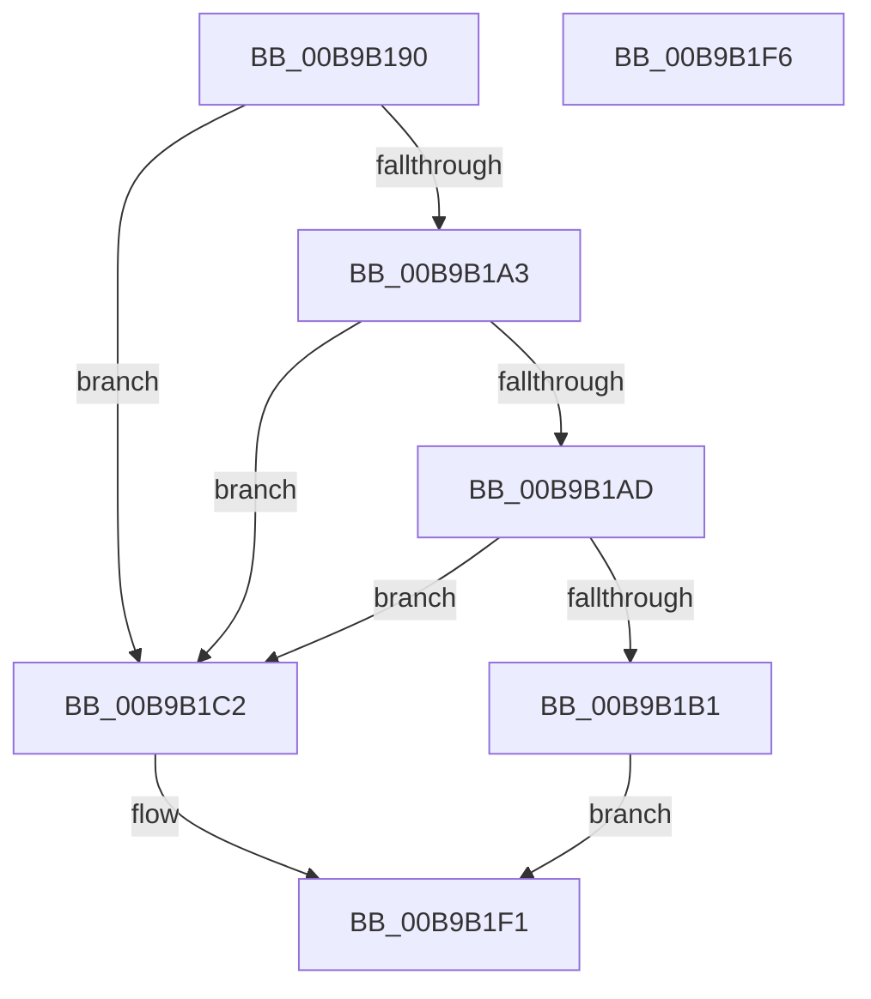

# VerifierPortIoAllocateMdl

- RVA: `0x00B9B190`–`0x00B9B1F7` (길이 `103` bytes)
- VA: `0x0000000140B9B190`
- 실행 섹션: `PAGEVRFY`
- PDB 이름 있음: `예`; PDB Function 태그: `아니요`
- unwind 정보 RVA: `0x00063458`
- 디코드: `25`개 명령, `103/103` bytes 표시
- 미해석 바이트: `0` (있으면 어셈블리에 `.byte`로 보존)

> 이 문서는 커널 이미지의 기계어와 PDB 기호를 분석해 생성했습니다. 4번과 5번은 함수 원형과 자료형을 바이너리 사용 방식에서 추정한 C 해석이며 원본 소스 복구 결과는 아닙니다.

## 1. Dependencies

- 직접 호출 지점: **2**; 고유 호출 대상: **2**
- 직접 호출자로 확인된 함수: **0**
- RIP 상대 이미지 참조: **4**

### Outgoing calls
- `0x00B9B1BB` → [IoAllocateMdl](../../text/29/IoAllocateMdl_function_0029EBF0.md) (function, `0x0029EBF0`)
- `0x00B9B1EC` → [guard_dispatch_icall](../../text/6B/guard_dispatch_icall_function_006BAAD0.md) (function, `0x006BAAD0`)

### Direct callers
- 이 함수 시작 RVA로 연결되는 직접 call은 확인되지 않았습니다. 간접 호출은 완전히 역산할 수 없습니다.

### Static image references
- `0x00B9B194` → RVA `0x00E681A0` (`.data`; read)
- `0x00B9B1A3` → RVA `0x00F04A20` (`.data`; read)
- `0x00B9B1C2` → RVA `0x00FF4070` (`PAGEVRFD`; read)
- `0x00B9B1C9` → RVA `0x00B92350` (`IovAllocateMdl`; read)

## 2. Other-region calls and transfers

- 다른 실행 섹션으로 향하는 call: **2**
  - `0x00B9B1BB` → [IoAllocateMdl](../../text/29/IoAllocateMdl_function_0029EBF0.md) (`PAGEVRFY` → `.text`)
  - `0x00B9B1EC` → [guard_dispatch_icall](../../text/6B/guard_dispatch_icall_function_006BAAD0.md) (`PAGEVRFY` → `.text`)
- 별도 외부 분기/꼬리 이동을 확인하지 못했습니다.

## 3. Assembly (complete function range)

```asm
00B9B190  48 83 EC 48                     sub rsp, 0x48
00B9B194  F7 05 02 D0 2C 00 00 00 40 00   test dword ptr [rip + 0x2cd002], 0x400000
00B9B19E  4C 8B D1                        mov r10, rcx
00B9B1A1  74 1F                           je 0x140b9b1c2
00B9B1A3  8B 05 77 98 36 00               mov eax, dword ptr [rip + 0x369877]
00B9B1A9  A8 01                           test al, 1
00B9B1AB  75 15                           jne 0x140b9b1c2
00B9B1AD  A8 08                           test al, 8
00B9B1AF  75 11                           jne 0x140b9b1c2
00B9B1B1  48 8B 44 24 70                  mov rax, qword ptr [rsp + 0x70]
00B9B1B6  48 89 44 24 20                  mov qword ptr [rsp + 0x20], rax
00B9B1BB  E8 30 3A 70 FF                  call 0x14029ebf0
00B9B1C0  EB 2F                           jmp 0x140b9b1f1
00B9B1C2  48 8B 05 A7 8E 45 00            mov rax, qword ptr [rip + 0x458ea7]
00B9B1C9  48 8D 0D 80 71 FF FF            lea rcx, [rip - 0x8e80]
00B9B1D0  48 89 4C 24 30                  mov qword ptr [rsp + 0x30], rcx
00B9B1D5  48 8B 4C 24 78                  mov rcx, qword ptr [rsp + 0x78]
00B9B1DA  48 89 4C 24 28                  mov qword ptr [rsp + 0x28], rcx
00B9B1DF  48 8B 4C 24 70                  mov rcx, qword ptr [rsp + 0x70]
00B9B1E4  48 89 4C 24 20                  mov qword ptr [rsp + 0x20], rcx
00B9B1E9  49 8B CA                        mov rcx, r10
00B9B1EC  E8 DF F8 B1 FF                  call 0x1406baad0
00B9B1F1  48 83 C4 48                     add rsp, 0x48
00B9B1F5  C3                              ret
00B9B1F6  CC                              int3
```

## 4. C-style interpretation (structured pseudocode)

```c
__int64 __fastcall VerifierPortIoAllocateMdl(__int64 a1, __int64 a2, __int64 a3, __int64 a4, __int64 a5, __int64 a6)
{
    __int64 result;
    __int64 v_rsp;
    unsigned __int64 v_stack_m18;
    unsigned __int64 v_stack_m20;
    unsigned __int64 v_stack_m28;

    v_rsp = (v_rsp) - (72);
    if (((*(unsigned int *)(v_rip + 2936834)) & (0x400000ULL)) == 0) goto loc_00B9B1C2;
    if ((((unsigned __int8)((unsigned int)(*(unsigned int *)(v_rip + 3577975)))) & (1)) != 0) goto loc_00B9B1C2;
    if ((((unsigned __int8)((unsigned int)(*(unsigned int *)(v_rip + 3577975)))) & (8)) != 0) goto loc_00B9B1C2;
    v_stack_m28 = a5;
    result = IoAllocateMdl(a1, a2, a3, a4);
    goto loc_00B9B1F1;
loc_00B9B1C2:
    v_stack_m18 = v_rip - 36480;
    v_stack_m20 = a6;
    v_stack_m28 = a5;
    result = guard_dispatch_icall(a1, a2, a3, a4);
loc_00B9B1F1:
    v_rsp = (v_rsp) + (72);
    return result;
}
```

## 5. (Beta) C Style

```c
int64_t VerifierPortIoAllocateMdl(int64_t Arg1, int64_t Arg2, int64_t Arg3, int64_t Arg4, int64_t Arg5, int64_t Arg6)
{
    int64_t result;
    int64_t local_rsp;
    uint64_t v_stack_m18;
    uint64_t v_stack_m20;
    uint64_t v_stack_m28;

    local_rsp = (local_rsp) - (72);
    if (((*(uint32_t *)(v_rip + 0x2CD002)) & (0x400000ULL)) == 0) goto loc_00B9B1C2;
    if ((((uint8_t)((uint32_t)(*(uint32_t *)(v_rip + 0x369877)))) & (1)) != 0) goto loc_00B9B1C2;
    if ((((uint8_t)((uint32_t)(*(uint32_t *)(v_rip + 0x369877)))) & (8)) != 0) goto loc_00B9B1C2;
    v_stack_m28 = Arg5;
    result = IoAllocateMdl(Arg1, Arg2, Arg3, Arg4);
    goto loc_00B9B1F1;
loc_00B9B1C2:
    v_stack_m18 = v_rip - 36480;
    v_stack_m20 = Arg6;
    v_stack_m28 = Arg5;
    result = guard_dispatch_icall(Arg1, Arg2, Arg3, Arg4);
loc_00B9B1F1:
    local_rsp = (local_rsp) + (72);
    return result;
}
```

## 6. Execution-region graph

[열기: 2D/3D 그래프와 함수 탐색 컨트롤 패널](../../../control-panel.html?section=pagevrfy&rva=0x00B9B190&view=graph)

- 2D 그래프는 위에서 아래로 흐르고, 3D 그래프는 빈 공간을 드래그해 회전합니다. Shift+드래그는 이동, 휠은 확대·축소, 함수 노드 선택은 대상 보고서 이동입니다.

### Static fallback


