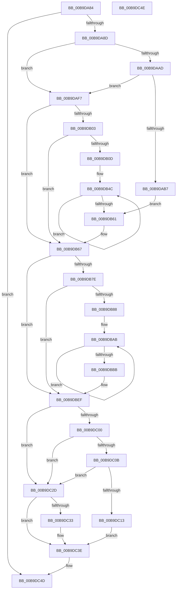

# VfAfterCallDriver

- RVA: `0x00B9DA84`–`0x00B9DC4F` (길이 `459` bytes)
- VA: `0x0000000140B9DA84`
- 실행 섹션: `PAGEVRFY`
- PDB 이름 있음: `예`; PDB Function 태그: `아니요`
- unwind 정보 RVA: `0x00067A3C`
- 디코드: `99`개 명령, `459/459` bytes 표시
- 미해석 바이트: `0` (있으면 어셈블리에 `.byte`로 보존)

> 이 문서는 커널 이미지의 기계어와 PDB 기호를 분석해 생성했습니다. 4번과 5번은 함수 원형과 자료형을 바이너리 사용 방식에서 추정한 C 해석이며 원본 소스 복구 결과는 아닙니다.

## 1. Dependencies

- 직접 호출 지점: **8**; 고유 호출 대상: **5**
- 직접 호출자로 확인된 함수: **2**
- RIP 상대 이미지 참조: **10**

### Outgoing calls
- `0x00B9DAA4` → [KeAreInterruptsEnabled](../../text/2F/KeAreInterruptsEnabled_function_002F8060.md) (function, `0x002F8060`)
- `0x00B9DABE` → [KeAcquireSpinLockRaiseToDpc](../../text/20/KeAcquireSpinLockRaiseToDpc_function_00208470.md) (function, `0x00208470`)
- `0x00B9DB14` → [KeAcquireSpinLockRaiseToDpc](../../text/20/KeAcquireSpinLockRaiseToDpc_function_00208470.md) (function, `0x00208470`)
- `0x00B9DB61` → [VfBugCheckNoStackUsage](../../text/61/VfBugCheckNoStackUsage_function_00613F98.md) (function, `0x00613F98`)
- `0x00B9DB8F` → [KeAcquireSpinLockRaiseToDpc](../../text/20/KeAcquireSpinLockRaiseToDpc_function_00208470.md) (function, `0x00208470`)
- `0x00B9DBE9` → [VfBugCheckNoStackUsage](../../text/61/VfBugCheckNoStackUsage_function_00613F98.md) (function, `0x00613F98`)
- `0x00B9DC26` → [ViErrorReport1](../../text/61/ViErrorReport1_function_00614584.md) (function, `0x00614584`)
- `0x00B9DC39` → [IovpCallDriver2](IovpCallDriver2_function_00B9D270.md) (function, `0x00B9D270`)

### Direct callers
- [IovpCallDriverWithStackBuffer](IovpCallDriverWithStackBuffer_function_00B92940.md) at `0x00B92AB7`
- [sub_00BBC34E](../BB/Unknown_function_00BBC34E.md) at `0x00BBC4FC`

### Static image references
- `0x00B9DAAD` → RVA `0x00E681A0` (`.data`; read)
- `0x00B9DAB7` → RVA `0x00FFDA70` (`PAGEVRFD`; read)
- `0x00B9DAD1` → RVA `0x00FFDA38` (`PAGEVRFD`; write)
- `0x00B9DADC` → RVA `0x00FFDA30` (`PAGEVRFD`; write)
- `0x00B9DAE7` → RVA `0x00FFDA40` (`PAGEVRFD`; write)
- `0x00B9DAEE` → RVA `0x00FFDA48` (`PAGEVRFD`; read)
- `0x00B9DB1F` → RVA `0x00FFDA30` (`PAGEVRFD`; read)
- `0x00B9DBDB` → RVA `0x00FFDA50` (`PAGEVRFD`; write)
- `0x00B9DBE2` → RVA `0x00FFDA48` (`PAGEVRFD`; write)
- `0x00B9DBEF` → RVA `0x00F04A20` (`.data`; read)

## 2. Other-region calls and transfers

- 다른 실행 섹션으로 향하는 call: **7**
  - `0x00B9DAA4` → [KeAreInterruptsEnabled](../../text/2F/KeAreInterruptsEnabled_function_002F8060.md) (`PAGEVRFY` → `.text`)
  - `0x00B9DABE` → [KeAcquireSpinLockRaiseToDpc](../../text/20/KeAcquireSpinLockRaiseToDpc_function_00208470.md) (`PAGEVRFY` → `.text`)
  - `0x00B9DB14` → [KeAcquireSpinLockRaiseToDpc](../../text/20/KeAcquireSpinLockRaiseToDpc_function_00208470.md) (`PAGEVRFY` → `.text`)
  - `0x00B9DB61` → [VfBugCheckNoStackUsage](../../text/61/VfBugCheckNoStackUsage_function_00613F98.md) (`PAGEVRFY` → `.text`)
  - `0x00B9DB8F` → [KeAcquireSpinLockRaiseToDpc](../../text/20/KeAcquireSpinLockRaiseToDpc_function_00208470.md) (`PAGEVRFY` → `.text`)
  - `0x00B9DBE9` → [VfBugCheckNoStackUsage](../../text/61/VfBugCheckNoStackUsage_function_00613F98.md) (`PAGEVRFY` → `.text`)
  - `0x00B9DC26` → [ViErrorReport1](../../text/61/ViErrorReport1_function_00614584.md) (`PAGEVRFY` → `.text`)
- 별도 외부 분기/꼬리 이동을 확인하지 못했습니다.

## 3. Assembly (complete function range)

```asm
00B9DA84  48 85 C9                        test rcx, rcx
00B9DA87  0F 84 C0 01 00 00               je 0x140b9dc4d
00B9DA8D  48 89 5C 24 08                  mov qword ptr [rsp + 8], rbx
00B9DA92  48 89 74 24 10                  mov qword ptr [rsp + 0x10], rsi
00B9DA97  57                              push rdi
00B9DA98  48 83 EC 20                     sub rsp, 0x20
00B9DA9C  48 8B F2                        mov rsi, rdx
00B9DA9F  48 8B D9                        mov rbx, rcx
00B9DAA2  33 FF                           xor edi, edi
00B9DAA4  E8 B7 A5 75 FF                  call 0x1402f8060
00B9DAA9  84 C0                           test al, al
00B9DAAB  75 4A                           jne 0x140b9daf7
00B9DAAD  0F BA 25 EB A6 2C 00 16         bt dword ptr [rip + 0x2ca6eb], 0x16
00B9DAB5  72 40                           jb 0x140b9daf7
00B9DAB7  48 8D 0D B2 FF 45 00            lea rcx, [rip + 0x45ffb2]
00B9DABE  E8 AD A9 66 FF                  call 0x140208470
00B9DAC3  88 83 9D 00 00 00               mov byte ptr [rbx + 0x9d], al
00B9DAC9  0F 57 C0                        xorps xmm0, xmm0
00B9DACC  B8 C4 00 00 00                  mov eax, 0xc4
00B9DAD1  48 C7 05 5C FF 45 00 C1 00 00 00  mov qword ptr [rip + 0x45ff5c], 0xc1
00B9DADC  48 89 05 4D FF 45 00            mov qword ptr [rip + 0x45ff4d], rax
00B9DAE3  48 8B 43 30                     mov rax, qword ptr [rbx + 0x30]
00B9DAE7  48 89 05 52 FF 45 00            mov qword ptr [rip + 0x45ff52], rax
00B9DAEE  0F 11 05 53 FF 45 00            movups xmmword ptr [rip + 0x45ff53], xmm0
00B9DAF5  EB 6A                           jmp 0x140b9db61
00B9DAF7  44 0F 20 C0                     mov rax, cr8
00B9DAFB  38 83 9C 00 00 00               cmp byte ptr [rbx + 0x9c], al
00B9DB01  74 64                           je 0x140b9db67
00B9DB03  0F BA 25 95 A6 2C 00 16         bt dword ptr [rip + 0x2ca695], 0x16
00B9DB0B  72 5A                           jb 0x140b9db67
00B9DB0D  48 8D 0D 5C FF 45 00            lea rcx, [rip + 0x45ff5c]
00B9DB14  E8 57 A9 66 FF                  call 0x140208470
00B9DB19  88 83 9D 00 00 00               mov byte ptr [rbx + 0x9d], al
00B9DB1F  48 8D 0D 0A FF 45 00            lea rcx, [rip + 0x45ff0a]
00B9DB26  48 8B 43 30                     mov rax, qword ptr [rbx + 0x30]
00B9DB2A  BA 02 00 00 00                  mov edx, 2
00B9DB2F  48 89 05 0A FF 45 00            mov qword ptr [rip + 0x45ff0a], rax
00B9DB36  48 C7 05 EF FE 45 00 C9 00 00 00  mov qword ptr [rip + 0x45feef], 0xc9
00B9DB41  48 C7 05 EC FE 45 00 12 00 00 00  mov qword ptr [rip + 0x45feec], 0x12
00B9DB4C  0F B6 84 3B 9C 00 00 00         movzx eax, byte ptr [rbx + rdi + 0x9c]
00B9DB54  48 89 44 F9 18                  mov qword ptr [rcx + rdi*8 + 0x18], rax
00B9DB59  48 FF C7                        inc rdi
00B9DB5C  48 3B FA                        cmp rdi, rdx
00B9DB5F  7C EB                           jl 0x140b9db4c
00B9DB61  E8 32 64 A7 FF                  call 0x140613f98
00B9DB66  CC                              int3
00B9DB67  65 48 8B 04 25 88 01 00 00      mov rax, qword ptr gs:[0x188]
00B9DB70  8B 88 E4 01 00 00               mov ecx, dword ptr [rax + 0x1e4]
00B9DB76  39 8B BC 00 00 00               cmp dword ptr [rbx + 0xbc], ecx
00B9DB7C  74 71                           je 0x140b9dbef
00B9DB7E  0F BA 25 1A A6 2C 00 16         bt dword ptr [rip + 0x2ca61a], 0x16
00B9DB86  72 67                           jb 0x140b9dbef
00B9DB88  48 8D 0D E1 FE 45 00            lea rcx, [rip + 0x45fee1]
00B9DB8F  E8 DC A8 66 FF                  call 0x140208470
00B9DB94  88 83 9D 00 00 00               mov byte ptr [rbx + 0x9d], al
00B9DB9A  48 8D 0D 8F FE 45 00            lea rcx, [rip + 0x45fe8f]
00B9DBA1  B8 C4 00 00 00                  mov eax, 0xc4
00B9DBA6  BA 02 00 00 00                  mov edx, 2
00B9DBAB  48 89 01                        mov qword ptr [rcx], rax
00B9DBAE  48 FF C0                        inc rax
00B9DBB1  48 8D 49 08                     lea rcx, [rcx + 8]
00B9DBB5  48 83 EA 01                     sub rdx, 1
00B9DBB9  75 F0                           jne 0x140b9dbab
00B9DBBB  48 8B 43 30                     mov rax, qword ptr [rbx + 0x30]
00B9DBBF  48 89 05 7A FE 45 00            mov qword ptr [rip + 0x45fe7a], rax
00B9DBC6  65 48 8B 04 25 88 01 00 00      mov rax, qword ptr gs:[0x188]
00B9DBCF  8B 88 E4 01 00 00               mov ecx, dword ptr [rax + 0x1e4]
00B9DBD5  8B 83 BC 00 00 00               mov eax, dword ptr [rbx + 0xbc]
00B9DBDB  48 89 05 6E FE 45 00            mov qword ptr [rip + 0x45fe6e], rax
00B9DBE2  48 89 0D 5F FE 45 00            mov qword ptr [rip + 0x45fe5f], rcx
00B9DBE9  E8 AA 63 A7 FF                  call 0x140613f98
00B9DBEE  CC                              int3
00B9DBEF  8B 05 2B 6E 36 00               mov eax, dword ptr [rip + 0x366e2b]
00B9DBF5  48 8D 8B 98 00 00 00            lea rcx, [rbx + 0x98]
00B9DBFC  A8 10                           test al, 0x10
00B9DBFE  74 2D                           je 0x140b9dc2d
00B9DC00  8B 01                           mov eax, dword ptr [rcx]
00B9DC02  BA 02 00 00 00                  mov edx, 2
00B9DC07  84 C2                           test dl, al
00B9DC09  74 22                           je 0x140b9dc2d
00B9DC0B  81 3E 03 01 00 00               cmp dword ptr [rsi], 0x103
00B9DC11  75 1A                           jne 0x140b9dc2d
00B9DC13  4C 8B 83 A8 00 00 00            mov r8, qword ptr [rbx + 0xa8]
00B9DC1A  B9 07 03 00 00                  mov ecx, 0x307
00B9DC1F  48 8B 93 B0 00 00 00            mov rdx, qword ptr [rbx + 0xb0]
00B9DC26  E8 59 69 A7 FF                  call 0x140614584
00B9DC2B  EB 11                           jmp 0x140b9dc3e
00B9DC2D  8B 01                           mov eax, dword ptr [rcx]
00B9DC2F  A8 01                           test al, 1
00B9DC31  74 0B                           je 0x140b9dc3e
00B9DC33  48 8B D6                        mov rdx, rsi
00B9DC36  48 8B CB                        mov rcx, rbx
00B9DC39  E8 32 F6 FF FF                  call 0x140b9d270
00B9DC3E  48 8B 5C 24 30                  mov rbx, qword ptr [rsp + 0x30]
00B9DC43  48 8B 74 24 38                  mov rsi, qword ptr [rsp + 0x38]
00B9DC48  48 83 C4 20                     add rsp, 0x20
00B9DC4C  5F                              pop rdi
00B9DC4D  C3                              ret
00B9DC4E  CC                              int3
```

## 4. C-style interpretation (structured pseudocode)

```c
__int64 __fastcall VfAfterCallDriver(__int64 a1, __int64 a2)
{
    __int64 result;
    __int64 v_rdi;
    __int64 v_rsp;
    unsigned __int64 v_stack_p10;
    unsigned __int64 v_stack_p8;

    if (a1 == 0) goto loc_00B9DC4D;
    v_stack_p8 = v_rbx;
    v_stack_p10 = v_rsi;
    v_rsp = (v_rsp) - (32);
    v_rdi = 0;
    result = KeAreInterruptsEnabled(a1, a2, a3, a4);
    if ((unsigned __int8)(result) != 0) goto loc_00B9DAF7;
    if (condition_is_below) goto loc_00B9DAF7;
    result = KeAcquireSpinLockRaiseToDpc(v_rip + 4587442, a2, a3, a4);
    *(unsigned __int8 *)(a1 + 157) = (unsigned __int8)(result);
    *(unsigned __int64 *)(v_rip + 4587356) = 193;
    *(unsigned __int64 *)(v_rip + 4587341) = 196;
    *(unsigned __int64 *)(v_rip + 4587346) = *(unsigned __int64 *)(a1 + 48);
    *(unsigned __int64 *)(v_rip + 4587347) = v_xmm0;
    goto loc_00B9DB61;
loc_00B9DAF7:
    if ((*(unsigned __int8 *)(a1 + 156)) == ((unsigned __int8)(v_cr8))) goto loc_00B9DB67;
    if ((*(unsigned __int8 *)(a1 + 156)) < ((unsigned __int8)(v_cr8))) goto loc_00B9DB67;
    result = KeAcquireSpinLockRaiseToDpc(v_rip + 4587356, a2, a3, a4);
    *(unsigned __int8 *)(a1 + 157) = (unsigned __int8)(result);
    *(unsigned __int64 *)(v_rip + 4587274) = *(unsigned __int64 *)(a1 + 48);
    *(unsigned __int64 *)(v_rip + 4587247) = 201;
    *(unsigned __int64 *)(v_rip + 4587244) = 18;
loc_00B9DB4C:
    *(unsigned __int64 *)(v_rip + 4587274 + v_rdi * 8 + 24) = *(unsigned __int8 *)(a1 + v_rdi * 1 + 156);
    v_rdi = (v_rdi) + 1;
    if (v_rdi < 2) goto loc_00B9DB4C;
loc_00B9DB61:
    result = VfBugCheckNoStackUsage(v_rip + 4587274, 2, a3, a4);
loc_00B9DB67:
    if ((*(unsigned int *)(a1 + 188)) == ((unsigned int)((unsigned int)(*(unsigned int *)(*(unsigned __int64 *)(gs_base + (0 + 392)) + 484))))) goto loc_00B9DBEF;
    if ((*(unsigned int *)(a1 + 188)) < ((unsigned int)((unsigned int)(*(unsigned int *)(*(unsigned __int64 *)(gs_base + (0 + 392)) + 484))))) goto loc_00B9DBEF;
    result = KeAcquireSpinLockRaiseToDpc(v_rip + 4587233, 2, a3, a4);
    *(unsigned __int8 *)(a1 + 157) = (unsigned __int8)(result);
loc_00B9DBAB:
    *(unsigned __int64 *)(v_rip + 4587151) = 196;
    result = (196) + 1;
    a2 = (2) - (1);
    if (condition_is_not_equal) goto loc_00B9DBAB;
    *(unsigned __int64 *)(v_rip + 4587130) = *(unsigned __int64 *)(a1 + 48);
    *(unsigned __int64 *)(v_rip + 4587118) = (unsigned int)(*(unsigned int *)(a1 + 188));
    *(unsigned __int64 *)(v_rip + 4587103) = (unsigned int)(*(unsigned int *)(*(unsigned __int64 *)(gs_base + (0 + 392)) + 484));
    result = VfBugCheckNoStackUsage((unsigned int)(*(unsigned int *)(*(unsigned __int64 *)(gs_base + (0 + 392)) + 484)), a2, a3, a4);
loc_00B9DBEF:
    if ((((unsigned __int8)((unsigned int)(*(unsigned int *)(v_rip + 3567147)))) & (16)) == 0) goto loc_00B9DC2D;
    if (((2) & ((unsigned __int8)((unsigned int)(*(unsigned int *)(a1 + 152))))) == 0) goto loc_00B9DC2D;
    if ((*(unsigned int *)(a2)) != 259) goto loc_00B9DC2D;
    result = ViErrorReport1(775, *(unsigned __int64 *)(a1 + 176), *(unsigned __int64 *)(a1 + 168), a4);
    goto loc_00B9DC3E;
loc_00B9DC2D:
    result = (unsigned int)(*(unsigned int *)(775));
    if ((((unsigned __int8)((unsigned int)(*(unsigned int *)(775)))) & (1)) != 0) {
        a2 = a2;
        a1 = a1;
        result = IovpCallDriver2(a1, a2, *(unsigned __int64 *)(a1 + 168), a4);
    }
    v_rsp = (v_rsp) + (32);
loc_00B9DC4D:
    return result;
}
```

## 5. (Beta) C Style

```c
int64_t VfAfterCallDriver(int64_t Arg1, void *Arg2)
{
    uint8_t *arg2 = (uint8_t *)Arg2;

    int64_t result;
    int64_t local_rdi;
    int64_t local_rsp;
    uint64_t v_stack_p10;
    uint64_t v_stack_p8;

    if (Arg1 == 0) goto loc_00B9DC4D;
    v_stack_p8 = local_rbx;
    v_stack_p10 = local_rsi;
    local_rsp = (local_rsp) - (32);
    local_rdi = 0;
    result = KeAreInterruptsEnabled(Arg1, Arg2, a3, a4);
    if ((uint8_t)(result) != 0) goto loc_00B9DAF7;
    if (condition_is_below) goto loc_00B9DAF7;
    result = KeAcquireSpinLockRaiseToDpc(v_rip + 4587442, Arg2, a3, a4);
    *(uint8_t *)(Arg1 + 0x9D) = (uint8_t)(result);
    *(uint64_t *)(v_rip + 0x45FF5C) = 193;
    *(uint64_t *)(v_rip + 0x45FF4D) = 196;
    *(uint64_t *)(v_rip + 0x45FF52) = *(uint64_t *)(Arg1 + 0x30);
    *(uint64_t *)(v_rip + 0x45FF53) = v_xmm0;
    goto loc_00B9DB61;
loc_00B9DAF7:
    if ((*(uint8_t *)(Arg1 + 0x9C)) == ((uint8_t)(v_cr8))) goto loc_00B9DB67;
    if ((*(uint8_t *)(Arg1 + 0x9C)) < ((uint8_t)(v_cr8))) goto loc_00B9DB67;
    result = KeAcquireSpinLockRaiseToDpc(v_rip + 4587356, Arg2, a3, a4);
    *(uint8_t *)(Arg1 + 0x9D) = (uint8_t)(result);
    *(uint64_t *)(v_rip + 0x45FF0A) = *(uint64_t *)(Arg1 + 0x30);
    *(uint64_t *)(v_rip + 0x45FEEF) = 201;
    *(uint64_t *)(v_rip + 0x45FEEC) = 18;
loc_00B9DB4C:
    *(uint64_t *)(v_rip + 0x45FF0A + local_rdi * 8 + 0x18) = *(uint8_t *)(Arg1 + local_rdi * 1 + 0x9C);
    local_rdi = (local_rdi) + 1;
    if (local_rdi < 2) goto loc_00B9DB4C;
loc_00B9DB61:
    result = VfBugCheckNoStackUsage(v_rip + 4587274, 2, a3, a4);
loc_00B9DB67:
    if ((*(uint32_t *)(Arg1 + 0xBC)) == ((uint32_t)((uint32_t)(*(uint32_t *)(*(uint64_t *)(gs_base + (0 + 0x188)) + 0x1E4))))) goto loc_00B9DBEF;
    if ((*(uint32_t *)(Arg1 + 0xBC)) < ((uint32_t)((uint32_t)(*(uint32_t *)(*(uint64_t *)(gs_base + (0 + 0x188)) + 0x1E4))))) goto loc_00B9DBEF;
    result = KeAcquireSpinLockRaiseToDpc(v_rip + 4587233, 2, a3, a4);
    *(uint8_t *)(Arg1 + 0x9D) = (uint8_t)(result);
loc_00B9DBAB:
    *(uint64_t *)(v_rip + 0x45FE8F) = 196;
    result = (196) + 1;
    Arg2 = (2) - (1);
    if (condition_is_not_equal) goto loc_00B9DBAB;
    *(uint64_t *)(v_rip + 0x45FE7A) = *(uint64_t *)(Arg1 + 0x30);
    *(uint64_t *)(v_rip + 0x45FE6E) = (uint32_t)(*(uint32_t *)(Arg1 + 0xBC));
    *(uint64_t *)(v_rip + 0x45FE5F) = (uint32_t)(*(uint32_t *)(*(uint64_t *)(gs_base + (0 + 0x188)) + 0x1E4));
    result = VfBugCheckNoStackUsage((uint32_t)(*(uint32_t *)(*(uint64_t *)(gs_base + (0 + 0x188)) + 0x1E4)), Arg2, a3, a4);
loc_00B9DBEF:
    if ((((uint8_t)((uint32_t)(*(uint32_t *)(v_rip + 0x366E2B)))) & (16)) == 0) goto loc_00B9DC2D;
    if (((2) & ((uint8_t)((uint32_t)(*(uint32_t *)(Arg1 + 0x98))))) == 0) goto loc_00B9DC2D;
    if ((*(uint32_t *)(arg2)) != 259) goto loc_00B9DC2D;
    result = ViErrorReport1(775, *(uint64_t *)(Arg1 + 0xB0), *(uint64_t *)(Arg1 + 0xA8), a4);
    goto loc_00B9DC3E;
loc_00B9DC2D:
    result = (uint32_t)(*(uint32_t *)(775));
    if ((((uint8_t)((uint32_t)(*(uint32_t *)(775)))) & (1)) != 0) {
        Arg2 = Arg2;
        Arg1 = Arg1;
        result = IovpCallDriver2(Arg1, Arg2, *(uint64_t *)(Arg1 + 0xA8), a4);
    }
    local_rsp = (local_rsp) + (32);
loc_00B9DC4D:
    return result;
}
```

### 관측된 메모리 오프셋

구조체 형식이 확인되지 않은 접근은 인자 기준의 오프셋으로만 기록했습니다.

| 기준 인자 | 오프셋 표현 | 폭 (bit) | 접근 |
|---|---:|---:|---|
| `Arg2` | `+ 0x0` | `32` | `R` |

## 6. Execution-region graph

[열기: 2D/3D 그래프와 함수 탐색 컨트롤 패널](../../../control-panel.html?section=pagevrfy&rva=0x00B9DA84&view=graph)

- 2D 그래프는 위에서 아래로 흐르고, 3D 그래프는 빈 공간을 드래그해 회전합니다. Shift+드래그는 이동, 휠은 확대·축소, 함수 노드 선택은 대상 보고서 이동입니다.

### Static fallback


