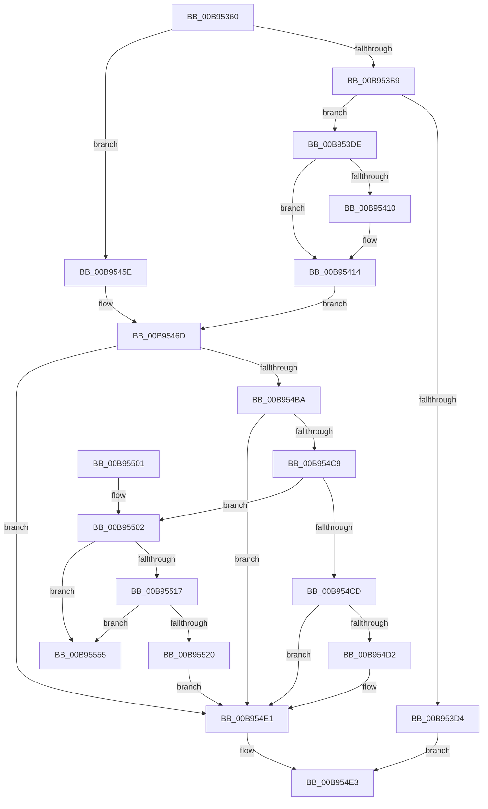

# VfAllocateAdapterChannelEx

- RVA: `0x00B95360`–`0x00B9555C` (길이 `508` bytes)
- VA: `0x0000000140B95360`
- 실행 섹션: `PAGEVRFY`
- PDB 이름 있음: `예`; PDB Function 태그: `아니요`
- unwind 정보 RVA: `0x000D23BC`
- 디코드: `134`개 명령, `508/508` bytes 표시
- 미해석 바이트: `0` (있으면 어셈블리에 `.byte`로 보존)

> 이 문서는 커널 이미지의 기계어와 PDB 기호를 분석해 생성했습니다. 4번과 5번은 함수 원형과 자료형을 바이너리 사용 방식에서 추정한 C 해석이며 원본 소스 복구 결과는 아닙니다.

## 1. Dependencies

- 직접 호출 지점: **15**; 고유 호출 대상: **15**
- 직접 호출자로 확인된 함수: **0**
- RIP 상대 이미지 참조: **2**

### Outgoing calls
- `0x00B95396` → [ViGetRealDmaAdapter](ViGetRealDmaAdapter_function_00B990DC.md) (function, `0x00B990DC`)
- `0x00B953A8` → [ViGetAdapterInformationInternal](ViGetAdapterInformationInternal_function_00B98E88.md) (function, `0x00B98E88`)
- `0x00B953BB` → [VF_ASSERT_IRQL](VF_ASSERT_IRQL_function_00B94F30.md) (function, `0x00B94F30`)
- `0x00B953C7` → [ExAllocateFromNPagedLookasideList](../../text/38/ExAllocateFromNPagedLookasideList_function_0038E6C0.md) (function, `0x0038E6C0`)
- `0x00B953E9` → [memset](../../text/6C/memset_function_006C6C40.md) (function, `0x006C6C40`)
- `0x00B9541E` → [INCREMENT_ADAPTER_CHANNELS](INCREMENT_ADAPTER_CHANNELS_function_00B94D70.md) (function, `0x00B94D70`)
- `0x00B9542C` → [ADD_MAP_REGISTERS](ADD_MAP_REGISTERS_function_00B94A08.md) (function, `0x00B94A08`)
- `0x00B95446` → [ExInterlockedInsertTailList](../../text/38/ExInterlockedInsertTailList_function_00386700.md) (function, `0x00386700`)
- `0x00B954AE` → [guard_dispatch_icall](../../text/6B/guard_dispatch_icall_function_006BAAD0.md) (function, `0x006BAAD0`)
- `0x00B954C0` → [ViIsActiveChannelWcb](../../text/61/ViIsActiveChannelWcb_function_00612DE0.md) (function, `0x00612DE0`)
- `0x00B95505` → [KeAcquireSpinLockRaiseToDpc](../../text/20/KeAcquireSpinLockRaiseToDpc_function_00208470.md) (function, `0x00208470`)
- `0x00B9552C` → [KeReleaseSpinLock](../../text/39/KeReleaseSpinLock_function_00392BA0.md) (function, `0x00392BA0`)
- `0x00B95534` → [DECREMENT_ADAPTER_CHANNELS](DECREMENT_ADAPTER_CHANNELS_function_00B94B14.md) (function, `0x00B94B14`)
- `0x00B9553F` → [SUBTRACT_MAP_REGISTERS](SUBTRACT_MAP_REGISTERS_function_00B94E10.md) (function, `0x00B94E10`)
- `0x00B9554E` → [ExFreeToNPagedLookasideList](../../text/38/ExFreeToNPagedLookasideList_function_0038D9D0.md) (function, `0x0038D9D0`)

### Direct callers
- 이 함수 시작 RVA로 연결되는 직접 call은 확인되지 않았습니다. 간접 호출은 완전히 역산할 수 없습니다.

### Static image references
- `0x00B953C0` → RVA `0x00E28A80` (`.data`; read)
- `0x00B9544E` → RVA `0x00B97B40` (`ViAdapterCallback`; read)

## 2. Other-region calls and transfers

- 다른 실행 섹션으로 향하는 call: **8**
  - `0x00B953C7` → [ExAllocateFromNPagedLookasideList](../../text/38/ExAllocateFromNPagedLookasideList_function_0038E6C0.md) (`PAGEVRFY` → `.text`)
  - `0x00B953E9` → [memset](../../text/6C/memset_function_006C6C40.md) (`PAGEVRFY` → `.text`)
  - `0x00B95446` → [ExInterlockedInsertTailList](../../text/38/ExInterlockedInsertTailList_function_00386700.md) (`PAGEVRFY` → `.text`)
  - `0x00B954AE` → [guard_dispatch_icall](../../text/6B/guard_dispatch_icall_function_006BAAD0.md) (`PAGEVRFY` → `.text`)
  - `0x00B954C0` → [ViIsActiveChannelWcb](../../text/61/ViIsActiveChannelWcb_function_00612DE0.md) (`PAGEVRFY` → `.text`)
  - `0x00B95505` → [KeAcquireSpinLockRaiseToDpc](../../text/20/KeAcquireSpinLockRaiseToDpc_function_00208470.md) (`PAGEVRFY` → `.text`)
  - `0x00B9552C` → [KeReleaseSpinLock](../../text/39/KeReleaseSpinLock_function_00392BA0.md) (`PAGEVRFY` → `.text`)
  - `0x00B9554E` → [ExFreeToNPagedLookasideList](../../text/38/ExFreeToNPagedLookasideList_function_0038D9D0.md) (`PAGEVRFY` → `.text`)
- 별도 외부 분기/꼬리 이동을 확인하지 못했습니다.

## 3. Assembly (complete function range)

```asm
00B95360  48 8B C4                        mov rax, rsp
00B95363  48 89 58 08                     mov qword ptr [rax + 8], rbx
00B95367  48 89 68 10                     mov qword ptr [rax + 0x10], rbp
00B9536B  48 89 70 20                     mov qword ptr [rax + 0x20], rsi
00B9536F  4C 89 40 18                     mov qword ptr [rax + 0x18], r8
00B95373  57                              push rdi
00B95374  41 54                           push r12
00B95376  41 55                           push r13
00B95378  41 56                           push r14
00B9537A  41 57                           push r15
00B9537C  48 83 EC 60                     sub rsp, 0x60
00B95380  48 8B B4 24 B8 00 00 00         mov rsi, qword ptr [rsp + 0xb8]
00B95388  45 8B F9                        mov r15d, r9d
00B9538B  4D 8B F0                        mov r14, r8
00B9538E  4C 8B EA                        mov r13, rdx
00B95391  48 8B D9                        mov rbx, rcx
00B95394  33 FF                           xor edi, edi
00B95396  E8 41 3D 00 00                  call 0x140b990dc
00B9539B  B2 01                           mov dl, 1
00B9539D  48 89 44 24 50                  mov qword ptr [rsp + 0x50], rax
00B953A2  48 8B CB                        mov rcx, rbx
00B953A5  4C 8B E0                        mov r12, rax
00B953A8  E8 DB 3A 00 00                  call 0x140b98e88
00B953AD  48 8B D8                        mov rbx, rax
00B953B0  48 85 C0                        test rax, rax
00B953B3  0F 84 A5 00 00 00               je 0x140b9545e
00B953B9  B1 02                           mov cl, 2
00B953BB  E8 70 FB FF FF                  call 0x140b94f30
00B953C0  48 8D 0D B9 36 29 00            lea rcx, [rip + 0x2936b9]
00B953C7  E8 F4 92 7F FF                  call 0x14038e6c0
00B953CC  48 8B F8                        mov rdi, rax
00B953CF  48 85 C0                        test rax, rax
00B953D2  75 0A                           jne 0x140b953de
00B953D4  B8 9A 00 00 C0                  mov eax, 0xc000009a
00B953D9  E9 05 01 00 00                  jmp 0x140b954e3
00B953DE  33 D2                           xor edx, edx
00B953E0  41 B8 98 00 00 00               mov r8d, 0x98
00B953E6  48 8B CF                        mov rcx, rdi
00B953E9  E8 52 18 B3 FF                  call 0x1406c6c40
00B953EE  48 8B AC 24 C0 00 00 00         mov rbp, qword ptr [rsp + 0xc0]
00B953F6  48 89 2F                        mov qword ptr [rdi], rbp
00B953F9  48 89 77 08                     mov qword ptr [rdi + 8], rsi
00B953FD  48 89 5F 38                     mov qword ptr [rdi + 0x38], rbx
00B95401  44 89 7F 30                     mov dword ptr [rdi + 0x30], r15d
00B95405  4C 89 77 28                     mov qword ptr [rdi + 0x28], r14
00B95409  48 83 7B 40 00                  cmp qword ptr [rbx + 0x40], 0
00B9540E  75 04                           jne 0x140b95414
00B95410  4C 89 6B 40                     mov qword ptr [rbx + 0x40], r13
00B95414  48 85 F6                        test rsi, rsi
00B95417  48 8B CB                        mov rcx, rbx
00B9541A  48 0F 45 EF                     cmovne rbp, rdi
00B9541E  E8 4D F9 FF FF                  call 0x140b94d70
00B95423  41 B0 01                        mov r8b, 1
00B95426  41 8B D7                        mov edx, r15d
00B95429  48 8B CB                        mov rcx, rbx
00B9542C  E8 D7 F5 FF FF                  call 0x140b94a08
00B95431  4C 8D B3 B0 00 00 00            lea r14, [rbx + 0xb0]
00B95438  4D 8B C6                        mov r8, r14
00B9543B  48 8D 57 48                     lea rdx, [rdi + 0x48]
00B9543F  48 8D 8B A0 00 00 00            lea rcx, [rbx + 0xa0]
00B95446  E8 B5 12 7F FF                  call 0x140386700
00B9544B  48 85 F6                        test rsi, rsi
00B9544E  48 8D 05 EB 26 00 00            lea rax, [rip + 0x26eb]
00B95455  48 0F 44 C6                     cmove rax, rsi
00B95459  48 8B F0                        mov rsi, rax
00B9545C  EB 0F                           jmp 0x140b9546d
00B9545E  48 8B AC 24 C0 00 00 00         mov rbp, qword ptr [rsp + 0xc0]
00B95466  4C 8D B0 B0 00 00 00            lea r14, [rax + 0xb0]
00B9546D  49 8B 44 24 08                  mov rax, qword ptr [r12 + 8]
00B95472  45 8B CF                        mov r9d, r15d
00B95475  8B 8C 24 B0 00 00 00            mov ecx, dword ptr [rsp + 0xb0]
00B9547C  49 8B D5                        mov rdx, r13
00B9547F  4C 8B A4 24 C8 00 00 00         mov r12, qword ptr [rsp + 0xc8]
00B95487  4C 8B 84 24 A0 00 00 00         mov r8, qword ptr [rsp + 0xa0]
00B9548F  48 8B 80 A0 00 00 00            mov rax, qword ptr [rax + 0xa0]
00B95496  4C 89 64 24 38                  mov qword ptr [rsp + 0x38], r12
00B9549B  48 89 6C 24 30                  mov qword ptr [rsp + 0x30], rbp
00B954A0  48 89 74 24 28                  mov qword ptr [rsp + 0x28], rsi
00B954A5  89 4C 24 20                     mov dword ptr [rsp + 0x20], ecx
00B954A9  48 8B 4C 24 50                  mov rcx, qword ptr [rsp + 0x50]
00B954AE  E8 1D 56 B2 FF                  call 0x1406baad0
00B954B3  8B E8                           mov ebp, eax
00B954B5  48 85 DB                        test rbx, rbx
00B954B8  74 27                           je 0x140b954e1
00B954BA  48 8B D7                        mov rdx, rdi
00B954BD  48 8B CB                        mov rcx, rbx
00B954C0  E8 1B D9 A7 FF                  call 0x140612de0
00B954C5  84 C0                           test al, al
00B954C7  74 18                           je 0x140b954e1
00B954C9  85 ED                           test ebp, ebp
00B954CB  75 35                           jne 0x140b95502
00B954CD  48 85 F6                        test rsi, rsi
00B954D0  75 0F                           jne 0x140b954e1
00B954D2  C7 47 34 01 00 00 00            mov dword ptr [rdi + 0x34], 1
00B954D9  49 8B 04 24                     mov rax, qword ptr [r12]
00B954DD  48 89 47 58                     mov qword ptr [rdi + 0x58], rax
00B954E1  8B C5                           mov eax, ebp
00B954E3  4C 8D 5C 24 60                  lea r11, [rsp + 0x60]
00B954E8  49 8B 5B 30                     mov rbx, qword ptr [r11 + 0x30]
00B954EC  49 8B 6B 38                     mov rbp, qword ptr [r11 + 0x38]
00B954F0  49 8B 73 48                     mov rsi, qword ptr [r11 + 0x48]
00B954F4  49 8B E3                        mov rsp, r11
00B954F7  41 5F                           pop r15
00B954F9  41 5E                           pop r14
00B954FB  41 5D                           pop r13
00B954FD  41 5C                           pop r12
00B954FF  5F                              pop rdi
00B95500  C3                              ret
00B95501  CC                              int3
00B95502  49 8B CE                        mov rcx, r14
00B95505  E8 66 2F 67 FF                  call 0x140208470
00B9550A  48 8D 57 48                     lea rdx, [rdi + 0x48]
00B9550E  4C 8B 0A                        mov r9, qword ptr [rdx]
00B95511  49 39 51 08                     cmp qword ptr [r9 + 8], rdx
00B95515  75 3E                           jne 0x140b95555
00B95517  4C 8B 42 08                     mov r8, qword ptr [rdx + 8]
00B9551B  49 39 10                        cmp qword ptr [r8], rdx
00B9551E  75 35                           jne 0x140b95555
00B95520  4D 89 08                        mov qword ptr [r8], r9
00B95523  8A D0                           mov dl, al
00B95525  49 8B CE                        mov rcx, r14
00B95528  4D 89 41 08                     mov qword ptr [r9 + 8], r8
00B9552C  E8 6F D6 7F FF                  call 0x140392ba0
00B95531  48 8B CB                        mov rcx, rbx
00B95534  E8 DB F5 FF FF                  call 0x140b94b14
00B95539  41 8B D7                        mov edx, r15d
00B9553C  48 8B CB                        mov rcx, rbx
00B9553F  E8 CC F8 FF FF                  call 0x140b94e10
00B95544  48 8B D7                        mov rdx, rdi
00B95547  48 8D 0D 32 35 29 00            lea rcx, [rip + 0x293532]
00B9554E  E8 7D 84 7F FF                  call 0x14038d9d0
00B95553  EB 8C                           jmp 0x140b954e1
00B95555  B9 03 00 00 00                  mov ecx, 3
00B9555A  CD 29                           int 0x29
```

## 4. C-style interpretation (structured pseudocode)

```c
__int64 __fastcall VfAllocateAdapterChannelEx(__int64 a1, __int64 a2, __int64 a3, int a4, unsigned int a5, __int64 a6, __int64 a7, __int64 a8)
{
    __int64 result;
    __int64 v_rdi;
    __int64 v_rsp;
    unsigned __int64 v_stack_m28;
    unsigned __int64 v_stack_m38;
    unsigned __int64 v_stack_m50;
    unsigned __int64 v_stack_m58;
    unsigned __int64 v_stack_m60;
    unsigned int v_stack_m68;
    unsigned __int64 v_stack_p18;

    *(unsigned __int64 *)(v_rsp + 8) = v_rbx;
    *(unsigned __int64 *)(v_rsp + 16) = v_rbp;
    *(unsigned __int64 *)(v_rsp + 32) = v_rsi;
    *(unsigned __int64 *)(v_rsp + 24) = a3;
    v_rsp = (v_rsp) - (96);
    v_rdi = 0;
    result = ViGetRealDmaAdapter(a1, a2, a3, a4);
    v_stack_m38 = result;
    result = ViGetAdapterInformationInternal(a1, 1, a3, a4);
    if (result == 0) goto loc_00B9545E;
    result = VF_ASSERT_IRQL(2, 1, a3, a4);
    result = ExAllocateFromNPagedLookasideList(v_rip + 2700985, 1, a3, a4);
    if (result != 0) goto loc_00B953DE;
    goto loc_00B954E3;
loc_00B953DE:
    a2 = 0;
    result = memset(result, a2, 152, a4);
    *(unsigned __int64 *)(result) = a7;
    *(unsigned __int64 *)(result + 8) = a6;
    *(unsigned __int64 *)(result + 56) = result;
    *(unsigned int *)(result + 48) = (unsigned int)((unsigned int)(a4));
    *(unsigned __int64 *)(result + 40) = a3;
    if ((*(unsigned __int64 *)(result + 64)) == 0) {
        *(unsigned __int64 *)(result + 64) = 0;
    }
    if (a6 != 0) { a7 = result; }
    result = INCREMENT_ADAPTER_CHANNELS(result, a2, 152, a4);
    result = ADD_MAP_REGISTERS(result, (unsigned int)((unsigned int)((unsigned int)(a4))), 1, a4);
    result = ExInterlockedInsertTailList(result + 160, result + 72, result + 176, a4);
    result = v_rip + 9963;
    if (a6 == 0) { result = a6; }
    goto loc_00B9546D;
loc_00B9545E:
loc_00B9546D:
    v_stack_m50 = a8;
    v_stack_m58 = a7;
    v_stack_m60 = result;
    v_stack_m68 = (unsigned int)((unsigned int)(a5));
    result = guard_dispatch_icall(v_stack_m38, 0, v_stack_p18, (unsigned int)((unsigned int)((unsigned int)(a4))));
    if (result == 0) goto loc_00B954E1;
    result = ViIsActiveChannelWcb(result, result, v_stack_p18, (unsigned int)((unsigned int)((unsigned int)(a4))));
    if ((unsigned __int8)(result) == 0) goto loc_00B954E1;
    if ((unsigned int)((unsigned int)((unsigned int)(result))) != 0) goto loc_00B95502;
    if (result == 0) {
        *(unsigned int *)(result + 52) = 1;
        result = *(unsigned __int64 *)(a8);
        *(unsigned __int64 *)(result + 88) = result;
    }
loc_00B954E3:
    return (unsigned int)((unsigned int)((unsigned int)((unsigned int)(result))));
loc_00B95502:
    result = KeAcquireSpinLockRaiseToDpc(result + 176, result, v_stack_p18, (unsigned int)((unsigned int)((unsigned int)(a4))));
    if ((*(unsigned __int64 *)(*(unsigned __int64 *)(result + 72) + 8)) != (result + 72)) goto loc_00B95555;
    if ((*(unsigned __int64 *)(*(unsigned __int64 *)(result + 72 + 8))) != (result + 72)) goto loc_00B95555;
    *(unsigned __int64 *)(*(unsigned __int64 *)(result + 72 + 8)) = *(unsigned __int64 *)(result + 72);
    *(unsigned __int64 *)(*(unsigned __int64 *)(result + 72) + 8) = *(unsigned __int64 *)(result + 72 + 8);
    result = KeReleaseSpinLock(result + 176, (unsigned __int8)(result), *(unsigned __int64 *)(result + 72 + 8), *(unsigned __int64 *)(result + 72));
    result = DECREMENT_ADAPTER_CHANNELS(*(unsigned __int64 *)(v_stack_m28 + 48), (unsigned __int8)(result), *(unsigned __int64 *)(result + 72 + 8), *(unsigned __int64 *)(result + 72));
    result = SUBTRACT_MAP_REGISTERS(*(unsigned __int64 *)(v_stack_m28 + 48), (unsigned int)((unsigned int)((unsigned int)(a4))), *(unsigned __int64 *)(result + 72 + 8), *(unsigned __int64 *)(result + 72));
    result = ExFreeToNPagedLookasideList(v_rip + 2700594, result, *(unsigned __int64 *)(result + 72 + 8), *(unsigned __int64 *)(result + 72));
    goto loc_00B954E1;
loc_00B95555:
    return result;
}
```

## 5. (Beta) C Style

```c
int64_t VfAllocateAdapterChannelEx(int64_t Arg1, int64_t Arg2, int64_t Arg3, int32_t Arg4, uint32_t Arg5, int64_t Arg6, int64_t Arg7, void *Arg8)
{
    uint8_t *arg8 = (uint8_t *)Arg8;

    int64_t result;
    int64_t local_rdi;
    int64_t local_rsp;
    uint64_t v_stack_m28;
    uint64_t v_stack_m38;
    uint64_t v_stack_m50;
    uint64_t v_stack_m58;
    uint64_t v_stack_m60;
    uint32_t v_stack_m68;
    uint64_t v_stack_p18;

    *(uint64_t *)(local_rsp + 0x8) = local_rbx;
    *(uint64_t *)(local_rsp + 0x10) = local_rbp;
    *(uint64_t *)(local_rsp + 0x20) = local_rsi;
    *(uint64_t *)(local_rsp + 0x18) = Arg3;
    local_rsp = (local_rsp) - (96);
    local_rdi = 0;
    result = ViGetRealDmaAdapter(Arg1, Arg2, Arg3, Arg4);
    v_stack_m38 = result;
    result = ViGetAdapterInformationInternal(Arg1, 1, Arg3, Arg4);
    if (result == 0) goto loc_00B9545E;
    result = VF_ASSERT_IRQL(2, 1, Arg3, Arg4);
    result = ExAllocateFromNPagedLookasideList(v_rip + 2700985, 1, Arg3, Arg4);
    if (result != 0) goto loc_00B953DE;
    goto loc_00B954E3;
loc_00B953DE:
    Arg2 = 0;
    result = memset(result, Arg2, 152, Arg4);
    *(uint64_t *)(result) = Arg7;
    *(uint64_t *)(result + 0x8) = Arg6;
    *(uint64_t *)(result + 0x38) = result;
    *(uint32_t *)(result + 0x30) = (uint32_t)((uint32_t)(Arg4));
    *(uint64_t *)(result + 0x28) = Arg3;
    if ((*(uint64_t *)(result + 0x40)) == 0) {
        *(uint64_t *)(result + 0x40) = 0;
    }
    if (Arg6 != 0) { Arg7 = result; }
    result = INCREMENT_ADAPTER_CHANNELS(result, Arg2, 152, Arg4);
    result = ADD_MAP_REGISTERS(result, (uint32_t)((uint32_t)((uint32_t)(Arg4))), 1, Arg4);
    result = ExInterlockedInsertTailList(result + 160, result + 72, result + 176, Arg4);
    result = v_rip + 9963;
    if (Arg6 == 0) { result = Arg6; }
    goto loc_00B9546D;
loc_00B9545E:
loc_00B9546D:
    v_stack_m50 = Arg8;
    v_stack_m58 = Arg7;
    v_stack_m60 = result;
    v_stack_m68 = (uint32_t)((uint32_t)(Arg5));
    result = guard_dispatch_icall(v_stack_m38, 0, v_stack_p18, (uint32_t)((uint32_t)((uint32_t)(Arg4))));
    if (result == 0) goto loc_00B954E1;
    result = ViIsActiveChannelWcb(result, result, v_stack_p18, (uint32_t)((uint32_t)((uint32_t)(Arg4))));
    if ((uint8_t)(result) == 0) goto loc_00B954E1;
    if ((uint32_t)((uint32_t)((uint32_t)(result))) != 0) goto loc_00B95502;
    if (result == 0) {
        *(uint32_t *)(result + 0x34) = 1;
        result = *(uint64_t *)(arg8);
        *(uint64_t *)(result + 0x58) = result;
    }
loc_00B954E3:
    return (uint32_t)((uint32_t)((uint32_t)((uint32_t)(result))));
loc_00B95502:
    result = KeAcquireSpinLockRaiseToDpc(result + 176, result, v_stack_p18, (uint32_t)((uint32_t)((uint32_t)(Arg4))));
    if ((*(uint64_t *)(*(uint64_t *)(result + 0x48) + 0x8)) != (result + 72)) goto loc_00B95555;
    if ((*(uint64_t *)(*(uint64_t *)(result + 0x48 + 0x8))) != (result + 72)) goto loc_00B95555;
    *(uint64_t *)(*(uint64_t *)(result + 0x48 + 0x8)) = *(uint64_t *)(result + 0x48);
    *(uint64_t *)(*(uint64_t *)(result + 0x48) + 0x8) = *(uint64_t *)(result + 0x48 + 0x8);
    result = KeReleaseSpinLock(result + 176, (uint8_t)(result), *(uint64_t *)(result + 0x48 + 0x8), *(uint64_t *)(result + 0x48));
    result = DECREMENT_ADAPTER_CHANNELS(*(uint64_t *)(v_stack_m28 + 0x30), (uint8_t)(result), *(uint64_t *)(result + 0x48 + 0x8), *(uint64_t *)(result + 0x48));
    result = SUBTRACT_MAP_REGISTERS(*(uint64_t *)(v_stack_m28 + 0x30), (uint32_t)((uint32_t)((uint32_t)(Arg4))), *(uint64_t *)(result + 0x48 + 0x8), *(uint64_t *)(result + 0x48));
    result = ExFreeToNPagedLookasideList(v_rip + 2700594, result, *(uint64_t *)(result + 0x48 + 0x8), *(uint64_t *)(result + 0x48));
    goto loc_00B954E1;
loc_00B95555:
    return result;
}
```

### 관측된 메모리 오프셋

구조체 형식이 확인되지 않은 접근은 인자 기준의 오프셋으로만 기록했습니다.

| 기준 인자 | 오프셋 표현 | 폭 (bit) | 접근 |
|---|---:|---:|---|
| `Arg8` | `+ 0x0` | `64` | `R` |

## 6. Execution-region graph

[열기: 2D/3D 그래프와 함수 탐색 컨트롤 패널](../../../control-panel.html?section=pagevrfy&rva=0x00B95360&view=graph)

- 2D 그래프는 위에서 아래로 흐르고, 3D 그래프는 빈 공간을 드래그해 회전합니다. Shift+드래그는 이동, 휠은 확대·축소, 함수 노드 선택은 대상 보고서 이동입니다.

### Static fallback


