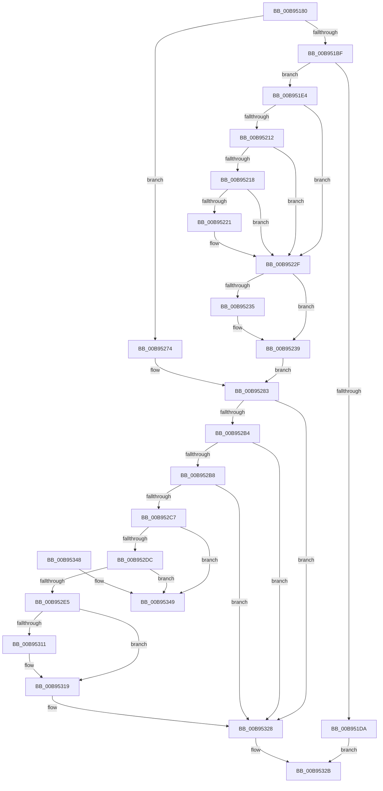

# VfAllocateAdapterChannel

- RVA: `0x00B95180`–`0x00B95350` (길이 `464` bytes)
- VA: `0x0000000140B95180`
- 실행 섹션: `PAGEVRFY`
- PDB 이름 있음: `예`; PDB Function 태그: `아니요`
- unwind 정보 RVA: `0x000A3C28`
- 디코드: `129`개 명령, `464/464` bytes 표시
- 미해석 바이트: `0` (있으면 어셈블리에 `.byte`로 보존)

> 이 문서는 커널 이미지의 기계어와 PDB 기호를 분석해 생성했습니다. 4번과 5번은 함수 원형과 자료형을 바이너리 사용 방식에서 추정한 C 해석이며 원본 소스 복구 결과는 아닙니다.

## 1. Dependencies

- 직접 호출 지점: **17**; 고유 호출 대상: **17**
- 직접 호출자로 확인된 함수: **0**
- RIP 상대 이미지 참조: **3**

### Outgoing calls
- `0x00B951AE` → [ViGetAdapterInformationInternal](ViGetAdapterInformationInternal_function_00B98E88.md) (function, `0x00B98E88`)
- `0x00B951C1` → [VF_ASSERT_IRQL](VF_ASSERT_IRQL_function_00B94F30.md) (function, `0x00B94F30`)
- `0x00B951CD` → [ExAllocateFromNPagedLookasideList](../../text/38/ExAllocateFromNPagedLookasideList_function_0038E6C0.md) (function, `0x0038E6C0`)
- `0x00B951EF` → [memset](../../text/6C/memset_function_006C6C40.md) (function, `0x006C6C40`)
- `0x00B95226` → [ViAllocateMapRegisterFile](ViAllocateMapRegisterFile_function_00B97E9C.md) (function, `0x00B97E9C`)
- `0x00B95246` → [INCREMENT_ADAPTER_CHANNELS](INCREMENT_ADAPTER_CHANNELS_function_00B94D70.md) (function, `0x00B94D70`)
- `0x00B95253` → [ADD_MAP_REGISTERS](ADD_MAP_REGISTERS_function_00B94A08.md) (function, `0x00B94A08`)
- `0x00B9526D` → [ExInterlockedInsertTailList](../../text/38/ExInterlockedInsertTailList_function_00386700.md) (function, `0x00386700`)
- `0x00B95286` → [ViGetRealDmaAdapter](ViGetRealDmaAdapter_function_00B990DC.md) (function, `0x00B990DC`)
- `0x00B952A7` → [guard_dispatch_icall](../../text/6B/guard_dispatch_icall_function_006BAAD0.md) (function, `0x006BAAD0`)
- `0x00B952BE` → [ViIsActiveChannelWcb](../../text/61/ViIsActiveChannelWcb_function_00612DE0.md) (function, `0x00612DE0`)
- `0x00B952CA` → [KeAcquireSpinLockRaiseToDpc](../../text/20/KeAcquireSpinLockRaiseToDpc_function_00208470.md) (function, `0x00208470`)
- `0x00B952F1` → [KeReleaseSpinLock](../../text/39/KeReleaseSpinLock_function_00392BA0.md) (function, `0x00392BA0`)
- `0x00B952F9` → [DECREMENT_ADAPTER_CHANNELS](DECREMENT_ADAPTER_CHANNELS_function_00B94B14.md) (function, `0x00B94B14`)
- `0x00B95303` → [SUBTRACT_MAP_REGISTERS](SUBTRACT_MAP_REGISTERS_function_00B94E10.md) (function, `0x00B94E10`)
- `0x00B95314` → [ViFreeMapRegisterFile](ViFreeMapRegisterFile_function_00B98B8C.md) (function, `0x00B98B8C`)
- `0x00B95323` → [ExFreeToNPagedLookasideList](../../text/38/ExFreeToNPagedLookasideList_function_0038D9D0.md) (function, `0x0038D9D0`)

### Direct callers
- 이 함수 시작 RVA로 연결되는 직접 call은 확인되지 않았습니다. 간접 호출은 완전히 역산할 수 없습니다.

### Static image references
- `0x00B951C6` → RVA `0x00E28A80` (`.data`; read)
- `0x00B951F4` → RVA `0x00FF4004` (`PAGEVRFD`; read)
- `0x00B9523C` → RVA `0x00B97B40` (`ViAdapterCallback`; read)

## 2. Other-region calls and transfers

- 다른 실행 섹션으로 향하는 call: **8**
  - `0x00B951CD` → [ExAllocateFromNPagedLookasideList](../../text/38/ExAllocateFromNPagedLookasideList_function_0038E6C0.md) (`PAGEVRFY` → `.text`)
  - `0x00B951EF` → [memset](../../text/6C/memset_function_006C6C40.md) (`PAGEVRFY` → `.text`)
  - `0x00B9526D` → [ExInterlockedInsertTailList](../../text/38/ExInterlockedInsertTailList_function_00386700.md) (`PAGEVRFY` → `.text`)
  - `0x00B952A7` → [guard_dispatch_icall](../../text/6B/guard_dispatch_icall_function_006BAAD0.md) (`PAGEVRFY` → `.text`)
  - `0x00B952BE` → [ViIsActiveChannelWcb](../../text/61/ViIsActiveChannelWcb_function_00612DE0.md) (`PAGEVRFY` → `.text`)
  - `0x00B952CA` → [KeAcquireSpinLockRaiseToDpc](../../text/20/KeAcquireSpinLockRaiseToDpc_function_00208470.md) (`PAGEVRFY` → `.text`)
  - `0x00B952F1` → [KeReleaseSpinLock](../../text/39/KeReleaseSpinLock_function_00392BA0.md) (`PAGEVRFY` → `.text`)
  - `0x00B95323` → [ExFreeToNPagedLookasideList](../../text/38/ExFreeToNPagedLookasideList_function_0038D9D0.md) (`PAGEVRFY` → `.text`)
- 별도 외부 분기/꼬리 이동을 확인하지 못했습니다.

## 3. Assembly (complete function range)

```asm
00B95180  48 89 5C 24 08                  mov qword ptr [rsp + 8], rbx
00B95185  48 89 6C 24 10                  mov qword ptr [rsp + 0x10], rbp
00B9518A  48 89 74 24 18                  mov qword ptr [rsp + 0x18], rsi
00B9518F  57                              push rdi
00B95190  41 54                           push r12
00B95192  41 55                           push r13
00B95194  41 56                           push r14
00B95196  41 57                           push r15
00B95198  48 83 EC 30                     sub rsp, 0x30
00B9519C  4C 8B E2                        mov r12, rdx
00B9519F  33 ED                           xor ebp, ebp
00B951A1  B2 01                           mov dl, 1
00B951A3  8B FD                           mov edi, ebp
00B951A5  4D 8B F1                        mov r14, r9
00B951A8  41 8B F0                        mov esi, r8d
00B951AB  4C 8B E9                        mov r13, rcx
00B951AE  E8 D5 3C 00 00                  call 0x140b98e88
00B951B3  48 8B D8                        mov rbx, rax
00B951B6  48 85 C0                        test rax, rax
00B951B9  0F 84 B5 00 00 00               je 0x140b95274
00B951BF  B1 02                           mov cl, 2
00B951C1  E8 6A FD FF FF                  call 0x140b94f30
00B951C6  48 8D 0D B3 38 29 00            lea rcx, [rip + 0x2938b3]
00B951CD  E8 EE 94 7F FF                  call 0x14038e6c0
00B951D2  48 8B F8                        mov rdi, rax
00B951D5  48 85 C0                        test rax, rax
00B951D8  75 0A                           jne 0x140b951e4
00B951DA  B8 9A 00 00 C0                  mov eax, 0xc000009a
00B951DF  E9 47 01 00 00                  jmp 0x140b9532b
00B951E4  33 D2                           xor edx, edx
00B951E6  41 B8 98 00 00 00               mov r8d, 0x98
00B951EC  48 8B CF                        mov rcx, rdi
00B951EF  E8 4C 1A B3 FF                  call 0x1406c6c40
00B951F4  39 2D 0A EE 45 00               cmp dword ptr [rip + 0x45ee0a], ebp
00B951FA  48 8B 84 24 80 00 00 00         mov rax, qword ptr [rsp + 0x80]
00B95202  48 89 07                        mov qword ptr [rdi], rax
00B95205  4C 89 77 08                     mov qword ptr [rdi + 8], r14
00B95209  48 89 5F 38                     mov qword ptr [rdi + 0x38], rbx
00B9520D  89 77 30                        mov dword ptr [rdi + 0x30], esi
00B95210  74 1D                           je 0x140b9522f
00B95212  40 38 6B 49                     cmp byte ptr [rbx + 0x49], bpl
00B95216  75 17                           jne 0x140b9522f
00B95218  83 BB E0 00 00 00 03            cmp dword ptr [rbx + 0xe0], 3
00B9521F  73 0E                           jae 0x140b9522f
00B95221  8B D6                           mov edx, esi
00B95223  48 8B CB                        mov rcx, rbx
00B95226  E8 71 2C 00 00                  call 0x140b97e9c
00B9522B  48 89 47 60                     mov qword ptr [rdi + 0x60], rax
00B9522F  48 39 6B 40                     cmp qword ptr [rbx + 0x40], rbp
00B95233  75 04                           jne 0x140b95239
00B95235  4C 89 63 40                     mov qword ptr [rbx + 0x40], r12
00B95239  48 8B CB                        mov rcx, rbx
00B9523C  4C 8D 35 FD 28 00 00            lea r14, [rip + 0x28fd]
00B95243  4C 8B FF                        mov r15, rdi
00B95246  E8 25 FB FF FF                  call 0x140b94d70
00B9524B  45 33 C0                        xor r8d, r8d
00B9524E  8B D6                           mov edx, esi
00B95250  48 8B CB                        mov rcx, rbx
00B95253  E8 B0 F7 FF FF                  call 0x140b94a08
00B95258  48 8D AB B0 00 00 00            lea rbp, [rbx + 0xb0]
00B9525F  4C 8B C5                        mov r8, rbp
00B95262  48 8D 57 48                     lea rdx, [rdi + 0x48]
00B95266  48 8D 8B A0 00 00 00            lea rcx, [rbx + 0xa0]
00B9526D  E8 8E 14 7F FF                  call 0x140386700
00B95272  EB 0F                           jmp 0x140b95283
00B95274  4C 8B BC 24 80 00 00 00         mov r15, qword ptr [rsp + 0x80]
00B9527C  48 8D A8 B0 00 00 00            lea rbp, [rax + 0xb0]
00B95283  49 8B CD                        mov rcx, r13
00B95286  E8 51 3E 00 00                  call 0x140b990dc
00B9528B  4C 8B D0                        mov r10, rax
00B9528E  4C 89 7C 24 20                  mov qword ptr [rsp + 0x20], r15
00B95293  4D 8B CE                        mov r9, r14
00B95296  44 8B C6                        mov r8d, esi
00B95299  49 8B D4                        mov rdx, r12
00B9529C  48 8B 48 08                     mov rcx, qword ptr [rax + 8]
00B952A0  48 8B 41 20                     mov rax, qword ptr [rcx + 0x20]
00B952A4  49 8B CA                        mov rcx, r10
00B952A7  E8 24 58 B2 FF                  call 0x1406baad0
00B952AC  44 8B F0                        mov r14d, eax
00B952AF  48 85 DB                        test rbx, rbx
00B952B2  74 74                           je 0x140b95328
00B952B4  85 C0                           test eax, eax
00B952B6  74 70                           je 0x140b95328
00B952B8  48 8B D7                        mov rdx, rdi
00B952BB  48 8B CB                        mov rcx, rbx
00B952BE  E8 1D DB A7 FF                  call 0x140612de0
00B952C3  84 C0                           test al, al
00B952C5  74 61                           je 0x140b95328
00B952C7  48 8B CD                        mov rcx, rbp
00B952CA  E8 A1 31 67 FF                  call 0x140208470
00B952CF  48 8D 57 48                     lea rdx, [rdi + 0x48]
00B952D3  4C 8B 02                        mov r8, qword ptr [rdx]
00B952D6  49 39 50 08                     cmp qword ptr [r8 + 8], rdx
00B952DA  75 6D                           jne 0x140b95349
00B952DC  48 8B 4A 08                     mov rcx, qword ptr [rdx + 8]
00B952E0  48 39 11                        cmp qword ptr [rcx], rdx
00B952E3  75 64                           jne 0x140b95349
00B952E5  4C 89 01                        mov qword ptr [rcx], r8
00B952E8  8A D0                           mov dl, al
00B952EA  49 89 48 08                     mov qword ptr [r8 + 8], rcx
00B952EE  48 8B CD                        mov rcx, rbp
00B952F1  E8 AA D8 7F FF                  call 0x140392ba0
00B952F6  48 8B CB                        mov rcx, rbx
00B952F9  E8 16 F8 FF FF                  call 0x140b94b14
00B952FE  8B D6                           mov edx, esi
00B95300  48 8B CB                        mov rcx, rbx
00B95303  E8 08 FB FF FF                  call 0x140b94e10
00B95308  48 8B 57 60                     mov rdx, qword ptr [rdi + 0x60]
00B9530C  48 85 D2                        test rdx, rdx
00B9530F  74 08                           je 0x140b95319
00B95311  48 8B CB                        mov rcx, rbx
00B95314  E8 73 38 00 00                  call 0x140b98b8c
00B95319  48 8B D7                        mov rdx, rdi
00B9531C  48 8D 0D 5D 37 29 00            lea rcx, [rip + 0x29375d]
00B95323  E8 A8 86 7F FF                  call 0x14038d9d0
00B95328  41 8B C6                        mov eax, r14d
00B9532B  48 8B 5C 24 60                  mov rbx, qword ptr [rsp + 0x60]
00B95330  48 8B 6C 24 68                  mov rbp, qword ptr [rsp + 0x68]
00B95335  48 8B 74 24 70                  mov rsi, qword ptr [rsp + 0x70]
00B9533A  48 83 C4 30                     add rsp, 0x30
00B9533E  41 5F                           pop r15
00B95340  41 5E                           pop r14
00B95342  41 5D                           pop r13
00B95344  41 5C                           pop r12
00B95346  5F                              pop rdi
00B95347  C3                              ret
00B95348  CC                              int3
00B95349  B9 03 00 00 00                  mov ecx, 3
00B9534E  CD 29                           int 0x29
```

## 4. C-style interpretation (structured pseudocode)

```c
__int64 __fastcall VfAllocateAdapterChannel(__int64 a1, __int64 a2, int a3, __int64 a4, __int64 a5)
{
    __int64 result;
    __int64 v_rbp;
    __int64 v_rsp;
    unsigned __int64 v_stack_m38;
    unsigned __int64 v_stack_p10;
    unsigned __int64 v_stack_p18;
    unsigned __int64 v_stack_p8;

    v_stack_p8 = v_rbx;
    v_stack_p10 = v_rbp;
    v_stack_p18 = v_rsi;
    v_rsp = (v_rsp) - (48);
    v_rbp = 0;
    result = ViGetAdapterInformationInternal(a1, 1, a3, a4);
    if (result == 0) goto loc_00B95274;
    result = VF_ASSERT_IRQL(2, 1, a3, a4);
    result = ExAllocateFromNPagedLookasideList(v_rip + 2701491, 1, a3, a4);
    if (result != 0) goto loc_00B951E4;
    goto loc_00B9532B;
loc_00B951E4:
    a2 = 0;
    result = memset(result, a2, 152, a4);
    *(unsigned __int64 *)(result) = a5;
    *(unsigned __int64 *)(result + 8) = a4;
    *(unsigned __int64 *)(result + 56) = result;
    *(unsigned int *)(result + 48) = (unsigned int)((unsigned int)(a3));
    if ((*(unsigned int *)(v_rip + 4582922)) == 0) goto loc_00B9522F;
    if ((*(unsigned __int8 *)(result + 73)) != 0) goto loc_00B9522F;
    result = a5;
    if ((*(unsigned int *)(result + 224)) < 3) {
        a2 = (unsigned int)((unsigned int)(a3));
        a1 = result;
        result = ViAllocateMapRegisterFile(a1, a2, 152, a4);
        *(unsigned __int64 *)(result + 96) = result;
    }
    if ((*(unsigned __int64 *)(result + 64)) == 0) {
        *(unsigned __int64 *)(result + 64) = a2;
    }
    result = INCREMENT_ADAPTER_CHANNELS(result, a2, 152, a4);
    a3 = 0;
    result = ADD_MAP_REGISTERS(result, (unsigned int)((unsigned int)((unsigned int)(a3))), a3, a4);
    result = ExInterlockedInsertTailList(result + 160, result + 72, result + 176, a4);
    goto loc_00B95283;
loc_00B95274:
loc_00B95283:
    result = ViGetRealDmaAdapter(a1, result + 72, result + 176, a4);
    v_stack_m38 = a5;
    result = guard_dispatch_icall(result, a2, (unsigned int)((unsigned int)((unsigned int)(a3))), v_rip + 10493);
    if (result == 0) goto loc_00B95328;
    if ((unsigned int)(result) == 0) goto loc_00B95328;
    result = ViIsActiveChannelWcb(result, result, (unsigned int)((unsigned int)((unsigned int)(a3))), v_rip + 10493);
    if ((unsigned __int8)(result) == 0) goto loc_00B95328;
    result = KeAcquireSpinLockRaiseToDpc(result + 176, result, (unsigned int)((unsigned int)((unsigned int)(a3))), v_rip + 10493);
    if ((*(unsigned __int64 *)(*(unsigned __int64 *)(result + 72) + 8)) != (result + 72)) goto loc_00B95349;
    if ((*(unsigned __int64 *)(*(unsigned __int64 *)(result + 72 + 8))) != (result + 72)) goto loc_00B95349;
    *(unsigned __int64 *)(*(unsigned __int64 *)(result + 72 + 8)) = *(unsigned __int64 *)(result + 72);
    *(unsigned __int64 *)(*(unsigned __int64 *)(result + 72) + 8) = *(unsigned __int64 *)(result + 72 + 8);
    result = KeReleaseSpinLock(result + 176, (unsigned __int8)(result), *(unsigned __int64 *)(result + 72), v_rip + 10493);
    result = DECREMENT_ADAPTER_CHANNELS(result, (unsigned __int8)(result), *(unsigned __int64 *)(result + 72), v_rip + 10493);
    result = SUBTRACT_MAP_REGISTERS(result, (unsigned int)((unsigned int)((unsigned int)(a3))), *(unsigned __int64 *)(result + 72), v_rip + 10493);
    if (*(unsigned __int64 *)(result + 96) != 0) {
        a1 = result;
        result = ViFreeMapRegisterFile(a1, *(unsigned __int64 *)(result + 96), *(unsigned __int64 *)(result + 72), v_rip + 10493);
    }
    result = ExFreeToNPagedLookasideList(v_rip + 2701149, result, *(unsigned __int64 *)(result + 72), v_rip + 10493);
loc_00B95328:
loc_00B9532B:
    v_rsp = (v_rsp) + (48);
    return (unsigned int)((unsigned int)((unsigned int)((unsigned int)(result))));
loc_00B95349:
    return (unsigned int)((unsigned int)((unsigned int)((unsigned int)(result))));
}
```

## 5. (Beta) C Style

```c
int64_t VfAllocateAdapterChannel(int64_t Arg1, int64_t Arg2, int32_t Arg3, int64_t Arg4, int64_t Arg5)
{
    int64_t result;
    int64_t local_rbp;
    int64_t local_rsp;
    uint64_t v_stack_m38;
    uint64_t v_stack_p10;
    uint64_t v_stack_p18;
    uint64_t v_stack_p8;

    v_stack_p8 = local_rbx;
    v_stack_p10 = local_rbp;
    v_stack_p18 = local_rsi;
    local_rsp = (local_rsp) - (48);
    local_rbp = 0;
    result = ViGetAdapterInformationInternal(Arg1, 1, Arg3, Arg4);
    if (result == 0) goto loc_00B95274;
    result = VF_ASSERT_IRQL(2, 1, Arg3, Arg4);
    result = ExAllocateFromNPagedLookasideList(v_rip + 2701491, 1, Arg3, Arg4);
    if (result != 0) goto loc_00B951E4;
    goto loc_00B9532B;
loc_00B951E4:
    Arg2 = 0;
    result = memset(result, Arg2, 152, Arg4);
    *(uint64_t *)(result) = Arg5;
    *(uint64_t *)(result + 0x8) = Arg4;
    *(uint64_t *)(result + 0x38) = result;
    *(uint32_t *)(result + 0x30) = (uint32_t)((uint32_t)(Arg3));
    if ((*(uint32_t *)(v_rip + 0x45EE0A)) == 0) goto loc_00B9522F;
    if ((*(uint8_t *)(result + 0x49)) != 0) goto loc_00B9522F;
    result = Arg5;
    if ((*(uint32_t *)(result + 0xE0)) < 3) {
        Arg2 = (uint32_t)((uint32_t)(Arg3));
        Arg1 = result;
        result = ViAllocateMapRegisterFile(Arg1, Arg2, 152, Arg4);
        *(uint64_t *)(result + 0x60) = result;
    }
    if ((*(uint64_t *)(result + 0x40)) == 0) {
        *(uint64_t *)(result + 0x40) = Arg2;
    }
    result = INCREMENT_ADAPTER_CHANNELS(result, Arg2, 152, Arg4);
    Arg3 = 0;
    result = ADD_MAP_REGISTERS(result, (uint32_t)((uint32_t)((uint32_t)(Arg3))), Arg3, Arg4);
    result = ExInterlockedInsertTailList(result + 160, result + 72, result + 176, Arg4);
    goto loc_00B95283;
loc_00B95274:
loc_00B95283:
    result = ViGetRealDmaAdapter(Arg1, result + 72, result + 176, Arg4);
    v_stack_m38 = Arg5;
    result = guard_dispatch_icall(result, Arg2, (uint32_t)((uint32_t)((uint32_t)(Arg3))), v_rip + 10493);
    if (result == 0) goto loc_00B95328;
    if ((uint32_t)(result) == 0) goto loc_00B95328;
    result = ViIsActiveChannelWcb(result, result, (uint32_t)((uint32_t)((uint32_t)(Arg3))), v_rip + 10493);
    if ((uint8_t)(result) == 0) goto loc_00B95328;
    result = KeAcquireSpinLockRaiseToDpc(result + 176, result, (uint32_t)((uint32_t)((uint32_t)(Arg3))), v_rip + 10493);
    if ((*(uint64_t *)(*(uint64_t *)(result + 0x48) + 0x8)) != (result + 72)) goto loc_00B95349;
    if ((*(uint64_t *)(*(uint64_t *)(result + 0x48 + 0x8))) != (result + 72)) goto loc_00B95349;
    *(uint64_t *)(*(uint64_t *)(result + 0x48 + 0x8)) = *(uint64_t *)(result + 0x48);
    *(uint64_t *)(*(uint64_t *)(result + 0x48) + 0x8) = *(uint64_t *)(result + 0x48 + 0x8);
    result = KeReleaseSpinLock(result + 176, (uint8_t)(result), *(uint64_t *)(result + 0x48), v_rip + 10493);
    result = DECREMENT_ADAPTER_CHANNELS(result, (uint8_t)(result), *(uint64_t *)(result + 0x48), v_rip + 10493);
    result = SUBTRACT_MAP_REGISTERS(result, (uint32_t)((uint32_t)((uint32_t)(Arg3))), *(uint64_t *)(result + 0x48), v_rip + 10493);
    if (*(uint64_t *)(result + 0x60) != 0) {
        Arg1 = result;
        result = ViFreeMapRegisterFile(Arg1, *(uint64_t *)(result + 0x60), *(uint64_t *)(result + 0x48), v_rip + 10493);
    }
    result = ExFreeToNPagedLookasideList(v_rip + 2701149, result, *(uint64_t *)(result + 0x48), v_rip + 10493);
loc_00B95328:
loc_00B9532B:
    local_rsp = (local_rsp) + (48);
    return (uint32_t)((uint32_t)((uint32_t)((uint32_t)(result))));
loc_00B95349:
    return (uint32_t)((uint32_t)((uint32_t)((uint32_t)(result))));
}
```

## 6. Execution-region graph

[열기: 2D/3D 그래프와 함수 탐색 컨트롤 패널](../../../control-panel.html?section=pagevrfy&rva=0x00B95180&view=graph)

- 2D 그래프는 위에서 아래로 흐르고, 3D 그래프는 빈 공간을 드래그해 회전합니다. Shift+드래그는 이동, 휠은 확대·축소, 함수 노드 선택은 대상 보고서 이동입니다.

### Static fallback


