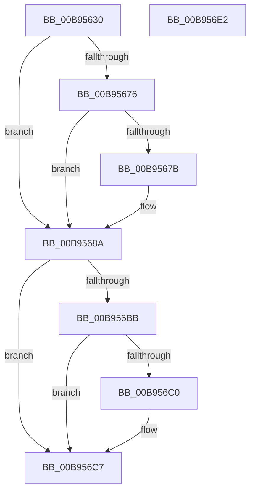

# VfAllocateCommonBufferEx

- RVA: `0x00B95630`–`0x00B956E3` (길이 `179` bytes)
- VA: `0x0000000140B95630`
- 실행 섹션: `PAGEVRFY`
- PDB 이름 있음: `예`; PDB Function 태그: `아니요`
- unwind 정보 RVA: `0x00060130`
- 디코드: `49`개 명령, `179/179` bytes 표시
- 미해석 바이트: `0` (있으면 어셈블리에 `.byte`로 보존)

> 이 문서는 커널 이미지의 기계어와 PDB 기호를 분석해 생성했습니다. 4번과 5번은 함수 원형과 자료형을 바이너리 사용 방식에서 추정한 C 해석이며 원본 소스 복구 결과는 아닙니다.

## 1. Dependencies

- 직접 호출 지점: **4**; 고유 호출 대상: **4**
- 직접 호출자로 확인된 함수: **0**
- RIP 상대 이미지 참조: **1**

### Outgoing calls
- `0x00B95655` → [ViGetRealDmaAdapter](ViGetRealDmaAdapter_function_00B990DC.md) (function, `0x00B990DC`)
- `0x00B95662` → [ViGetAdapterInformationInternal](ViGetAdapterInformationInternal_function_00B98E88.md) (function, `0x00B98E88`)
- `0x00B95685` → [Below4gb_AllocateCommonBuffer_Entry](../BA/Below4gb_AllocateCommonBuffer_Entry_function_00BAC140.md) (function, `0x00BAC140`)
- `0x00B956B1` → [guard_dispatch_icall](../../text/6B/guard_dispatch_icall_function_006BAAD0.md) (function, `0x006BAAD0`)

### Direct callers
- 이 함수 시작 RVA로 연결되는 직접 call은 확인되지 않았습니다. 간접 호출은 완전히 역산할 수 없습니다.

### Static image references
- `0x00B95667` → RVA `0x00F04A20` (`.data`; read)

## 2. Other-region calls and transfers

- 다른 실행 섹션으로 향하는 call: **1**
  - `0x00B956B1` → [guard_dispatch_icall](../../text/6B/guard_dispatch_icall_function_006BAAD0.md) (`PAGEVRFY` → `.text`)
- 별도 외부 분기/꼬리 이동을 확인하지 못했습니다.

## 3. Assembly (complete function range)

```asm
00B95630  48 8B C4                        mov rax, rsp
00B95633  48 89 58 08                     mov qword ptr [rax + 8], rbx
00B95637  48 89 68 10                     mov qword ptr [rax + 0x10], rbp
00B9563B  48 89 70 18                     mov qword ptr [rax + 0x18], rsi
00B9563F  48 89 78 20                     mov qword ptr [rax + 0x20], rdi
00B95643  41 56                           push r14
00B95645  48 83 EC 40                     sub rsp, 0x40
00B95649  4D 8B F1                        mov r14, r9
00B9564C  41 8B F8                        mov edi, r8d
00B9564F  48 8B F2                        mov rsi, rdx
00B95652  48 8B D9                        mov rbx, rcx
00B95655  E8 82 3A 00 00                  call 0x140b990dc
00B9565A  B2 01                           mov dl, 1
00B9565C  48 8B CB                        mov rcx, rbx
00B9565F  48 8B E8                        mov rbp, rax
00B95662  E8 21 38 00 00                  call 0x140b98e88
00B95667  F7 05 AF F3 36 00 00 00 00 04   test dword ptr [rip + 0x36f3af], 0x4000000
00B95671  48 8B D8                        mov rbx, rax
00B95674  74 14                           je 0x140b9568a
00B95676  48 85 C0                        test rax, rax
00B95679  74 0F                           je 0x140b9568a
00B9567B  48 8B 48 50                     mov rcx, qword ptr [rax + 0x50]
00B9567F  44 8B C7                        mov r8d, edi
00B95682  48 8B D6                        mov rdx, rsi
00B95685  E8 B6 6A 01 00                  call 0x140bac140
00B9568A  8B 4C 24 78                     mov ecx, dword ptr [rsp + 0x78]
00B9568E  4D 8B CE                        mov r9, r14
00B95691  48 8B 45 08                     mov rax, qword ptr [rbp + 8]
00B95695  44 8B C7                        mov r8d, edi
00B95698  89 4C 24 28                     mov dword ptr [rsp + 0x28], ecx
00B9569C  48 8B D6                        mov rdx, rsi
00B9569F  8A 4C 24 70                     mov cl, byte ptr [rsp + 0x70]
00B956A3  88 4C 24 20                     mov byte ptr [rsp + 0x20], cl
00B956A7  48 8B CD                        mov rcx, rbp
00B956AA  48 8B 80 98 00 00 00            mov rax, qword ptr [rax + 0x98]
00B956B1  E8 1A 54 B2 FF                  call 0x1406baad0
00B956B6  48 85 C0                        test rax, rax
00B956B9  74 0C                           je 0x140b956c7
00B956BB  48 85 DB                        test rbx, rbx
00B956BE  74 07                           je 0x140b956c7
00B956C0  F0 FF 83 CC 00 00 00            lock inc dword ptr [rbx + 0xcc]
00B956C7  48 8B 5C 24 50                  mov rbx, qword ptr [rsp + 0x50]
00B956CC  48 8B 6C 24 58                  mov rbp, qword ptr [rsp + 0x58]
00B956D1  48 8B 74 24 60                  mov rsi, qword ptr [rsp + 0x60]
00B956D6  48 8B 7C 24 68                  mov rdi, qword ptr [rsp + 0x68]
00B956DB  48 83 C4 40                     add rsp, 0x40
00B956DF  41 5E                           pop r14
00B956E1  C3                              ret
00B956E2  CC                              int3
```

## 4. C-style interpretation (structured pseudocode)

```c
__int64 __fastcall VfAllocateCommonBufferEx(__int64 a1, __int64 a2, int a3, __int64 a4, unsigned __int8 a5, unsigned int a6)
{
    __int64 result;
    __int64 v_rsp;
    unsigned int v_stack_m20;
    unsigned __int8 v_stack_m28;
    unsigned __int64 v_stack_p10;
    unsigned __int64 v_stack_p18;
    unsigned __int64 v_stack_p20;
    unsigned __int64 v_stack_p8;

    *(unsigned __int64 *)(v_rsp + 8) = v_rbx;
    *(unsigned __int64 *)(v_rsp + 16) = v_rbp;
    *(unsigned __int64 *)(v_rsp + 24) = v_rsi;
    *(unsigned __int64 *)(v_rsp + 32) = v_rdi;
    v_rsp = (v_rsp) - (64);
    result = ViGetRealDmaAdapter(a1, a2, a3, a4);
    result = ViGetAdapterInformationInternal(a1, 1, a3, a4);
    if (((*(unsigned int *)(v_rip + 3601327)) & (0x4000000ULL)) == 0) goto loc_00B9568A;
    if (result != 0) {
        a1 = *(unsigned __int64 *)(result + 80);
        a3 = (unsigned int)((unsigned int)(a3));
        a2 = a2;
        result = Below4gb_AllocateCommonBuffer_Entry(a1, a2, a3, a4);
    }
    v_stack_m20 = (unsigned int)((unsigned int)(a6));
    v_stack_m28 = a5;
    result = guard_dispatch_icall(result, a2, (unsigned int)((unsigned int)((unsigned int)(a3))), a4);
    if (result == 0) goto loc_00B956C7;
    if (result != 0) {
    }
    v_rsp = (v_rsp) + (64);
    return result;
}
```

## 5. (Beta) C Style

```c
int64_t VfAllocateCommonBufferEx(int64_t Arg1, int64_t Arg2, int32_t Arg3, int64_t Arg4, uint8_t Arg5, uint32_t Arg6)
{
    int64_t result;
    int64_t local_rsp;
    uint32_t v_stack_m20;
    uint8_t v_stack_m28;
    uint64_t v_stack_p10;
    uint64_t v_stack_p18;
    uint64_t v_stack_p20;
    uint64_t v_stack_p8;

    *(uint64_t *)(local_rsp + 0x8) = local_rbx;
    *(uint64_t *)(local_rsp + 0x10) = local_rbp;
    *(uint64_t *)(local_rsp + 0x18) = local_rsi;
    *(uint64_t *)(local_rsp + 0x20) = local_rdi;
    local_rsp = (local_rsp) - (64);
    result = ViGetRealDmaAdapter(Arg1, Arg2, Arg3, Arg4);
    result = ViGetAdapterInformationInternal(Arg1, 1, Arg3, Arg4);
    if (((*(uint32_t *)(v_rip + 0x36F3AF)) & (0x4000000ULL)) == 0) goto loc_00B9568A;
    if (result != 0) {
        Arg1 = *(uint64_t *)(result + 0x50);
        Arg3 = (uint32_t)((uint32_t)(Arg3));
        Arg2 = Arg2;
        result = Below4gb_AllocateCommonBuffer_Entry(Arg1, Arg2, Arg3, Arg4);
    }
    v_stack_m20 = (uint32_t)((uint32_t)(Arg6));
    v_stack_m28 = Arg5;
    result = guard_dispatch_icall(result, Arg2, (uint32_t)((uint32_t)((uint32_t)(Arg3))), Arg4);
    if (result == 0) goto loc_00B956C7;
    if (result != 0) {
    }
    local_rsp = (local_rsp) + (64);
    return result;
}
```

## 6. Execution-region graph

[열기: 2D/3D 그래프와 함수 탐색 컨트롤 패널](../../../control-panel.html?section=pagevrfy&rva=0x00B95630&view=graph)

- 2D 그래프는 위에서 아래로 흐르고, 3D 그래프는 빈 공간을 드래그해 회전합니다. Shift+드래그는 이동, 휠은 확대·축소, 함수 노드 선택은 대상 보고서 이동입니다.

### Static fallback


