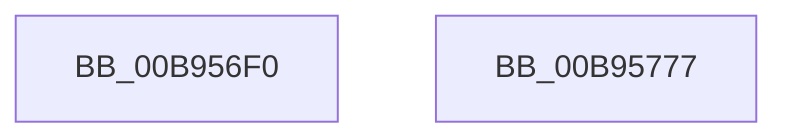

# VfAllocateCommonBufferVector

- RVA: `0x00B956F0`–`0x00B95778` (길이 `136` bytes)
- VA: `0x0000000140B956F0`
- 실행 섹션: `PAGEVRFY`
- PDB 이름 있음: `예`; PDB Function 태그: `아니요`
- unwind 정보 RVA: `0x0008A4C8`
- 디코드: `32`개 명령, `136/136` bytes 표시
- 미해석 바이트: `0` (있으면 어셈블리에 `.byte`로 보존)

> 이 문서는 커널 이미지의 기계어와 PDB 기호를 분석해 생성했습니다. 4번과 5번은 함수 원형과 자료형을 바이너리 사용 방식에서 추정한 C 해석이며 원본 소스 복구 결과는 아닙니다.

## 1. Dependencies

- 직접 호출 지점: **2**; 고유 호출 대상: **2**
- 직접 호출자로 확인된 함수: **0**
- RIP 상대 이미지 참조: **0**

### Outgoing calls
- `0x00B95708` → [ViGetRealDmaAdapter](ViGetRealDmaAdapter_function_00B990DC.md) (function, `0x00B990DC`)
- `0x00B95762` → [guard_dispatch_icall](../../text/6B/guard_dispatch_icall_function_006BAAD0.md) (function, `0x006BAAD0`)

### Direct callers
- 이 함수 시작 RVA로 연결되는 직접 call은 확인되지 않았습니다. 간접 호출은 완전히 역산할 수 없습니다.

### Static image references
- 디코드된 RIP-relative 메모리 참조가 없습니다.

## 2. Other-region calls and transfers

- 다른 실행 섹션으로 향하는 call: **1**
  - `0x00B95762` → [guard_dispatch_icall](../../text/6B/guard_dispatch_icall_function_006BAAD0.md) (`PAGEVRFY` → `.text`)
- 별도 외부 분기/꼬리 이동을 확인하지 못했습니다.

## 3. Assembly (complete function range)

```asm
00B956F0  48 89 5C 24 08                  mov qword ptr [rsp + 8], rbx
00B956F5  48 89 74 24 10                  mov qword ptr [rsp + 0x10], rsi
00B956FA  57                              push rdi
00B956FB  48 83 EC 50                     sub rsp, 0x50
00B956FF  41 8B F1                        mov esi, r9d
00B95702  49 8B D8                        mov rbx, r8
00B95705  48 8B FA                        mov rdi, rdx
00B95708  E8 CF 39 00 00                  call 0x140b990dc
00B9570D  4C 8B D0                        mov r10, rax
00B95710  44 8B CE                        mov r9d, esi
00B95713  4C 8B C3                        mov r8, rbx
00B95716  48 8B D7                        mov rdx, rdi
00B95719  48 8B 48 08                     mov rcx, qword ptr [rax + 8]
00B9571D  48 8B 81 18 01 00 00            mov rax, qword ptr [rcx + 0x118]
00B95724  48 8B 8C 24 A0 00 00 00         mov rcx, qword ptr [rsp + 0xa0]
00B9572C  48 89 4C 24 40                  mov qword ptr [rsp + 0x40], rcx
00B95731  48 8B 8C 24 98 00 00 00         mov rcx, qword ptr [rsp + 0x98]
00B95739  48 89 4C 24 38                  mov qword ptr [rsp + 0x38], rcx
00B9573E  8B 8C 24 90 00 00 00            mov ecx, dword ptr [rsp + 0x90]
00B95745  89 4C 24 30                     mov dword ptr [rsp + 0x30], ecx
00B95749  8B 8C 24 88 00 00 00            mov ecx, dword ptr [rsp + 0x88]
00B95750  89 4C 24 28                     mov dword ptr [rsp + 0x28], ecx
00B95754  8B 8C 24 80 00 00 00            mov ecx, dword ptr [rsp + 0x80]
00B9575B  89 4C 24 20                     mov dword ptr [rsp + 0x20], ecx
00B9575F  49 8B CA                        mov rcx, r10
00B95762  E8 69 53 B2 FF                  call 0x1406baad0
00B95767  48 8B 5C 24 60                  mov rbx, qword ptr [rsp + 0x60]
00B9576C  48 8B 74 24 68                  mov rsi, qword ptr [rsp + 0x68]
00B95771  48 83 C4 50                     add rsp, 0x50
00B95775  5F                              pop rdi
00B95776  C3                              ret
00B95777  CC                              int3
```

## 4. C-style interpretation (structured pseudocode)

```c
__int64 __fastcall VfAllocateCommonBufferVector(__int64 a1, __int64 a2, __int64 a3, int a4, unsigned int a5, unsigned int a6, unsigned int a7, __int64 a8, __int64 a9)
{
    __int64 result;
    __int64 v_rsp;
    unsigned __int64 v_stack_m18;
    unsigned __int64 v_stack_m20;
    unsigned int v_stack_m28;
    unsigned int v_stack_m30;
    unsigned int v_stack_m38;
    unsigned __int64 v_stack_p10;
    unsigned __int64 v_stack_p8;

    v_stack_p8 = v_rbx;
    v_stack_p10 = v_rsi;
    v_rsp = (v_rsp) - (80);
    result = ViGetRealDmaAdapter(a1, a2, a3, a4);
    v_stack_m18 = a9;
    v_stack_m20 = a8;
    v_stack_m28 = (unsigned int)((unsigned int)(a7));
    v_stack_m30 = (unsigned int)((unsigned int)(a6));
    v_stack_m38 = (unsigned int)((unsigned int)(a5));
    result = guard_dispatch_icall(result, a2, a3, (unsigned int)((unsigned int)((unsigned int)(a4))));
    v_rsp = (v_rsp) + (80);
    return result;
}
```

## 5. (Beta) C Style

```c
int64_t VfAllocateCommonBufferVector(int64_t Arg1, int64_t Arg2, int64_t Arg3, int32_t Arg4, uint32_t Arg5, uint32_t Arg6, uint32_t Arg7, int64_t Arg8, int64_t Arg9)
{
    int64_t result;
    int64_t local_rsp;
    uint64_t v_stack_m18;
    uint64_t v_stack_m20;
    uint32_t v_stack_m28;
    uint32_t v_stack_m30;
    uint32_t v_stack_m38;
    uint64_t v_stack_p10;
    uint64_t v_stack_p8;

    v_stack_p8 = local_rbx;
    v_stack_p10 = local_rsi;
    local_rsp = (local_rsp) - (80);
    result = ViGetRealDmaAdapter(Arg1, Arg2, Arg3, Arg4);
    v_stack_m18 = Arg9;
    v_stack_m20 = Arg8;
    v_stack_m28 = (uint32_t)((uint32_t)(Arg7));
    v_stack_m30 = (uint32_t)((uint32_t)(Arg6));
    v_stack_m38 = (uint32_t)((uint32_t)(Arg5));
    result = guard_dispatch_icall(result, Arg2, Arg3, (uint32_t)((uint32_t)((uint32_t)(Arg4))));
    local_rsp = (local_rsp) + (80);
    return result;
}
```

## 6. Execution-region graph

[열기: 2D/3D 그래프와 함수 탐색 컨트롤 패널](../../../control-panel.html?section=pagevrfy&rva=0x00B956F0&view=graph)

- 2D 그래프는 위에서 아래로 흐르고, 3D 그래프는 빈 공간을 드래그해 회전합니다. Shift+드래그는 이동, 휠은 확대·축소, 함수 노드 선택은 대상 보고서 이동입니다.

### Static fallback


