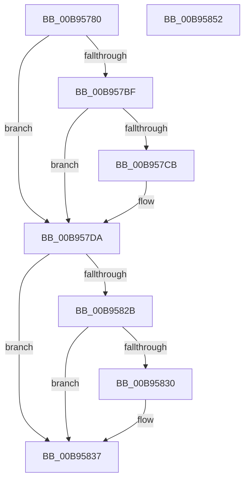

# VfAllocateCommonBufferWithBounds

- RVA: `0x00B95780`–`0x00B95853` (길이 `211` bytes)
- VA: `0x0000000140B95780`
- 실행 섹션: `PAGEVRFY`
- PDB 이름 있음: `예`; PDB Function 태그: `아니요`
- unwind 정보 RVA: `0x00091ECC`
- 디코드: `53`개 명령, `211/211` bytes 표시
- 미해석 바이트: `0` (있으면 어셈블리에 `.byte`로 보존)

> 이 문서는 커널 이미지의 기계어와 PDB 기호를 분석해 생성했습니다. 4번과 5번은 함수 원형과 자료형을 바이너리 사용 방식에서 추정한 C 해석이며 원본 소스 복구 결과는 아닙니다.

## 1. Dependencies

- 직접 호출 지점: **4**; 고유 호출 대상: **4**
- 직접 호출자로 확인된 함수: **0**
- RIP 상대 이미지 참조: **1**

### Outgoing calls
- `0x00B957A5` → [ViGetRealDmaAdapter](ViGetRealDmaAdapter_function_00B990DC.md) (function, `0x00B990DC`)
- `0x00B957B2` → [ViGetAdapterInformationInternal](ViGetAdapterInformationInternal_function_00B98E88.md) (function, `0x00B98E88`)
- `0x00B957D5` → [Below4gb_AllocateCommonBuffer_Entry](../BA/Below4gb_AllocateCommonBuffer_Entry_function_00BAC140.md) (function, `0x00BAC140`)
- `0x00B95821` → [guard_dispatch_icall](../../text/6B/guard_dispatch_icall_function_006BAAD0.md) (function, `0x006BAAD0`)

### Direct callers
- 이 함수 시작 RVA로 연결되는 직접 call은 확인되지 않았습니다. 간접 호출은 완전히 역산할 수 없습니다.

### Static image references
- `0x00B957BF` → RVA `0x00F04A20` (`.data`; read)

## 2. Other-region calls and transfers

- 다른 실행 섹션으로 향하는 call: **1**
  - `0x00B95821` → [guard_dispatch_icall](../../text/6B/guard_dispatch_icall_function_006BAAD0.md) (`PAGEVRFY` → `.text`)
- 별도 외부 분기/꼬리 이동을 확인하지 못했습니다.

## 3. Assembly (complete function range)

```asm
00B95780  48 8B C4                        mov rax, rsp
00B95783  48 89 58 08                     mov qword ptr [rax + 8], rbx
00B95787  48 89 68 10                     mov qword ptr [rax + 0x10], rbp
00B9578B  48 89 70 18                     mov qword ptr [rax + 0x18], rsi
00B9578F  48 89 78 20                     mov qword ptr [rax + 0x20], rdi
00B95793  41 56                           push r14
00B95795  48 83 EC 50                     sub rsp, 0x50
00B95799  41 8B F9                        mov edi, r9d
00B9579C  49 8B F0                        mov rsi, r8
00B9579F  4C 8B F2                        mov r14, rdx
00B957A2  48 8B D9                        mov rbx, rcx
00B957A5  E8 32 39 00 00                  call 0x140b990dc
00B957AA  B2 01                           mov dl, 1
00B957AC  48 8B CB                        mov rcx, rbx
00B957AF  48 8B E8                        mov rbp, rax
00B957B2  E8 D1 36 00 00                  call 0x140b98e88
00B957B7  48 8B D8                        mov rbx, rax
00B957BA  48 85 C0                        test rax, rax
00B957BD  74 1B                           je 0x140b957da
00B957BF  F7 05 57 F2 36 00 00 00 00 04   test dword ptr [rip + 0x36f257], 0x4000000
00B957C9  74 0F                           je 0x140b957da
00B957CB  48 8B 48 50                     mov rcx, qword ptr [rax + 0x50]
00B957CF  44 8B C7                        mov r8d, edi
00B957D2  48 8B D6                        mov rdx, rsi
00B957D5  E8 66 69 01 00                  call 0x140bac140
00B957DA  48 8B 8C 24 98 00 00 00         mov rcx, qword ptr [rsp + 0x98]
00B957E2  44 8B CF                        mov r9d, edi
00B957E5  48 8B 45 08                     mov rax, qword ptr [rbp + 8]
00B957E9  4C 8B C6                        mov r8, rsi
00B957EC  48 89 4C 24 38                  mov qword ptr [rsp + 0x38], rcx
00B957F1  49 8B D6                        mov rdx, r14
00B957F4  8B 8C 24 90 00 00 00            mov ecx, dword ptr [rsp + 0x90]
00B957FB  89 4C 24 30                     mov dword ptr [rsp + 0x30], ecx
00B957FF  48 8B 8C 24 88 00 00 00         mov rcx, qword ptr [rsp + 0x88]
00B95807  48 8B 80 10 01 00 00            mov rax, qword ptr [rax + 0x110]
00B9580E  48 89 4C 24 28                  mov qword ptr [rsp + 0x28], rcx
00B95813  8B 8C 24 80 00 00 00            mov ecx, dword ptr [rsp + 0x80]
00B9581A  89 4C 24 20                     mov dword ptr [rsp + 0x20], ecx
00B9581E  48 8B CD                        mov rcx, rbp
00B95821  E8 AA 52 B2 FF                  call 0x1406baad0
00B95826  48 85 C0                        test rax, rax
00B95829  74 0C                           je 0x140b95837
00B9582B  48 85 DB                        test rbx, rbx
00B9582E  74 07                           je 0x140b95837
00B95830  F0 FF 83 CC 00 00 00            lock inc dword ptr [rbx + 0xcc]
00B95837  48 8B 5C 24 60                  mov rbx, qword ptr [rsp + 0x60]
00B9583C  48 8B 6C 24 68                  mov rbp, qword ptr [rsp + 0x68]
00B95841  48 8B 74 24 70                  mov rsi, qword ptr [rsp + 0x70]
00B95846  48 8B 7C 24 78                  mov rdi, qword ptr [rsp + 0x78]
00B9584B  48 83 C4 50                     add rsp, 0x50
00B9584F  41 5E                           pop r14
00B95851  C3                              ret
00B95852  CC                              int3
```

## 4. C-style interpretation (structured pseudocode)

```c
__int64 __fastcall VfAllocateCommonBufferWithBounds(__int64 a1, __int64 a2, __int64 a3, int a4, unsigned int a5, __int64 a6, unsigned int a7, __int64 a8)
{
    __int64 result;
    __int64 v_rsp;
    unsigned __int64 v_stack_m20;
    unsigned int v_stack_m28;
    unsigned __int64 v_stack_m30;
    unsigned int v_stack_m38;
    unsigned __int64 v_stack_p10;
    unsigned __int64 v_stack_p18;
    unsigned __int64 v_stack_p20;
    unsigned __int64 v_stack_p8;

    *(unsigned __int64 *)(v_rsp + 8) = v_rbx;
    *(unsigned __int64 *)(v_rsp + 16) = v_rbp;
    *(unsigned __int64 *)(v_rsp + 24) = v_rsi;
    *(unsigned __int64 *)(v_rsp + 32) = v_rdi;
    v_rsp = (v_rsp) - (80);
    result = ViGetRealDmaAdapter(a1, a2, a3, a4);
    result = ViGetAdapterInformationInternal(a1, 1, a3, a4);
    if (result == 0) goto loc_00B957DA;
    if (((*(unsigned int *)(v_rip + 3600983)) & (0x4000000ULL)) != 0) {
        a1 = *(unsigned __int64 *)(result + 80);
        a3 = (unsigned int)((unsigned int)(a4));
        a2 = a3;
        result = Below4gb_AllocateCommonBuffer_Entry(a1, a2, a3, a4);
    }
    v_stack_m20 = a8;
    v_stack_m28 = (unsigned int)((unsigned int)(a7));
    v_stack_m30 = a6;
    v_stack_m38 = (unsigned int)((unsigned int)(a5));
    result = guard_dispatch_icall(result, a2, a3, (unsigned int)((unsigned int)((unsigned int)(a4))));
    if (result == 0) goto loc_00B95837;
    if (result != 0) {
    }
    v_rsp = (v_rsp) + (80);
    return result;
}
```

## 5. (Beta) C Style

```c
int64_t VfAllocateCommonBufferWithBounds(int64_t Arg1, int64_t Arg2, int64_t Arg3, int32_t Arg4, uint32_t Arg5, int64_t Arg6, uint32_t Arg7, int64_t Arg8)
{
    int64_t result;
    int64_t local_rsp;
    uint64_t v_stack_m20;
    uint32_t v_stack_m28;
    uint64_t v_stack_m30;
    uint32_t v_stack_m38;
    uint64_t v_stack_p10;
    uint64_t v_stack_p18;
    uint64_t v_stack_p20;
    uint64_t v_stack_p8;

    *(uint64_t *)(local_rsp + 0x8) = local_rbx;
    *(uint64_t *)(local_rsp + 0x10) = local_rbp;
    *(uint64_t *)(local_rsp + 0x18) = local_rsi;
    *(uint64_t *)(local_rsp + 0x20) = local_rdi;
    local_rsp = (local_rsp) - (80);
    result = ViGetRealDmaAdapter(Arg1, Arg2, Arg3, Arg4);
    result = ViGetAdapterInformationInternal(Arg1, 1, Arg3, Arg4);
    if (result == 0) goto loc_00B957DA;
    if (((*(uint32_t *)(v_rip + 0x36F257)) & (0x4000000ULL)) != 0) {
        Arg1 = *(uint64_t *)(result + 0x50);
        Arg3 = (uint32_t)((uint32_t)(Arg4));
        Arg2 = Arg3;
        result = Below4gb_AllocateCommonBuffer_Entry(Arg1, Arg2, Arg3, Arg4);
    }
    v_stack_m20 = Arg8;
    v_stack_m28 = (uint32_t)((uint32_t)(Arg7));
    v_stack_m30 = Arg6;
    v_stack_m38 = (uint32_t)((uint32_t)(Arg5));
    result = guard_dispatch_icall(result, Arg2, Arg3, (uint32_t)((uint32_t)((uint32_t)(Arg4))));
    if (result == 0) goto loc_00B95837;
    if (result != 0) {
    }
    local_rsp = (local_rsp) + (80);
    return result;
}
```

## 6. Execution-region graph

[열기: 2D/3D 그래프와 함수 탐색 컨트롤 패널](../../../control-panel.html?section=pagevrfy&rva=0x00B95780&view=graph)

- 2D 그래프는 위에서 아래로 흐르고, 3D 그래프는 빈 공간을 드래그해 회전합니다. Shift+드래그는 이동, 휠은 확대·축소, 함수 노드 선택은 대상 보고서 이동입니다.

### Static fallback


