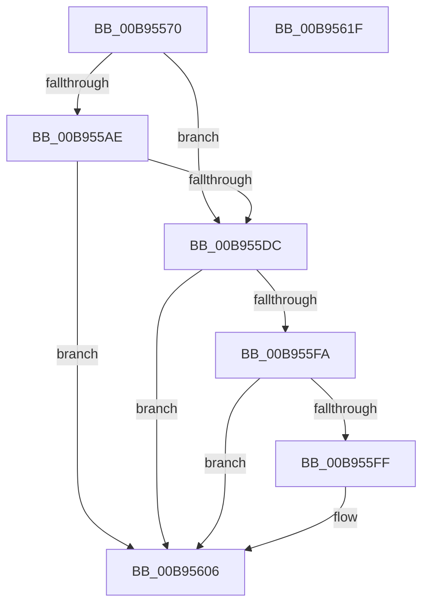

# VfAllocateCommonBuffer

- RVA: `0x00B95570`–`0x00B95620` (길이 `176` bytes)
- VA: `0x0000000140B95570`
- 실행 섹션: `PAGEVRFY`
- PDB 이름 있음: `예`; PDB Function 태그: `아니요`
- unwind 정보 RVA: `0x00084C9C`
- 디코드: `52`개 명령, `176/176` bytes 표시
- 미해석 바이트: `0` (있으면 어셈블리에 `.byte`로 보존)

> 이 문서는 커널 이미지의 기계어와 PDB 기호를 분석해 생성했습니다. 4번과 5번은 함수 원형과 자료형을 바이너리 사용 방식에서 추정한 C 해석이며 원본 소스 복구 결과는 아닙니다.

## 1. Dependencies

- 직접 호출 지점: **5**; 고유 호출 대상: **5**
- 직접 호출자로 확인된 함수: **0**
- RIP 상대 이미지 참조: **0**

### Outgoing calls
- `0x00B95594` → [ViGetRealDmaAdapter](ViGetRealDmaAdapter_function_00B990DC.md) (function, `0x00B990DC`)
- `0x00B955A1` → [ViGetAdapterInformationInternal](ViGetAdapterInformationInternal_function_00B98E88.md) (function, `0x00B98E88`)
- `0x00B955B0` → [VF_ASSERT_IRQL](VF_ASSERT_IRQL_function_00B94F30.md) (function, `0x00B94F30`)
- `0x00B955D2` → [ViSpecialAllocateCommonBuffer](ViSpecialAllocateCommonBuffer_function_00B99BB0.md) (function, `0x00B99BB0`)
- `0x00B955F0` → [guard_dispatch_icall](../../text/6B/guard_dispatch_icall_function_006BAAD0.md) (function, `0x006BAAD0`)

### Direct callers
- 이 함수 시작 RVA로 연결되는 직접 call은 확인되지 않았습니다. 간접 호출은 완전히 역산할 수 없습니다.

### Static image references
- 디코드된 RIP-relative 메모리 참조가 없습니다.

## 2. Other-region calls and transfers

- 다른 실행 섹션으로 향하는 call: **1**
  - `0x00B955F0` → [guard_dispatch_icall](../../text/6B/guard_dispatch_icall_function_006BAAD0.md) (`PAGEVRFY` → `.text`)
- 별도 외부 분기/꼬리 이동을 확인하지 못했습니다.

## 3. Assembly (complete function range)

```asm
00B95570  48 89 5C 24 08                  mov qword ptr [rsp + 8], rbx
00B95575  48 89 6C 24 10                  mov qword ptr [rsp + 0x10], rbp
00B9557A  48 89 74 24 18                  mov qword ptr [rsp + 0x18], rsi
00B9557F  57                              push rdi
00B95580  41 56                           push r14
00B95582  41 57                           push r15
00B95584  48 83 EC 30                     sub rsp, 0x30
00B95588  41 8A F1                        mov sil, r9b
00B9558B  49 8B E8                        mov rbp, r8
00B9558E  44 8B F2                        mov r14d, edx
00B95591  48 8B D9                        mov rbx, rcx
00B95594  E8 43 3B 00 00                  call 0x140b990dc
00B95599  B2 01                           mov dl, 1
00B9559B  48 8B CB                        mov rcx, rbx
00B9559E  4C 8B F8                        mov r15, rax
00B955A1  E8 E2 38 00 00                  call 0x140b98e88
00B955A6  48 8B D8                        mov rbx, rax
00B955A9  48 85 C0                        test rax, rax
00B955AC  74 2E                           je 0x140b955dc
00B955AE  33 C9                           xor ecx, ecx
00B955B0  E8 7B F9 FF FF                  call 0x140b94f30
00B955B5  49 8B 4F 08                     mov rcx, qword ptr [r15 + 8]
00B955B9  45 8B CE                        mov r9d, r14d
00B955BC  4C 8B 44 24 48                  mov r8, qword ptr [rsp + 0x48]
00B955C1  48 8B D3                        mov rdx, rbx
00B955C4  40 88 74 24 28                  mov byte ptr [rsp + 0x28], sil
00B955C9  48 89 6C 24 20                  mov qword ptr [rsp + 0x20], rbp
00B955CE  48 8B 49 10                     mov rcx, qword ptr [rcx + 0x10]
00B955D2  E8 D9 45 00 00                  call 0x140b99bb0
00B955D7  48 85 C0                        test rax, rax
00B955DA  75 2A                           jne 0x140b95606
00B955DC  49 8B 47 08                     mov rax, qword ptr [r15 + 8]
00B955E0  44 8A CE                        mov r9b, sil
00B955E3  4C 8B C5                        mov r8, rbp
00B955E6  41 8B D6                        mov edx, r14d
00B955E9  49 8B CF                        mov rcx, r15
00B955EC  48 8B 40 10                     mov rax, qword ptr [rax + 0x10]
00B955F0  E8 DB 54 B2 FF                  call 0x1406baad0
00B955F5  48 85 C0                        test rax, rax
00B955F8  74 0C                           je 0x140b95606
00B955FA  48 85 DB                        test rbx, rbx
00B955FD  74 07                           je 0x140b95606
00B955FF  F0 FF 83 CC 00 00 00            lock inc dword ptr [rbx + 0xcc]
00B95606  48 8B 5C 24 50                  mov rbx, qword ptr [rsp + 0x50]
00B9560B  48 8B 6C 24 58                  mov rbp, qword ptr [rsp + 0x58]
00B95610  48 8B 74 24 60                  mov rsi, qword ptr [rsp + 0x60]
00B95615  48 83 C4 30                     add rsp, 0x30
00B95619  41 5F                           pop r15
00B9561B  41 5E                           pop r14
00B9561D  5F                              pop rdi
00B9561E  C3                              ret
00B9561F  CC                              int3
```

## 4. C-style interpretation (structured pseudocode)

```c
__int64 __fastcall VfAllocateCommonBuffer(__int64 a1, int a2, __int64 a3, unsigned __int8 a4)
{
    __int64 result;
    __int64 v_rsp;
    unsigned __int8 v_stack_m20;
    unsigned __int64 v_stack_m28;
    unsigned __int64 v_stack_p0;
    unsigned __int64 v_stack_p10;
    unsigned __int64 v_stack_p18;
    unsigned __int64 v_stack_p8;

    v_stack_p8 = v_rbx;
    v_stack_p10 = v_rbp;
    v_stack_p18 = v_rsi;
    v_rsp = (v_rsp) - (48);
    result = ViGetRealDmaAdapter(a1, a2, a3, a4);
    result = ViGetAdapterInformationInternal(a1, 1, a3, a4);
    if (result == 0) goto loc_00B955DC;
    a1 = 0;
    result = VF_ASSERT_IRQL(a1, 1, a3, a4);
    v_stack_m20 = a4;
    v_stack_m28 = a3;
    result = ViSpecialAllocateCommonBuffer(*(unsigned __int64 *)(*(unsigned __int64 *)(result + 8) + 16), result, v_stack_p0, (unsigned int)((unsigned int)((unsigned int)(a2))));
    if (result != 0) goto loc_00B95606;
loc_00B955DC:
    result = guard_dispatch_icall(result, (unsigned int)((unsigned int)((unsigned int)(a2))), a3, a4);
    if (result == 0) goto loc_00B95606;
    if (result != 0) {
    }
    v_rsp = (v_rsp) + (48);
    return result;
}
```

## 5. (Beta) C Style

```c
int64_t VfAllocateCommonBuffer(int64_t Arg1, int32_t Arg2, int64_t Arg3, uint8_t Arg4)
{
    int64_t result;
    int64_t local_rsp;
    uint8_t v_stack_m20;
    uint64_t v_stack_m28;
    uint64_t v_stack_p0;
    uint64_t v_stack_p10;
    uint64_t v_stack_p18;
    uint64_t v_stack_p8;

    v_stack_p8 = local_rbx;
    v_stack_p10 = local_rbp;
    v_stack_p18 = local_rsi;
    local_rsp = (local_rsp) - (48);
    result = ViGetRealDmaAdapter(Arg1, Arg2, Arg3, Arg4);
    result = ViGetAdapterInformationInternal(Arg1, 1, Arg3, Arg4);
    if (result == 0) goto loc_00B955DC;
    Arg1 = 0;
    result = VF_ASSERT_IRQL(Arg1, 1, Arg3, Arg4);
    v_stack_m20 = Arg4;
    v_stack_m28 = Arg3;
    result = ViSpecialAllocateCommonBuffer(*(uint64_t *)(*(uint64_t *)(result + 0x8) + 0x10), result, v_stack_p0, (uint32_t)((uint32_t)((uint32_t)(Arg2))));
    if (result != 0) goto loc_00B95606;
loc_00B955DC:
    result = guard_dispatch_icall(result, (uint32_t)((uint32_t)((uint32_t)(Arg2))), Arg3, Arg4);
    if (result == 0) goto loc_00B95606;
    if (result != 0) {
    }
    local_rsp = (local_rsp) + (48);
    return result;
}
```

## 6. Execution-region graph

[열기: 2D/3D 그래프와 함수 탐색 컨트롤 패널](../../../control-panel.html?section=pagevrfy&rva=0x00B95570&view=graph)

- 2D 그래프는 위에서 아래로 흐르고, 3D 그래프는 빈 공간을 드래그해 회전합니다. Shift+드래그는 이동, 휠은 확대·축소, 함수 노드 선택은 대상 보고서 이동입니다.

### Static fallback


