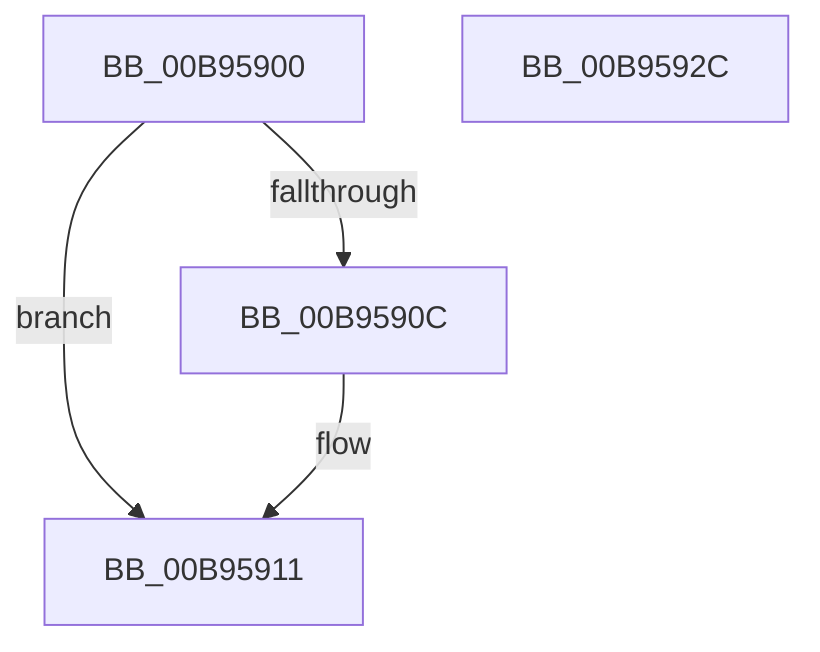

# VfAllocateCrashDumpRegistersEx

- RVA: `0x00B95900`–`0x00B9592D` (길이 `45` bytes)
- VA: `0x0000000140B95900`
- 실행 섹션: `PAGEVRFY`
- PDB 이름 있음: `예`; PDB Function 태그: `아니요`
- unwind 정보 RVA: `0x0005D2F4`
- 디코드: `12`개 명령, `45/45` bytes 표시
- 미해석 바이트: `0` (있으면 어셈블리에 `.byte`로 보존)

> 이 문서는 커널 이미지의 기계어와 PDB 기호를 분석해 생성했습니다. 4번과 5번은 함수 원형과 자료형을 바이너리 사용 방식에서 추정한 C 해석이며 원본 소스 복구 결과는 아닙니다.

## 1. Dependencies

- 직접 호출 지점: **2**; 고유 호출 대상: **2**
- 직접 호출자로 확인된 함수: **0**
- RIP 상대 이미지 참조: **1**

### Outgoing calls
- `0x00B9590C` → [VfDisableHalVerifier](../../text/61/VfDisableHalVerifier_function_00612C28.md) (function, `0x00612C28`)
- `0x00B95922` → [guard_dispatch_icall](../../text/6B/guard_dispatch_icall_function_006BAAD0.md) (function, `0x006BAAD0`)

### Direct callers
- 이 함수 시작 RVA로 연결되는 직접 call은 확인되지 않았습니다. 간접 호출은 완전히 역산할 수 없습니다.

### Static image references
- `0x00B95916` → RVA `0x00FFE6E0` (`PAGEVRFD`; read)

## 2. Other-region calls and transfers

- 다른 실행 섹션으로 향하는 call: **2**
  - `0x00B9590C` → [VfDisableHalVerifier](../../text/61/VfDisableHalVerifier_function_00612C28.md) (`PAGEVRFY` → `.text`)
  - `0x00B95922` → [guard_dispatch_icall](../../text/6B/guard_dispatch_icall_function_006BAAD0.md) (`PAGEVRFY` → `.text`)
- 별도 외부 분기/꼬리 이동을 확인하지 못했습니다.

## 3. Assembly (complete function range)

```asm
00B95900  48 83 EC 38                     sub rsp, 0x38
00B95904  44 0F 20 C0                     mov rax, cr8
00B95908  3C 0F                           cmp al, 0xf
00B9590A  75 05                           jne 0x140b95911
00B9590C  E8 17 D3 A7 FF                  call 0x140612c28
00B95911  4C 8B 54 24 60                  mov r10, qword ptr [rsp + 0x60]
00B95916  48 8B 05 C3 8D 46 00            mov rax, qword ptr [rip + 0x468dc3]
00B9591D  4C 89 54 24 20                  mov qword ptr [rsp + 0x20], r10
00B95922  E8 A9 51 B2 FF                  call 0x1406baad0
00B95927  48 83 C4 38                     add rsp, 0x38
00B9592B  C3                              ret
00B9592C  CC                              int3
```

## 4. C-style interpretation (structured pseudocode)

```c
__int64 __fastcall VfAllocateCrashDumpRegistersEx(__int64 a1, __int64 a2, __int64 a3, __int64 a4, __int64 a5)
{
    __int64 result;
    __int64 v_rsp;
    unsigned __int64 v_stack_m18;

    v_rsp = (v_rsp) - (56);
    result = v_cr8;
    if (((unsigned __int8)(v_cr8)) == 15) {
        result = VfDisableHalVerifier(a1, a2, a3, a4);
    }
    v_stack_m18 = a5;
    result = guard_dispatch_icall(a1, a2, a3, a4);
    v_rsp = (v_rsp) + (56);
    return result;
}
```

## 5. (Beta) C Style

```c
int64_t VfAllocateCrashDumpRegistersEx(int64_t Arg1, int64_t Arg2, int64_t Arg3, int64_t Arg4, int64_t Arg5)
{
    int64_t result;
    int64_t local_rsp;
    uint64_t v_stack_m18;

    local_rsp = (local_rsp) - (56);
    result = v_cr8;
    if (((uint8_t)(v_cr8)) == 15) {
        result = VfDisableHalVerifier(Arg1, Arg2, Arg3, Arg4);
    }
    v_stack_m18 = Arg5;
    result = guard_dispatch_icall(Arg1, Arg2, Arg3, Arg4);
    local_rsp = (local_rsp) + (56);
    return result;
}
```

## 6. Execution-region graph

[열기: 2D/3D 그래프와 함수 탐색 컨트롤 패널](../../../control-panel.html?section=pagevrfy&rva=0x00B95900&view=graph)

- 2D 그래프는 위에서 아래로 흐르고, 3D 그래프는 빈 공간을 드래그해 회전합니다. Shift+드래그는 이동, 휠은 확대·축소, 함수 노드 선택은 대상 보고서 이동입니다.

### Static fallback


