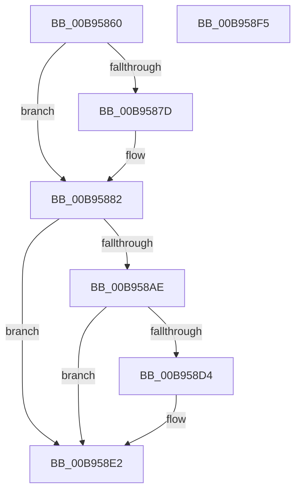

# VfAllocateCrashDumpRegisters

- RVA: `0x00B95860`–`0x00B958F6` (길이 `150` bytes)
- VA: `0x0000000140B95860`
- 실행 섹션: `PAGEVRFY`
- PDB 이름 있음: `예`; PDB Function 태그: `아니요`
- unwind 정보 RVA: `0x00060BC4`
- 디코드: `42`개 명령, `150/150` bytes 표시
- 미해석 바이트: `0` (있으면 어셈블리에 `.byte`로 보존)

> 이 문서는 커널 이미지의 기계어와 PDB 기호를 분석해 생성했습니다. 4번과 5번은 함수 원형과 자료형을 바이너리 사용 방식에서 추정한 C 해석이며 원본 소스 복구 결과는 아닙니다.

## 1. Dependencies

- 직접 호출 지점: **6**; 고유 호출 대상: **6**
- 직접 호출자로 확인된 함수: **0**
- RIP 상대 이미지 참조: **2**

### Outgoing calls
- `0x00B9587D` → [VfDisableHalVerifier](../../text/61/VfDisableHalVerifier_function_00612C28.md) (function, `0x00612C28`)
- `0x00B95884` → [ViGetAdapterInformationInternal](ViGetAdapterInformationInternal_function_00B98E88.md) (function, `0x00B98E88`)
- `0x00B9588F` → [ViGetRealDmaAdapter](ViGetRealDmaAdapter_function_00B990DC.md) (function, `0x00B990DC`)
- `0x00B958A1` → [guard_dispatch_icall](../../text/6B/guard_dispatch_icall_function_006BAAD0.md) (function, `0x006BAAD0`)
- `0x00B958B0` → [VF_ASSERT_IRQL](VF_ASSERT_IRQL_function_00B94F30.md) (function, `0x00B94F30`)
- `0x00B958C6` → [ADD_MAP_REGISTERS](ADD_MAP_REGISTERS_function_00B94A08.md) (function, `0x00B94A08`)

### Direct callers
- 이 함수 시작 RVA로 연결되는 직접 call은 확인되지 않았습니다. 간접 호출은 완전히 역산할 수 없습니다.

### Static image references
- `0x00B9589A` → RVA `0x00FFE6F0` (`PAGEVRFD`; read)
- `0x00B958CB` → RVA `0x00F03FA4` (`.data`; read)

## 2. Other-region calls and transfers

- 다른 실행 섹션으로 향하는 call: **2**
  - `0x00B9587D` → [VfDisableHalVerifier](../../text/61/VfDisableHalVerifier_function_00612C28.md) (`PAGEVRFY` → `.text`)
  - `0x00B958A1` → [guard_dispatch_icall](../../text/6B/guard_dispatch_icall_function_006BAAD0.md) (`PAGEVRFY` → `.text`)
- 별도 외부 분기/꼬리 이동을 확인하지 못했습니다.

## 3. Assembly (complete function range)

```asm
00B95860  48 89 5C 24 08                  mov qword ptr [rsp + 8], rbx
00B95865  48 89 74 24 10                  mov qword ptr [rsp + 0x10], rsi
00B9586A  57                              push rdi
00B9586B  48 83 EC 20                     sub rsp, 0x20
00B9586F  48 8B FA                        mov rdi, rdx
00B95872  48 8B D9                        mov rbx, rcx
00B95875  44 0F 20 C0                     mov rax, cr8
00B95879  3C 02                           cmp al, 2
00B9587B  76 05                           jbe 0x140b95882
00B9587D  E8 A6 D3 A7 FF                  call 0x140612c28
00B95882  B2 01                           mov dl, 1
00B95884  E8 FF 35 00 00                  call 0x140b98e88
00B95889  48 8B CB                        mov rcx, rbx
00B9588C  48 8B F0                        mov rsi, rax
00B9588F  E8 48 38 00 00                  call 0x140b990dc
00B95894  48 8B C8                        mov rcx, rax
00B95897  48 8B D7                        mov rdx, rdi
00B9589A  48 8B 05 4F 8E 46 00            mov rax, qword ptr [rip + 0x468e4f]
00B958A1  E8 2A 52 B2 FF                  call 0x1406baad0
00B958A6  48 8B D8                        mov rbx, rax
00B958A9  48 85 F6                        test rsi, rsi
00B958AC  74 34                           je 0x140b958e2
00B958AE  B1 02                           mov cl, 2
00B958B0  E8 7B F6 FF FF                  call 0x140b94f30
00B958B5  8B 0F                           mov ecx, dword ptr [rdi]
00B958B7  F0 01 8E B8 00 00 00            lock add dword ptr [rsi + 0xb8], ecx
00B958BE  8B 17                           mov edx, dword ptr [rdi]
00B958C0  45 33 C0                        xor r8d, r8d
00B958C3  48 8B CE                        mov rcx, rsi
00B958C6  E8 3D F1 FF FF                  call 0x140b94a08
00B958CB  83 3D D2 E6 36 00 00            cmp dword ptr [rip + 0x36e6d2], 0
00B958D2  74 0E                           je 0x140b958e2
00B958D4  48 85 DB                        test rbx, rbx
00B958D7  48 C7 C0 0D F0 AD DE            mov rax, 0xffffffffdeadf00d
00B958DE  48 0F 44 D8                     cmove rbx, rax
00B958E2  48 8B 74 24 38                  mov rsi, qword ptr [rsp + 0x38]
00B958E7  48 8B C3                        mov rax, rbx
00B958EA  48 8B 5C 24 30                  mov rbx, qword ptr [rsp + 0x30]
00B958EF  48 83 C4 20                     add rsp, 0x20
00B958F3  5F                              pop rdi
00B958F4  C3                              ret
00B958F5  CC                              int3
```

## 4. C-style interpretation (structured pseudocode)

```c
__int64 __fastcall VfAllocateCrashDumpRegisters(__int64 a1, __int64 a2, int a3)
{
    __int64 result;
    __int64 v_rbx;
    __int64 v_rsp;
    unsigned __int64 v_stack_p10;
    unsigned __int64 v_stack_p8;

    v_stack_p8 = v_rbx;
    v_stack_p10 = v_rsi;
    v_rsp = (v_rsp) - (32);
    result = v_cr8;
    if (((unsigned __int8)(v_cr8)) >= = 2) {
        result = VfDisableHalVerifier(a1, a2, a3, a4);
    }
    result = ViGetAdapterInformationInternal(a1, 1, a3, a4);
    result = ViGetRealDmaAdapter(a1, 1, a3, a4);
    result = guard_dispatch_icall(result, a2, a3, a4);
    if (result == 0) goto loc_00B958E2;
    result = VF_ASSERT_IRQL(2, a2, a3, a4);
    a3 = 0;
    result = ADD_MAP_REGISTERS(result, (unsigned int)(*(unsigned int *)(a2)), a3, a4);
    v_rbx = result;
    if ((*(unsigned int *)(v_rip + 3598034)) != 0) {
        result = 0xFFFFFFFFDEADF00DULL;
        v_rbx = result;
        if (result == 0) { v_rbx = result; }
    }
    v_rsp = (v_rsp) + (32);
    return v_rbx;
}
```

## 5. (Beta) C Style

```c
int64_t VfAllocateCrashDumpRegisters(int64_t Arg1, void *Arg2, int32_t Arg3)
{
    uint8_t *arg2 = (uint8_t *)Arg2;

    int64_t result;
    int64_t local_rbx;
    int64_t local_rsp;
    uint64_t v_stack_p10;
    uint64_t v_stack_p8;

    v_stack_p8 = local_rbx;
    v_stack_p10 = local_rsi;
    local_rsp = (local_rsp) - (32);
    result = v_cr8;
    if (((uint8_t)(v_cr8)) >= = 2) {
        result = VfDisableHalVerifier(Arg1, Arg2, Arg3, a4);
    }
    result = ViGetAdapterInformationInternal(Arg1, 1, Arg3, a4);
    result = ViGetRealDmaAdapter(Arg1, 1, Arg3, a4);
    result = guard_dispatch_icall(result, Arg2, Arg3, a4);
    if (result == 0) goto loc_00B958E2;
    result = VF_ASSERT_IRQL(2, Arg2, Arg3, a4);
    Arg3 = 0;
    result = ADD_MAP_REGISTERS(result, (uint32_t)(*(uint32_t *)(arg2)), Arg3, a4);
    local_rbx = result;
    if ((*(uint32_t *)(v_rip + 0x36E6D2)) != 0) {
        result = 0xFFFFFFFFDEADF00DULL;
        local_rbx = result;
        if (result == 0) { local_rbx = result; }
    }
    local_rsp = (local_rsp) + (32);
    return local_rbx;
}
```

### 관측된 메모리 오프셋

구조체 형식이 확인되지 않은 접근은 인자 기준의 오프셋으로만 기록했습니다.

| 기준 인자 | 오프셋 표현 | 폭 (bit) | 접근 |
|---|---:|---:|---|
| `Arg2` | `+ 0x0` | `32` | `R` |

## 6. Execution-region graph

[열기: 2D/3D 그래프와 함수 탐색 컨트롤 패널](../../../control-panel.html?section=pagevrfy&rva=0x00B95860&view=graph)

- 2D 그래프는 위에서 아래로 흐르고, 3D 그래프는 빈 공간을 드래그해 회전합니다. Shift+드래그는 이동, 휠은 확대·축소, 함수 노드 선택은 대상 보고서 이동입니다.

### Static fallback


