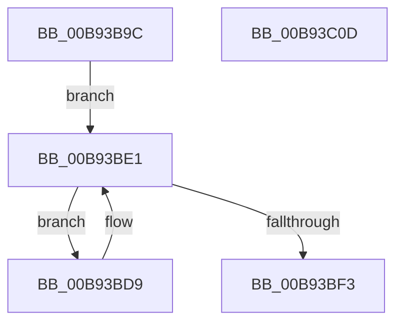

# VfAvlDeleteAllTreeNodes

- RVA: `0x00B93B9C`–`0x00B93C0E` (길이 `114` bytes)
- VA: `0x0000000140B93B9C`
- 실행 섹션: `PAGEVRFY`
- PDB 이름 있음: `예`; PDB Function 태그: `아니요`
- unwind 정보 RVA: `0x000697A4`
- 디코드: `32`개 명령, `114/114` bytes 표시
- 미해석 바이트: `0` (있으면 어셈블리에 `.byte`로 보존)

> 이 문서는 커널 이미지의 기계어와 PDB 기호를 분석해 생성했습니다. 4번과 5번은 함수 원형과 자료형을 바이너리 사용 방식에서 추정한 C 해석이며 원본 소스 복구 결과는 아닙니다.

## 1. Dependencies

- 직접 호출 지점: **7**; 고유 호출 대상: **7**
- 직접 호출자로 확인된 함수: **2**
- RIP 상대 이미지 참조: **0**

### Outgoing calls
- `0x00B93BBB` → [VfAvlInitializeLockContext](../../text/4A/VfAvlInitializeLockContext_function_004A686C.md) (function, `0x004A686C`)
- `0x00B93BC5` → [ViAvlRaiseIrqlSafe](../../text/3E/ViAvlRaiseIrqlSafe_function_003EF404.md) (function, `0x003EF404`)
- `0x00B93BD2` → [ViAvlAcquireTableLockAtDpcLevelSafe](../../text/3E/ViAvlAcquireTableLockAtDpcLevelSafe_function_003EF3A0.md) (function, `0x003EF3A0`)
- `0x00B93BDC` → [RtlDeleteElementGenericTableAvl](../../text/3E/RtlDeleteElementGenericTableAvl_function_003EE750.md) (function, `0x003EE750`)
- `0x00B93BE6` → [RtlEnumerateGenericTableAvl](../../text/3E/RtlEnumerateGenericTableAvl_function_003E5AB0.md) (function, `0x003E5AB0`)
- `0x00B93BF8` → [ViAvlReleaseTableLockFromDpcLevel](../../text/3E/ViAvlReleaseTableLockFromDpcLevel_function_003EF5D0.md) (function, `0x003EF5D0`)
- `0x00B93C02` → [VfAvlCleanupLockContext](../../text/3E/VfAvlCleanupLockContext_function_003EF56C.md) (function, `0x003EF56C`)

### Direct callers
- [VfDeleteLookasideTree](../BA/VfDeleteLookasideTree_function_00BAFE08.md) at `0x00BAFE13`
- [VfDeleteResourceTree](../BB/VfDeleteResourceTree_function_00BB1974.md) at `0x00BB197F`

### Static image references
- 디코드된 RIP-relative 메모리 참조가 없습니다.

## 2. Other-region calls and transfers

- 다른 실행 섹션으로 향하는 call: **7**
  - `0x00B93BBB` → [VfAvlInitializeLockContext](../../text/4A/VfAvlInitializeLockContext_function_004A686C.md) (`PAGEVRFY` → `.text`)
  - `0x00B93BC5` → [ViAvlRaiseIrqlSafe](../../text/3E/ViAvlRaiseIrqlSafe_function_003EF404.md) (`PAGEVRFY` → `.text`)
  - `0x00B93BD2` → [ViAvlAcquireTableLockAtDpcLevelSafe](../../text/3E/ViAvlAcquireTableLockAtDpcLevelSafe_function_003EF3A0.md) (`PAGEVRFY` → `.text`)
  - `0x00B93BDC` → [RtlDeleteElementGenericTableAvl](../../text/3E/RtlDeleteElementGenericTableAvl_function_003EE750.md) (`PAGEVRFY` → `.text`)
  - `0x00B93BE6` → [RtlEnumerateGenericTableAvl](../../text/3E/RtlEnumerateGenericTableAvl_function_003E5AB0.md) (`PAGEVRFY` → `.text`)
  - `0x00B93BF8` → [ViAvlReleaseTableLockFromDpcLevel](../../text/3E/ViAvlReleaseTableLockFromDpcLevel_function_003EF5D0.md) (`PAGEVRFY` → `.text`)
  - `0x00B93C02` → [VfAvlCleanupLockContext](../../text/3E/VfAvlCleanupLockContext_function_003EF56C.md) (`PAGEVRFY` → `.text`)
- 별도 외부 분기/꼬리 이동을 확인하지 못했습니다.

## 3. Assembly (complete function range)

```asm
00B93B9C  40 53                           push rbx
00B93B9E  48 83 EC 40                     sub rsp, 0x40
00B93BA2  0F 57 C0                        xorps xmm0, xmm0
00B93BA5  33 C0                           xor eax, eax
00B93BA7  48 8B D9                        mov rbx, rcx
00B93BAA  48 89 44 24 30                  mov qword ptr [rsp + 0x30], rax
00B93BAF  48 8D 4C 24 20                  lea rcx, [rsp + 0x20]
00B93BB4  33 D2                           xor edx, edx
00B93BB6  0F 11 44 24 20                  movups xmmword ptr [rsp + 0x20], xmm0
00B93BBB  E8 AC 2C 91 FF                  call 0x1404a686c
00B93BC0  48 8D 4C 24 20                  lea rcx, [rsp + 0x20]
00B93BC5  E8 3A B8 85 FF                  call 0x1403ef404
00B93BCA  48 8D 54 24 20                  lea rdx, [rsp + 0x20]
00B93BCF  48 8B CB                        mov rcx, rbx
00B93BD2  E8 C9 B7 85 FF                  call 0x1403ef3a0
00B93BD7  EB 08                           jmp 0x140b93be1
00B93BD9  48 8B D0                        mov rdx, rax
00B93BDC  E8 6F AB 85 FF                  call 0x1403ee750
00B93BE1  B2 01                           mov dl, 1
00B93BE3  48 8B CB                        mov rcx, rbx
00B93BE6  E8 C5 1E 85 FF                  call 0x1403e5ab0
00B93BEB  48 8B CB                        mov rcx, rbx
00B93BEE  48 85 C0                        test rax, rax
00B93BF1  75 E6                           jne 0x140b93bd9
00B93BF3  48 8D 54 24 20                  lea rdx, [rsp + 0x20]
00B93BF8  E8 D3 B9 85 FF                  call 0x1403ef5d0
00B93BFD  48 8D 4C 24 20                  lea rcx, [rsp + 0x20]
00B93C02  E8 65 B9 85 FF                  call 0x1403ef56c
00B93C07  48 83 C4 40                     add rsp, 0x40
00B93C0B  5B                              pop rbx
00B93C0C  C3                              ret
00B93C0D  CC                              int3
```

## 4. C-style interpretation (structured pseudocode)

```c
__int64 __fastcall VfAvlDeleteAllTreeNodes(__int64 a1, int a2)
{
    __int64 result;
    __int64 v_rsp;
    unsigned __int64 v_stack_m18;
    unsigned __int64 v_stack_m28;

    v_rsp = (v_rsp) - (64);
    result = 0;
    v_stack_m18 = 0;
    a2 = 0;
    v_stack_m28 = v_xmm0;
    result = VfAvlInitializeLockContext(v_stack_m28, a2, a3, a4);
    result = ViAvlRaiseIrqlSafe(v_stack_m28, a2, a3, a4);
    result = ViAvlAcquireTableLockAtDpcLevelSafe(a1, v_stack_m28, a3, a4);
    goto loc_00B93BE1;
loc_00B93BD9:
    result = RtlDeleteElementGenericTableAvl(a1, result, a3, a4);
loc_00B93BE1:
    result = RtlEnumerateGenericTableAvl(a1, 1, a3, a4);
    if (result != 0) goto loc_00B93BD9;
    result = ViAvlReleaseTableLockFromDpcLevel(a1, v_stack_m28, a3, a4);
    result = VfAvlCleanupLockContext(v_stack_m28, v_stack_m28, a3, a4);
    v_rsp = (v_rsp) + (64);
    return result;
}
```

## 5. (Beta) C Style

```c
int64_t VfAvlDeleteAllTreeNodes(int64_t Arg1, int32_t Arg2)
{
    int64_t result;
    int64_t local_rsp;
    uint64_t v_stack_m18;
    uint64_t v_stack_m28;

    local_rsp = (local_rsp) - (64);
    result = 0;
    v_stack_m18 = 0;
    Arg2 = 0;
    v_stack_m28 = v_xmm0;
    result = VfAvlInitializeLockContext(v_stack_m28, Arg2, a3, a4);
    result = ViAvlRaiseIrqlSafe(v_stack_m28, Arg2, a3, a4);
    result = ViAvlAcquireTableLockAtDpcLevelSafe(Arg1, v_stack_m28, a3, a4);
    goto loc_00B93BE1;
loc_00B93BD9:
    result = RtlDeleteElementGenericTableAvl(Arg1, result, a3, a4);
loc_00B93BE1:
    result = RtlEnumerateGenericTableAvl(Arg1, 1, a3, a4);
    if (result != 0) goto loc_00B93BD9;
    result = ViAvlReleaseTableLockFromDpcLevel(Arg1, v_stack_m28, a3, a4);
    result = VfAvlCleanupLockContext(v_stack_m28, v_stack_m28, a3, a4);
    local_rsp = (local_rsp) + (64);
    return result;
}
```

## 6. Execution-region graph

[열기: 2D/3D 그래프와 함수 탐색 컨트롤 패널](../../../control-panel.html?section=pagevrfy&rva=0x00B93B9C&view=graph)

- 2D 그래프는 위에서 아래로 흐르고, 3D 그래프는 빈 공간을 드래그해 회전합니다. Shift+드래그는 이동, 휠은 확대·축소, 함수 노드 선택은 대상 보고서 이동입니다.

### Static fallback


