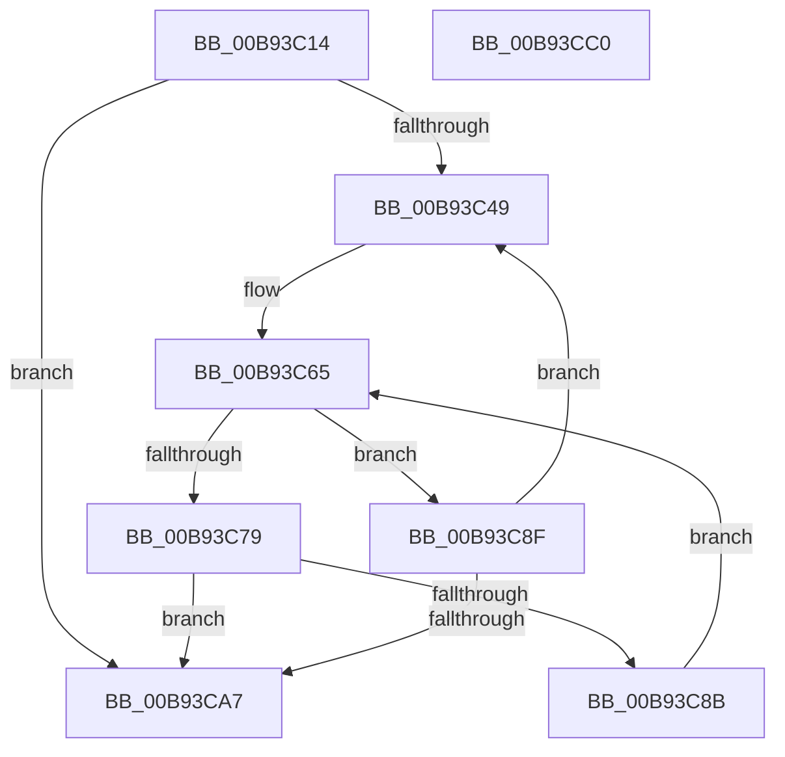

# VfAvlEnumerateNodes

- RVA: `0x00B93C14`–`0x00B93CC1` (길이 `173` bytes)
- VA: `0x0000000140B93C14`
- 실행 섹션: `PAGEVRFY`
- PDB 이름 있음: `예`; PDB Function 태그: `아니요`
- unwind 정보 RVA: `0x00060300`
- 디코드: `52`개 명령, `173/173` bytes 표시
- 미해석 바이트: `0` (있으면 어셈블리에 `.byte`로 보존)

> 이 문서는 커널 이미지의 기계어와 PDB 기호를 분석해 생성했습니다. 4번과 5번은 함수 원형과 자료형을 바이너리 사용 방식에서 추정한 C 해석이며 원본 소스 복구 결과는 아닙니다.

## 1. Dependencies

- 직접 호출 지점: **5**; 고유 호출 대상: **5**
- 직접 호출자로 확인된 함수: **3**
- RIP 상대 이미지 참조: **2**

### Outgoing calls
- `0x00B93C38` → [ViAvlRaiseIrqlSafe](../../text/3E/ViAvlRaiseIrqlSafe_function_003EF404.md) (function, `0x003EF404`)
- `0x00B93C5E` → [ViAvlAcquireTableLockAtDpcLevelSafe](../../text/3E/ViAvlAcquireTableLockAtDpcLevelSafe_function_003EF3A0.md) (function, `0x003EF3A0`)
- `0x00B93C6F` → [RtlEnumerateGenericTableAvl](../../text/3E/RtlEnumerateGenericTableAvl_function_003E5AB0.md) (function, `0x003E5AB0`)
- `0x00B93C82` → [guard_dispatch_icall](../../text/6B/guard_dispatch_icall_function_006BAAD0.md) (function, `0x006BAAD0`)
- `0x00B93C9C` → [ViAvlReleaseTableLockFromDpcLevel](../../text/3E/ViAvlReleaseTableLockFromDpcLevel_function_003EF5D0.md) (function, `0x003EF5D0`)

### Direct callers
- [VfTargetFreeContiguousMemory](VfTargetFreeContiguousMemory_function_00B9B6BC.md) at `0x00B9B72E`
- [ViTargetWMIDeregister](ViTargetWMIDeregister_function_00B9BC28.md) at `0x00B9BC9C`
- [VfSuspectDriversGetVerifierInformation](../BA/VfSuspectDriversGetVerifierInformation_function_00BAA884.md) at `0x00BAAA4C`

### Static image references
- `0x00B93C3D` → RVA `0x00F049B8` (`.data`; read)
- `0x00B93C49` → RVA `0x00F049B0` (`.data`; read)

## 2. Other-region calls and transfers

- 다른 실행 섹션으로 향하는 call: **5**
  - `0x00B93C38` → [ViAvlRaiseIrqlSafe](../../text/3E/ViAvlRaiseIrqlSafe_function_003EF404.md) (`PAGEVRFY` → `.text`)
  - `0x00B93C5E` → [ViAvlAcquireTableLockAtDpcLevelSafe](../../text/3E/ViAvlAcquireTableLockAtDpcLevelSafe_function_003EF3A0.md) (`PAGEVRFY` → `.text`)
  - `0x00B93C6F` → [RtlEnumerateGenericTableAvl](../../text/3E/RtlEnumerateGenericTableAvl_function_003E5AB0.md) (`PAGEVRFY` → `.text`)
  - `0x00B93C82` → [guard_dispatch_icall](../../text/6B/guard_dispatch_icall_function_006BAAD0.md) (`PAGEVRFY` → `.text`)
  - `0x00B93C9C` → [ViAvlReleaseTableLockFromDpcLevel](../../text/3E/ViAvlReleaseTableLockFromDpcLevel_function_003EF5D0.md) (`PAGEVRFY` → `.text`)
- 별도 외부 분기/꼬리 이동을 확인하지 못했습니다.

## 3. Assembly (complete function range)

```asm
00B93C14  48 89 5C 24 08                  mov qword ptr [rsp + 8], rbx
00B93C19  48 89 6C 24 10                  mov qword ptr [rsp + 0x10], rbp
00B93C1E  48 89 74 24 18                  mov qword ptr [rsp + 0x18], rsi
00B93C23  57                              push rdi
00B93C24  41 56                           push r14
00B93C26  41 57                           push r15
00B93C28  48 83 EC 20                     sub rsp, 0x20
00B93C2C  48 8B CA                        mov rcx, rdx
00B93C2F  4D 8B F1                        mov r14, r9
00B93C32  4D 8B F8                        mov r15, r8
00B93C35  48 8B F2                        mov rsi, rdx
00B93C38  E8 C7 B7 85 FF                  call 0x1403ef404
00B93C3D  8B 2D 75 0D 37 00               mov ebp, dword ptr [rip + 0x370d75]
00B93C43  33 DB                           xor ebx, ebx
00B93C45  85 ED                           test ebp, ebp
00B93C47  74 5E                           je 0x140b93ca7
00B93C49  48 8B 0D 60 0D 37 00            mov rcx, qword ptr [rip + 0x370d60]
00B93C50  48 8D 3C 5B                     lea rdi, [rbx + rbx*2]
00B93C54  48 C1 E7 06                     shl rdi, 6
00B93C58  48 8B D6                        mov rdx, rsi
00B93C5B  48 03 CF                        add rcx, rdi
00B93C5E  E8 3D B7 85 FF                  call 0x1403ef3a0
00B93C63  B2 01                           mov dl, 1
00B93C65  48 8B 0D 44 0D 37 00            mov rcx, qword ptr [rip + 0x370d44]
00B93C6C  48 03 CF                        add rcx, rdi
00B93C6F  E8 3C 1E 85 FF                  call 0x1403e5ab0
00B93C74  48 85 C0                        test rax, rax
00B93C77  74 16                           je 0x140b93c8f
00B93C79  48 8B C8                        mov rcx, rax
00B93C7C  49 8B D6                        mov rdx, r14
00B93C7F  49 8B C7                        mov rax, r15
00B93C82  E8 49 6E B2 FF                  call 0x1406baad0
00B93C87  85 C0                           test eax, eax
00B93C89  74 1C                           je 0x140b93ca7
00B93C8B  33 D2                           xor edx, edx
00B93C8D  EB D6                           jmp 0x140b93c65
00B93C8F  48 8B 0D 1A 0D 37 00            mov rcx, qword ptr [rip + 0x370d1a]
00B93C96  48 8B D6                        mov rdx, rsi
00B93C99  48 03 CF                        add rcx, rdi
00B93C9C  E8 2F B9 85 FF                  call 0x1403ef5d0
00B93CA1  FF C3                           inc ebx
00B93CA3  3B DD                           cmp ebx, ebp
00B93CA5  72 A2                           jb 0x140b93c49
00B93CA7  48 8B 5C 24 40                  mov rbx, qword ptr [rsp + 0x40]
00B93CAC  48 8B 6C 24 48                  mov rbp, qword ptr [rsp + 0x48]
00B93CB1  48 8B 74 24 50                  mov rsi, qword ptr [rsp + 0x50]
00B93CB6  48 83 C4 20                     add rsp, 0x20
00B93CBA  41 5F                           pop r15
00B93CBC  41 5E                           pop r14
00B93CBE  5F                              pop rdi
00B93CBF  C3                              ret
00B93CC0  CC                              int3
```

## 4. C-style interpretation (structured pseudocode)

```c
__int64 __fastcall VfAvlEnumerateNodes(__int64 a1, __int64 a2, __int64 a3, __int64 a4)
{
    __int64 result;
    __int64 v_rbx;
    __int64 v_rdi;
    __int64 v_rsp;
    unsigned __int64 v_stack_p10;
    unsigned __int64 v_stack_p18;
    unsigned __int64 v_stack_p8;

    v_stack_p8 = v_rbx;
    v_stack_p10 = v_rbp;
    v_stack_p18 = v_rsi;
    v_rsp = (v_rsp) - (32);
    result = ViAvlRaiseIrqlSafe(a2, a2, a3, a4);
    v_rbx = 0;
    if ((unsigned int)((unsigned int)(*(unsigned int *)(v_rip + 3607925))) == 0) goto loc_00B93CA7;
loc_00B93C49:
    v_rdi = (v_rbx + v_rbx * 2) << (6);
    a1 = (*(unsigned __int64 *)(v_rip + 3607904)) + (v_rdi);
    result = ViAvlAcquireTableLockAtDpcLevelSafe(a1, a2, a3, a4);
loc_00B93C65:
    a1 = (*(unsigned __int64 *)(v_rip + 3607876)) + (v_rdi);
    result = RtlEnumerateGenericTableAvl(a1, 1, a3, a4);
    if (result == 0) goto loc_00B93C8F;
    result = guard_dispatch_icall(result, a4, a3, a4);
    if ((unsigned int)(result) == 0) goto loc_00B93CA7;
    a2 = 0;
    goto loc_00B93C65;
loc_00B93C8F:
    a1 = (*(unsigned __int64 *)(v_rip + 3607834)) + (v_rdi);
    result = ViAvlReleaseTableLockFromDpcLevel(a1, 0, a3, a4);
    v_rbx = (unsigned int)((v_rbx) + 1);
    if (((unsigned int)(v_rbx)) < ((unsigned int)((unsigned int)(*(unsigned int *)(v_rip + 3607925))))) goto loc_00B93C49;
loc_00B93CA7:
    v_rsp = (v_rsp) + (32);
    return result;
}
```

## 5. (Beta) C Style

```c
int64_t VfAvlEnumerateNodes(int64_t Arg1, int64_t Arg2, int64_t Arg3, int64_t Arg4)
{
    int64_t result;
    int64_t local_rbx;
    int64_t local_rdi;
    int64_t local_rsp;
    uint64_t v_stack_p10;
    uint64_t v_stack_p18;
    uint64_t v_stack_p8;

    v_stack_p8 = local_rbx;
    v_stack_p10 = local_rbp;
    v_stack_p18 = local_rsi;
    local_rsp = (local_rsp) - (32);
    result = ViAvlRaiseIrqlSafe(Arg2, Arg2, Arg3, Arg4);
    local_rbx = 0;
    if ((uint32_t)((uint32_t)(*(uint32_t *)(v_rip + 0x370D75))) == 0) goto loc_00B93CA7;
loc_00B93C49:
    local_rdi = (local_rbx + local_rbx * 2) << (6);
    Arg1 = (*(uint64_t *)(v_rip + 0x370D60)) + (local_rdi);
    result = ViAvlAcquireTableLockAtDpcLevelSafe(Arg1, Arg2, Arg3, Arg4);
loc_00B93C65:
    Arg1 = (*(uint64_t *)(v_rip + 0x370D44)) + (local_rdi);
    result = RtlEnumerateGenericTableAvl(Arg1, 1, Arg3, Arg4);
    if (result == 0) goto loc_00B93C8F;
    result = guard_dispatch_icall(result, Arg4, Arg3, Arg4);
    if ((uint32_t)(result) == 0) goto loc_00B93CA7;
    Arg2 = 0;
    goto loc_00B93C65;
loc_00B93C8F:
    Arg1 = (*(uint64_t *)(v_rip + 0x370D1A)) + (local_rdi);
    result = ViAvlReleaseTableLockFromDpcLevel(Arg1, 0, Arg3, Arg4);
    local_rbx = (uint32_t)((local_rbx) + 1);
    if (((uint32_t)(local_rbx)) < ((uint32_t)((uint32_t)(*(uint32_t *)(v_rip + 0x370D75))))) goto loc_00B93C49;
loc_00B93CA7:
    local_rsp = (local_rsp) + (32);
    return result;
}
```

## 6. Execution-region graph

[열기: 2D/3D 그래프와 함수 탐색 컨트롤 패널](../../../control-panel.html?section=pagevrfy&rva=0x00B93C14&view=graph)

- 2D 그래프는 위에서 아래로 흐르고, 3D 그래프는 빈 공간을 드래그해 회전합니다. Shift+드래그는 이동, 휠은 확대·축소, 함수 노드 선택은 대상 보고서 이동입니다.

### Static fallback


