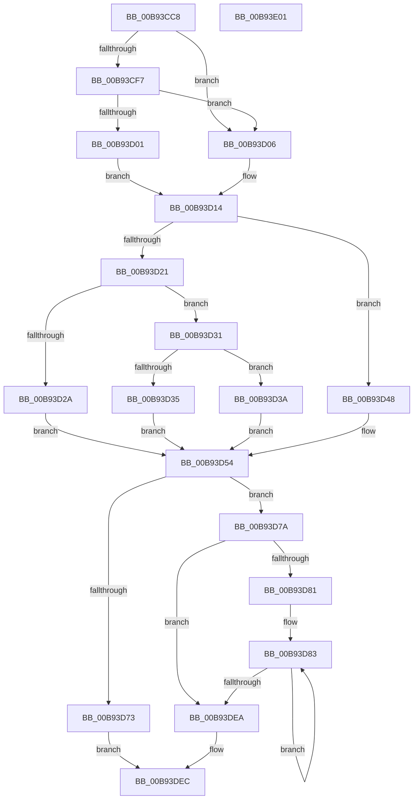

# VfAvlInitializeTreeEx

- RVA: `0x00B93CC8`–`0x00B93E02` (길이 `314` bytes)
- VA: `0x0000000140B93CC8`
- 실행 섹션: `PAGEVRFY`
- PDB 이름 있음: `예`; PDB Function 태그: `아니요`
- unwind 정보 RVA: `0x00066400`
- 디코드: `82`개 명령, `314/314` bytes 표시
- 미해석 바이트: `0` (있으면 어셈블리에 `.byte`로 보존)

> 이 문서는 커널 이미지의 기계어와 PDB 기호를 분석해 생성했습니다. 4번과 5번은 함수 원형과 자료형을 바이너리 사용 방식에서 추정한 C 해석이며 원본 소스 복구 결과는 아닙니다.

## 1. Dependencies

- 직접 호출 지점: **3**; 고유 호출 대상: **3**
- 직접 호출자로 확인된 함수: **2**
- RIP 상대 이미지 참조: **3**

### Outgoing calls
- `0x00B93D21` → [HalQueryMaximumProcessorCount](../../text/4A/HalQueryMaximumProcessorCount_function_004AC9A0.md) (function, `0x004AC9A0`)
- `0x00B93D65` → [ExAllocatePool2](../../poolcode/B8/ExAllocatePool2_function_00B820F0.md) (function, `0x00B820F0`)
- `0x00B93DD3` → [RtlInitializeGenericTableAvl](../../text/46/RtlInitializeGenericTableAvl_function_00466100.md) (function, `0x00466100`)

### Direct callers
- [VfAvlInitializeTree](../../text/61/VfAvlInitializeTree_function_00612704.md) at `0x00612708`
- [VfInitBootDriversLoaded](../../init/C4/VfInitBootDriversLoaded_function_00C4BD0C.md) at `0x00C4BE28`

### Static image references
- `0x00B93CF7` → RVA `0x00F04860` (`.data`; read)
- `0x00B93D87` → RVA `0x004BE5C0` (`ViAvlAllocateNode`; read)
- `0x00B93D96` → RVA `0x004993D0` (`ViAvlCompareNode`; read)

## 2. Other-region calls and transfers

- 다른 실행 섹션으로 향하는 call: **3**
  - `0x00B93D21` → [HalQueryMaximumProcessorCount](../../text/4A/HalQueryMaximumProcessorCount_function_004AC9A0.md) (`PAGEVRFY` → `.text`)
  - `0x00B93D65` → [ExAllocatePool2](../../poolcode/B8/ExAllocatePool2_function_00B820F0.md) (`PAGEVRFY` → `POOLCODE`)
  - `0x00B93DD3` → [RtlInitializeGenericTableAvl](../../text/46/RtlInitializeGenericTableAvl_function_00466100.md) (`PAGEVRFY` → `.text`)
- 별도 외부 분기/꼬리 이동을 확인하지 못했습니다.

## 3. Assembly (complete function range)

```asm
00B93CC8  48 89 5C 24 08                  mov qword ptr [rsp + 8], rbx
00B93CCD  48 89 6C 24 10                  mov qword ptr [rsp + 0x10], rbp
00B93CD2  48 89 74 24 18                  mov qword ptr [rsp + 0x18], rsi
00B93CD7  57                              push rdi
00B93CD8  48 83 EC 30                     sub rsp, 0x30
00B93CDC  48 C7 41 08 00 00 00 00         mov qword ptr [rcx + 8], 0
00B93CE4  49 8B E9                        mov rbp, r9
00B93CE7  48 89 11                        mov qword ptr [rcx], rdx
00B93CEA  48 8B D9                        mov rbx, rcx
00B93CED  BF 20 00 00 00                  mov edi, 0x20
00B93CF2  45 85 C0                        test r8d, r8d
00B93CF5  75 0F                           jne 0x140b93d06
00B93CF7  8B 05 63 0B 37 00               mov eax, dword ptr [rip + 0x370b63]
00B93CFD  85 C0                           test eax, eax
00B93CFF  74 05                           je 0x140b93d06
00B93D01  8D 47 E1                        lea eax, [rdi - 0x1f]
00B93D04  EB 0E                           jmp 0x140b93d14
00B93D06  45 85 C0                        test r8d, r8d
00B93D09  B8 10 00 00 00                  mov eax, 0x10
00B93D0E  41 0F 45 C0                     cmovne eax, r8d
00B93D12  03 C7                           add eax, edi
00B93D14  89 41 1C                        mov dword ptr [rcx + 0x1c], eax
00B93D17  BE 40 00 00 00                  mov esi, 0x40
00B93D1C  48 85 D2                        test rdx, rdx
00B93D1F  74 27                           je 0x140b93d48
00B93D21  E8 7A 8C 91 FF                  call 0x1404ac9a0
00B93D26  3B C6                           cmp eax, esi
00B93D28  72 07                           jb 0x140b93d31
00B93D2A  89 73 18                        mov dword ptr [rbx + 0x18], esi
00B93D2D  8B FE                           mov edi, esi
00B93D2F  EB 23                           jmp 0x140b93d54
00B93D31  3B C7                           cmp eax, edi
00B93D33  72 05                           jb 0x140b93d3a
00B93D35  89 7B 18                        mov dword ptr [rbx + 0x18], edi
00B93D38  EB 1A                           jmp 0x140b93d54
00B93D3A  C7 43 18 10 00 00 00            mov dword ptr [rbx + 0x18], 0x10
00B93D41  BF 10 00 00 00                  mov edi, 0x10
00B93D46  EB 0C                           jmp 0x140b93d54
00B93D48  C7 41 18 01 00 00 00            mov dword ptr [rcx + 0x18], 1
00B93D4F  BF 01 00 00 00                  mov edi, 1
00B93D54  48 8D 14 7F                     lea rdx, [rdi + rdi*2]
00B93D58  41 B8 56 66 41 54               mov r8d, 0x54416656
00B93D5E  48 C1 E2 06                     shl rdx, 6
00B93D62  48 8B CE                        mov rcx, rsi
00B93D65  E8 86 E3 FE FF                  call 0x140b820f0
00B93D6A  48 89 43 10                     mov qword ptr [rbx + 0x10], rax
00B93D6E  48 85 C0                        test rax, rax
00B93D71  75 07                           jne 0x140b93d7a
00B93D73  B8 17 00 00 C0                  mov eax, 0xc0000017
00B93D78  EB 72                           jmp 0x140b93dec
00B93D7A  33 F6                           xor esi, esi
00B93D7C  39 73 18                        cmp dword ptr [rbx + 0x18], esi
00B93D7F  76 69                           jbe 0x140b93dea
00B93D81  33 FF                           xor edi, edi
00B93D83  48 8B 43 10                     mov rax, qword ptr [rbx + 0x10]
00B93D87  4C 8D 05 32 A8 92 FF            lea r8, [rip - 0x6d57ce]
00B93D8E  4C 8B CD                        mov r9, rbp
00B93D91  48 89 5C 24 20                  mov qword ptr [rsp + 0x20], rbx
00B93D96  48 8D 15 33 56 90 FF            lea rdx, [rip - 0x6fa9cd]
00B93D9D  48 83 64 07 68 00               and qword ptr [rdi + rax + 0x68], 0
00B93DA3  48 8B 43 10                     mov rax, qword ptr [rbx + 0x10]
00B93DA7  C7 84 07 80 00 00 00 00 00 00 00  mov dword ptr [rdi + rax + 0x80], 0
00B93DB2  48 8B 43 10                     mov rax, qword ptr [rbx + 0x10]
00B93DB6  48 83 64 07 70 00               and qword ptr [rdi + rax + 0x70], 0
00B93DBC  48 8B 43 10                     mov rax, qword ptr [rbx + 0x10]
00B93DC0  48 C7 84 07 88 00 00 00 00 00 00 00  mov qword ptr [rdi + rax + 0x88], 0
00B93DCC  48 8B 4B 10                     mov rcx, qword ptr [rbx + 0x10]
00B93DD0  48 03 CF                        add rcx, rdi
00B93DD3  E8 28 23 8D FF                  call 0x140466100
00B93DD8  8B 43 18                        mov eax, dword ptr [rbx + 0x18]
00B93DDB  48 FF C6                        inc rsi
00B93DDE  48 81 C7 C0 00 00 00            add rdi, 0xc0
00B93DE5  48 3B F0                        cmp rsi, rax
00B93DE8  72 99                           jb 0x140b93d83
00B93DEA  33 C0                           xor eax, eax
00B93DEC  48 8B 5C 24 40                  mov rbx, qword ptr [rsp + 0x40]
00B93DF1  48 8B 6C 24 48                  mov rbp, qword ptr [rsp + 0x48]
00B93DF6  48 8B 74 24 50                  mov rsi, qword ptr [rsp + 0x50]
00B93DFB  48 83 C4 30                     add rsp, 0x30
00B93DFF  5F                              pop rdi
00B93E00  C3                              ret
00B93E01  CC                              int3
```

## 4. C-style interpretation (structured pseudocode)

```c
__int64 __fastcall VfAvlInitializeTreeEx(__int64 a1, __int64 a2, int a3, __int64 a4)
{
    __int64 result;
    __int64 v_rdi;
    __int64 v_rsi;
    __int64 v_rsp;
    unsigned __int64 v_stack_m18;
    unsigned __int64 v_stack_p10;
    unsigned __int64 v_stack_p18;
    unsigned __int64 v_stack_p8;

    v_stack_p8 = v_rbx;
    v_stack_p10 = v_rbp;
    v_stack_p18 = v_rsi;
    v_rsp = (v_rsp) - (48);
    *(unsigned __int64 *)(a1 + 8) = 0;
    *(unsigned __int64 *)(a1) = a2;
    if (a3 != 0) goto loc_00B93D06;
    if ((unsigned int)((unsigned int)(*(unsigned int *)(v_rip + 3607395))) == 0) goto loc_00B93D06;
    goto loc_00B93D14;
loc_00B93D06:
    result = 16;
    if (a3 != 0) { result = a3; }
    result = (unsigned int)((result) + (32));
loc_00B93D14:
    *(unsigned int *)(a1 + 28) = (unsigned int)(result);
    if (a2 == 0) goto loc_00B93D48;
    result = HalQueryMaximumProcessorCount(a1, a2, a3, a4);
    if (((unsigned int)(result)) < 64) goto loc_00B93D31;
    *(unsigned int *)(a1 + 24) = 64;
    goto loc_00B93D54;
loc_00B93D31:
    if (((unsigned int)(result)) < 64) goto loc_00B93D3A;
    *(unsigned int *)(a1 + 24) = 64;
    goto loc_00B93D54;
loc_00B93D3A:
    *(unsigned int *)(a1 + 24) = 16;
    goto loc_00B93D54;
loc_00B93D48:
    *(unsigned int *)(a1 + 24) = 1;
loc_00B93D54:
    a2 = (1 + 1 * 2) << (6);
    result = ExAllocatePool2(64, a2, (unsigned int)(0x54416656ULL), a4);
    *(unsigned __int64 *)(a1 + 16) = result;
    if (result != 0) goto loc_00B93D7A;
    goto loc_00B93DEC;
loc_00B93D7A:
    v_rsi = 0;
    if ((*(unsigned int *)(a1 + 24)) <= 0) goto loc_00B93DEA;
    v_rdi = 0;
loc_00B93D83:
    v_stack_m18 = a1;
    *(unsigned int *)(v_rdi + *(unsigned __int64 *)(a1 + 16) * 1 + 128) = 0;
    *(unsigned __int64 *)(v_rdi + *(unsigned __int64 *)(a1 + 16) * 1 + 136) = 0;
    a1 = (*(unsigned __int64 *)(a1 + 16)) + (0);
    result = RtlInitializeGenericTableAvl(a1, v_rip - 7317965, v_rip - 7165902, a4);
    v_rsi = (v_rsi) + 1;
    v_rdi = (v_rdi) + (192);
    if (v_rsi < ((unsigned int)(*(unsigned int *)(a1 + 24)))) goto loc_00B93D83;
loc_00B93DEA:
    result = 0;
loc_00B93DEC:
    v_rsp = (v_rsp) + (48);
    return result;
}
```

## 5. (Beta) C Style

```c
int64_t VfAvlInitializeTreeEx(void *Arg1, int64_t Arg2, int32_t Arg3, int64_t Arg4)
{
    uint8_t *arg1 = (uint8_t *)Arg1;

    int64_t result;
    int64_t local_rdi;
    int64_t local_rsi;
    int64_t local_rsp;
    uint64_t v_stack_m18;
    uint64_t v_stack_p10;
    uint64_t v_stack_p18;
    uint64_t v_stack_p8;

    v_stack_p8 = local_rbx;
    v_stack_p10 = local_rbp;
    v_stack_p18 = local_rsi;
    local_rsp = (local_rsp) - (48);
    *(uint64_t *)(arg1 + 0x8) = 0;
    *(uint64_t *)(arg1) = Arg2;
    if (Arg3 != 0) goto loc_00B93D06;
    if ((uint32_t)((uint32_t)(*(uint32_t *)(v_rip + 0x370B63))) == 0) goto loc_00B93D06;
    goto loc_00B93D14;
loc_00B93D06:
    result = 16;
    if (Arg3 != 0) { result = Arg3; }
    result = (uint32_t)((result) + (32));
loc_00B93D14:
    *(uint32_t *)(arg1 + 0x1C) = (uint32_t)(result);
    if (Arg2 == 0) goto loc_00B93D48;
    result = HalQueryMaximumProcessorCount(Arg1, Arg2, Arg3, Arg4);
    if (((uint32_t)(result)) < 64) goto loc_00B93D31;
    *(uint32_t *)(arg1 + 0x18) = 64;
    goto loc_00B93D54;
loc_00B93D31:
    if (((uint32_t)(result)) < 64) goto loc_00B93D3A;
    *(uint32_t *)(arg1 + 0x18) = 64;
    goto loc_00B93D54;
loc_00B93D3A:
    *(uint32_t *)(arg1 + 0x18) = 16;
    goto loc_00B93D54;
loc_00B93D48:
    *(uint32_t *)(arg1 + 0x18) = 1;
loc_00B93D54:
    Arg2 = (1 + 1 * 2) << (6);
    result = ExAllocatePool2(64, Arg2, (uint32_t)(0x54416656ULL), Arg4);
    *(uint64_t *)(arg1 + 0x10) = result;
    if (result != 0) goto loc_00B93D7A;
    goto loc_00B93DEC;
loc_00B93D7A:
    local_rsi = 0;
    if ((*(uint32_t *)(arg1 + 0x18)) <= 0) goto loc_00B93DEA;
    local_rdi = 0;
loc_00B93D83:
    v_stack_m18 = Arg1;
    *(uint32_t *)(local_rdi + *(uint64_t *)(arg1 + 0x10) * 1 + 0x80) = 0;
    *(uint64_t *)(local_rdi + *(uint64_t *)(arg1 + 0x10) * 1 + 0x88) = 0;
    Arg1 = (*(uint64_t *)(arg1 + 0x10)) + (0);
    result = RtlInitializeGenericTableAvl(Arg1, v_rip - 7317965, v_rip - 7165902, Arg4);
    local_rsi = (local_rsi) + 1;
    local_rdi = (local_rdi) + (192);
    if (local_rsi < ((uint32_t)(*(uint32_t *)(arg1 + 0x18)))) goto loc_00B93D83;
loc_00B93DEA:
    result = 0;
loc_00B93DEC:
    local_rsp = (local_rsp) + (48);
    return result;
}
```

### 관측된 메모리 오프셋

구조체 형식이 확인되지 않은 접근은 인자 기준의 오프셋으로만 기록했습니다.

| 기준 인자 | 오프셋 표현 | 폭 (bit) | 접근 |
|---|---:|---:|---|
| `Arg1` | `+ 0x0` | `64` | `W` |
| `Arg1` | `+ 0x8` | `64` | `W` |
| `Arg1` | `+ 0x10` | `64` | `R` |
| `Arg1` | `+ 0x10` | `64` | `W` |
| `Arg1` | `+ 0x18` | `32` | `R` |
| `Arg1` | `+ 0x18` | `32` | `W` |
| `Arg1` | `+ 0x1C` | `32` | `W` |

## 6. Execution-region graph

[열기: 2D/3D 그래프와 함수 탐색 컨트롤 패널](../../../control-panel.html?section=pagevrfy&rva=0x00B93CC8&view=graph)

- 2D 그래프는 위에서 아래로 흐르고, 3D 그래프는 빈 공간을 드래그해 회전합니다. Shift+드래그는 이동, 휠은 확대·축소, 함수 노드 선택은 대상 보고서 이동입니다.

### Static fallback


