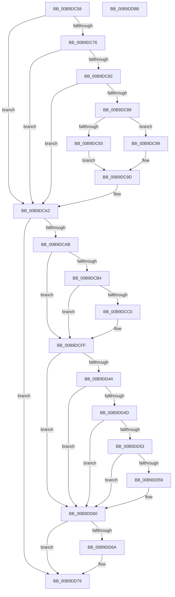

# VfBeforeCallDriver

- RVA: `0x00B9DC58`–`0x00B9DD8C` (길이 `308` bytes)
- VA: `0x0000000140B9DC58`
- 실행 섹션: `PAGEVRFY`
- PDB 이름 있음: `예`; PDB Function 태그: `아니요`
- unwind 정보 RVA: `0x00060BC4`
- 디코드: `74`개 명령, `308/308` bytes 표시
- 미해석 바이트: `0` (있으면 어셈블리에 `.byte`로 보존)

> 이 문서는 커널 이미지의 기계어와 PDB 기호를 분석해 생성했습니다. 4번과 5번은 함수 원형과 자료형을 바이너리 사용 방식에서 추정한 C 해석이며 원본 소스 복구 결과는 아닙니다.

## 1. Dependencies

- 직접 호출 지점: **6**; 고유 호출 대상: **6**
- 직접 호출자로 확인된 함수: **3**
- RIP 상대 이미지 참조: **8**

### Outgoing calls
- `0x00B9DC9D` → [ViIrpCheckKernelAddressForIrp](ViIrpCheckKernelAddressForIrp_function_00B9E218.md) (function, `0x00B9E218`)
- `0x00B9DCAB` → [KeAreInterruptsEnabled](../../text/2F/KeAreInterruptsEnabled_function_002F8060.md) (function, `0x002F8060`)
- `0x00B9DCC7` → [KeAcquireSpinLockRaiseToDpc](../../text/20/KeAcquireSpinLockRaiseToDpc_function_00208470.md) (function, `0x00208470`)
- `0x00B9DCF9` → [VfBugCheckNoStackUsage](../../text/61/VfBugCheckNoStackUsage_function_00613F98.md) (function, `0x00613F98`)
- `0x00B9DD0E` → [VfGetPristineDispatchRoutine](VfGetPristineDispatchRoutine_function_00B9D87C.md) (function, `0x00B9D87C`)
- `0x00B9DD74` → [IovpCallDriver1](IovpCallDriver1_function_00B9CCA4.md) (function, `0x00B9CCA4`)

### Direct callers
- [IovpCallDriverNoIrpTracking](IovpCallDriverNoIrpTracking_function_00B928F8.md) at `0x00B9290B`
- [IovpCallDriverWithStackBuffer](IovpCallDriverWithStackBuffer_function_00B92940.md) at `0x00B92A88`
- [sub_00BBC34E](../BB/Unknown_function_00BBC34E.md) at `0x00BBC4C8`

### Static image references
- `0x00B9DC76` → RVA `0x00F04A20` (`.data`; read)
- `0x00B9DCB4` → RVA `0x00E681A0` (`.data`; read)
- `0x00B9DCC0` → RVA `0x00FFDA70` (`PAGEVRFD`; read)
- `0x00B9DCD5` → RVA `0x00FFDA48` (`PAGEVRFD`; read)
- `0x00B9DCDC` → RVA `0x00FFDA30` (`PAGEVRFD`; write)
- `0x00B9DCE7` → RVA `0x00FFDA38` (`PAGEVRFD`; write)
- `0x00B9DCF2` → RVA `0x00FFDA40` (`PAGEVRFD`; write)
- `0x00B9DD60` → RVA `0x00FF4000` (`PAGEVRFD`; read)

## 2. Other-region calls and transfers

- 다른 실행 섹션으로 향하는 call: **3**
  - `0x00B9DCAB` → [KeAreInterruptsEnabled](../../text/2F/KeAreInterruptsEnabled_function_002F8060.md) (`PAGEVRFY` → `.text`)
  - `0x00B9DCC7` → [KeAcquireSpinLockRaiseToDpc](../../text/20/KeAcquireSpinLockRaiseToDpc_function_00208470.md) (`PAGEVRFY` → `.text`)
  - `0x00B9DCF9` → [VfBugCheckNoStackUsage](../../text/61/VfBugCheckNoStackUsage_function_00613F98.md) (`PAGEVRFY` → `.text`)
- 별도 외부 분기/꼬리 이동을 확인하지 못했습니다.

## 3. Assembly (complete function range)

```asm
00B9DC58  48 89 5C 24 08                  mov qword ptr [rsp + 8], rbx
00B9DC5D  48 89 74 24 10                  mov qword ptr [rsp + 0x10], rsi
00B9DC62  57                              push rdi
00B9DC63  48 83 EC 20                     sub rsp, 0x20
00B9DC67  80 7A 40 01                     cmp byte ptr [rdx + 0x40], 1
00B9DC6B  49 8B D8                        mov rbx, r8
00B9DC6E  48 8B FA                        mov rdi, rdx
00B9DC71  48 8B F1                        mov rsi, rcx
00B9DC74  74 2C                           je 0x140b9dca2
00B9DC76  F7 05 A0 6D 36 00 00 01 00 00   test dword ptr [rip + 0x366da0], 0x100
00B9DC80  74 20                           je 0x140b9dca2
00B9DC82  48 83 7A 08 00                  cmp qword ptr [rdx + 8], 0
00B9DC87  75 19                           jne 0x140b9dca2
00B9DC89  8B 42 10                        mov eax, dword ptr [rdx + 0x10]
00B9DC8C  48 8B CA                        mov rcx, rdx
00B9DC8F  A8 10                           test al, 0x10
00B9DC91  74 06                           je 0x140b9dc99
00B9DC93  48 8B 52 18                     mov rdx, qword ptr [rdx + 0x18]
00B9DC97  EB 04                           jmp 0x140b9dc9d
00B9DC99  48 8B 52 70                     mov rdx, qword ptr [rdx + 0x70]
00B9DC9D  E8 76 05 00 00                  call 0x140b9e218
00B9DCA2  48 85 DB                        test rbx, rbx
00B9DCA5  0F 84 CE 00 00 00               je 0x140b9dd79
00B9DCAB  E8 B0 A3 75 FF                  call 0x1402f8060
00B9DCB0  84 C0                           test al, al
00B9DCB2  75 4B                           jne 0x140b9dcff
00B9DCB4  F7 05 E2 A4 2C 00 00 00 40 00   test dword ptr [rip + 0x2ca4e2], 0x400000
00B9DCBE  75 3F                           jne 0x140b9dcff
00B9DCC0  48 8D 0D A9 FD 45 00            lea rcx, [rip + 0x45fda9]
00B9DCC7  E8 A4 A7 66 FF                  call 0x140208470
00B9DCCC  0F 57 C0                        xorps xmm0, xmm0
00B9DCCF  88 83 9D 00 00 00               mov byte ptr [rbx + 0x9d], al
00B9DCD5  0F 11 05 6C FD 45 00            movups xmmword ptr [rip + 0x45fd6c], xmm0
00B9DCDC  48 C7 05 49 FD 45 00 C4 00 00 00  mov qword ptr [rip + 0x45fd49], 0xc4
00B9DCE7  48 C7 05 46 FD 45 00 C0 00 00 00  mov qword ptr [rip + 0x45fd46], 0xc0
00B9DCF2  48 89 3D 47 FD 45 00            mov qword ptr [rip + 0x45fd47], rdi
00B9DCF9  E8 9A 62 A7 FF                  call 0x140613f98
00B9DCFE  CC                              int3
00B9DCFF  48 8B 87 B8 00 00 00            mov rax, qword ptr [rdi + 0xb8]
00B9DD06  48 8B 4E 08                     mov rcx, qword ptr [rsi + 8]
00B9DD0A  0F B6 50 B8                     movzx edx, byte ptr [rax - 0x48]
00B9DD0E  E8 69 FB FF FF                  call 0x140b9d87c
00B9DD13  48 89 43 30                     mov qword ptr [rbx + 0x30], rax
00B9DD17  44 0F 20 C0                     mov rax, cr8
00B9DD1B  88 83 9C 00 00 00               mov byte ptr [rbx + 0x9c], al
00B9DD21  65 48 8B 04 25 88 01 00 00      mov rax, qword ptr gs:[0x188]
00B9DD2A  8B 88 E4 01 00 00               mov ecx, dword ptr [rax + 0x1e4]
00B9DD30  89 8B BC 00 00 00               mov dword ptr [rbx + 0xbc], ecx
00B9DD36  0F BE 4F 42                     movsx ecx, byte ptr [rdi + 0x42]
00B9DD3A  0F BE 47 43                     movsx eax, byte ptr [rdi + 0x43]
00B9DD3E  FF C1                           inc ecx
00B9DD40  3B C1                           cmp eax, ecx
00B9DD42  75 1C                           jne 0x140b9dd60
00B9DD44  48 8B 47 50                     mov rax, qword ptr [rdi + 0x50]
00B9DD48  48 85 C0                        test rax, rax
00B9DD4B  74 13                           je 0x140b9dd60
00B9DD4D  80 7F 40 00                     cmp byte ptr [rdi + 0x40], 0
00B9DD51  75 0D                           jne 0x140b9dd60
00B9DD53  83 78 04 00                     cmp dword ptr [rax + 4], 0
00B9DD57  74 07                           je 0x140b9dd60
00B9DD59  83 8B 98 00 00 00 02            or dword ptr [rbx + 0x98], 2
00B9DD60  8B 05 9A 62 45 00               mov eax, dword ptr [rip + 0x45629a]
00B9DD66  85 C0                           test eax, eax
00B9DD68  75 0F                           jne 0x140b9dd79
00B9DD6A  83 8B 98 00 00 00 01            or dword ptr [rbx + 0x98], 1
00B9DD71  48 8B CB                        mov rcx, rbx
00B9DD74  E8 2B EF FF FF                  call 0x140b9cca4
00B9DD79  48 8B 5C 24 30                  mov rbx, qword ptr [rsp + 0x30]
00B9DD7E  33 C0                           xor eax, eax
00B9DD80  48 8B 74 24 38                  mov rsi, qword ptr [rsp + 0x38]
00B9DD85  48 83 C4 20                     add rsp, 0x20
00B9DD89  5F                              pop rdi
00B9DD8A  C3                              ret
00B9DD8B  CC                              int3
```

## 4. C-style interpretation (structured pseudocode)

```c
__int64 __fastcall VfBeforeCallDriver(__int64 a1, __int64 a2, __int64 a3)
{
    __int64 result;
    __int64 v_rsp;
    unsigned __int64 v_stack_p10;
    unsigned __int64 v_stack_p8;

    v_stack_p8 = v_rbx;
    v_stack_p10 = v_rsi;
    v_rsp = (v_rsp) - (32);
    if ((*(unsigned __int8 *)(a2 + 64)) == 1) goto loc_00B9DCA2;
    if (((*(unsigned int *)(v_rip + 3567008)) & (256)) == 0) goto loc_00B9DCA2;
    if ((*(unsigned __int64 *)(a2 + 8)) != 0) goto loc_00B9DCA2;
    if ((((unsigned __int8)((unsigned int)(*(unsigned int *)(a2 + 16)))) & (16)) == 0) goto loc_00B9DC99;
    goto loc_00B9DC9D;
loc_00B9DC99:
loc_00B9DC9D:
    result = ViIrpCheckKernelAddressForIrp(a2, *(unsigned __int64 *)(*(unsigned __int64 *)(a2 + 24) + 112), a3, a4);
loc_00B9DCA2:
    if (a3 == 0) goto loc_00B9DD79;
    result = KeAreInterruptsEnabled(a2, *(unsigned __int64 *)(*(unsigned __int64 *)(a2 + 24) + 112), a3, a4);
    if ((unsigned __int8)(result) != 0) goto loc_00B9DCFF;
    if (((*(unsigned int *)(v_rip + 2925794)) & (0x400000ULL)) == 0) {
        a1 = v_rip + 4586921;
        result = KeAcquireSpinLockRaiseToDpc(a1, *(unsigned __int64 *)(*(unsigned __int64 *)(a2 + 24) + 112), a3, a4);
        *(unsigned __int8 *)(a3 + 157) = (unsigned __int8)(result);
        *(unsigned __int64 *)(v_rip + 4586860) = v_xmm0;
        *(unsigned __int64 *)(v_rip + 4586825) = 196;
        *(unsigned __int64 *)(v_rip + 4586822) = 192;
        *(unsigned __int64 *)(v_rip + 4586823) = a2;
        result = VfBugCheckNoStackUsage(a1, *(unsigned __int64 *)(*(unsigned __int64 *)(a2 + 24) + 112), a3, a4);
    }
    result = VfGetPristineDispatchRoutine(*(unsigned __int64 *)(a1 + 8), *(unsigned __int8 *)(*(unsigned __int64 *)(a2 + 184) - 72), a3, a4);
    *(unsigned __int64 *)(a3 + 48) = result;
    *(unsigned __int8 *)(a3 + 156) = (unsigned __int8)(v_cr8);
    *(unsigned int *)(a3 + 188) = (unsigned int)((unsigned int)(*(unsigned int *)(*(unsigned __int64 *)(gs_base + (0 + 392)) + 484)));
    a1 = (unsigned int)(((__int8)(*(unsigned __int8 *)(a2 + 66))) + 1);
    if (((unsigned int)((__int8)(*(unsigned __int8 *)(a2 + 67)))) != ((unsigned int)(a1))) goto loc_00B9DD60;
    if (*(unsigned __int64 *)(a2 + 80) == 0) goto loc_00B9DD60;
    if ((*(unsigned __int8 *)(a2 + 64)) != 0) goto loc_00B9DD60;
    if ((*(unsigned int *)(*(unsigned __int64 *)(a2 + 80) + 4)) != 0) {
    }
    result = (unsigned int)(*(unsigned int *)(v_rip + 4547226));
    if ((unsigned int)((unsigned int)(*(unsigned int *)(v_rip + 4547226))) == 0) {
        a1 = a3;
        result = IovpCallDriver1(a1, *(unsigned __int8 *)(*(unsigned __int64 *)(a2 + 184) - 72), a3, a4);
    }
    result = 0;
    v_rsp = (v_rsp) + (32);
    return result;
}
```

## 5. (Beta) C Style

```c
int64_t VfBeforeCallDriver(void *Arg1, void *Arg2, int64_t Arg3)
{
    uint8_t *arg1 = (uint8_t *)Arg1;
    uint8_t *arg2 = (uint8_t *)Arg2;

    int64_t result;
    int64_t local_rsp;
    uint64_t v_stack_p10;
    uint64_t v_stack_p8;

    v_stack_p8 = local_rbx;
    v_stack_p10 = local_rsi;
    local_rsp = (local_rsp) - (32);
    if ((*(uint8_t *)(arg2 + 0x40)) == 1) goto loc_00B9DCA2;
    if (((*(uint32_t *)(v_rip + 0x366DA0)) & (256)) == 0) goto loc_00B9DCA2;
    if ((*(uint64_t *)(arg2 + 0x8)) != 0) goto loc_00B9DCA2;
    if ((((uint8_t)((uint32_t)(*(uint32_t *)(arg2 + 0x10)))) & (16)) == 0) goto loc_00B9DC99;
    goto loc_00B9DC9D;
loc_00B9DC99:
loc_00B9DC9D:
    result = ViIrpCheckKernelAddressForIrp(Arg2, *(uint64_t *)(*(uint64_t *)(arg2 + 0x18) + 0x70), Arg3, a4);
loc_00B9DCA2:
    if (Arg3 == 0) goto loc_00B9DD79;
    result = KeAreInterruptsEnabled(Arg2, *(uint64_t *)(*(uint64_t *)(arg2 + 0x18) + 0x70), Arg3, a4);
    if ((uint8_t)(result) != 0) goto loc_00B9DCFF;
    if (((*(uint32_t *)(v_rip + 0x2CA4E2)) & (0x400000ULL)) == 0) {
        Arg1 = v_rip + 4586921;
        result = KeAcquireSpinLockRaiseToDpc(Arg1, *(uint64_t *)(*(uint64_t *)(arg2 + 0x18) + 0x70), Arg3, a4);
        *(uint8_t *)(Arg3 + 0x9D) = (uint8_t)(result);
        *(uint64_t *)(v_rip + 0x45FD6C) = v_xmm0;
        *(uint64_t *)(v_rip + 0x45FD49) = 196;
        *(uint64_t *)(v_rip + 0x45FD46) = 192;
        *(void **)(v_rip + 0x45FD47) = Arg2;
        result = VfBugCheckNoStackUsage(Arg1, *(uint64_t *)(*(uint64_t *)(arg2 + 0x18) + 0x70), Arg3, a4);
    }
    result = VfGetPristineDispatchRoutine(*(uint64_t *)(arg1 + 0x8), *(uint8_t *)(*(uint64_t *)(arg2 + 0xB8) - 0x48), Arg3, a4);
    *(uint64_t *)(Arg3 + 0x30) = result;
    *(uint8_t *)(Arg3 + 0x9C) = (uint8_t)(v_cr8);
    *(uint32_t *)(Arg3 + 0xBC) = (uint32_t)((uint32_t)(*(uint32_t *)(*(uint64_t *)(gs_base + (0 + 0x188)) + 0x1E4)));
    Arg1 = (uint32_t)(((int8_t)(*(uint8_t *)(arg2 + 0x42))) + 1);
    if (((uint32_t)((int8_t)(*(uint8_t *)(arg2 + 0x43)))) != ((uint32_t)(Arg1))) goto loc_00B9DD60;
    if (*(uint64_t *)(arg2 + 0x50) == 0) goto loc_00B9DD60;
    if ((*(uint8_t *)(arg2 + 0x40)) != 0) goto loc_00B9DD60;
    if ((*(uint32_t *)(*(uint64_t *)(arg2 + 0x50) + 0x4)) != 0) {
    }
    result = (uint32_t)(*(uint32_t *)(v_rip + 0x45629A));
    if ((uint32_t)((uint32_t)(*(uint32_t *)(v_rip + 0x45629A))) == 0) {
        Arg1 = Arg3;
        result = IovpCallDriver1(Arg1, *(uint8_t *)(*(uint64_t *)(arg2 + 0xB8) - 0x48), Arg3, a4);
    }
    result = 0;
    local_rsp = (local_rsp) + (32);
    return result;
}
```

### 관측된 메모리 오프셋

구조체 형식이 확인되지 않은 접근은 인자 기준의 오프셋으로만 기록했습니다.

| 기준 인자 | 오프셋 표현 | 폭 (bit) | 접근 |
|---|---:|---:|---|
| `Arg1` | `+ 0x8` | `64` | `R` |
| `Arg2` | `+ 0x8` | `64` | `R` |
| `Arg2` | `+ 0x10` | `32` | `R` |
| `Arg2` | `+ 0x18` | `64` | `R` |
| `Arg2` | `+ 0x40` | `8` | `R` |
| `Arg2` | `+ 0x42` | `8` | `R` |
| `Arg2` | `+ 0x43` | `8` | `R` |
| `Arg2` | `+ 0x50` | `64` | `R` |
| `Arg2` | `+ 0x70` | `64` | `R` |
| `Arg2` | `+ 0xB8` | `64` | `R` |

## 6. Execution-region graph

[열기: 2D/3D 그래프와 함수 탐색 컨트롤 패널](../../../control-panel.html?section=pagevrfy&rva=0x00B9DC58&view=graph)

- 2D 그래프는 위에서 아래로 흐르고, 3D 그래프는 빈 공간을 드래그해 회전합니다. Shift+드래그는 이동, 휠은 확대·축소, 함수 노드 선택은 대상 보고서 이동입니다.

### Static fallback


