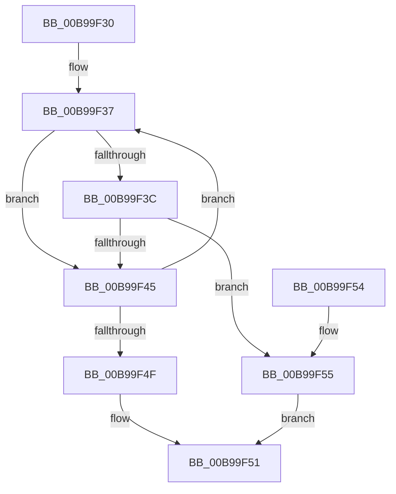

# VfBindDifCallbackWrappers

- RVA: `0x00B99F30`–`0x00B99F69` (길이 `57` bytes)
- VA: `0x0000000140B99F30`
- 실행 섹션: `PAGEVRFY`
- PDB 이름 있음: `예`; PDB Function 태그: `아니요`
- unwind 정보 RVA: `0x000DB714`
- 디코드: `19`개 명령, `57/57` bytes 표시
- 미해석 바이트: `0` (있으면 어셈블리에 `.byte`로 보존)

> 이 문서는 커널 이미지의 기계어와 PDB 기호를 분석해 생성했습니다. 4번과 5번은 함수 원형과 자료형을 바이너리 사용 방식에서 추정한 C 해석이며 원본 소스 복구 결과는 아닙니다.

## 1. Dependencies

- 직접 호출 지점: **0**; 고유 호출 대상: **0**
- 직접 호출자로 확인된 함수: **1**
- RIP 상대 이미지 참조: **1**

### Outgoing calls
- 직접 디코드된 call 명령이 없습니다.

### Direct callers
- [DifRegisterPlugin](../../text/61/DifRegisterPlugin_function_0061ABE0.md) at `0x0061AE05`

### Static image references
- `0x00B99F30` → RVA `0x00FF4210` (`PAGEVRFD`; read)

## 2. Other-region calls and transfers

- 다른 실행 섹션으로 향하는 call: **0**
- 별도 외부 분기/꼬리 이동을 확인하지 못했습니다.

## 3. Assembly (complete function range)

```asm
00B99F30  48 8D 05 D9 A2 45 00            lea rax, [rip + 0x45a2d9]
00B99F37  39 48 18                        cmp dword ptr [rax + 0x18], ecx
00B99F3A  75 09                           jne 0x140b99f45
00B99F3C  4C 8B 48 10                     mov r9, qword ptr [rax + 0x10]
00B99F40  4D 85 C9                        test r9, r9
00B99F43  75 10                           jne 0x140b99f55
00B99F45  48 83 C0 20                     add rax, 0x20
00B99F49  48 83 38 00                     cmp qword ptr [rax], 0
00B99F4D  75 E8                           jne 0x140b99f37
00B99F4F  32 C9                           xor cl, cl
00B99F51  8A C1                           mov al, cl
00B99F53  C3                              ret
00B99F54  CC                              int3
00B99F55  49 89 11                        mov qword ptr [r9], rdx
00B99F58  B9 01 00 00 00                  mov ecx, 1
00B99F5D  09 48 08                        or dword ptr [rax + 8], ecx
00B99F60  8B 40 08                        mov eax, dword ptr [rax + 8]
00B99F63  41 09 40 0C                     or dword ptr [r8 + 0xc], eax
00B99F67  EB E8                           jmp 0x140b99f51
```

## 4. C-style interpretation (structured pseudocode)

```c
__int64 __fastcall VfBindDifCallbackWrappers(int a1, __int64 a2, __int64 a3)
{
    __int64 result;

loc_00B99F37:
    if ((*(unsigned int *)(v_rip + 4563673 + 24)) != a1) goto loc_00B99F45;
    if (*(unsigned __int64 *)(v_rip + 4563673 + 16) != 0) goto loc_00B99F55;
loc_00B99F45:
    result = (v_rip + 4563673) + (32);
    if ((*(unsigned __int64 *)(result)) != 0) goto loc_00B99F37;
    a1 = 0;
loc_00B99F51:
    return 0;
loc_00B99F55:
    *(unsigned __int64 *)(*(unsigned __int64 *)(v_rip + 4563673 + 16)) = a2;
    goto loc_00B99F51;
}
```

## 5. (Beta) C Style

```c
int64_t VfBindDifCallbackWrappers(int32_t Arg1, int64_t Arg2, void *Arg3)
{
    uint8_t *arg3 = (uint8_t *)Arg3;

    int64_t result;

loc_00B99F37:
    if ((*(uint32_t *)(v_rip + 0x45A2D9 + 0x18)) != Arg1) goto loc_00B99F45;
    if (*(uint64_t *)(v_rip + 0x45A2D9 + 0x10) != 0) goto loc_00B99F55;
loc_00B99F45:
    result = (v_rip + 4563673) + (32);
    if ((*(uint64_t *)(result)) != 0) goto loc_00B99F37;
    Arg1 = 0;
loc_00B99F51:
    return 0;
loc_00B99F55:
    *(uint64_t *)(*(uint64_t *)(v_rip + 0x45A2D9 + 0x10)) = Arg2;
    goto loc_00B99F51;
}
```

### 관측된 메모리 오프셋

구조체 형식이 확인되지 않은 접근은 인자 기준의 오프셋으로만 기록했습니다.

| 기준 인자 | 오프셋 표현 | 폭 (bit) | 접근 |
|---|---:|---:|---|
| `Arg3` | `+ 0xC` | `32` | `R/W` |

## 6. Execution-region graph

[열기: 2D/3D 그래프와 함수 탐색 컨트롤 패널](../../../control-panel.html?section=pagevrfy&rva=0x00B99F30&view=graph)

- 2D 그래프는 위에서 아래로 흐르고, 3D 그래프는 빈 공간을 드래그해 회전합니다. Shift+드래그는 이동, 휠은 확대·축소, 함수 노드 선택은 대상 보고서 이동입니다.

### Static fallback


