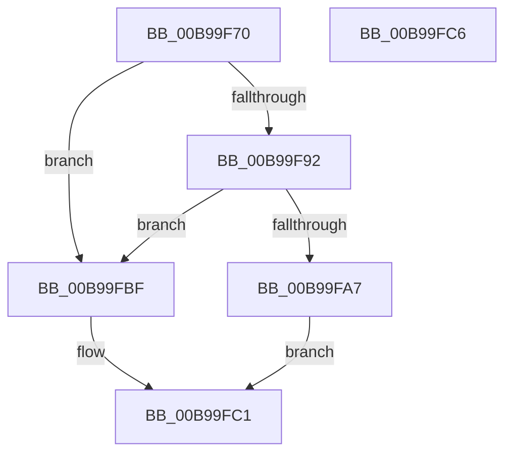

# VfBindDifDDIWrappers

- RVA: `0x00B99F70`–`0x00B99FC7` (길이 `87` bytes)
- VA: `0x0000000140B99F70`
- 실행 섹션: `PAGEVRFY`
- PDB 이름 있음: `예`; PDB Function 태그: `아니요`
- unwind 정보 RVA: `0x0005D2F4`
- 디코드: `24`개 명령, `87/87` bytes 표시
- 미해석 바이트: `0` (있으면 어셈블리에 `.byte`로 보존)

> 이 문서는 커널 이미지의 기계어와 PDB 기호를 분석해 생성했습니다. 4번과 5번은 함수 원형과 자료형을 바이너리 사용 방식에서 추정한 C 해석이며 원본 소스 복구 결과는 아닙니다.

## 1. Dependencies

- 직접 호출 지점: **3**; 고유 호출 대상: **1**
- 직접 호출자로 확인된 함수: **1**
- RIP 상대 이미지 참조: **3**

### Outgoing calls
- `0x00B99F89` → [ViBindDifThunkNormal](ViBindDifThunkNormal_function_00B9A6A0.md) (function, `0x00B9A6A0`)
- `0x00B99F9E` → [ViBindDifThunkNormal](ViBindDifThunkNormal_function_00B9A6A0.md) (function, `0x00B9A6A0`)
- `0x00B99FB3` → [ViBindDifThunkNormal](ViBindDifThunkNormal_function_00B9A6A0.md) (function, `0x00B9A6A0`)

### Direct callers
- [DifRegisterPlugin](../../text/61/DifRegisterPlugin_function_0061ABE0.md) at `0x0061ADDE`

### Static image references
- `0x00B99F82` → RVA `0x00FF5F20` (`PAGEVRFD`; read)
- `0x00B99F92` → RVA `0x00FF4A40` (`PAGEVRFD`; read)
- `0x00B99FA7` → RVA `0x00FF51B0` (`PAGEVRFD`; read)

## 2. Other-region calls and transfers

- 다른 실행 섹션으로 향하는 call: **0**
- 별도 외부 분기/꼬리 이동을 확인하지 못했습니다.

## 3. Assembly (complete function range)

```asm
00B99F70  48 83 EC 38                     sub rsp, 0x38
00B99F74  4D 8B D0                        mov r10, r8
00B99F77  4C 8B CA                        mov r9, rdx
00B99F7A  44 8B C1                        mov r8d, ecx
00B99F7D  4C 89 54 24 20                  mov qword ptr [rsp + 0x20], r10
00B99F82  48 8D 0D 97 BF 45 00            lea rcx, [rip + 0x45bf97]
00B99F89  E8 12 07 00 00                  call 0x140b9a6a0
00B99F8E  84 C0                           test al, al
00B99F90  75 2D                           jne 0x140b99fbf
00B99F92  48 8D 0D A7 AA 45 00            lea rcx, [rip + 0x45aaa7]
00B99F99  4C 89 54 24 20                  mov qword ptr [rsp + 0x20], r10
00B99F9E  E8 FD 06 00 00                  call 0x140b9a6a0
00B99FA3  84 C0                           test al, al
00B99FA5  75 18                           jne 0x140b99fbf
00B99FA7  48 8D 0D 02 B2 45 00            lea rcx, [rip + 0x45b202]
00B99FAE  4C 89 54 24 20                  mov qword ptr [rsp + 0x20], r10
00B99FB3  E8 E8 06 00 00                  call 0x140b9a6a0
00B99FB8  84 C0                           test al, al
00B99FBA  0F 95 C0                        setne al
00B99FBD  EB 02                           jmp 0x140b99fc1
00B99FBF  B0 01                           mov al, 1
00B99FC1  48 83 C4 38                     add rsp, 0x38
00B99FC5  C3                              ret
00B99FC6  CC                              int3
```

## 4. C-style interpretation (structured pseudocode)

```c
__int64 __fastcall VfBindDifDDIWrappers(int a1, __int64 a2, __int64 a3)
{
    __int64 result;
    __int64 v_rsp;
    unsigned __int64 v_stack_m18;

    v_rsp = (v_rsp) - (56);
    v_stack_m18 = a3;
    result = ViBindDifThunkNormal(v_rip + 4571031, a2, (unsigned int)(a1), a2);
    if ((unsigned __int8)(result) != 0) goto loc_00B99FBF;
    v_stack_m18 = a3;
    result = ViBindDifThunkNormal(v_rip + 4565671, a2, (unsigned int)(a1), a2);
    if ((unsigned __int8)(result) != 0) goto loc_00B99FBF;
    v_stack_m18 = a3;
    result = ViBindDifThunkNormal(v_rip + 4567554, a2, (unsigned int)(a1), a2);
    result = ((unsigned __int8)(result) != 0) ? 1 : 0;
    goto loc_00B99FC1;
loc_00B99FBF:
loc_00B99FC1:
    v_rsp = (v_rsp) + (56);
    return 1;
}
```

## 5. (Beta) C Style

```c
int64_t VfBindDifDDIWrappers(int32_t Arg1, int64_t Arg2, int64_t Arg3)
{
    int64_t result;
    int64_t local_rsp;
    uint64_t v_stack_m18;

    local_rsp = (local_rsp) - (56);
    v_stack_m18 = Arg3;
    result = ViBindDifThunkNormal(v_rip + 4571031, Arg2, (uint32_t)(Arg1), Arg2);
    if ((uint8_t)(result) != 0) goto loc_00B99FBF;
    v_stack_m18 = Arg3;
    result = ViBindDifThunkNormal(v_rip + 4565671, Arg2, (uint32_t)(Arg1), Arg2);
    if ((uint8_t)(result) != 0) goto loc_00B99FBF;
    v_stack_m18 = Arg3;
    result = ViBindDifThunkNormal(v_rip + 4567554, Arg2, (uint32_t)(Arg1), Arg2);
    result = ((uint8_t)(result) != 0) ? 1 : 0;
    goto loc_00B99FC1;
loc_00B99FBF:
loc_00B99FC1:
    local_rsp = (local_rsp) + (56);
    return 1;
}
```

## 6. Execution-region graph

[열기: 2D/3D 그래프와 함수 탐색 컨트롤 패널](../../../control-panel.html?section=pagevrfy&rva=0x00B99F70&view=graph)

- 2D 그래프는 위에서 아래로 흐르고, 3D 그래프는 빈 공간을 드래그해 회전합니다. Shift+드래그는 이동, 휠은 확대·축소, 함수 노드 선택은 대상 보고서 이동입니다.

### Static fallback


