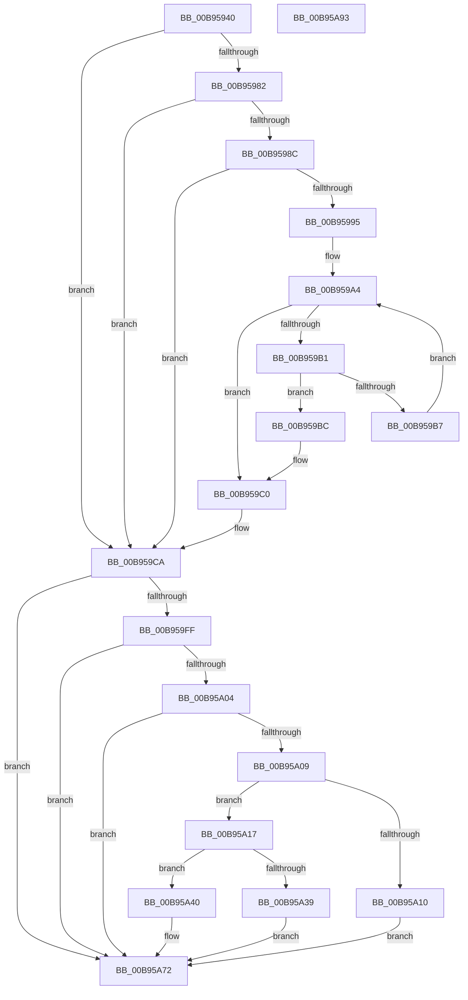

# VfBuildMdlFromScatterGatherList

- RVA: `0x00B95940`–`0x00B95A94` (길이 `340` bytes)
- VA: `0x0000000140B95940`
- 실행 섹션: `PAGEVRFY`
- PDB 이름 있음: `예`; PDB Function 태그: `아니요`
- unwind 정보 RVA: `0x000ACFA4`
- 디코드: `102`개 명령, `340/340` bytes 표시
- 미해석 바이트: `0` (있으면 어셈블리에 `.byte`로 보존)

> 이 문서는 커널 이미지의 기계어와 PDB 기호를 분석해 생성했습니다. 4번과 5번은 함수 원형과 자료형을 바이너리 사용 방식에서 추정한 C 해석이며 원본 소스 복구 결과는 아닙니다.

## 1. Dependencies

- 직접 호출 지점: **9**; 고유 호출 대상: **9**
- 직접 호출자로 확인된 함수: **0**
- RIP 상대 이미지 참조: **0**

### Outgoing calls
- `0x00B9596B` → [ViGetRealDmaAdapter](ViGetRealDmaAdapter_function_00B990DC.md) (function, `0x00B990DC`)
- `0x00B95978` → [ViGetAdapterInformationInternal](ViGetAdapterInformationInternal_function_00B98E88.md) (function, `0x00B98E88`)
- `0x00B9599C` → [KeAcquireSpinLockRaiseToDpc](../../text/20/KeAcquireSpinLockRaiseToDpc_function_00208470.md) (function, `0x00208470`)
- `0x00B959C5` → [KeReleaseSpinLock](../../text/39/KeReleaseSpinLock_function_00392BA0.md) (function, `0x00392BA0`)
- `0x00B959D0` → [VF_UNMARK_SCATTER_GATHER_LIST](VF_UNMARK_SCATTER_GATHER_LIST_function_00B95160.md) (function, `0x00B95160`)
- `0x00B959E9` → [guard_dispatch_icall](../../text/6B/guard_dispatch_icall_function_006BAAD0.md) (function, `0x006BAAD0`)
- `0x00B959F6` → [VF_MARK_SCATTER_GATHER_LIST](VF_MARK_SCATTER_GATHER_LIST_function_00B95140.md) (function, `0x00B95140`)
- `0x00B95A2C` → [IoAllocateMdl](../../text/29/IoAllocateMdl_function_0029EBF0.md) (function, `0x0029EBF0`)
- `0x00B95A58` → [memcpy](../../text/6C/memcpy_function_006C6840.md) (function, `0x006C6840`)

### Direct callers
- 이 함수 시작 RVA로 연결되는 직접 call은 확인되지 않았습니다. 간접 호출은 완전히 역산할 수 없습니다.

### Static image references
- 디코드된 RIP-relative 메모리 참조가 없습니다.

## 2. Other-region calls and transfers

- 다른 실행 섹션으로 향하는 call: **5**
  - `0x00B9599C` → [KeAcquireSpinLockRaiseToDpc](../../text/20/KeAcquireSpinLockRaiseToDpc_function_00208470.md) (`PAGEVRFY` → `.text`)
  - `0x00B959C5` → [KeReleaseSpinLock](../../text/39/KeReleaseSpinLock_function_00392BA0.md) (`PAGEVRFY` → `.text`)
  - `0x00B959E9` → [guard_dispatch_icall](../../text/6B/guard_dispatch_icall_function_006BAAD0.md) (`PAGEVRFY` → `.text`)
  - `0x00B95A2C` → [IoAllocateMdl](../../text/29/IoAllocateMdl_function_0029EBF0.md) (`PAGEVRFY` → `.text`)
  - `0x00B95A58` → [memcpy](../../text/6C/memcpy_function_006C6840.md) (`PAGEVRFY` → `.text`)
- 별도 외부 분기/꼬리 이동을 확인하지 못했습니다.

## 3. Assembly (complete function range)

```asm
00B95940  48 8B C4                        mov rax, rsp
00B95943  48 89 58 08                     mov qword ptr [rax + 8], rbx
00B95947  48 89 68 10                     mov qword ptr [rax + 0x10], rbp
00B9594B  48 89 70 18                     mov qword ptr [rax + 0x18], rsi
00B9594F  48 89 78 20                     mov qword ptr [rax + 0x20], rdi
00B95953  41 55                           push r13
00B95955  41 56                           push r14
00B95957  41 57                           push r15
00B95959  48 83 EC 30                     sub rsp, 0x30
00B9595D  4D 8B F1                        mov r14, r9
00B95960  4D 8B F8                        mov r15, r8
00B95963  48 8B EA                        mov rbp, rdx
00B95966  48 8B D9                        mov rbx, rcx
00B95969  33 F6                           xor esi, esi
00B9596B  E8 6C 37 00 00                  call 0x140b990dc
00B95970  B2 01                           mov dl, 1
00B95972  48 8B CB                        mov rcx, rbx
00B95975  4C 8B E8                        mov r13, rax
00B95978  E8 0B 35 00 00                  call 0x140b98e88
00B9597D  48 85 C0                        test rax, rax
00B95980  74 48                           je 0x140b959ca
00B95982  48 81 7D 08 0D F0 AD DE         cmp qword ptr [rbp + 8], -0x21520ff3
00B9598A  75 3E                           jne 0x140b959ca
00B9598C  48 8D 58 58                     lea rbx, [rax + 0x58]
00B95990  48 39 1B                        cmp qword ptr [rbx], rbx
00B95993  74 35                           je 0x140b959ca
00B95995  48 8D 78 68                     lea rdi, [rax + 0x68]
00B95999  48 8B CF                        mov rcx, rdi
00B9599C  E8 CF 2A 67 FF                  call 0x140208470
00B959A1  48 8B 0B                        mov rcx, qword ptr [rbx]
00B959A4  48 83 E9 48                     sub rcx, 0x48
00B959A8  48 8D 51 48                     lea rdx, [rcx + 0x48]
00B959AC  48 3B DA                        cmp rbx, rdx
00B959AF  74 0F                           je 0x140b959c0
00B959B1  48 39 69 40                     cmp qword ptr [rcx + 0x40], rbp
00B959B5  74 05                           je 0x140b959bc
00B959B7  48 8B 0A                        mov rcx, qword ptr [rdx]
00B959BA  EB E8                           jmp 0x140b959a4
00B959BC  48 8B 71 60                     mov rsi, qword ptr [rcx + 0x60]
00B959C0  8A D0                           mov dl, al
00B959C2  48 8B CF                        mov rcx, rdi
00B959C5  E8 D6 D1 7F FF                  call 0x140392ba0
00B959CA  48 8B D6                        mov rdx, rsi
00B959CD  48 8B CD                        mov rcx, rbp
00B959D0  E8 8B F7 FF FF                  call 0x140b95160
00B959D5  49 8B 4D 08                     mov rcx, qword ptr [r13 + 8]
00B959D9  4D 8B CE                        mov r9, r14
00B959DC  4D 8B C7                        mov r8, r15
00B959DF  48 8B D5                        mov rdx, rbp
00B959E2  48 8B 41 78                     mov rax, qword ptr [rcx + 0x78]
00B959E6  49 8B CD                        mov rcx, r13
00B959E9  E8 E2 50 B2 FF                  call 0x1406baad0
00B959EE  48 8B D6                        mov rdx, rsi
00B959F1  48 8B CD                        mov rcx, rbp
00B959F4  8B F8                           mov edi, eax
00B959F6  E8 45 F7 FF FF                  call 0x140b95140
00B959FB  85 FF                           test edi, edi
00B959FD  78 73                           js 0x140b95a72
00B959FF  4D 39 3E                        cmp qword ptr [r14], r15
00B95A02  75 6E                           jne 0x140b95a72
00B95A04  48 85 F6                        test rsi, rsi
00B95A07  74 69                           je 0x140b95a72
00B95A09  48 83 7E 28 00                  cmp qword ptr [rsi + 0x28], 0
00B95A0E  74 07                           je 0x140b95a17
00B95A10  BF 73 00 00 C0                  mov edi, 0xc0000073
00B95A15  EB 5B                           jmp 0x140b95a72
00B95A17  48 8B 6E 38                     mov rbp, qword ptr [rsi + 0x38]
00B95A1B  45 33 C9                        xor r9d, r9d
00B95A1E  48 83 64 24 20 00               and qword ptr [rsp + 0x20], 0
00B95A24  45 33 C0                        xor r8d, r8d
00B95A27  33 C9                           xor ecx, ecx
00B95A29  8B 55 28                        mov edx, dword ptr [rbp + 0x28]
00B95A2C  E8 BF 91 70 FF                  call 0x14029ebf0
00B95A31  48 8B D8                        mov rbx, rax
00B95A34  48 85 C0                        test rax, rax
00B95A37  75 07                           jne 0x140b95a40
00B95A39  BF 9A 00 00 C0                  mov edi, 0xc000009a
00B95A3E  EB 32                           jmp 0x140b95a72
00B95A40  48 89 5E 28                     mov qword ptr [rsi + 0x28], rbx
00B95A44  48 8D 55 30                     lea rdx, [rbp + 0x30]
00B95A48  44 8B 45 28                     mov r8d, dword ptr [rbp + 0x28]
00B95A4C  48 8D 48 30                     lea rcx, [rax + 0x30]
00B95A50  49 C1 E8 0C                     shr r8, 0xc
00B95A54  49 C1 E0 03                     shl r8, 3
00B95A58  E8 E3 0D B3 FF                  call 0x1406c6840
00B95A5D  41 8B 47 2C                     mov eax, dword ptr [r15 + 0x2c]
00B95A61  01 43 2C                        add dword ptr [rbx + 0x2c], eax
00B95A64  8B 43 2C                        mov eax, dword ptr [rbx + 0x2c]
00B95A67  29 43 28                        sub dword ptr [rbx + 0x28], eax
00B95A6A  66 83 4B 0A 02                  or word ptr [rbx + 0xa], 2
00B95A6F  49 89 1E                        mov qword ptr [r14], rbx
00B95A72  48 8B 5C 24 50                  mov rbx, qword ptr [rsp + 0x50]
00B95A77  8B C7                           mov eax, edi
00B95A79  48 8B 7C 24 68                  mov rdi, qword ptr [rsp + 0x68]
00B95A7E  48 8B 6C 24 58                  mov rbp, qword ptr [rsp + 0x58]
00B95A83  48 8B 74 24 60                  mov rsi, qword ptr [rsp + 0x60]
00B95A88  48 83 C4 30                     add rsp, 0x30
00B95A8C  41 5F                           pop r15
00B95A8E  41 5E                           pop r14
00B95A90  41 5D                           pop r13
00B95A92  C3                              ret
00B95A93  CC                              int3
```

## 4. C-style interpretation (structured pseudocode)

```c
__int64 __fastcall VfBuildMdlFromScatterGatherList(__int64 a1, __int64 a2, __int64 a3, __int64 a4)
{
    __int64 result;
    __int64 v_rsi;
    __int64 v_rsp;
    unsigned __int64 v_stack_m28;
    unsigned __int64 v_stack_p10;
    unsigned __int64 v_stack_p18;
    unsigned __int64 v_stack_p20;
    unsigned __int64 v_stack_p8;

    *(unsigned __int64 *)(v_rsp + 8) = v_rbx;
    *(unsigned __int64 *)(v_rsp + 16) = v_rbp;
    *(unsigned __int64 *)(v_rsp + 24) = v_rsi;
    *(unsigned __int64 *)(v_rsp + 32) = v_rdi;
    v_rsp = (v_rsp) - (48);
    v_rsi = 0;
    result = ViGetRealDmaAdapter(a1, a2, a3, a4);
    result = ViGetAdapterInformationInternal(a1, 1, a3, a4);
    if (result == 0) goto loc_00B959CA;
    if ((*(unsigned __int64 *)(a2 + 8)) != 0xFFFFFFFFDEADF00DULL) goto loc_00B959CA;
    if ((*(unsigned __int64 *)(result + 88)) == (result + 88)) goto loc_00B959CA;
    result = KeAcquireSpinLockRaiseToDpc(result + 104, 1, a3, a4);
loc_00B959A4:
    a1 = (*(unsigned __int64 *)(result + 88)) - (72);
    if ((result + 88) == (a1 + 72)) goto loc_00B959C0;
    if ((*(unsigned __int64 *)(a1 + 64)) == a2) goto loc_00B959BC;
    goto loc_00B959A4;
loc_00B959BC:
loc_00B959C0:
    result = KeReleaseSpinLock(result + 104, (unsigned __int8)(result), a3, a4);
loc_00B959CA:
    result = VF_UNMARK_SCATTER_GATHER_LIST(a2, *(unsigned __int64 *)(*(unsigned __int64 *)(a1 + 72) + 96), a3, a4);
    result = guard_dispatch_icall(result, a2, a3, a4);
    result = VF_MARK_SCATTER_GATHER_LIST(a2, *(unsigned __int64 *)(*(unsigned __int64 *)(a1 + 72) + 96), a3, a4);
    if (sign_flag) goto loc_00B95A72;
    if ((*(unsigned __int64 *)(a4)) != a3) goto loc_00B95A72;
    if (*(unsigned __int64 *)(*(unsigned __int64 *)(a1 + 72) + 96) == 0) goto loc_00B95A72;
    if ((*(unsigned __int64 *)(*(unsigned __int64 *)(*(unsigned __int64 *)(a1 + 72) + 96) + 40)) == 0) goto loc_00B95A17;
    goto loc_00B95A72;
loc_00B95A17:
    a4 = 0;
    a3 = 0;
    a1 = 0;
    result = IoAllocateMdl(a1, (unsigned int)(*(unsigned int *)(*(unsigned __int64 *)(*(unsigned __int64 *)(*(unsigned __int64 *)(a1 + 72) + 96) + 56) + 40)), a3, a4);
    if (result != 0) goto loc_00B95A40;
    goto loc_00B95A72;
loc_00B95A40:
    *(unsigned __int64 *)(*(unsigned __int64 *)(*(unsigned __int64 *)(a1 + 72) + 96) + 40) = result;
    a3 = ((unsigned int)(*(unsigned int *)(*(unsigned __int64 *)(*(unsigned __int64 *)(*(unsigned __int64 *)(a1 + 72) + 96) + 56) + 40))) >> (12);
    a3 = (a3) << (3);
    result = memcpy(result + 48, *(unsigned __int64 *)(*(unsigned __int64 *)(*(unsigned __int64 *)(a1 + 72) + 96) + 56) + 48, a3, a4);
    *(unsigned __int64 *)(a4) = result;
loc_00B95A72:
    v_rsp = (v_rsp) + (48);
    return (unsigned int)((unsigned int)((unsigned int)(0xC000009AULL)));
}
```

## 5. (Beta) C Style

```c
int64_t VfBuildMdlFromScatterGatherList(int64_t Arg1, void *Arg2, void *Arg3, void *Arg4)
{
    uint8_t *arg2 = (uint8_t *)Arg2;
    uint8_t *arg3 = (uint8_t *)Arg3;
    uint8_t *arg4 = (uint8_t *)Arg4;

    int64_t result;
    int64_t local_rsi;
    int64_t local_rsp;
    uint64_t v_stack_m28;
    uint64_t v_stack_p10;
    uint64_t v_stack_p18;
    uint64_t v_stack_p20;
    uint64_t v_stack_p8;

    *(uint64_t *)(local_rsp + 0x8) = local_rbx;
    *(uint64_t *)(local_rsp + 0x10) = local_rbp;
    *(uint64_t *)(local_rsp + 0x18) = local_rsi;
    *(uint64_t *)(local_rsp + 0x20) = local_rdi;
    local_rsp = (local_rsp) - (48);
    local_rsi = 0;
    result = ViGetRealDmaAdapter(Arg1, Arg2, Arg3, Arg4);
    result = ViGetAdapterInformationInternal(Arg1, 1, Arg3, Arg4);
    if (result == 0) goto loc_00B959CA;
    if ((*(uint64_t *)(arg2 + 0x8)) != 0xFFFFFFFFDEADF00DULL) goto loc_00B959CA;
    if ((*(uint64_t *)(result + 0x58)) == (result + 88)) goto loc_00B959CA;
    result = KeAcquireSpinLockRaiseToDpc(result + 104, 1, Arg3, Arg4);
loc_00B959A4:
    Arg1 = (*(uint64_t *)(result + 0x58)) - (72);
    if ((result + 88) == (Arg1 + 72)) goto loc_00B959C0;
    if ((*(uint64_t *)(Arg1 + 0x40)) == Arg2) goto loc_00B959BC;
    goto loc_00B959A4;
loc_00B959BC:
loc_00B959C0:
    result = KeReleaseSpinLock(result + 104, (uint8_t)(result), Arg3, Arg4);
loc_00B959CA:
    result = VF_UNMARK_SCATTER_GATHER_LIST(Arg2, *(uint64_t *)(*(uint64_t *)(Arg1 + 0x48) + 0x60), Arg3, Arg4);
    result = guard_dispatch_icall(result, Arg2, Arg3, Arg4);
    result = VF_MARK_SCATTER_GATHER_LIST(Arg2, *(uint64_t *)(*(uint64_t *)(Arg1 + 0x48) + 0x60), Arg3, Arg4);
    if (sign_flag) goto loc_00B95A72;
    if ((*(uint64_t *)(arg4)) != Arg3) goto loc_00B95A72;
    if (*(uint64_t *)(*(uint64_t *)(Arg1 + 0x48) + 0x60) == 0) goto loc_00B95A72;
    if ((*(uint64_t *)(*(uint64_t *)(*(uint64_t *)(Arg1 + 0x48) + 0x60) + 0x28)) == 0) goto loc_00B95A17;
    goto loc_00B95A72;
loc_00B95A17:
    Arg4 = 0;
    Arg3 = 0;
    Arg1 = 0;
    result = IoAllocateMdl(Arg1, (uint32_t)(*(uint32_t *)(*(uint64_t *)(*(uint64_t *)(*(uint64_t *)(Arg1 + 0x48) + 0x60) + 0x38) + 0x28)), Arg3, Arg4);
    if (result != 0) goto loc_00B95A40;
    goto loc_00B95A72;
loc_00B95A40:
    *(uint64_t *)(*(uint64_t *)(*(uint64_t *)(Arg1 + 0x48) + 0x60) + 0x28) = result;
    Arg3 = ((uint32_t)(*(uint32_t *)(*(uint64_t *)(*(uint64_t *)(*(uint64_t *)(Arg1 + 0x48) + 0x60) + 0x38) + 0x28))) >> (12);
    Arg3 = (Arg3) << (3);
    result = memcpy(result + 48, *(uint64_t *)(*(uint64_t *)(*(uint64_t *)(Arg1 + 0x48) + 0x60) + 0x38) + 48, Arg3, Arg4);
    *(uint64_t *)(arg4) = result;
loc_00B95A72:
    local_rsp = (local_rsp) + (48);
    return (uint32_t)((uint32_t)((uint32_t)(0xC000009AULL)));
}
```

### 관측된 메모리 오프셋

구조체 형식이 확인되지 않은 접근은 인자 기준의 오프셋으로만 기록했습니다.

| 기준 인자 | 오프셋 표현 | 폭 (bit) | 접근 |
|---|---:|---:|---|
| `Arg2` | `+ 0x8` | `64` | `R` |
| `Arg3` | `+ 0x2C` | `32` | `R` |
| `Arg4` | `+ 0x0` | `64` | `R` |
| `Arg4` | `+ 0x0` | `64` | `W` |

## 6. Execution-region graph

[열기: 2D/3D 그래프와 함수 탐색 컨트롤 패널](../../../control-panel.html?section=pagevrfy&rva=0x00B95940&view=graph)

- 2D 그래프는 위에서 아래로 흐르고, 3D 그래프는 빈 공간을 드래그해 회전합니다. Shift+드래그는 이동, 휠은 확대·축소, 함수 노드 선택은 대상 보고서 이동입니다.

### Static fallback


