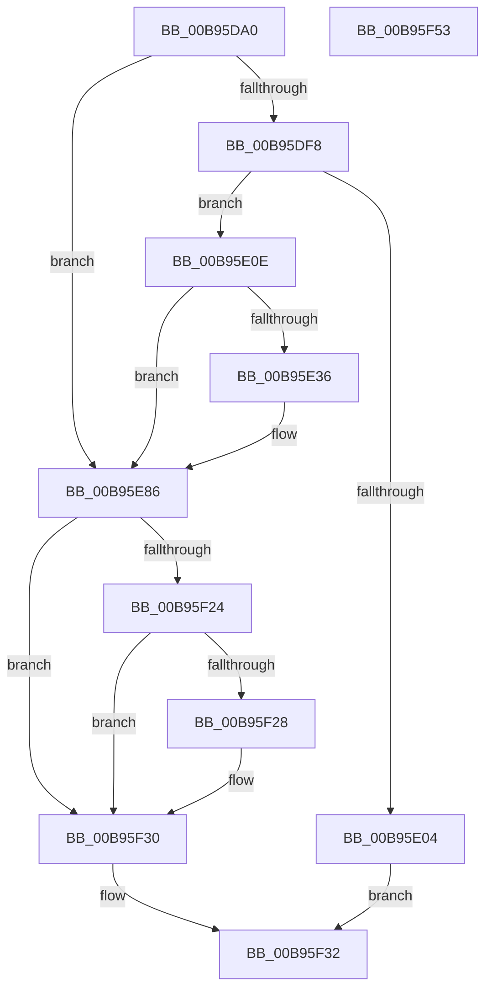

# VfBuildScatterGatherListEx

- RVA: `0x00B95DA0`–`0x00B95F54` (길이 `436` bytes)
- VA: `0x0000000140B95DA0`
- 실행 섹션: `PAGEVRFY`
- PDB 이름 있음: `예`; PDB Function 태그: `아니요`
- unwind 정보 RVA: `0x000BCF9C`
- 디코드: `103`개 명령, `436/436` bytes 표시
- 미해석 바이트: `0` (있으면 어셈블리에 `.byte`로 보존)

> 이 문서는 커널 이미지의 기계어와 PDB 기호를 분석해 생성했습니다. 4번과 5번은 함수 원형과 자료형을 바이너리 사용 방식에서 추정한 C 해석이며 원본 소스 복구 결과는 아닙니다.

## 1. Dependencies

- 직접 호출 지점: **9**; 고유 호출 대상: **9**
- 직접 호출자로 확인된 함수: **0**
- RIP 상대 이미지 참조: **2**

### Outgoing calls
- `0x00B95DCB` → [ViGetRealDmaAdapter](ViGetRealDmaAdapter_function_00B990DC.md) (function, `0x00B990DC`)
- `0x00B95DD8` → [ViGetAdapterInformationInternal](ViGetAdapterInformationInternal_function_00B98E88.md) (function, `0x00B98E88`)
- `0x00B95DFA` → [VF_ASSERT_IRQL](VF_ASSERT_IRQL_function_00B94F30.md) (function, `0x00B94F30`)
- `0x00B95E1F` → [VERIFY_BUFFER_LOCKED](VERIFY_BUFFER_LOCKED_function_00B94EA4.md) (function, `0x00B94EA4`)
- `0x00B95E2D` → [ViCheckMdlLength](ViCheckMdlLength_function_00B9841C.md) (function, `0x00B9841C`)
- `0x00B95E5B` → [ViHalPreprocessOptions](ViHalPreprocessOptions_function_00B9920C.md) (function, `0x00B9920C`)
- `0x00B95E81` → [VfReportIssueWithOptions](../../text/61/VfReportIssueWithOptions_function_00614444.md) (function, `0x00614444`)
- `0x00B95F18` → [guard_dispatch_icall](../../text/6B/guard_dispatch_icall_function_006BAAD0.md) (function, `0x006BAAD0`)
- `0x00B95F2B` → [DECREMENT_SCATTER_GATHER_LISTS](DECREMENT_SCATTER_GATHER_LISTS_function_00B94C44.md) (function, `0x00B94C44`)

### Direct callers
- 이 함수 시작 RVA로 연결되는 직접 call은 확인되지 않았습니다. 간접 호출은 완전히 역산할 수 없습니다.

### Static image references
- `0x00B95E3C` → RVA `0x00BB9C20` (` ?? ::JKADOLAD::`string'`; read)
- `0x00B95E49` → RVA `0x00E0E960` (`.data`; read)

## 2. Other-region calls and transfers

- 다른 실행 섹션으로 향하는 call: **2**
  - `0x00B95E81` → [VfReportIssueWithOptions](../../text/61/VfReportIssueWithOptions_function_00614444.md) (`PAGEVRFY` → `.text`)
  - `0x00B95F18` → [guard_dispatch_icall](../../text/6B/guard_dispatch_icall_function_006BAAD0.md) (`PAGEVRFY` → `.text`)
- 별도 외부 분기/꼬리 이동을 확인하지 못했습니다.

## 3. Assembly (complete function range)

```asm
00B95DA0  48 89 5C 24 08                  mov qword ptr [rsp + 8], rbx
00B95DA5  48 89 6C 24 10                  mov qword ptr [rsp + 0x10], rbp
00B95DAA  48 89 74 24 18                  mov qword ptr [rsp + 0x18], rsi
00B95DAF  57                              push rdi
00B95DB0  41 54                           push r12
00B95DB2  41 55                           push r13
00B95DB4  41 56                           push r14
00B95DB6  41 57                           push r15
00B95DB8  48 81 EC 80 00 00 00            sub rsp, 0x80
00B95DBF  49 8B F1                        mov rsi, r9
00B95DC2  4D 8B E0                        mov r12, r8
00B95DC5  4C 8B EA                        mov r13, rdx
00B95DC8  48 8B D9                        mov rbx, rcx
00B95DCB  E8 0C 33 00 00                  call 0x140b990dc
00B95DD0  B2 01                           mov dl, 1
00B95DD2  48 8B CB                        mov rcx, rbx
00B95DD5  4C 8B F8                        mov r15, rax
00B95DD8  E8 AB 30 00 00                  call 0x140b98e88
00B95DDD  8B AC 24 D8 00 00 00            mov ebp, dword ptr [rsp + 0xd8]
00B95DE4  48 8B F8                        mov rdi, rax
00B95DE7  4C 8B B4 24 D0 00 00 00         mov r14, qword ptr [rsp + 0xd0]
00B95DEF  48 85 C0                        test rax, rax
00B95DF2  0F 84 8E 00 00 00               je 0x140b95e86
00B95DF8  B1 02                           mov cl, 2
00B95DFA  E8 31 F1 FF FF                  call 0x140b94f30
00B95DFF  48 85 F6                        test rsi, rsi
00B95E02  75 0A                           jne 0x140b95e0e
00B95E04  B8 0D 00 00 C0                  mov eax, 0xc000000d
00B95E09  E9 24 01 00 00                  jmp 0x140b95f32
00B95E0E  F0 FF 87 C4 00 00 00            lock inc dword ptr [rdi + 0xc4]
00B95E15  F0 FF 87 C8 00 00 00            lock inc dword ptr [rdi + 0xc8]
00B95E1C  48 8B CE                        mov rcx, rsi
00B95E1F  E8 80 F0 FF FF                  call 0x140b94ea4
00B95E24  44 8B C5                        mov r8d, ebp
00B95E27  49 8B D6                        mov rdx, r14
00B95E2A  48 8B CE                        mov rcx, rsi
00B95E2D  E8 EA 25 00 00                  call 0x140b9841c
00B95E32  85 C0                           test eax, eax
00B95E34  74 50                           je 0x140b95e86
00B95E36  48 83 64 24 28 00               and qword ptr [rsp + 0x28], 0
00B95E3C  48 8D 15 DD 3D 02 00            lea rdx, [rip + 0x23ddd]
00B95E43  48 83 64 24 20 00               and qword ptr [rsp + 0x20], 0
00B95E49  48 8D 0D 10 8B 27 00            lea rcx, [rip + 0x278b10]
00B95E50  44 8B C8                        mov r9d, eax
00B95E53  41 B8 24 00 00 00               mov r8d, 0x24
00B95E59  8B D8                           mov ebx, eax
00B95E5B  E8 AC 33 00 00                  call 0x140b9920c
00B95E60  45 33 C9                        xor r9d, r9d
00B95E63  48 8D 05 F6 8A 27 00            lea rax, [rip + 0x278af6]
00B95E6A  48 89 44 24 28                  mov qword ptr [rsp + 0x28], rax
00B95E6F  44 8B C3                        mov r8d, ebx
00B95E72  48 83 64 24 20 00               and qword ptr [rsp + 0x20], 0
00B95E78  B9 E6 00 00 00                  mov ecx, 0xe6
00B95E7D  41 8D 51 24                     lea edx, [r9 + 0x24]
00B95E81  E8 BE E5 A7 FF                  call 0x140614444
00B95E86  49 8B 47 08                     mov rax, qword ptr [r15 + 8]
00B95E8A  4C 8B CE                        mov r9, rsi
00B95E8D  8A 8C 24 F8 00 00 00            mov cl, byte ptr [rsp + 0xf8]
00B95E94  4D 8B C4                        mov r8, r12
00B95E97  49 8B D5                        mov rdx, r13
00B95E9A  4C 8B 90 C8 00 00 00            mov r10, qword ptr [rax + 0xc8]
00B95EA1  48 8B 84 24 20 01 00 00         mov rax, qword ptr [rsp + 0x120]
00B95EA9  48 89 44 24 70                  mov qword ptr [rsp + 0x70], rax
00B95EAE  48 8B 84 24 18 01 00 00         mov rax, qword ptr [rsp + 0x118]
00B95EB6  48 89 44 24 68                  mov qword ptr [rsp + 0x68], rax
00B95EBB  48 8B 84 24 10 01 00 00         mov rax, qword ptr [rsp + 0x110]
00B95EC3  48 89 44 24 60                  mov qword ptr [rsp + 0x60], rax
00B95EC8  8B 84 24 08 01 00 00            mov eax, dword ptr [rsp + 0x108]
00B95ECF  89 44 24 58                     mov dword ptr [rsp + 0x58], eax
00B95ED3  48 8B 84 24 00 01 00 00         mov rax, qword ptr [rsp + 0x100]
00B95EDB  48 89 44 24 50                  mov qword ptr [rsp + 0x50], rax
00B95EE0  49 8B C2                        mov rax, r10
00B95EE3  88 4C 24 48                     mov byte ptr [rsp + 0x48], cl
00B95EE7  48 8B 8C 24 F0 00 00 00         mov rcx, qword ptr [rsp + 0xf0]
00B95EEF  48 89 4C 24 40                  mov qword ptr [rsp + 0x40], rcx
00B95EF4  48 8B 8C 24 E8 00 00 00         mov rcx, qword ptr [rsp + 0xe8]
00B95EFC  48 89 4C 24 38                  mov qword ptr [rsp + 0x38], rcx
00B95F01  8B 8C 24 E0 00 00 00            mov ecx, dword ptr [rsp + 0xe0]
00B95F08  89 4C 24 30                     mov dword ptr [rsp + 0x30], ecx
00B95F0C  49 8B CF                        mov rcx, r15
00B95F0F  89 6C 24 28                     mov dword ptr [rsp + 0x28], ebp
00B95F13  4C 89 74 24 20                  mov qword ptr [rsp + 0x20], r14
00B95F18  E8 B3 4B B2 FF                  call 0x1406baad0
00B95F1D  8B D8                           mov ebx, eax
00B95F1F  48 85 FF                        test rdi, rdi
00B95F22  74 0C                           je 0x140b95f30
00B95F24  85 C0                           test eax, eax
00B95F26  79 08                           jns 0x140b95f30
00B95F28  48 8B CF                        mov rcx, rdi
00B95F2B  E8 14 ED FF FF                  call 0x140b94c44
00B95F30  8B C3                           mov eax, ebx
00B95F32  4C 8D 9C 24 80 00 00 00         lea r11, [rsp + 0x80]
00B95F3A  49 8B 5B 30                     mov rbx, qword ptr [r11 + 0x30]
00B95F3E  49 8B 6B 38                     mov rbp, qword ptr [r11 + 0x38]
00B95F42  49 8B 73 40                     mov rsi, qword ptr [r11 + 0x40]
00B95F46  49 8B E3                        mov rsp, r11
00B95F49  41 5F                           pop r15
00B95F4B  41 5E                           pop r14
00B95F4D  41 5D                           pop r13
00B95F4F  41 5C                           pop r12
00B95F51  5F                              pop rdi
00B95F52  C3                              ret
00B95F53  CC                              int3
```

## 4. C-style interpretation (structured pseudocode)

```c
__int64 __fastcall VfBuildScatterGatherListEx(__int64 a1, __int64 a2, __int64 a3, __int64 a4, __int64 a5, unsigned int a6, unsigned int a7, __int64 a8, __int64 a9, unsigned __int8 a10, __int64 a11, unsigned int a12, __int64 a13, __int64 a14, __int64 a15)
{
    __int64 result;
    __int64 v_rbx;
    __int64 v_rsp;
    unsigned __int64 v_stack_m28;
    unsigned __int64 v_stack_m38;
    unsigned __int64 v_stack_m40;
    unsigned __int64 v_stack_m48;
    unsigned int v_stack_m50;
    unsigned __int64 v_stack_m58;
    unsigned __int8 v_stack_m60;
    unsigned __int64 v_stack_m68;
    unsigned __int64 v_stack_m70;
    unsigned int v_stack_m78;
    unsigned __int64 v_stack_m80;
    unsigned __int64 v_stack_m88;
    unsigned __int64 v_stack_p10;
    unsigned __int64 v_stack_p18;
    unsigned __int64 v_stack_p8;

    v_stack_p8 = v_rbx;
    v_stack_p10 = v_rbp;
    v_stack_p18 = v_rsi;
    v_rsp = (v_rsp) - (128);
    result = ViGetRealDmaAdapter(a1, a2, a3, a4);
    result = ViGetAdapterInformationInternal(a1, 1, a3, a4);
    if (result == 0) goto loc_00B95E86;
    result = VF_ASSERT_IRQL(2, 1, a3, a4);
    if (a4 != 0) goto loc_00B95E0E;
    goto loc_00B95F32;
loc_00B95E0E:
    result = VERIFY_BUFFER_LOCKED(a4, 1, a3, a4);
    result = ViCheckMdlLength(a4, a5, (unsigned int)((unsigned int)((unsigned int)(a6))), a4);
    v_rbx = a1;
    if ((unsigned int)(result) != 0) {
        a2 = v_rip + 146909;
        a1 = v_rip + 2591504;
        a4 = (unsigned int)(result);
        a3 = 36;
        v_rbx = (unsigned int)(result);
        result = ViHalPreprocessOptions(a1, a2, a3, a4);
        a4 = 0;
        result = v_rip + 2591478;
        v_stack_m80 = result;
        a3 = (unsigned int)(v_rbx);
        a1 = 230;
        a2 = a4 + 36;
        result = VfReportIssueWithOptions(a1, a2, a3, a4);
    }
    v_stack_m38 = a15;
    v_stack_m40 = a14;
    v_stack_m48 = a13;
    v_stack_m50 = (unsigned int)((unsigned int)(a12));
    v_stack_m58 = a11;
    v_stack_m60 = a10;
    v_stack_m68 = a9;
    v_stack_m70 = a8;
    v_stack_m78 = (unsigned int)((unsigned int)(a7));
    v_stack_m80 = (unsigned int)((unsigned int)(a6));
    v_stack_m88 = a5;
    result = guard_dispatch_icall(result, a2, a3, 0);
    if (result == 0) goto loc_00B95F30;
    if (sign_flag) {
        a1 = result;
        result = DECREMENT_SCATTER_GATHER_LISTS(a1, a2, a3, 0);
    }
loc_00B95F32:
    return (unsigned int)((unsigned int)((unsigned int)((unsigned int)(result))));
}
```

## 5. (Beta) C Style

```c
int64_t VfBuildScatterGatherListEx(int64_t Arg1, int64_t Arg2, int64_t Arg3, int64_t Arg4, int64_t Arg5, uint32_t Arg6, uint32_t Arg7, int64_t Arg8, int64_t Arg9, uint8_t Arg10, int64_t Arg11, uint32_t Arg12, int64_t Arg13, int64_t Arg14, int64_t Arg15)
{
    int64_t result;
    int64_t local_rbx;
    int64_t local_rsp;
    uint64_t v_stack_m28;
    uint64_t v_stack_m38;
    uint64_t v_stack_m40;
    uint64_t v_stack_m48;
    uint32_t v_stack_m50;
    uint64_t v_stack_m58;
    uint8_t v_stack_m60;
    uint64_t v_stack_m68;
    uint64_t v_stack_m70;
    uint32_t v_stack_m78;
    uint64_t v_stack_m80;
    uint64_t v_stack_m88;
    uint64_t v_stack_p10;
    uint64_t v_stack_p18;
    uint64_t v_stack_p8;

    v_stack_p8 = local_rbx;
    v_stack_p10 = local_rbp;
    v_stack_p18 = local_rsi;
    local_rsp = (local_rsp) - (128);
    result = ViGetRealDmaAdapter(Arg1, Arg2, Arg3, Arg4);
    result = ViGetAdapterInformationInternal(Arg1, 1, Arg3, Arg4);
    if (result == 0) goto loc_00B95E86;
    result = VF_ASSERT_IRQL(2, 1, Arg3, Arg4);
    if (Arg4 != 0) goto loc_00B95E0E;
    goto loc_00B95F32;
loc_00B95E0E:
    result = VERIFY_BUFFER_LOCKED(Arg4, 1, Arg3, Arg4);
    result = ViCheckMdlLength(Arg4, Arg5, (uint32_t)((uint32_t)((uint32_t)(Arg6))), Arg4);
    local_rbx = Arg1;
    if ((uint32_t)(result) != 0) {
        Arg2 = v_rip + 146909;
        Arg1 = v_rip + 2591504;
        Arg4 = (uint32_t)(result);
        Arg3 = 36;
        local_rbx = (uint32_t)(result);
        result = ViHalPreprocessOptions(Arg1, Arg2, Arg3, Arg4);
        Arg4 = 0;
        result = v_rip + 2591478;
        v_stack_m80 = result;
        Arg3 = (uint32_t)(local_rbx);
        Arg1 = 230;
        Arg2 = Arg4 + 36;
        result = VfReportIssueWithOptions(Arg1, Arg2, Arg3, Arg4);
    }
    v_stack_m38 = Arg15;
    v_stack_m40 = Arg14;
    v_stack_m48 = Arg13;
    v_stack_m50 = (uint32_t)((uint32_t)(Arg12));
    v_stack_m58 = Arg11;
    v_stack_m60 = Arg10;
    v_stack_m68 = Arg9;
    v_stack_m70 = Arg8;
    v_stack_m78 = (uint32_t)((uint32_t)(Arg7));
    v_stack_m80 = (uint32_t)((uint32_t)(Arg6));
    v_stack_m88 = Arg5;
    result = guard_dispatch_icall(result, Arg2, Arg3, 0);
    if (result == 0) goto loc_00B95F30;
    if (sign_flag) {
        Arg1 = result;
        result = DECREMENT_SCATTER_GATHER_LISTS(Arg1, Arg2, Arg3, 0);
    }
loc_00B95F32:
    return (uint32_t)((uint32_t)((uint32_t)((uint32_t)(result))));
}
```

## 6. Execution-region graph

[열기: 2D/3D 그래프와 함수 탐색 컨트롤 패널](../../../control-panel.html?section=pagevrfy&rva=0x00B95DA0&view=graph)

- 2D 그래프는 위에서 아래로 흐르고, 3D 그래프는 빈 공간을 드래그해 회전합니다. Shift+드래그는 이동, 휠은 확대·축소, 함수 노드 선택은 대상 보고서 이동입니다.

### Static fallback


