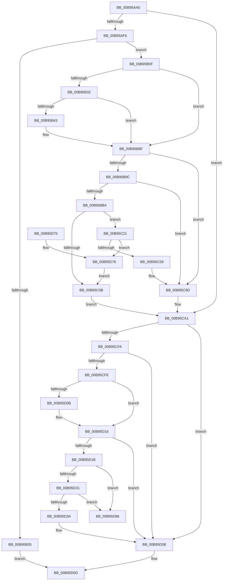

# VfBuildScatterGatherList

- RVA: `0x00B95AA0`–`0x00B95D8D` (길이 `749` bytes)
- VA: `0x0000000140B95AA0`
- 실행 섹션: `PAGEVRFY`
- PDB 이름 있음: `예`; PDB Function 태그: `아니요`
- unwind 정보 RVA: `0x000D23A0`
- 디코드: `200`개 명령, `749/749` bytes 표시
- 미해석 바이트: `0` (있으면 어셈블리에 `.byte`로 보존)

> 이 문서는 커널 이미지의 기계어와 PDB 기호를 분석해 생성했습니다. 4번과 5번은 함수 원형과 자료형을 바이너리 사용 방식에서 추정한 C 해석이며 원본 소스 복구 결과는 아닙니다.

## 1. Dependencies

- 직접 호출 지점: **19**; 고유 호출 대상: **17**
- 직접 호출자로 확인된 함수: **0**
- RIP 상대 이미지 참조: **5**

### Outgoing calls
- `0x00B95AD3` → [ViGetRealDmaAdapter](ViGetRealDmaAdapter_function_00B990DC.md) (function, `0x00B990DC`)
- `0x00B95AE1` → [ViGetAdapterInformationInternal](ViGetAdapterInformationInternal_function_00B98E88.md) (function, `0x00B98E88`)
- `0x00B95AF8` → [VF_ASSERT_IRQL](VF_ASSERT_IRQL_function_00B94F30.md) (function, `0x00B94F30`)
- `0x00B95B24` → [VERIFY_BUFFER_LOCKED](VERIFY_BUFFER_LOCKED_function_00B94EA4.md) (function, `0x00B94EA4`)
- `0x00B95B3A` → [ViCheckMdlLength](ViCheckMdlLength_function_00B9841C.md) (function, `0x00B9841C`)
- `0x00B95B69` → [ViHalPreprocessOptions](ViHalPreprocessOptions_function_00B9920C.md) (function, `0x00B9920C`)
- `0x00B95B8A` → [VfReportIssueWithOptions](../../text/61/VfReportIssueWithOptions_function_00614444.md) (function, `0x00614444`)
- `0x00B95BA3` → [ExAllocateFromNPagedLookasideList](../../text/38/ExAllocateFromNPagedLookasideList_function_0038E6C0.md) (function, `0x0038E6C0`)
- `0x00B95BFA` → [ViAllocateMapRegisterFile](ViAllocateMapRegisterFile_function_00B97E9C.md) (function, `0x00B97E9C`)
- `0x00B95C15` → [ExFreeToNPagedLookasideList](../../text/38/ExFreeToNPagedLookasideList_function_0038D9D0.md) (function, `0x0038D9D0`)
- `0x00B95C4C` → [ViMapDoubleBuffer](ViMapDoubleBuffer_function_00B99640.md) (function, `0x00B99640`)
- `0x00B95C91` → [ViSwap](ViSwap_function_00B99E54.md) (function, `0x00B99E54`)
- `0x00B95CEE` → [guard_dispatch_icall](../../text/6B/guard_dispatch_icall_function_006BAAD0.md) (function, `0x006BAAD0`)
- `0x00B95D01` → [DECREMENT_SCATTER_GATHER_LISTS](DECREMENT_SCATTER_GATHER_LISTS_function_00B94C44.md) (function, `0x00B94C44`)
- `0x00B95D11` → [ViFreeMapRegisterFile](ViFreeMapRegisterFile_function_00B98B8C.md) (function, `0x00B98B8C`)
- `0x00B95D1F` → [KeAcquireSpinLockRaiseToDpc](../../text/20/KeAcquireSpinLockRaiseToDpc_function_00208470.md) (function, `0x00208470`)
- `0x00B95D47` → [KeReleaseSpinLock](../../text/39/KeReleaseSpinLock_function_00392BA0.md) (function, `0x00392BA0`)
- `0x00B95D56` → [ExFreeToNPagedLookasideList](../../text/38/ExFreeToNPagedLookasideList_function_0038D9D0.md) (function, `0x0038D9D0`)
- `0x00B95D7C` → [ViFreeMapRegisterFile](ViFreeMapRegisterFile_function_00B98B8C.md) (function, `0x00B98B8C`)

### Direct callers
- 이 함수 시작 RVA로 연결되는 직접 call은 확인되지 않았습니다. 간접 호출은 완전히 역산할 수 없습니다.

### Static image references
- `0x00B95B48` → RVA `0x00BB9C20` (` ?? ::JKADOLAD::`string'`; read)
- `0x00B95B5A` → RVA `0x00E0E9DC` (`.data`; read)
- `0x00B95B8F` → RVA `0x00FF4004` (`PAGEVRFD`; read)
- `0x00B95B9C` → RVA `0x00E28A80` (`.data`; read)
- `0x00B95C5D` → RVA `0x00B99B20` (`ViScatterGatherCallback`; read)

## 2. Other-region calls and transfers

- 다른 실행 섹션으로 향하는 call: **7**
  - `0x00B95B8A` → [VfReportIssueWithOptions](../../text/61/VfReportIssueWithOptions_function_00614444.md) (`PAGEVRFY` → `.text`)
  - `0x00B95BA3` → [ExAllocateFromNPagedLookasideList](../../text/38/ExAllocateFromNPagedLookasideList_function_0038E6C0.md) (`PAGEVRFY` → `.text`)
  - `0x00B95C15` → [ExFreeToNPagedLookasideList](../../text/38/ExFreeToNPagedLookasideList_function_0038D9D0.md) (`PAGEVRFY` → `.text`)
  - `0x00B95CEE` → [guard_dispatch_icall](../../text/6B/guard_dispatch_icall_function_006BAAD0.md) (`PAGEVRFY` → `.text`)
  - `0x00B95D1F` → [KeAcquireSpinLockRaiseToDpc](../../text/20/KeAcquireSpinLockRaiseToDpc_function_00208470.md) (`PAGEVRFY` → `.text`)
  - `0x00B95D47` → [KeReleaseSpinLock](../../text/39/KeReleaseSpinLock_function_00392BA0.md) (`PAGEVRFY` → `.text`)
  - `0x00B95D56` → [ExFreeToNPagedLookasideList](../../text/38/ExFreeToNPagedLookasideList_function_0038D9D0.md) (`PAGEVRFY` → `.text`)
- 별도 외부 분기/꼬리 이동을 확인하지 못했습니다.

## 3. Assembly (complete function range)

```asm
00B95AA0  48 8B C4                        mov rax, rsp
00B95AA3  48 89 58 08                     mov qword ptr [rax + 8], rbx
00B95AA7  4C 89 48 20                     mov qword ptr [rax + 0x20], r9
00B95AAB  4C 89 40 18                     mov qword ptr [rax + 0x18], r8
00B95AAF  48 89 50 10                     mov qword ptr [rax + 0x10], rdx
00B95AB3  55                              push rbp
00B95AB4  56                              push rsi
00B95AB5  57                              push rdi
00B95AB6  41 54                           push r12
00B95AB8  41 55                           push r13
00B95ABA  41 56                           push r14
00B95ABC  41 57                           push r15
00B95ABE  48 8B EC                        mov rbp, rsp
00B95AC1  48 83 EC 70                     sub rsp, 0x70
00B95AC5  4D 8B F9                        mov r15, r9
00B95AC8  4D 8B F0                        mov r14, r8
00B95ACB  48 8B D9                        mov rbx, rcx
00B95ACE  33 FF                           xor edi, edi
00B95AD0  45 33 E4                        xor r12d, r12d
00B95AD3  E8 04 36 00 00                  call 0x140b990dc
00B95AD8  B2 01                           mov dl, 1
00B95ADA  48 89 45 F8                     mov qword ptr [rbp - 8], rax
00B95ADE  48 8B CB                        mov rcx, rbx
00B95AE1  E8 A2 33 00 00                  call 0x140b98e88
00B95AE6  44 8B 6D 60                     mov r13d, dword ptr [rbp + 0x60]
00B95AEA  48 8B F0                        mov rsi, rax
00B95AED  48 85 C0                        test rax, rax
00B95AF0  0F 84 AB 01 00 00               je 0x140b95ca1
00B95AF6  B1 02                           mov cl, 2
00B95AF8  E8 33 F4 FF FF                  call 0x140b94f30
00B95AFD  45 33 FF                        xor r15d, r15d
00B95B00  4D 85 F6                        test r14, r14
00B95B03  75 0A                           jne 0x140b95b0f
00B95B05  B8 0D 00 00 C0                  mov eax, 0xc000000d
00B95B0A  E9 4E 02 00 00                  jmp 0x140b95d5d
00B95B0F  F0 FF 86 C4 00 00 00            lock inc dword ptr [rsi + 0xc4]
00B95B16  F0 FF 86 C8 00 00 00            lock inc dword ptr [rsi + 0xc8]
00B95B1D  4C 8B 75 50                     mov r14, qword ptr [rbp + 0x50]
00B95B21  49 8B CE                        mov rcx, r14
00B95B24  E8 7B F3 FF FF                  call 0x140b94ea4
00B95B29  83 BE E0 00 00 00 03            cmp dword ptr [rsi + 0xe0], 3
00B95B30  75 5D                           jne 0x140b95b8f
00B95B32  45 8B C5                        mov r8d, r13d
00B95B35  33 D2                           xor edx, edx
00B95B37  49 8B CE                        mov rcx, r14
00B95B3A  E8 DD 28 00 00                  call 0x140b9841c
00B95B3F  85 C0                           test eax, eax
00B95B41  74 4C                           je 0x140b95b8f
00B95B43  4C 89 7C 24 28                  mov qword ptr [rsp + 0x28], r15
00B95B48  48 8D 15 D1 40 02 00            lea rdx, [rip + 0x240d1]
00B95B4F  4C 89 7C 24 20                  mov qword ptr [rsp + 0x20], r15
00B95B54  41 B8 24 00 00 00               mov r8d, 0x24
00B95B5A  4C 8D 3D 7B 8E 27 00            lea r15, [rip + 0x278e7b]
00B95B61  44 8B C8                        mov r9d, eax
00B95B64  49 8B CF                        mov rcx, r15
00B95B67  8B D8                           mov ebx, eax
00B95B69  E8 9E 36 00 00                  call 0x140b9920c
00B95B6E  4C 89 7C 24 28                  mov qword ptr [rsp + 0x28], r15
00B95B73  45 33 C9                        xor r9d, r9d
00B95B76  45 33 FF                        xor r15d, r15d
00B95B79  44 8B C3                        mov r8d, ebx
00B95B7C  B9 E6 00 00 00                  mov ecx, 0xe6
00B95B81  4C 89 7C 24 20                  mov qword ptr [rsp + 0x20], r15
00B95B86  41 8D 57 24                     lea edx, [r15 + 0x24]
00B95B8A  E8 B5 E8 A7 FF                  call 0x140614444
00B95B8F  44 39 3D 6E E4 45 00            cmp dword ptr [rip + 0x45e46e], r15d
00B95B96  0F 84 01 01 00 00               je 0x140b95c9d
00B95B9C  48 8D 0D DD 2E 29 00            lea rcx, [rip + 0x292edd]
00B95BA3  E8 18 8B 7F FF                  call 0x14038e6c0
00B95BA8  48 8B F8                        mov rdi, rax
00B95BAB  48 85 C0                        test rax, rax
00B95BAE  0F 84 E9 00 00 00               je 0x140b95c9d
00B95BB4  48 8B 4D 70                     mov rcx, qword ptr [rbp + 0x70]
00B95BB8  48 89 08                        mov qword ptr [rax], rcx
00B95BBB  48 8B 4D 68                     mov rcx, qword ptr [rbp + 0x68]
00B95BBF  48 89 48 08                     mov qword ptr [rax + 8], rcx
00B95BC3  49 8D 8D FF 0F 00 00            lea rcx, [r13 + 0xfff]
00B95BCA  4C 89 78 40                     mov qword ptr [rax + 0x40], r15
00B95BCE  4C 8B 7D 58                     mov r15, qword ptr [rbp + 0x58]
00B95BD2  48 89 70 38                     mov qword ptr [rax + 0x38], rsi
00B95BD6  49 8B D7                        mov rdx, r15
00B95BD9  81 E2 FF 0F 00 00               and edx, 0xfff
00B95BDF  48 03 D1                        add rdx, rcx
00B95BE2  48 8B CE                        mov rcx, rsi
00B95BE5  48 C1 EA 0C                     shr rdx, 0xc
00B95BE9  89 50 30                        mov dword ptr [rax + 0x30], edx
00B95BEC  48 83 C0 48                     add rax, 0x48
00B95BF0  48 89 40 08                     mov qword ptr [rax + 8], rax
00B95BF4  48 89 00                        mov qword ptr [rax], rax
00B95BF7  8B 57 30                        mov edx, dword ptr [rdi + 0x30]
00B95BFA  E8 9D 22 00 00                  call 0x140b97e9c
00B95BFF  48 89 45 F0                     mov qword ptr [rbp - 0x10], rax
00B95C03  48 8B D8                        mov rbx, rax
00B95C06  48 85 C0                        test rax, rax
00B95C09  75 16                           jne 0x140b95c21
00B95C0B  48 8B D7                        mov rdx, rdi
00B95C0E  48 8D 0D 6B 2E 29 00            lea rcx, [rip + 0x292e6b]
00B95C15  E8 B6 7D 7F FF                  call 0x14038d9d0
00B95C1A  33 FF                           xor edi, edi
00B95C1C  E9 80 00 00 00                  jmp 0x140b95ca1
00B95C21  C6 40 19 01                     mov byte ptr [rax + 0x19], 1
00B95C25  45 8B CD                        mov r9d, r13d
00B95C28  48 8D 47 68                     lea rax, [rdi + 0x68]
00B95C2C  48 89 5F 60                     mov qword ptr [rdi + 0x60], rbx
00B95C30  48 89 47 10                     mov qword ptr [rdi + 0x10], rax
00B95C34  4D 8B C7                        mov r8, r15
00B95C37  8A 45 78                        mov al, byte ptr [rbp + 0x78]
00B95C3A  49 8B D6                        mov rdx, r14
00B95C3D  48 8B CB                        mov rcx, rbx
00B95C40  88 44 24 20                     mov byte ptr [rsp + 0x20], al
00B95C44  4C 89 7F 18                     mov qword ptr [rdi + 0x18], r15
00B95C48  44 89 6F 20                     mov dword ptr [rdi + 0x20], r13d
00B95C4C  E8 EF 39 00 00                  call 0x140b99640
00B95C51  85 C0                           test eax, eax
00B95C53  0F 84 1D 01 00 00               je 0x140b95d76
00B95C59  41 0F 10 06                     movups xmm0, xmmword ptr [r14]
00B95C5D  48 8D 05 BC 3E 00 00            lea rax, [rip + 0x3ebc]
00B95C64  48 89 7D 70                     mov qword ptr [rbp + 0x70], rdi
00B95C68  48 89 45 68                     mov qword ptr [rbp + 0x68], rax
00B95C6C  4C 8D 45 58                     lea r8, [rbp + 0x58]
00B95C70  48 8B 47 10                     mov rax, qword ptr [rdi + 0x10]
00B95C74  48 8D 55 50                     lea rdx, [rbp + 0x50]
00B95C78  48 8D 4D F0                     lea rcx, [rbp - 0x10]
00B95C7C  0F 11 00                        movups xmmword ptr [rax], xmm0
00B95C7F  41 0F 10 4E 10                  movups xmm1, xmmword ptr [r14 + 0x10]
00B95C84  0F 11 48 10                     movups xmmword ptr [rax + 0x10], xmm1
00B95C88  41 0F 10 46 20                  movups xmm0, xmmword ptr [r14 + 0x20]
00B95C8D  0F 11 40 20                     movups xmmword ptr [rax + 0x20], xmm0
00B95C91  E8 BE 41 00 00                  call 0x140b99e54
00B95C96  4C 8B 75 50                     mov r14, qword ptr [rbp + 0x50]
00B95C9A  4C 8B E3                        mov r12, rbx
00B95C9D  4C 8B 7D 58                     mov r15, qword ptr [rbp + 0x58]
00B95CA1  4C 8B 55 F8                     mov r10, qword ptr [rbp - 8]
00B95CA5  4D 8B CF                        mov r9, r15
00B95CA8  8B 8D 88 00 00 00               mov ecx, dword ptr [rbp + 0x88]
00B95CAE  4D 8B C6                        mov r8, r14
00B95CB1  48 8B 55 48                     mov rdx, qword ptr [rbp + 0x48]
00B95CB5  89 4C 24 48                     mov dword ptr [rsp + 0x48], ecx
00B95CB9  48 8B 8D 80 00 00 00            mov rcx, qword ptr [rbp + 0x80]
00B95CC0  49 8B 42 08                     mov rax, qword ptr [r10 + 8]
00B95CC4  48 89 4C 24 40                  mov qword ptr [rsp + 0x40], rcx
00B95CC9  8A 4D 78                        mov cl, byte ptr [rbp + 0x78]
00B95CCC  88 4C 24 38                     mov byte ptr [rsp + 0x38], cl
00B95CD0  48 8B 4D 70                     mov rcx, qword ptr [rbp + 0x70]
00B95CD4  48 8B 40 70                     mov rax, qword ptr [rax + 0x70]
00B95CD8  48 89 4C 24 30                  mov qword ptr [rsp + 0x30], rcx
00B95CDD  48 8B 4D 68                     mov rcx, qword ptr [rbp + 0x68]
00B95CE1  48 89 4C 24 28                  mov qword ptr [rsp + 0x28], rcx
00B95CE6  49 8B CA                        mov rcx, r10
00B95CE9  44 89 6C 24 20                  mov dword ptr [rsp + 0x20], r13d
00B95CEE  E8 DD 4D B2 FF                  call 0x1406baad0
00B95CF3  8B D8                           mov ebx, eax
00B95CF5  48 85 F6                        test rsi, rsi
00B95CF8  74 61                           je 0x140b95d5b
00B95CFA  85 C0                           test eax, eax
00B95CFC  79 5D                           jns 0x140b95d5b
00B95CFE  48 8B CE                        mov rcx, rsi
00B95D01  E8 3E EF FF FF                  call 0x140b94c44
00B95D06  4D 85 E4                        test r12, r12
00B95D09  74 0B                           je 0x140b95d16
00B95D0B  49 8B D4                        mov rdx, r12
00B95D0E  48 8B CE                        mov rcx, rsi
00B95D11  E8 76 2E 00 00                  call 0x140b98b8c
00B95D16  48 85 FF                        test rdi, rdi
00B95D19  74 40                           je 0x140b95d5b
00B95D1B  48 8D 4E 68                     lea rcx, [rsi + 0x68]
00B95D1F  E8 4C 27 67 FF                  call 0x140208470
00B95D24  48 8D 57 48                     lea rdx, [rdi + 0x48]
00B95D28  4C 8B 0A                        mov r9, qword ptr [rdx]
00B95D2B  49 39 51 08                     cmp qword ptr [r9 + 8], rdx
00B95D2F  75 55                           jne 0x140b95d86
00B95D31  4C 8B 42 08                     mov r8, qword ptr [rdx + 8]
00B95D35  49 39 10                        cmp qword ptr [r8], rdx
00B95D38  75 4C                           jne 0x140b95d86
00B95D3A  4D 89 08                        mov qword ptr [r8], r9
00B95D3D  48 8D 4E 68                     lea rcx, [rsi + 0x68]
00B95D41  8A D0                           mov dl, al
00B95D43  4D 89 41 08                     mov qword ptr [r9 + 8], r8
00B95D47  E8 54 CE 7F FF                  call 0x140392ba0
00B95D4C  48 8B D7                        mov rdx, rdi
00B95D4F  48 8D 0D 2A 2D 29 00            lea rcx, [rip + 0x292d2a]
00B95D56  E8 75 7C 7F FF                  call 0x14038d9d0
00B95D5B  8B C3                           mov eax, ebx
00B95D5D  48 8B 9C 24 B0 00 00 00         mov rbx, qword ptr [rsp + 0xb0]
00B95D65  48 83 C4 70                     add rsp, 0x70
00B95D69  41 5F                           pop r15
00B95D6B  41 5E                           pop r14
00B95D6D  41 5D                           pop r13
00B95D6F  41 5C                           pop r12
00B95D71  5F                              pop rdi
00B95D72  5E                              pop rsi
00B95D73  5D                              pop rbp
00B95D74  C3                              ret
00B95D75  CC                              int3
00B95D76  48 8B D3                        mov rdx, rbx
00B95D79  48 8B CE                        mov rcx, rsi
00B95D7C  E8 0B 2E 00 00                  call 0x140b98b8c
00B95D81  E9 85 FE FF FF                  jmp 0x140b95c0b
00B95D86  B9 03 00 00 00                  mov ecx, 3
00B95D8B  CD 29                           int 0x29
```

## 4. C-style interpretation (structured pseudocode)

```c
__int64 __fastcall VfBuildScatterGatherList(__int64 a1, __int64 a2, __int64 a3, __int64 a4, unsigned int a5, __int64 a6, __int64 a7, unsigned __int8 a8, __int64 a9, unsigned int a10)
{
    __int64 result;
    __int64 v_r12;
    __int64 v_r15;
    __int64 v_rbx;
    __int64 v_rdi;
    __int64 v_rsp;
    unsigned __int64 v_stack_m40;
    unsigned __int64 v_stack_m48;
    unsigned int v_stack_m60;
    unsigned __int64 v_stack_m68;
    unsigned __int8 v_stack_m70;
    unsigned __int64 v_stack_m78;
    unsigned __int64 v_stack_m80;
    unsigned __int64 v_stack_m88;
    unsigned __int64 v_stack_p10;
    unsigned __int64 v_stack_p18;
    unsigned __int64 v_stack_p20;
    unsigned __int64 v_stack_p30;
    unsigned __int64 v_stack_p38;
    unsigned __int64 v_stack_p8;

    *(unsigned __int64 *)(v_rsp + 8) = v_rbx;
    *(unsigned __int64 *)(v_rsp + 32) = a4;
    *(unsigned __int64 *)(v_rsp + 24) = a3;
    *(unsigned __int64 *)(v_rsp + 16) = a2;
    v_rsp = (v_rsp) - (112);
    v_rdi = 0;
    v_r12 = 0;
    result = ViGetRealDmaAdapter(a1, a2, a3, a4);
    v_stack_m40 = result;
    result = ViGetAdapterInformationInternal(a1, 1, a3, a4);
    if (result == 0) goto loc_00B95CA1;
    result = VF_ASSERT_IRQL(2, 1, a3, a4);
    v_r15 = 0;
    if (a3 != 0) goto loc_00B95B0F;
    goto loc_00B95D5D;
loc_00B95B0F:
    result = VERIFY_BUFFER_LOCKED(v_stack_p18, 1, a3, a4);
    if ((*(unsigned int *)(result + 224)) != 3) goto loc_00B95B8F;
    a2 = 0;
    result = ViCheckMdlLength(v_stack_p18, a2, (unsigned int)((unsigned int)((unsigned int)(a5))), a4);
    v_rbx = a1;
    if ((unsigned int)(result) != 0) {
        v_stack_m80 = 0;
        a2 = v_rip + 147665;
        v_stack_m88 = 0;
        a3 = 36;
        v_r15 = v_rip + 2592379;
        a4 = (unsigned int)(result);
        a1 = v_r15;
        v_rbx = (unsigned int)(result);
        result = ViHalPreprocessOptions(a1, a2, a3, a4);
        v_stack_m80 = v_r15;
        a4 = 0;
        v_r15 = 0;
        a3 = (unsigned int)(v_rbx);
        a1 = 230;
        v_stack_m88 = 0;
        a2 = v_r15 + 36;
        result = VfReportIssueWithOptions(a1, a2, a3, a4);
    }
    if ((*(unsigned int *)(v_rip + 4580462)) == 0) goto loc_00B95C9D;
    result = ExAllocateFromNPagedLookasideList(v_rip + 2698973, a2, a3, a4);
    if (result == 0) goto loc_00B95C9D;
    *(unsigned __int64 *)(result) = a7;
    *(unsigned __int64 *)(result + 8) = a6;
    *(unsigned __int64 *)(result + 64) = 0;
    *(unsigned __int64 *)(result + 56) = result;
    a2 = (unsigned int)((v_stack_p20) & (0xFFFULL));
    a2 = (a2) + ((unsigned int)(a5) + 4095);
    a2 = (a2) >> (12);
    *(unsigned int *)(result + 48) = (unsigned int)(a2);
    result = (result) + (72);
    *(unsigned __int64 *)(result + 8) = result;
    *(unsigned __int64 *)(result) = result;
    result = ViAllocateMapRegisterFile(result, (unsigned int)(*(unsigned int *)(result + 48)), a3, a4);
    v_stack_m48 = result;
    if (result != 0) goto loc_00B95C21;
loc_00B95C0B:
    result = ExFreeToNPagedLookasideList(v_rip + 2698859, result, a3, a4);
    v_rdi = 0;
    goto loc_00B95CA1;
loc_00B95C21:
    *(unsigned __int8 *)(result + 25) = 1;
    *(unsigned __int64 *)(v_rdi + 96) = result;
    *(unsigned __int64 *)(v_rdi + 16) = v_rdi + 104;
    v_stack_m88 = a8;
    *(unsigned __int64 *)(v_rdi + 24) = v_stack_p20;
    *(unsigned int *)(v_rdi + 32) = (unsigned int)((unsigned int)(a5));
    result = ViMapDoubleBuffer(result, v_stack_p18, v_stack_p20, (unsigned int)((unsigned int)((unsigned int)(a5))));
    if ((unsigned int)(result) == 0) goto loc_00B95D76;
    v_stack_p38 = 0;
    v_stack_p30 = v_rip + 16060;
    *(unsigned __int64 *)(*(unsigned __int64 *)(v_rdi + 16)) = v_xmm0;
    *(unsigned __int64 *)(*(unsigned __int64 *)(v_rdi + 16) + 16) = v_xmm1;
    *(unsigned __int64 *)(*(unsigned __int64 *)(v_rdi + 16) + 32) = v_xmm0;
    result = ViSwap(v_stack_m48, v_stack_p18, v_stack_p20, (unsigned int)((unsigned int)((unsigned int)(a5))));
loc_00B95C9D:
loc_00B95CA1:
    v_stack_m60 = (unsigned int)((unsigned int)(a10));
    v_stack_m68 = a9;
    v_stack_m70 = a8;
    v_stack_m78 = a7;
    v_stack_m80 = a6;
    v_stack_m88 = (unsigned int)((unsigned int)(a5));
    result = guard_dispatch_icall(v_stack_m40, v_stack_p10, v_stack_p18, v_stack_p20);
    if (result == 0) goto loc_00B95D5B;
    if (!sign_flag) goto loc_00B95D5B;
    result = DECREMENT_SCATTER_GATHER_LISTS(result, v_stack_p10, v_stack_p18, v_stack_p20);
    if (result != 0) {
        a2 = result;
        a1 = result;
        result = ViFreeMapRegisterFile(a1, a2, v_stack_p18, v_stack_p20);
    }
    if (0 == 0) goto loc_00B95D5B;
    result = KeAcquireSpinLockRaiseToDpc(result + 104, a2, v_stack_p18, v_stack_p20);
    if ((*(unsigned __int64 *)(*(unsigned __int64 *)(v_rdi + 72) + 8)) != (v_rdi + 72)) goto loc_00B95D86;
    if ((*(unsigned __int64 *)(*(unsigned __int64 *)(v_rdi + 72 + 8))) != (v_rdi + 72)) goto loc_00B95D86;
    *(unsigned __int64 *)(*(unsigned __int64 *)(v_rdi + 72 + 8)) = *(unsigned __int64 *)(v_rdi + 72);
    *(unsigned __int64 *)(*(unsigned __int64 *)(v_rdi + 72) + 8) = *(unsigned __int64 *)(v_rdi + 72 + 8);
    result = KeReleaseSpinLock(result + 104, (unsigned __int8)(result), *(unsigned __int64 *)(v_rdi + 72 + 8), *(unsigned __int64 *)(v_rdi + 72));
    result = ExFreeToNPagedLookasideList(v_rip + 2698538, 0, *(unsigned __int64 *)(v_rdi + 72 + 8), *(unsigned __int64 *)(v_rdi + 72));
loc_00B95D5B:
loc_00B95D5D:
    v_rsp = (v_rsp) + (112);
    return (unsigned int)((unsigned int)((unsigned int)((unsigned int)(result))));
loc_00B95D76:
    result = ViFreeMapRegisterFile(result, v_stack_p8, *(unsigned __int64 *)(v_rdi + 72 + 8), *(unsigned __int64 *)(v_rdi + 72));
    goto loc_00B95C0B;
loc_00B95D86:
    return result;
}
```

## 5. (Beta) C Style

```c
int64_t VfBuildScatterGatherList(int64_t Arg1, int64_t Arg2, int64_t Arg3, int64_t Arg4, void *Arg5, int64_t Arg6, int64_t Arg7, uint8_t Arg8, int64_t Arg9, uint32_t Arg10)
{
    uint8_t *arg5 = (uint8_t *)Arg5;

    int64_t result;
    int64_t local_r12;
    int64_t local_r15;
    int64_t local_rbx;
    int64_t local_rdi;
    int64_t local_rsp;
    uint64_t v_stack_m40;
    uint64_t v_stack_m48;
    uint32_t v_stack_m60;
    uint64_t v_stack_m68;
    uint8_t v_stack_m70;
    uint64_t v_stack_m78;
    uint64_t v_stack_m80;
    uint64_t v_stack_m88;
    uint64_t v_stack_p10;
    uint64_t v_stack_p18;
    uint64_t v_stack_p20;
    uint64_t v_stack_p30;
    uint64_t v_stack_p38;
    uint64_t v_stack_p8;

    *(uint64_t *)(local_rsp + 0x8) = local_rbx;
    *(uint64_t *)(local_rsp + 0x20) = Arg4;
    *(uint64_t *)(local_rsp + 0x18) = Arg3;
    *(uint64_t *)(local_rsp + 0x10) = Arg2;
    local_rsp = (local_rsp) - (112);
    local_rdi = 0;
    local_r12 = 0;
    result = ViGetRealDmaAdapter(Arg1, Arg2, Arg3, Arg4);
    v_stack_m40 = result;
    result = ViGetAdapterInformationInternal(Arg1, 1, Arg3, Arg4);
    if (result == 0) goto loc_00B95CA1;
    result = VF_ASSERT_IRQL(2, 1, Arg3, Arg4);
    local_r15 = 0;
    if (Arg3 != 0) goto loc_00B95B0F;
    goto loc_00B95D5D;
loc_00B95B0F:
    result = VERIFY_BUFFER_LOCKED(v_stack_p18, 1, Arg3, Arg4);
    if ((*(uint32_t *)(result + 0xE0)) != 3) goto loc_00B95B8F;
    Arg2 = 0;
    result = ViCheckMdlLength(v_stack_p18, Arg2, (uint32_t)((uint32_t)((uint32_t)(Arg5))), Arg4);
    local_rbx = Arg1;
    if ((uint32_t)(result) != 0) {
        v_stack_m80 = 0;
        Arg2 = v_rip + 147665;
        v_stack_m88 = 0;
        Arg3 = 36;
        local_r15 = v_rip + 2592379;
        Arg4 = (uint32_t)(result);
        Arg1 = local_r15;
        local_rbx = (uint32_t)(result);
        result = ViHalPreprocessOptions(Arg1, Arg2, Arg3, Arg4);
        v_stack_m80 = local_r15;
        Arg4 = 0;
        local_r15 = 0;
        Arg3 = (uint32_t)(local_rbx);
        Arg1 = 230;
        v_stack_m88 = 0;
        Arg2 = local_r15 + 36;
        result = VfReportIssueWithOptions(Arg1, Arg2, Arg3, Arg4);
    }
    if ((*(uint32_t *)(v_rip + 0x45E46E)) == 0) goto loc_00B95C9D;
    result = ExAllocateFromNPagedLookasideList(v_rip + 2698973, Arg2, Arg3, Arg4);
    if (result == 0) goto loc_00B95C9D;
    *(uint64_t *)(result) = Arg7;
    *(uint64_t *)(result + 0x8) = Arg6;
    *(uint64_t *)(result + 0x40) = 0;
    *(uint64_t *)(result + 0x38) = result;
    Arg2 = (uint32_t)((v_stack_p20) & (0xFFFULL));
    Arg2 = (Arg2) + ((uint32_t)(Arg5) + 4095);
    Arg2 = (Arg2) >> (12);
    *(uint32_t *)(result + 0x30) = (uint32_t)(Arg2);
    result = (result) + (72);
    *(uint64_t *)(result + 0x8) = result;
    *(uint64_t *)(result) = result;
    result = ViAllocateMapRegisterFile(result, (uint32_t)(*(uint32_t *)(result + 0x30)), Arg3, Arg4);
    v_stack_m48 = result;
    if (result != 0) goto loc_00B95C21;
loc_00B95C0B:
    result = ExFreeToNPagedLookasideList(v_rip + 2698859, result, Arg3, Arg4);
    local_rdi = 0;
    goto loc_00B95CA1;
loc_00B95C21:
    *(uint8_t *)(result + 0x19) = 1;
    *(uint64_t *)(local_rdi + 0x60) = result;
    *(uint64_t *)(local_rdi + 0x10) = local_rdi + 104;
    v_stack_m88 = Arg8;
    *(uint64_t *)(local_rdi + 0x18) = v_stack_p20;
    *(uint32_t *)(local_rdi + 0x20) = (uint32_t)((uint32_t)(Arg5));
    result = ViMapDoubleBuffer(result, v_stack_p18, v_stack_p20, (uint32_t)((uint32_t)((uint32_t)(Arg5))));
    if ((uint32_t)(result) == 0) goto loc_00B95D76;
    v_stack_p38 = 0;
    v_stack_p30 = v_rip + 16060;
    *(uint64_t *)(*(uint64_t *)(local_rdi + 0x10)) = v_xmm0;
    *(uint64_t *)(*(uint64_t *)(local_rdi + 0x10) + 0x10) = v_xmm1;
    *(uint64_t *)(*(uint64_t *)(local_rdi + 0x10) + 0x20) = v_xmm0;
    result = ViSwap(v_stack_m48, v_stack_p18, v_stack_p20, (uint32_t)((uint32_t)((uint32_t)(Arg5))));
loc_00B95C9D:
loc_00B95CA1:
    v_stack_m60 = (uint32_t)((uint32_t)(Arg10));
    v_stack_m68 = Arg9;
    v_stack_m70 = Arg8;
    v_stack_m78 = Arg7;
    v_stack_m80 = Arg6;
    v_stack_m88 = (uint32_t)((uint32_t)(Arg5));
    result = guard_dispatch_icall(v_stack_m40, v_stack_p10, v_stack_p18, v_stack_p20);
    if (result == 0) goto loc_00B95D5B;
    if (!sign_flag) goto loc_00B95D5B;
    result = DECREMENT_SCATTER_GATHER_LISTS(result, v_stack_p10, v_stack_p18, v_stack_p20);
    if (result != 0) {
        Arg2 = result;
        Arg1 = result;
        result = ViFreeMapRegisterFile(Arg1, Arg2, v_stack_p18, v_stack_p20);
    }
    if (0 == 0) goto loc_00B95D5B;
    result = KeAcquireSpinLockRaiseToDpc(result + 104, Arg2, v_stack_p18, v_stack_p20);
    if ((*(uint64_t *)(*(uint64_t *)(local_rdi + 0x48) + 0x8)) != (local_rdi + 72)) goto loc_00B95D86;
    if ((*(uint64_t *)(*(uint64_t *)(local_rdi + 0x48 + 0x8))) != (local_rdi + 72)) goto loc_00B95D86;
    *(uint64_t *)(*(uint64_t *)(local_rdi + 0x48 + 0x8)) = *(uint64_t *)(local_rdi + 0x48);
    *(uint64_t *)(*(uint64_t *)(local_rdi + 0x48) + 0x8) = *(uint64_t *)(local_rdi + 0x48 + 0x8);
    result = KeReleaseSpinLock(result + 104, (uint8_t)(result), *(uint64_t *)(local_rdi + 0x48 + 0x8), *(uint64_t *)(local_rdi + 0x48));
    result = ExFreeToNPagedLookasideList(v_rip + 2698538, 0, *(uint64_t *)(local_rdi + 0x48 + 0x8), *(uint64_t *)(local_rdi + 0x48));
loc_00B95D5B:
loc_00B95D5D:
    local_rsp = (local_rsp) + (112);
    return (uint32_t)((uint32_t)((uint32_t)((uint32_t)(result))));
loc_00B95D76:
    result = ViFreeMapRegisterFile(result, v_stack_p8, *(uint64_t *)(local_rdi + 0x48 + 0x8), *(uint64_t *)(local_rdi + 0x48));
    goto loc_00B95C0B;
loc_00B95D86:
    return result;
}
```

### 관측된 메모리 오프셋

구조체 형식이 확인되지 않은 접근은 인자 기준의 오프셋으로만 기록했습니다.

| 기준 인자 | 오프셋 표현 | 폭 (bit) | 접근 |
|---|---:|---:|---|
| `Arg5` | `+ 0xFFF` | `64` | `R` |

## 6. Execution-region graph

[열기: 2D/3D 그래프와 함수 탐색 컨트롤 패널](../../../control-panel.html?section=pagevrfy&rva=0x00B95AA0&view=graph)

- 2D 그래프는 위에서 아래로 흐르고, 3D 그래프는 빈 공간을 드래그해 회전합니다. Shift+드래그는 이동, 휠은 확대·축소, 함수 노드 선택은 대상 보고서 이동입니다.

### Static fallback


