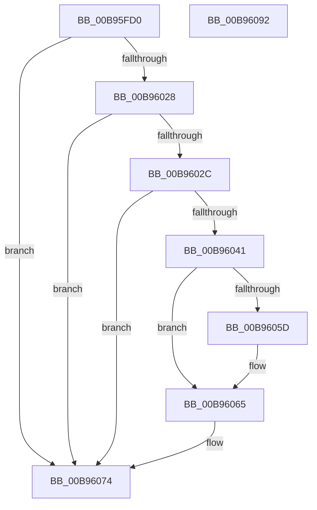

# VfCancelAdapterChannel

- RVA: `0x00B95FD0`–`0x00B96093` (길이 `195` bytes)
- VA: `0x0000000140B95FD0`
- 실행 섹션: `PAGEVRFY`
- PDB 이름 있음: `예`; PDB Function 태그: `아니요`
- unwind 정보 RVA: `0x0005E6B4`
- 디코드: `56`개 명령, `195/195` bytes 표시
- 미해석 바이트: `0` (있으면 어셈블리에 `.byte`로 보존)

> 이 문서는 커널 이미지의 기계어와 PDB 기호를 분석해 생성했습니다. 4번과 5번은 함수 원형과 자료형을 바이너리 사용 방식에서 추정한 C 해석이며 원본 소스 복구 결과는 아닙니다.

## 1. Dependencies

- 직접 호출 지점: **8**; 고유 호출 대상: **8**
- 직접 호출자로 확인된 함수: **0**
- RIP 상대 이미지 참조: **1**

### Outgoing calls
- `0x00B95FF2` → [ViGetRealDmaAdapter](ViGetRealDmaAdapter_function_00B990DC.md) (function, `0x00B990DC`)
- `0x00B95FFF` → [ViGetAdapterInformationInternal](ViGetAdapterInformationInternal_function_00B98E88.md) (function, `0x00B98E88`)
- `0x00B9601B` → [guard_dispatch_icall](../../text/6B/guard_dispatch_icall_function_006BAAD0.md) (function, `0x006BAAD0`)
- `0x00B96034` → [ViRemoveChannelWcb](../../text/61/ViRemoveChannelWcb_function_00612E5C.md) (function, `0x00612E5C`)
- `0x00B96044` → [DECREMENT_ADAPTER_CHANNELS](DECREMENT_ADAPTER_CHANNELS_function_00B94B14.md) (function, `0x00B94B14`)
- `0x00B9604F` → [SUBTRACT_MAP_REGISTERS](SUBTRACT_MAP_REGISTERS_function_00B94E10.md) (function, `0x00B94E10`)
- `0x00B96060` → [ViFreeMapRegisterFile](ViFreeMapRegisterFile_function_00B98B8C.md) (function, `0x00B98B8C`)
- `0x00B9606F` → [ExFreeToNPagedLookasideList](../../text/38/ExFreeToNPagedLookasideList_function_0038D9D0.md) (function, `0x0038D9D0`)

### Direct callers
- 이 함수 시작 RVA로 연결되는 직접 call은 확인되지 않았습니다. 간접 호출은 완전히 역산할 수 없습니다.

### Static image references
- `0x00B96068` → RVA `0x00E28A80` (`.data`; read)

## 2. Other-region calls and transfers

- 다른 실행 섹션으로 향하는 call: **3**
  - `0x00B9601B` → [guard_dispatch_icall](../../text/6B/guard_dispatch_icall_function_006BAAD0.md) (`PAGEVRFY` → `.text`)
  - `0x00B96034` → [ViRemoveChannelWcb](../../text/61/ViRemoveChannelWcb_function_00612E5C.md) (`PAGEVRFY` → `.text`)
  - `0x00B9606F` → [ExFreeToNPagedLookasideList](../../text/38/ExFreeToNPagedLookasideList_function_0038D9D0.md) (`PAGEVRFY` → `.text`)
- 별도 외부 분기/꼬리 이동을 확인하지 못했습니다.

## 3. Assembly (complete function range)

```asm
00B95FD0  48 8B C4                        mov rax, rsp
00B95FD3  48 89 58 08                     mov qword ptr [rax + 8], rbx
00B95FD7  48 89 68 10                     mov qword ptr [rax + 0x10], rbp
00B95FDB  48 89 70 18                     mov qword ptr [rax + 0x18], rsi
00B95FDF  48 89 78 20                     mov qword ptr [rax + 0x20], rdi
00B95FE3  41 56                           push r14
00B95FE5  48 83 EC 20                     sub rsp, 0x20
00B95FE9  4D 8B F0                        mov r14, r8
00B95FEC  48 8B F2                        mov rsi, rdx
00B95FEF  48 8B D9                        mov rbx, rcx
00B95FF2  E8 E5 30 00 00                  call 0x140b990dc
00B95FF7  B2 01                           mov dl, 1
00B95FF9  48 8B CB                        mov rcx, rbx
00B95FFC  48 8B F8                        mov rdi, rax
00B95FFF  E8 84 2E 00 00                  call 0x140b98e88
00B96004  48 8B 4F 08                     mov rcx, qword ptr [rdi + 8]
00B96008  48 8B E8                        mov rbp, rax
00B9600B  4D 8B C6                        mov r8, r14
00B9600E  48 8B D6                        mov rdx, rsi
00B96011  48 8B 81 B0 00 00 00            mov rax, qword ptr [rcx + 0xb0]
00B96018  48 8B CF                        mov rcx, rdi
00B9601B  E8 B0 4A B2 FF                  call 0x1406baad0
00B96020  40 8A F8                        mov dil, al
00B96023  48 85 ED                        test rbp, rbp
00B96026  74 4C                           je 0x140b96074
00B96028  84 C0                           test al, al
00B9602A  74 48                           je 0x140b96074
00B9602C  4D 8B C6                        mov r8, r14
00B9602F  33 D2                           xor edx, edx
00B96031  48 8B CD                        mov rcx, rbp
00B96034  E8 23 CE A7 FF                  call 0x140612e5c
00B96039  48 8B D8                        mov rbx, rax
00B9603C  48 85 C0                        test rax, rax
00B9603F  74 33                           je 0x140b96074
00B96041  48 8B CD                        mov rcx, rbp
00B96044  E8 CB EA FF FF                  call 0x140b94b14
00B96049  8B 53 30                        mov edx, dword ptr [rbx + 0x30]
00B9604C  48 8B CD                        mov rcx, rbp
00B9604F  E8 BC ED FF FF                  call 0x140b94e10
00B96054  48 8B 53 60                     mov rdx, qword ptr [rbx + 0x60]
00B96058  48 85 D2                        test rdx, rdx
00B9605B  74 08                           je 0x140b96065
00B9605D  48 8B CD                        mov rcx, rbp
00B96060  E8 27 2B 00 00                  call 0x140b98b8c
00B96065  48 8B D3                        mov rdx, rbx
00B96068  48 8D 0D 11 2A 29 00            lea rcx, [rip + 0x292a11]
00B9606F  E8 5C 79 7F FF                  call 0x14038d9d0
00B96074  48 8B 5C 24 30                  mov rbx, qword ptr [rsp + 0x30]
00B96079  40 8A C7                        mov al, dil
00B9607C  48 8B 7C 24 48                  mov rdi, qword ptr [rsp + 0x48]
00B96081  48 8B 6C 24 38                  mov rbp, qword ptr [rsp + 0x38]
00B96086  48 8B 74 24 40                  mov rsi, qword ptr [rsp + 0x40]
00B9608B  48 83 C4 20                     add rsp, 0x20
00B9608F  41 5E                           pop r14
00B96091  C3                              ret
00B96092  CC                              int3
```

## 4. C-style interpretation (structured pseudocode)

```c
__int64 __fastcall VfCancelAdapterChannel(__int64 a1, __int64 a2, __int64 a3)
{
    __int64 result;
    __int64 v_rsp;
    unsigned __int64 v_stack_p10;
    unsigned __int64 v_stack_p18;
    unsigned __int64 v_stack_p20;
    unsigned __int64 v_stack_p8;

    *(unsigned __int64 *)(v_rsp + 8) = v_rbx;
    *(unsigned __int64 *)(v_rsp + 16) = v_rbp;
    *(unsigned __int64 *)(v_rsp + 24) = v_rsi;
    *(unsigned __int64 *)(v_rsp + 32) = v_rdi;
    v_rsp = (v_rsp) - (32);
    result = ViGetRealDmaAdapter(a1, a2, a3, a4);
    result = ViGetAdapterInformationInternal(a1, 1, a3, a4);
    result = guard_dispatch_icall(result, a2, a3, a4);
    if (result == 0) goto loc_00B96074;
    if ((unsigned __int8)(result) == 0) goto loc_00B96074;
    a2 = 0;
    result = ViRemoveChannelWcb(result, a2, a3, a4);
    if (result == 0) goto loc_00B96074;
    result = DECREMENT_ADAPTER_CHANNELS(result, a2, a3, a4);
    result = SUBTRACT_MAP_REGISTERS(result, (unsigned int)(*(unsigned int *)(result + 48)), a3, a4);
    if (*(unsigned __int64 *)(result + 96) != 0) {
        a1 = result;
        result = ViFreeMapRegisterFile(a1, *(unsigned __int64 *)(result + 96), a3, a4);
    }
    result = ExFreeToNPagedLookasideList(v_rip + 2697745, result, a3, a4);
loc_00B96074:
    v_rsp = (v_rsp) + (32);
    return (unsigned __int8)((unsigned __int8)(result));
}
```

## 5. (Beta) C Style

```c
int64_t VfCancelAdapterChannel(int64_t Arg1, int64_t Arg2, int64_t Arg3)
{
    int64_t result;
    int64_t local_rsp;
    uint64_t v_stack_p10;
    uint64_t v_stack_p18;
    uint64_t v_stack_p20;
    uint64_t v_stack_p8;

    *(uint64_t *)(local_rsp + 0x8) = local_rbx;
    *(uint64_t *)(local_rsp + 0x10) = local_rbp;
    *(uint64_t *)(local_rsp + 0x18) = local_rsi;
    *(uint64_t *)(local_rsp + 0x20) = local_rdi;
    local_rsp = (local_rsp) - (32);
    result = ViGetRealDmaAdapter(Arg1, Arg2, Arg3, a4);
    result = ViGetAdapterInformationInternal(Arg1, 1, Arg3, a4);
    result = guard_dispatch_icall(result, Arg2, Arg3, a4);
    if (result == 0) goto loc_00B96074;
    if ((uint8_t)(result) == 0) goto loc_00B96074;
    Arg2 = 0;
    result = ViRemoveChannelWcb(result, Arg2, Arg3, a4);
    if (result == 0) goto loc_00B96074;
    result = DECREMENT_ADAPTER_CHANNELS(result, Arg2, Arg3, a4);
    result = SUBTRACT_MAP_REGISTERS(result, (uint32_t)(*(uint32_t *)(result + 0x30)), Arg3, a4);
    if (*(uint64_t *)(result + 0x60) != 0) {
        Arg1 = result;
        result = ViFreeMapRegisterFile(Arg1, *(uint64_t *)(result + 0x60), Arg3, a4);
    }
    result = ExFreeToNPagedLookasideList(v_rip + 2697745, result, Arg3, a4);
loc_00B96074:
    local_rsp = (local_rsp) + (32);
    return (uint8_t)((uint8_t)(result));
}
```

## 6. Execution-region graph

[열기: 2D/3D 그래프와 함수 탐색 컨트롤 패널](../../../control-panel.html?section=pagevrfy&rva=0x00B95FD0&view=graph)

- 2D 그래프는 위에서 아래로 흐르고, 3D 그래프는 빈 공간을 드래그해 회전합니다. Shift+드래그는 이동, 휠은 확대·축소, 함수 노드 선택은 대상 보고서 이동입니다.

### Static fallback


