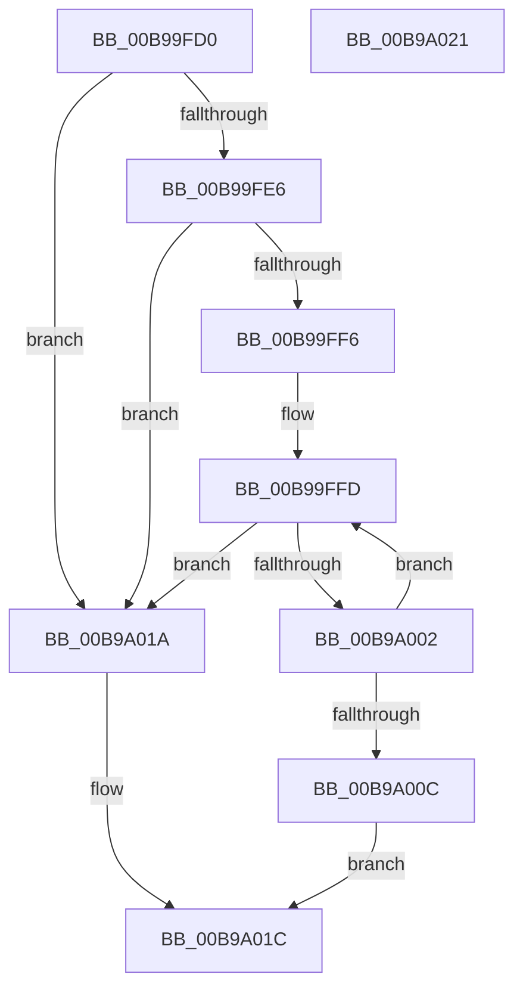

# VfCheckDifDdiExist

- RVA: `0x00B99FD0`–`0x00B9A022` (길이 `82` bytes)
- VA: `0x0000000140B99FD0`
- 실행 섹션: `PAGEVRFY`
- PDB 이름 있음: `예`; PDB Function 태그: `아니요`
- unwind 정보 RVA: `0x0005C788`
- 디코드: `23`개 명령, `82/82` bytes 표시
- 미해석 바이트: `0` (있으면 어셈블리에 `.byte`로 보존)

> 이 문서는 커널 이미지의 기계어와 PDB 기호를 분석해 생성했습니다. 4번과 5번은 함수 원형과 자료형을 바이너리 사용 방식에서 추정한 C 해석이며 원본 소스 복구 결과는 아닙니다.

## 1. Dependencies

- 직접 호출 지점: **3**; 고유 호출 대상: **1**
- 직접 호출자로 확인된 함수: **1**
- RIP 상대 이미지 참조: **4**

### Outgoing calls
- `0x00B99FDD` → [ViCheckDifDdiExist](ViCheckDifDdiExist_function_00B9A6DC.md) (function, `0x00B9A6DC`)
- `0x00B99FED` → [ViCheckDifDdiExist](ViCheckDifDdiExist_function_00B9A6DC.md) (function, `0x00B9A6DC`)
- `0x00B9A013` → [ViCheckDifDdiExist](ViCheckDifDdiExist_function_00B9A6DC.md) (function, `0x00B9A6DC`)

### Direct callers
- [DifRegisterPlugin](../../text/61/DifRegisterPlugin_function_0061ABE0.md) at `0x0061AC70`

### Static image references
- `0x00B99FD6` → RVA `0x00FF5F20` (`PAGEVRFD`; read)
- `0x00B99FE6` → RVA `0x00FF4A40` (`PAGEVRFD`; read)
- `0x00B99FF6` → RVA `0x00FF4210` (`PAGEVRFD`; read)
- `0x00B9A00C` → RVA `0x00FF51B0` (`PAGEVRFD`; read)

## 2. Other-region calls and transfers

- 다른 실행 섹션으로 향하는 call: **0**
- 별도 외부 분기/꼬리 이동을 확인하지 못했습니다.

## 3. Assembly (complete function range)

```asm
00B99FD0  48 83 EC 28                     sub rsp, 0x28
00B99FD4  8B D1                           mov edx, ecx
00B99FD6  48 8D 0D 43 BF 45 00            lea rcx, [rip + 0x45bf43]
00B99FDD  E8 FA 06 00 00                  call 0x140b9a6dc
00B99FE2  84 C0                           test al, al
00B99FE4  75 34                           jne 0x140b9a01a
00B99FE6  48 8D 0D 53 AA 45 00            lea rcx, [rip + 0x45aa53]
00B99FED  E8 EA 06 00 00                  call 0x140b9a6dc
00B99FF2  84 C0                           test al, al
00B99FF4  75 24                           jne 0x140b9a01a
00B99FF6  48 8D 05 13 A2 45 00            lea rax, [rip + 0x45a213]
00B99FFD  39 50 18                        cmp dword ptr [rax + 0x18], edx
00B9A000  74 18                           je 0x140b9a01a
00B9A002  48 83 C0 20                     add rax, 0x20
00B9A006  48 83 38 00                     cmp qword ptr [rax], 0
00B9A00A  75 F1                           jne 0x140b99ffd
00B9A00C  48 8D 0D 9D B1 45 00            lea rcx, [rip + 0x45b19d]
00B9A013  E8 C4 06 00 00                  call 0x140b9a6dc
00B9A018  EB 02                           jmp 0x140b9a01c
00B9A01A  B0 01                           mov al, 1
00B9A01C  48 83 C4 28                     add rsp, 0x28
00B9A020  C3                              ret
00B9A021  CC                              int3
```

## 4. C-style interpretation (structured pseudocode)

```c
__int64 __fastcall VfCheckDifDdiExist(int a1)
{
    __int64 result;
    __int64 v_rsp;

    v_rsp = (v_rsp) - (40);
    result = ViCheckDifDdiExist(v_rip + 4570947, (unsigned int)(a1), a3, a4);
    if ((unsigned __int8)(result) != 0) goto loc_00B9A01A;
    result = ViCheckDifDdiExist(v_rip + 4565587, (unsigned int)(a1), a3, a4);
    if ((unsigned __int8)(result) != 0) goto loc_00B9A01A;
loc_00B99FFD:
    if ((*(unsigned int *)(v_rip + 4563475 + 24)) == ((unsigned int)((unsigned int)(a1)))) goto loc_00B9A01A;
    result = (v_rip + 4563475) + (32);
    if ((*(unsigned __int64 *)(result)) != 0) goto loc_00B99FFD;
    result = ViCheckDifDdiExist(v_rip + 4567453, (unsigned int)(a1), a3, a4);
    goto loc_00B9A01C;
loc_00B9A01A:
loc_00B9A01C:
    v_rsp = (v_rsp) + (40);
    return 1;
}
```

## 5. (Beta) C Style

```c
int64_t VfCheckDifDdiExist(int32_t Arg1)
{
    int64_t result;
    int64_t local_rsp;

    local_rsp = (local_rsp) - (40);
    result = ViCheckDifDdiExist(v_rip + 4570947, (uint32_t)(Arg1), a3, a4);
    if ((uint8_t)(result) != 0) goto loc_00B9A01A;
    result = ViCheckDifDdiExist(v_rip + 4565587, (uint32_t)(Arg1), a3, a4);
    if ((uint8_t)(result) != 0) goto loc_00B9A01A;
loc_00B99FFD:
    if ((*(uint32_t *)(v_rip + 0x45A213 + 0x18)) == ((uint32_t)((uint32_t)(Arg1)))) goto loc_00B9A01A;
    result = (v_rip + 4563475) + (32);
    if ((*(uint64_t *)(result)) != 0) goto loc_00B99FFD;
    result = ViCheckDifDdiExist(v_rip + 4567453, (uint32_t)(Arg1), a3, a4);
    goto loc_00B9A01C;
loc_00B9A01A:
loc_00B9A01C:
    local_rsp = (local_rsp) + (40);
    return 1;
}
```

## 6. Execution-region graph

[열기: 2D/3D 그래프와 함수 탐색 컨트롤 패널](../../../control-panel.html?section=pagevrfy&rva=0x00B99FD0&view=graph)

- 2D 그래프는 위에서 아래로 흐르고, 3D 그래프는 빈 공간을 드래그해 회전합니다. Shift+드래그는 이동, 휠은 확대·축소, 함수 노드 선택은 대상 보고서 이동입니다.

### Static fallback


