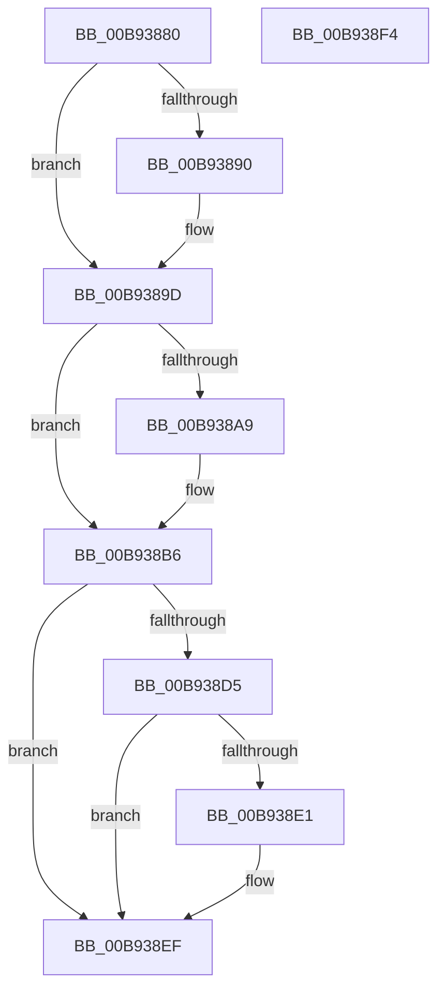

# VfClearDifWithoutReboot

- RVA: `0x00B93880`–`0x00B938F5` (길이 `117` bytes)
- VA: `0x0000000140B93880`
- 실행 섹션: `PAGEVRFY`
- PDB 이름 있음: `예`; PDB Function 태그: `아니요`
- unwind 정보 RVA: `0x0005C788`
- 디코드: `24`개 명령, `117/117` bytes 표시
- 미해석 바이트: `0` (있으면 어셈블리에 `.byte`로 보존)

> 이 문서는 커널 이미지의 기계어와 PDB 기호를 분석해 생성했습니다. 4번과 5번은 함수 원형과 자료형을 바이너리 사용 방식에서 추정한 C 해석이며 원본 소스 복구 결과는 아닙니다.

## 1. Dependencies

- 직접 호출 지점: **2**; 고유 호출 대상: **1**
- 직접 호출자로 확인된 함수: **2**
- RIP 상대 이미지 참조: **10**

### Outgoing calls
- `0x00B93890` → [MmUnlockPagableImageSection](../../text/2A/MmUnlockPagableImageSection_function_002A39F0.md) (function, `0x002A39F0`)
- `0x00B938A9` → [MmUnlockPagableImageSection](../../text/2A/MmUnlockPagableImageSection_function_002A39F0.md) (function, `0x002A39F0`)

### Direct callers
- [VfVolatileClearDifRuleClass](../../text/61/VfVolatileClearDifRuleClass_function_006168E0.md) at `0x006169D0`
- [VfVolatileSetDifRuleClass](../../text/61/VfVolatileSetDifRuleClass_function_00616AA4.md) at `0x00616CF8`

### Static image references
- `0x00B93884` → RVA `0x00F04358` (`.data`; read)
- `0x00B93895` → RVA `0x00F04358` (`.data`; read/write)
- `0x00B9389D` → RVA `0x00F04360` (`.data`; read)
- `0x00B938AE` → RVA `0x00F04360` (`.data`; read/write)
- `0x00B938B6` → RVA `0x00F0437C` (`.data`; read)
- `0x00B938C3` → RVA `0x00F04890` (`.data`; write)
- `0x00B938CB` → RVA `0x00F048A0` (`.data`; write)
- `0x00B938D5` → RVA `0x00F04980` (`.data`; read)
- `0x00B938E1` → RVA `0x00F0437C` (`.data`; read/write)
- `0x00B938E8` → RVA `0x00F04980` (`.data`; read/write)

## 2. Other-region calls and transfers

- 다른 실행 섹션으로 향하는 call: **2**
  - `0x00B93890` → [MmUnlockPagableImageSection](../../text/2A/MmUnlockPagableImageSection_function_002A39F0.md) (`PAGEVRFY` → `.text`)
  - `0x00B938A9` → [MmUnlockPagableImageSection](../../text/2A/MmUnlockPagableImageSection_function_002A39F0.md) (`PAGEVRFY` → `.text`)
- 별도 외부 분기/꼬리 이동을 확인하지 못했습니다.

## 3. Assembly (complete function range)

```asm
00B93880  48 83 EC 28                     sub rsp, 0x28
00B93884  48 8B 0D CD 0A 37 00            mov rcx, qword ptr [rip + 0x370acd]
00B9388B  48 85 C9                        test rcx, rcx
00B9388E  74 0D                           je 0x140b9389d
00B93890  E8 5B 01 71 FF                  call 0x1402a39f0
00B93895  48 83 25 BB 0A 37 00 00         and qword ptr [rip + 0x370abb], 0
00B9389D  48 8B 0D BC 0A 37 00            mov rcx, qword ptr [rip + 0x370abc]
00B938A4  48 85 C9                        test rcx, rcx
00B938A7  74 0D                           je 0x140b938b6
00B938A9  E8 42 01 71 FF                  call 0x1402a39f0
00B938AE  48 83 25 AA 0A 37 00 00         and qword ptr [rip + 0x370aaa], 0
00B938B6  83 3D BF 0A 37 00 00            cmp dword ptr [rip + 0x370abf], 0
00B938BD  0F 57 C0                        xorps xmm0, xmm0
00B938C0  0F 57 C9                        xorps xmm1, xmm1
00B938C3  F3 0F 7F 05 C5 0F 37 00         movdqu xmmword ptr [rip + 0x370fc5], xmm0
00B938CB  F3 0F 7F 0D CD 0F 37 00         movdqu xmmword ptr [rip + 0x370fcd], xmm1
00B938D3  74 1A                           je 0x140b938ef
00B938D5  F7 05 A1 10 37 00 00 08 00 00   test dword ptr [rip + 0x3710a1], 0x800
00B938DF  74 0E                           je 0x140b938ef
00B938E1  83 25 94 0A 37 00 00            and dword ptr [rip + 0x370a94], 0
00B938E8  83 25 91 10 37 00 00            and dword ptr [rip + 0x371091], 0
00B938EF  48 83 C4 28                     add rsp, 0x28
00B938F3  C3                              ret
00B938F4  CC                              int3
```

## 4. C-style interpretation (structured pseudocode)

```c
__int64 __fastcall VfClearDifWithoutReboot(void)
{
    __int64 result;
    __int64 v_rsp;

    v_rsp = (v_rsp) - (40);
    if (*(unsigned __int64 *)(v_rip + 3607245) != 0) {
        result = MmUnlockPagableImageSection(*(unsigned __int64 *)(v_rip + 3607245), a2, a3, a4);
    }
    if (*(unsigned __int64 *)(v_rip + 3607228) != 0) {
        result = MmUnlockPagableImageSection(*(unsigned __int64 *)(v_rip + 3607228), a2, a3, a4);
    }
    *(unsigned __int64 *)(v_rip + 3608517) = v_xmm0;
    *(unsigned __int64 *)(v_rip + 3608525) = v_xmm1;
    if ((*(unsigned int *)(v_rip + 3607231)) == 0) goto loc_00B938EF;
    if (((*(unsigned int *)(v_rip + 3608737)) & (0x800ULL)) != 0) {
    }
    v_rsp = (v_rsp) + (40);
    return result;
}
```

## 5. (Beta) C Style

```c
void VfClearDifWithoutReboot(void)
{
    int64_t result;
    int64_t local_rsp;

    local_rsp = (local_rsp) - (40);
    if (*(uint64_t *)(v_rip + 0x370ACD) != 0) {
        result = MmUnlockPagableImageSection(*(uint64_t *)(v_rip + 0x370ACD), a2, a3, a4);
    }
    if (*(uint64_t *)(v_rip + 0x370ABC) != 0) {
        result = MmUnlockPagableImageSection(*(uint64_t *)(v_rip + 0x370ABC), a2, a3, a4);
    }
    *(uint64_t *)(v_rip + 0x370FC5) = v_xmm0;
    *(uint64_t *)(v_rip + 0x370FCD) = v_xmm1;
    if ((*(uint32_t *)(v_rip + 0x370ABF)) == 0) goto loc_00B938EF;
    if (((*(uint32_t *)(v_rip + 0x3710A1)) & (0x800ULL)) != 0) {
    }
    local_rsp = (local_rsp) + (40);
    return result;
}
```

## 6. Execution-region graph

[열기: 2D/3D 그래프와 함수 탐색 컨트롤 패널](../../../control-panel.html?section=pagevrfy&rva=0x00B93880&view=graph)

- 2D 그래프는 위에서 아래로 흐르고, 3D 그래프는 빈 공간을 드래그해 회전합니다. Shift+드래그는 이동, 휠은 확대·축소, 함수 노드 선택은 대상 보고서 이동입니다.

### Static fallback


