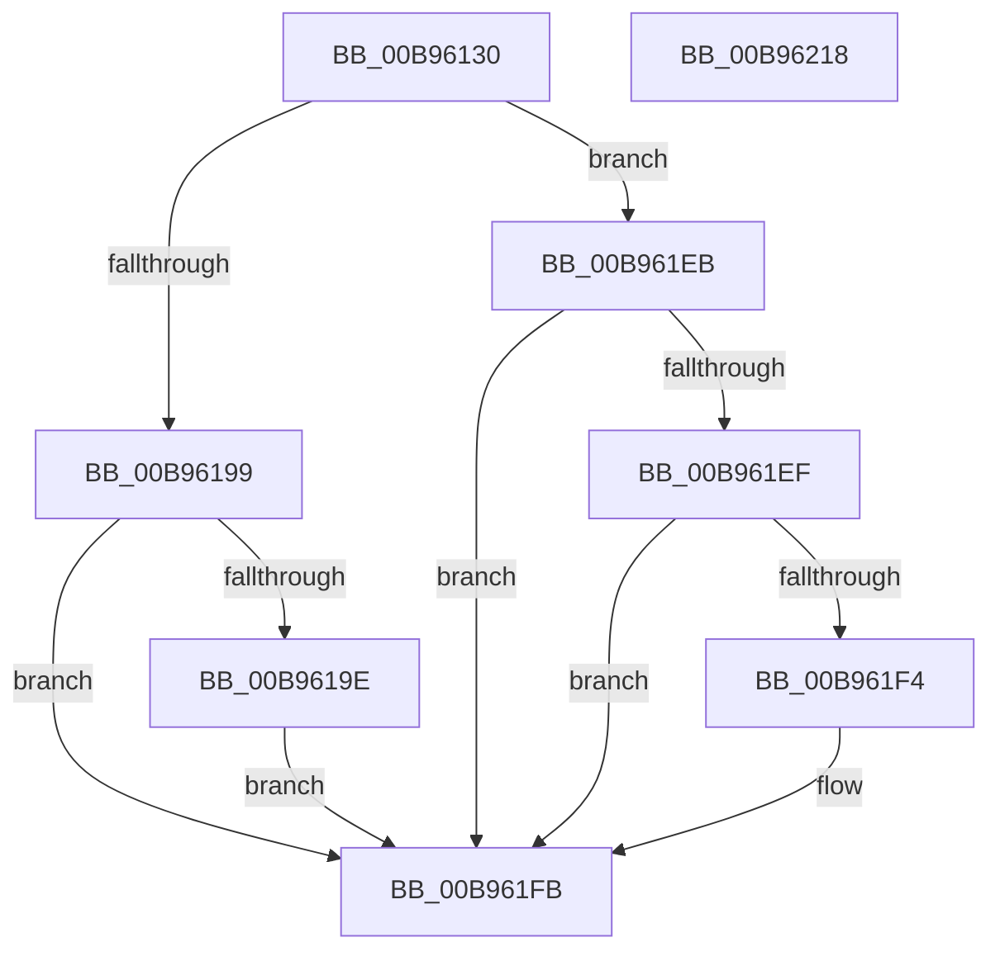

# VfCreateCommonBufferFromMdl

- RVA: `0x00B96130`–`0x00B96219` (길이 `233` bytes)
- VA: `0x0000000140B96130`
- 실행 섹션: `PAGEVRFY`
- PDB 이름 있음: `예`; PDB Function 태그: `아니요`
- unwind 정보 RVA: `0x0005D7BC`
- 디코드: `62`개 명령, `233/233` bytes 표시
- 미해석 바이트: `0` (있으면 어셈블리에 `.byte`로 보존)

> 이 문서는 커널 이미지의 기계어와 PDB 기호를 분석해 생성했습니다. 4번과 5번은 함수 원형과 자료형을 바이너리 사용 방식에서 추정한 C 해석이며 원본 소스 복구 결과는 아닙니다.

## 1. Dependencies

- 직접 호출 지점: **5**; 고유 호출 대상: **5**
- 직접 호출자로 확인된 함수: **0**
- RIP 상대 이미지 참조: **2**

### Outgoing calls
- `0x00B96155` → [ViGetRealDmaAdapter](ViGetRealDmaAdapter_function_00B990DC.md) (function, `0x00B990DC`)
- `0x00B96162` → [ViGetAdapterInformationInternal](ViGetAdapterInformationInternal_function_00B98E88.md) (function, `0x00B98E88`)
- `0x00B9618B` → [guard_dispatch_icall](../../text/6B/guard_dispatch_icall_function_006BAAD0.md) (function, `0x006BAAD0`)
- `0x00B961C5` → [ViHalPreprocessOptions](ViHalPreprocessOptions_function_00B9920C.md) (function, `0x00B9920C`)
- `0x00B961E4` → [VfReportIssueWithOptions](../../text/61/VfReportIssueWithOptions_function_00614444.md) (function, `0x00614444`)

### Direct callers
- 이 함수 시작 RVA로 연결되는 직접 call은 확인되지 않았습니다. 간접 호출은 완전히 역산할 수 없습니다.

### Static image references
- `0x00B961A6` → RVA `0x00E0E968` (`.data`; read)
- `0x00B961B5` → RVA `0x00BBA4E0` (` ?? ::JKADOLAD::`string'`; read)

## 2. Other-region calls and transfers

- 다른 실행 섹션으로 향하는 call: **2**
  - `0x00B9618B` → [guard_dispatch_icall](../../text/6B/guard_dispatch_icall_function_006BAAD0.md) (`PAGEVRFY` → `.text`)
  - `0x00B961E4` → [VfReportIssueWithOptions](../../text/61/VfReportIssueWithOptions_function_00614444.md) (`PAGEVRFY` → `.text`)
- 별도 외부 분기/꼬리 이동을 확인하지 못했습니다.

## 3. Assembly (complete function range)

```asm
00B96130  48 8B C4                        mov rax, rsp
00B96133  48 89 58 08                     mov qword ptr [rax + 8], rbx
00B96137  48 89 68 10                     mov qword ptr [rax + 0x10], rbp
00B9613B  48 89 70 18                     mov qword ptr [rax + 0x18], rsi
00B9613F  48 89 78 20                     mov qword ptr [rax + 0x20], rdi
00B96143  41 56                           push r14
00B96145  48 83 EC 30                     sub rsp, 0x30
00B96149  45 8B F1                        mov r14d, r9d
00B9614C  49 8B F0                        mov rsi, r8
00B9614F  48 8B EA                        mov rbp, rdx
00B96152  48 8B D9                        mov rbx, rcx
00B96155  E8 82 2F 00 00                  call 0x140b990dc
00B9615A  B2 01                           mov dl, 1
00B9615C  48 8B CB                        mov rcx, rbx
00B9615F  48 8B F8                        mov rdi, rax
00B96162  E8 21 2D 00 00                  call 0x140b98e88
00B96167  48 8B 4F 08                     mov rcx, qword ptr [rdi + 8]
00B9616B  48 8B D8                        mov rbx, rax
00B9616E  45 8B CE                        mov r9d, r14d
00B96171  4C 8B C6                        mov r8, rsi
00B96174  48 8B D5                        mov rdx, rbp
00B96177  48 8B 81 38 01 00 00            mov rax, qword ptr [rcx + 0x138]
00B9617E  48 8B 4C 24 60                  mov rcx, qword ptr [rsp + 0x60]
00B96183  48 89 4C 24 20                  mov qword ptr [rsp + 0x20], rcx
00B96188  48 8B CF                        mov rcx, rdi
00B9618B  E8 40 49 B2 FF                  call 0x1406baad0
00B96190  8B F8                           mov edi, eax
00B96192  3D 0D 00 00 C0                  cmp eax, 0xc000000d
00B96197  75 52                           jne 0x140b961eb
00B96199  48 85 DB                        test rbx, rbx
00B9619C  74 5D                           je 0x140b961fb
00B9619E  41 8B DE                        mov ebx, r14d
00B961A1  48 89 6C 24 28                  mov qword ptr [rsp + 0x28], rbp
00B961A6  4C 8D 35 BB 87 27 00            lea r14, [rip + 0x2787bb]
00B961AD  48 89 5C 24 20                  mov qword ptr [rsp + 0x20], rbx
00B961B2  49 8B CE                        mov rcx, r14
00B961B5  48 8D 15 24 43 02 00            lea rdx, [rip + 0x24324]
00B961BC  4C 8B CE                        mov r9, rsi
00B961BF  41 B8 26 00 00 00               mov r8d, 0x26
00B961C5  E8 42 30 00 00                  call 0x140b9920c
00B961CA  44 8B CB                        mov r9d, ebx
00B961CD  4C 89 74 24 28                  mov qword ptr [rsp + 0x28], r14
00B961D2  4C 8B C6                        mov r8, rsi
00B961D5  48 89 6C 24 20                  mov qword ptr [rsp + 0x20], rbp
00B961DA  BA 26 00 00 00                  mov edx, 0x26
00B961DF  B9 E6 00 00 00                  mov ecx, 0xe6
00B961E4  E8 5B E2 A7 FF                  call 0x140614444
00B961E9  EB 10                           jmp 0x140b961fb
00B961EB  85 FF                           test edi, edi
00B961ED  78 0C                           js 0x140b961fb
00B961EF  48 85 DB                        test rbx, rbx
00B961F2  74 07                           je 0x140b961fb
00B961F4  F0 FF 83 CC 00 00 00            lock inc dword ptr [rbx + 0xcc]
00B961FB  48 8B 5C 24 40                  mov rbx, qword ptr [rsp + 0x40]
00B96200  8B C7                           mov eax, edi
00B96202  48 8B 7C 24 58                  mov rdi, qword ptr [rsp + 0x58]
00B96207  48 8B 6C 24 48                  mov rbp, qword ptr [rsp + 0x48]
00B9620C  48 8B 74 24 50                  mov rsi, qword ptr [rsp + 0x50]
00B96211  48 83 C4 30                     add rsp, 0x30
00B96215  41 5E                           pop r14
00B96217  C3                              ret
00B96218  CC                              int3
```

## 4. C-style interpretation (structured pseudocode)

```c
__int64 __fastcall VfCreateCommonBufferFromMdl(__int64 a1, __int64 a2, __int64 a3, int a4, __int64 a5)
{
    __int64 result;
    __int64 v_rsp;
    unsigned __int64 v_stack_m10;
    unsigned __int64 v_stack_m18;
    unsigned __int64 v_stack_p10;
    unsigned __int64 v_stack_p18;
    unsigned __int64 v_stack_p20;
    unsigned __int64 v_stack_p8;

    *(unsigned __int64 *)(v_rsp + 8) = v_rbx;
    *(unsigned __int64 *)(v_rsp + 16) = v_rbp;
    *(unsigned __int64 *)(v_rsp + 24) = v_rsi;
    *(unsigned __int64 *)(v_rsp + 32) = v_rdi;
    v_rsp = (v_rsp) - (48);
    result = ViGetRealDmaAdapter(a1, a2, a3, a4);
    result = ViGetAdapterInformationInternal(a1, 1, a3, a4);
    v_stack_m18 = a5;
    result = guard_dispatch_icall(result, a2, a3, (unsigned int)((unsigned int)((unsigned int)(a4))));
    if (((unsigned int)(result)) != 0xC000000DULL) goto loc_00B961EB;
    if (result == 0) goto loc_00B961FB;
    v_stack_m10 = a2;
    v_stack_m18 = (unsigned int)((unsigned int)((unsigned int)(a4)));
    result = ViHalPreprocessOptions(v_rip + 2590651, v_rip + 148260, 38, a3);
    v_stack_m10 = v_rip + 2590651;
    v_stack_m18 = a2;
    result = VfReportIssueWithOptions(230, 38, a3, (unsigned int)((unsigned int)((unsigned int)((unsigned int)((unsigned int)(a4))))));
    goto loc_00B961FB;
loc_00B961EB:
    if (sign_flag) goto loc_00B961FB;
    if ((unsigned int)((unsigned int)((unsigned int)(a4))) != 0) {
    }
    v_rsp = (v_rsp) + (48);
    return (unsigned int)((unsigned int)((unsigned int)((unsigned int)(result))));
}
```

## 5. (Beta) C Style

```c
int64_t VfCreateCommonBufferFromMdl(int64_t Arg1, int64_t Arg2, int64_t Arg3, int32_t Arg4, int64_t Arg5)
{
    int64_t result;
    int64_t local_rsp;
    uint64_t v_stack_m10;
    uint64_t v_stack_m18;
    uint64_t v_stack_p10;
    uint64_t v_stack_p18;
    uint64_t v_stack_p20;
    uint64_t v_stack_p8;

    *(uint64_t *)(local_rsp + 0x8) = local_rbx;
    *(uint64_t *)(local_rsp + 0x10) = local_rbp;
    *(uint64_t *)(local_rsp + 0x18) = local_rsi;
    *(uint64_t *)(local_rsp + 0x20) = local_rdi;
    local_rsp = (local_rsp) - (48);
    result = ViGetRealDmaAdapter(Arg1, Arg2, Arg3, Arg4);
    result = ViGetAdapterInformationInternal(Arg1, 1, Arg3, Arg4);
    v_stack_m18 = Arg5;
    result = guard_dispatch_icall(result, Arg2, Arg3, (uint32_t)((uint32_t)((uint32_t)(Arg4))));
    if (((uint32_t)(result)) != 0xC000000DULL) goto loc_00B961EB;
    if (result == 0) goto loc_00B961FB;
    v_stack_m10 = Arg2;
    v_stack_m18 = (uint32_t)((uint32_t)((uint32_t)(Arg4)));
    result = ViHalPreprocessOptions(v_rip + 2590651, v_rip + 148260, 38, Arg3);
    v_stack_m10 = v_rip + 2590651;
    v_stack_m18 = Arg2;
    result = VfReportIssueWithOptions(230, 38, Arg3, (uint32_t)((uint32_t)((uint32_t)((uint32_t)((uint32_t)(Arg4))))));
    goto loc_00B961FB;
loc_00B961EB:
    if (sign_flag) goto loc_00B961FB;
    if ((uint32_t)((uint32_t)((uint32_t)(Arg4))) != 0) {
    }
    local_rsp = (local_rsp) + (48);
    return (uint32_t)((uint32_t)((uint32_t)((uint32_t)(result))));
}
```

## 6. Execution-region graph

[열기: 2D/3D 그래프와 함수 탐색 컨트롤 패널](../../../control-panel.html?section=pagevrfy&rva=0x00B96130&view=graph)

- 2D 그래프는 위에서 아래로 흐르고, 3D 그래프는 빈 공간을 드래그해 회전합니다. Shift+드래그는 이동, 휠은 확대·축소, 함수 노드 선택은 대상 보고서 이동입니다.

### Static fallback


