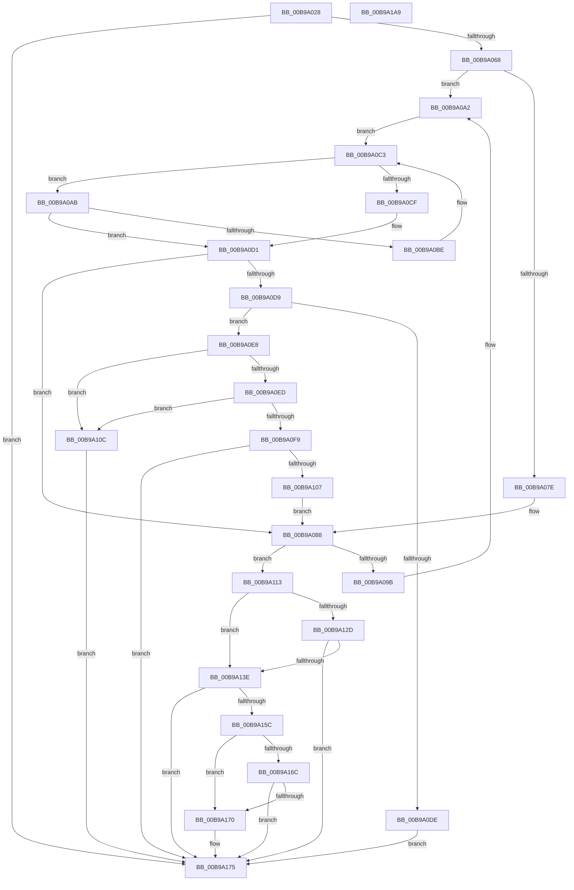

# VfDriverApplyDifVerification

- RVA: `0x00B9A028`–`0x00B9A1AA` (길이 `386` bytes)
- VA: `0x0000000140B9A028`
- 실행 섹션: `PAGEVRFY`
- PDB 이름 있음: `예`; PDB Function 태그: `아니요`
- unwind 정보 RVA: `0x00060300`
- 디코드: `105`개 명령, `386/386` bytes 표시
- 미해석 바이트: `0` (있으면 어셈블리에 `.byte`로 보존)

> 이 문서는 커널 이미지의 기계어와 PDB 기호를 분석해 생성했습니다. 4번과 5번은 함수 원형과 자료형을 바이너리 사용 방식에서 추정한 C 해석이며 원본 소스 복구 결과는 아닙니다.

## 1. Dependencies

- 직접 호출 지점: **9**; 고유 호출 대상: **8**
- 직접 호출자로 확인된 함수: **1**
- RIP 상대 이미지 참조: **12**

### Outgoing calls
- `0x00B9A04F` → [VfDriverLock](VfDriverLock_function_00B9A4A4.md) (function, `0x00B9A4A4`)
- `0x00B9A05B` → [VfSuspectDriversLookupName](../BA/VfSuspectDriversLookupName_function_00BAAE74.md) (function, `0x00BAAE74`)
- `0x00B9A075` → [RtlEqualUnicodeString](../../page/93/RtlEqualUnicodeString_function_00932A20.md) (function, `0x00932A20`)
- `0x00B9A0B5` → [RtlEqualUnicodeString](../../page/93/RtlEqualUnicodeString_function_00932A20.md) (function, `0x00932A20`)
- `0x00B9A0F0` → [VfUtilIsProtectedDriver](VfUtilIsProtectedDriver_function_00B9349C.md) (function, `0x00B9349C`)
- `0x00B9A0FC` → [MmIsVerifierApplicableToImage](../../text/67/MmIsVerifierApplicableToImage_function_0067B5AC.md) (function, `0x0067B5AC`)
- `0x00B9A133` → [VfSuspectApplyDifVolatileVerification](../BA/VfSuspectApplyDifVolatileVerification_function_00BAA558.md) (function, `0x00BAA558`)
- `0x00B9A170` → [ExSetPoolFlags](../../text/65/ExSetPoolFlags_function_006567C4.md) (function, `0x006567C4`)
- `0x00B9A189` → [KeReleaseMutex](../../text/39/KeReleaseMutex_function_00396810.md) (function, `0x00396810`)

### Direct callers
- [VfDriverEnableDisableVerifier](VfDriverEnableDisableVerifier_function_00B9A1B0.md) at `0x00B9A1FD`

### Static image references
- `0x00B9A06B` → RVA `0x00B8B038` (`VfKernelImageName`; read)
- `0x00B9A07E` → RVA `0x00F04ABC` (`.data`; write)
- `0x00B9A088` → RVA `0x00F049E8` (`.data`; read)
- `0x00B9A08F` → RVA `0x00F049E0` (`.data`; read)
- `0x00B9A0A2` → RVA `0x00EF54C0` (`.data`; read)
- `0x00B9A0D1` → RVA `0x00F04ABC` (`.data`; read)
- `0x00B9A124` → RVA `0x00F049E8` (`.data`; write)
- `0x00B9A13E` → RVA `0x00F04AA0` (`.data`; read)
- `0x00B9A154` → RVA `0x00F04AA0` (`.data`; write)
- `0x00B9A15C` → RVA `0x00E681A0` (`.data`; read)
- `0x00B9A177` → RVA `0x00F04938` (`.data`; write)
- `0x00B9A182` → RVA `0x00F04900` (`.data`; read)

## 2. Other-region calls and transfers

- 다른 실행 섹션으로 향하는 call: **5**
  - `0x00B9A075` → [RtlEqualUnicodeString](../../page/93/RtlEqualUnicodeString_function_00932A20.md) (`PAGEVRFY` → `PAGE`)
  - `0x00B9A0B5` → [RtlEqualUnicodeString](../../page/93/RtlEqualUnicodeString_function_00932A20.md) (`PAGEVRFY` → `PAGE`)
  - `0x00B9A0FC` → [MmIsVerifierApplicableToImage](../../text/67/MmIsVerifierApplicableToImage_function_0067B5AC.md) (`PAGEVRFY` → `.text`)
  - `0x00B9A170` → [ExSetPoolFlags](../../text/65/ExSetPoolFlags_function_006567C4.md) (`PAGEVRFY` → `.text`)
  - `0x00B9A189` → [KeReleaseMutex](../../text/39/KeReleaseMutex_function_00396810.md) (`PAGEVRFY` → `.text`)
- 별도 외부 분기/꼬리 이동을 확인하지 못했습니다.

## 3. Assembly (complete function range)

```asm
00B9A028  48 89 5C 24 08                  mov qword ptr [rsp + 8], rbx
00B9A02D  48 89 6C 24 10                  mov qword ptr [rsp + 0x10], rbp
00B9A032  48 89 74 24 18                  mov qword ptr [rsp + 0x18], rsi
00B9A037  57                              push rdi
00B9A038  41 56                           push r14
00B9A03A  41 57                           push r15
00B9A03C  48 83 EC 20                     sub rsp, 0x20
00B9A040  33 DB                           xor ebx, ebx
00B9A042  4D 8B F8                        mov r15, r8
00B9A045  41 21 18                        and dword ptr [r8], ebx
00B9A048  4C 8B F1                        mov r14, rcx
00B9A04B  33 F6                           xor esi, esi
00B9A04D  33 FF                           xor edi, edi
00B9A04F  E8 50 04 00 00                  call 0x140b9a4a4
00B9A054  49 8D 6E 28                     lea rbp, [r14 + 0x28]
00B9A058  48 8B CD                        mov rcx, rbp
00B9A05B  E8 14 0E 01 00                  call 0x140baae74
00B9A060  85 C0                           test eax, eax
00B9A062  0F 85 0D 01 00 00               jne 0x140b9a175
00B9A068  41 B0 01                        mov r8b, 1
00B9A06B  48 8D 0D C6 0F FF FF            lea rcx, [rip - 0xf03a]
00B9A072  48 8B D5                        mov rdx, rbp
00B9A075  E8 A6 89 D9 FF                  call 0x140932a20
00B9A07A  84 C0                           test al, al
00B9A07C  74 24                           je 0x140b9a0a2
00B9A07E  C7 05 34 AA 36 00 01 00 00 00   mov dword ptr [rip + 0x36aa34], 1
00B9A088  48 8B 05 59 A9 36 00            mov rax, qword ptr [rip + 0x36a959]
00B9A08F  48 8D 0D 4A A9 36 00            lea rcx, [rip + 0x36a94a]
00B9A096  48 39 08                        cmp qword ptr [rax], rcx
00B9A099  74 78                           je 0x140b9a113
00B9A09B  B9 03 00 00 00                  mov ecx, 3
00B9A0A0  CD 29                           int 0x29
00B9A0A2  48 8B 1D 17 B4 35 00            mov rbx, qword ptr [rip + 0x35b417]
00B9A0A9  EB 18                           jmp 0x140b9a0c3
00B9A0AB  48 8D 53 58                     lea rdx, [rbx + 0x58]
00B9A0AF  41 B0 01                        mov r8b, 1
00B9A0B2  48 8B CD                        mov rcx, rbp
00B9A0B5  E8 66 89 D9 FF                  call 0x140932a20
00B9A0BA  84 C0                           test al, al
00B9A0BC  75 13                           jne 0x140b9a0d1
00B9A0BE  48 8B 1B                        mov rbx, qword ptr [rbx]
00B9A0C1  FF C6                           inc esi
00B9A0C3  48 8D 05 F6 B3 35 00            lea rax, [rip + 0x35b3f6]
00B9A0CA  48 3B D8                        cmp rbx, rax
00B9A0CD  75 DC                           jne 0x140b9a0ab
00B9A0CF  33 DB                           xor ebx, ebx
00B9A0D1  39 3D E5 A9 36 00               cmp dword ptr [rip + 0x36a9e5], edi
00B9A0D7  75 AF                           jne 0x140b9a088
00B9A0D9  48 85 DB                        test rbx, rbx
00B9A0DC  75 0A                           jne 0x140b9a0e8
00B9A0DE  BF 7B 0C 00 C0                  mov edi, 0xc0000c7b
00B9A0E3  E9 8D 00 00 00                  jmp 0x140b9a175
00B9A0E8  83 FE 01                        cmp esi, 1
00B9A0EB  76 1F                           jbe 0x140b9a10c
00B9A0ED  48 8B CB                        mov rcx, rbx
00B9A0F0  E8 A7 93 FF FF                  call 0x140b9349c
00B9A0F5  85 C0                           test eax, eax
00B9A0F7  75 13                           jne 0x140b9a10c
00B9A0F9  48 8B CB                        mov rcx, rbx
00B9A0FC  E8 AB 14 AE FF                  call 0x14067b5ac
00B9A101  8B F8                           mov edi, eax
00B9A103  85 C0                           test eax, eax
00B9A105  78 6E                           js 0x140b9a175
00B9A107  E9 7C FF FF FF                  jmp 0x140b9a088
00B9A10C  BF 0D 0C 00 C0                  mov edi, 0xc0000c0d
00B9A111  EB 62                           jmp 0x140b9a175
00B9A113  49 89 0E                        mov qword ptr [r14], rcx
00B9A116  49 89 46 08                     mov qword ptr [r14 + 8], rax
00B9A11A  4C 89 30                        mov qword ptr [rax], r14
00B9A11D  83 3D 98 A9 36 00 00            cmp dword ptr [rip + 0x36a998], 0
00B9A124  4C 89 35 BD A8 36 00            mov qword ptr [rip + 0x36a8bd], r14
00B9A12B  75 11                           jne 0x140b9a13e
00B9A12D  49 8B D6                        mov rdx, r14
00B9A130  48 8B CB                        mov rcx, rbx
00B9A133  E8 20 04 01 00                  call 0x140baa558
00B9A138  8B F8                           mov edi, eax
00B9A13A  85 C0                           test eax, eax
00B9A13C  78 37                           js 0x140b9a175
00B9A13E  8B 05 5C A9 36 00               mov eax, dword ptr [rip + 0x36a95c]
00B9A144  FF C0                           inc eax
00B9A146  41 C7 07 01 00 00 00            mov dword ptr [r15], 1
00B9A14D  83 3D 68 A9 36 00 00            cmp dword ptr [rip + 0x36a968], 0
00B9A154  89 05 46 A9 36 00               mov dword ptr [rip + 0x36a946], eax
00B9A15A  74 19                           je 0x140b9a175
00B9A15C  48 8B 05 3D E0 2C 00            mov rax, qword ptr [rip + 0x2ce03d]
00B9A163  B9 08 00 00 00                  mov ecx, 8
00B9A168  84 C1                           test cl, al
00B9A16A  75 04                           jne 0x140b9a170
00B9A16C  A8 01                           test al, 1
00B9A16E  74 05                           je 0x140b9a175
00B9A170  E8 4F C6 AB FF                  call 0x1406567c4
00B9A175  33 D2                           xor edx, edx
00B9A177  48 C7 05 B6 A7 36 00 00 00 00 00  mov qword ptr [rip + 0x36a7b6], 0
00B9A182  48 8D 0D 77 A7 36 00            lea rcx, [rip + 0x36a777]
00B9A189  E8 82 C6 7F FF                  call 0x140396810
00B9A18E  48 8B 5C 24 40                  mov rbx, qword ptr [rsp + 0x40]
00B9A193  8B C7                           mov eax, edi
00B9A195  48 8B 6C 24 48                  mov rbp, qword ptr [rsp + 0x48]
00B9A19A  48 8B 74 24 50                  mov rsi, qword ptr [rsp + 0x50]
00B9A19F  48 83 C4 20                     add rsp, 0x20
00B9A1A3  41 5F                           pop r15
00B9A1A5  41 5E                           pop r14
00B9A1A7  5F                              pop rdi
00B9A1A8  C3                              ret
00B9A1A9  CC                              int3
```

## 4. C-style interpretation (structured pseudocode)

```c
__int64 __fastcall VfDriverApplyDifVerification(__int64 a1, __int64 a2, __int64 a3)
{
    __int64 result;
    __int64 v_rbx;
    __int64 v_rdi;
    __int64 v_rsi;
    __int64 v_rsp;
    unsigned __int64 v_stack_p10;
    unsigned __int64 v_stack_p18;
    unsigned __int64 v_stack_p8;

    v_stack_p8 = v_rbx;
    v_stack_p10 = v_rbp;
    v_stack_p18 = v_rsi;
    v_rsp = (v_rsp) - (32);
    v_rbx = 0;
    v_rsi = 0;
    v_rdi = 0;
    result = VfDriverLock(a1, a2, a3, a4);
    result = VfSuspectDriversLookupName(a1 + 40, a2, a3, a4);
    if ((unsigned int)(result) != 0) goto loc_00B9A175;
    result = RtlEqualUnicodeString(v_rip - 61498, a1 + 40, 1, a4);
    if ((unsigned __int8)(result) == 0) goto loc_00B9A0A2;
    *(unsigned int *)(v_rip + 3582516) = 1;
loc_00B9A088:
    if ((*(unsigned __int64 *)(*(unsigned __int64 *)(v_rip + 3582297))) == (v_rip + 3582282)) goto loc_00B9A113;
loc_00B9A0A2:
    goto loc_00B9A0C3;
loc_00B9A0AB:
    result = RtlEqualUnicodeString(a1 + 40, *(unsigned __int64 *)(v_rip + 3519511) + 88, 1, a4);
    if ((unsigned __int8)(result) != 0) goto loc_00B9A0D1;
    v_rsi = (unsigned int)((v_rsi) + 1);
loc_00B9A0C3:
    if ((*(unsigned __int64 *)(*(unsigned __int64 *)(v_rip + 3519511))) != (v_rip + 3519478)) goto loc_00B9A0AB;
    v_rbx = 0;
loc_00B9A0D1:
    if ((*(unsigned int *)(v_rip + 3582437)) != 0) goto loc_00B9A088;
    if (0 != 0) goto loc_00B9A0E8;
    goto loc_00B9A175;
loc_00B9A0E8:
    if (((unsigned int)(v_rsi)) <= 1) goto loc_00B9A10C;
    result = VfUtilIsProtectedDriver(0, *(unsigned __int64 *)(v_rip + 3519511) + 88, 1, a4);
    if ((unsigned int)(result) != 0) goto loc_00B9A10C;
    result = MmIsVerifierApplicableToImage(0, *(unsigned __int64 *)(v_rip + 3519511) + 88, 1, a4);
    if (sign_flag) goto loc_00B9A175;
    goto loc_00B9A088;
loc_00B9A10C:
    goto loc_00B9A175;
loc_00B9A113:
    *(unsigned __int64 *)(a1) = 0;
    *(unsigned __int64 *)(a1 + 8) = result;
    *(unsigned __int64 *)(result) = a1;
    *(unsigned __int64 *)(v_rip + 3582141) = a1;
    if ((*(unsigned int *)(v_rip + 3582360)) != 0) goto loc_00B9A13E;
    result = VfSuspectApplyDifVolatileVerification(0, a1, 1, a4);
    if (sign_flag) goto loc_00B9A175;
loc_00B9A13E:
    result = (unsigned int)(((unsigned int)(*(unsigned int *)(v_rip + 3582300))) + 1);
    *(unsigned int *)(a3) = 1;
    *(unsigned int *)(v_rip + 3582278) = (unsigned int)(result);
    if ((*(unsigned int *)(v_rip + 3582312)) == 0) goto loc_00B9A175;
    if (((8) & ((unsigned __int8)(*(unsigned __int64 *)(v_rip + 2940989)))) != 0) goto loc_00B9A170;
    result = *(unsigned __int64 *)(v_rip + 2940989);
    if ((((unsigned __int8)(*(unsigned __int64 *)(v_rip + 2940989))) & (1)) != 0) {
        result = ExSetPoolFlags(8, a1, 1, a4);
    }
    a2 = 0;
    *(unsigned __int64 *)(v_rip + 3581878) = 0;
    result = KeReleaseMutex(v_rip + 3581815, a2, 1, a4);
    v_rsp = (v_rsp) + (32);
    return (unsigned int)((unsigned int)((unsigned int)((unsigned int)(result))));
}
```

## 5. (Beta) C Style

```c
int64_t VfDriverApplyDifVerification(void *Arg1, int64_t Arg2, void *Arg3)
{
    uint8_t *arg1 = (uint8_t *)Arg1;
    uint8_t *arg3 = (uint8_t *)Arg3;

    int64_t result;
    int64_t local_rbx;
    int64_t local_rdi;
    int64_t local_rsi;
    int64_t local_rsp;
    uint64_t v_stack_p10;
    uint64_t v_stack_p18;
    uint64_t v_stack_p8;

    v_stack_p8 = local_rbx;
    v_stack_p10 = local_rbp;
    v_stack_p18 = local_rsi;
    local_rsp = (local_rsp) - (32);
    local_rbx = 0;
    local_rsi = 0;
    local_rdi = 0;
    result = VfDriverLock(Arg1, Arg2, Arg3, a4);
    result = VfSuspectDriversLookupName(Arg1 + 40, Arg2, Arg3, a4);
    if ((uint32_t)(result) != 0) goto loc_00B9A175;
    result = RtlEqualUnicodeString(v_rip - 61498, Arg1 + 40, 1, a4);
    if ((uint8_t)(result) == 0) goto loc_00B9A0A2;
    *(uint32_t *)(v_rip + 0x36AA34) = 1;
loc_00B9A088:
    if ((*(uint64_t *)(*(uint64_t *)(v_rip + 0x36A959))) == (v_rip + 3582282)) goto loc_00B9A113;
loc_00B9A0A2:
    goto loc_00B9A0C3;
loc_00B9A0AB:
    result = RtlEqualUnicodeString(Arg1 + 40, *(uint64_t *)(v_rip + 0x35B417) + 88, 1, a4);
    if ((uint8_t)(result) != 0) goto loc_00B9A0D1;
    local_rsi = (uint32_t)((local_rsi) + 1);
loc_00B9A0C3:
    if ((*(uint64_t *)(*(uint64_t *)(v_rip + 0x35B417))) != (v_rip + 3519478)) goto loc_00B9A0AB;
    local_rbx = 0;
loc_00B9A0D1:
    if ((*(uint32_t *)(v_rip + 0x36A9E5)) != 0) goto loc_00B9A088;
    if (0 != 0) goto loc_00B9A0E8;
    goto loc_00B9A175;
loc_00B9A0E8:
    if (((uint32_t)(local_rsi)) <= 1) goto loc_00B9A10C;
    result = VfUtilIsProtectedDriver(0, *(uint64_t *)(v_rip + 0x35B417) + 88, 1, a4);
    if ((uint32_t)(result) != 0) goto loc_00B9A10C;
    result = MmIsVerifierApplicableToImage(0, *(uint64_t *)(v_rip + 0x35B417) + 88, 1, a4);
    if (sign_flag) goto loc_00B9A175;
    goto loc_00B9A088;
loc_00B9A10C:
    goto loc_00B9A175;
loc_00B9A113:
    *(uint64_t *)(arg1) = 0;
    *(uint64_t *)(arg1 + 0x8) = result;
    *(void **)(result) = Arg1;
    *(void **)(v_rip + 0x36A8BD) = Arg1;
    if ((*(uint32_t *)(v_rip + 0x36A998)) != 0) goto loc_00B9A13E;
    result = VfSuspectApplyDifVolatileVerification(0, Arg1, 1, a4);
    if (sign_flag) goto loc_00B9A175;
loc_00B9A13E:
    result = (uint32_t)(((uint32_t)(*(uint32_t *)(v_rip + 0x36A95C))) + 1);
    *(uint32_t *)(arg3) = 1;
    *(uint32_t *)(v_rip + 0x36A946) = (uint32_t)(result);
    if ((*(uint32_t *)(v_rip + 0x36A968)) == 0) goto loc_00B9A175;
    if (((8) & ((uint8_t)(*(uint64_t *)(v_rip + 0x2CE03D)))) != 0) goto loc_00B9A170;
    result = *(uint64_t *)(v_rip + 0x2CE03D);
    if ((((uint8_t)(*(uint64_t *)(v_rip + 0x2CE03D))) & (1)) != 0) {
        result = ExSetPoolFlags(8, Arg1, 1, a4);
    }
    Arg2 = 0;
    *(uint64_t *)(v_rip + 0x36A7B6) = 0;
    result = KeReleaseMutex(v_rip + 3581815, Arg2, 1, a4);
    local_rsp = (local_rsp) + (32);
    return (uint32_t)((uint32_t)((uint32_t)((uint32_t)(result))));
}
```

### 관측된 메모리 오프셋

구조체 형식이 확인되지 않은 접근은 인자 기준의 오프셋으로만 기록했습니다.

| 기준 인자 | 오프셋 표현 | 폭 (bit) | 접근 |
|---|---:|---:|---|
| `Arg1` | `+ 0x0` | `64` | `W` |
| `Arg1` | `+ 0x8` | `64` | `W` |
| `Arg1` | `+ 0x28` | `64` | `R` |
| `Arg3` | `+ 0x0` | `32` | `R/W` |
| `Arg3` | `+ 0x0` | `32` | `W` |

## 6. Execution-region graph

[열기: 2D/3D 그래프와 함수 탐색 컨트롤 패널](../../../control-panel.html?section=pagevrfy&rva=0x00B9A028&view=graph)

- 2D 그래프는 위에서 아래로 흐르고, 3D 그래프는 빈 공간을 드래그해 회전합니다. Shift+드래그는 이동, 휠은 확대·축소, 함수 노드 선택은 대상 보고서 이동입니다.

### Static fallback


