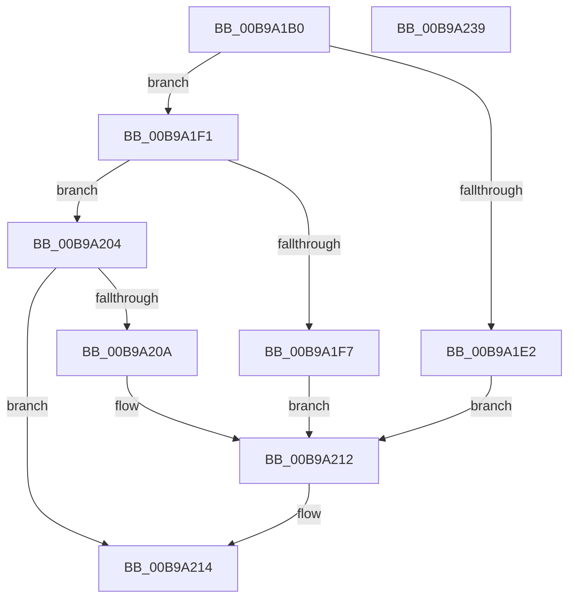

# VfDriverEnableDisableVerifier

- RVA: `0x00B9A1B0`–`0x00B9A23A` (길이 `138` bytes)
- VA: `0x0000000140B9A1B0`
- 실행 섹션: `PAGEVRFY`
- PDB 이름 있음: `예`; PDB Function 태그: `아니요`
- unwind 정보 RVA: `0x0005E6B4`
- 디코드: `42`개 명령, `138/138` bytes 표시
- 미해석 바이트: `0` (있으면 어셈블리에 `.byte`로 보존)

> 이 문서는 커널 이미지의 기계어와 PDB 기호를 분석해 생성했습니다. 4번과 5번은 함수 원형과 자료형을 바이너리 사용 방식에서 추정한 C 해석이며 원본 소스 복구 결과는 아닙니다.

## 1. Dependencies

- 직접 호출 지점: **5**; 고유 호출 대상: **5**
- 직접 호출자로 확인된 함수: **1**
- RIP 상대 이미지 참조: **0**

### Outgoing calls
- `0x00B9A1D4` → [MmAcquireLoadLock](../../text/4D/MmAcquireLoadLock_function_004DC2A0.md) (function, `0x004DC2A0`)
- `0x00B9A1EA` → [VfDriverEnableVerifier](VfDriverEnableVerifier_function_00B9A240.md) (function, `0x00B9A240`)
- `0x00B9A1FD` → [VfDriverApplyDifVerification](VfDriverApplyDifVerification_function_00B9A028.md) (function, `0x00B9A028`)
- `0x00B9A20D` → [VfDriverRemoveDifVerification](VfDriverRemoveDifVerification_function_00B9A4E0.md) (function, `0x00B9A4E0`)
- `0x00B9A217` → [MmReleaseLoadLock](../../text/4D/MmReleaseLoadLock_function_004D36D0.md) (function, `0x004D36D0`)

### Direct callers
- [MmEnableOrDisableVerifierForDriver](MmEnableOrDisableVerifierForDriver_function_00B92CC0.md) at `0x00B92CC7`

### Static image references
- 디코드된 RIP-relative 메모리 참조가 없습니다.

## 2. Other-region calls and transfers

- 다른 실행 섹션으로 향하는 call: **2**
  - `0x00B9A1D4` → [MmAcquireLoadLock](../../text/4D/MmAcquireLoadLock_function_004DC2A0.md) (`PAGEVRFY` → `.text`)
  - `0x00B9A217` → [MmReleaseLoadLock](../../text/4D/MmReleaseLoadLock_function_004D36D0.md) (`PAGEVRFY` → `.text`)
- 별도 외부 분기/꼬리 이동을 확인하지 못했습니다.

## 3. Assembly (complete function range)

```asm
00B9A1B0  48 8B C4                        mov rax, rsp
00B9A1B3  48 89 58 08                     mov qword ptr [rax + 8], rbx
00B9A1B7  48 89 68 10                     mov qword ptr [rax + 0x10], rbp
00B9A1BB  48 89 70 18                     mov qword ptr [rax + 0x18], rsi
00B9A1BF  48 89 78 20                     mov qword ptr [rax + 0x20], rdi
00B9A1C3  41 56                           push r14
00B9A1C5  48 83 EC 20                     sub rsp, 0x20
00B9A1C9  41 8B F8                        mov edi, r8d
00B9A1CC  48 8B EA                        mov rbp, rdx
00B9A1CF  48 8B F1                        mov rsi, rcx
00B9A1D2  33 DB                           xor ebx, ebx
00B9A1D4  E8 C7 20 94 FF                  call 0x1404dc2a0
00B9A1D9  4C 8B F0                        mov r14, rax
00B9A1DC  40 F6 C7 01                     test dil, 1
00B9A1E0  74 0F                           je 0x140b9a1f1
00B9A1E2  4C 8B C5                        mov r8, rbp
00B9A1E5  33 D2                           xor edx, edx
00B9A1E7  48 8B CE                        mov rcx, rsi
00B9A1EA  E8 51 00 00 00                  call 0x140b9a240
00B9A1EF  EB 21                           jmp 0x140b9a212
00B9A1F1  40 F6 C7 02                     test dil, 2
00B9A1F5  74 0D                           je 0x140b9a204
00B9A1F7  4C 8B C5                        mov r8, rbp
00B9A1FA  48 8B CE                        mov rcx, rsi
00B9A1FD  E8 26 FE FF FF                  call 0x140b9a028
00B9A202  EB 0E                           jmp 0x140b9a212
00B9A204  40 F6 C7 04                     test dil, 4
00B9A208  74 0A                           je 0x140b9a214
00B9A20A  48 8B CE                        mov rcx, rsi
00B9A20D  E8 CE 02 00 00                  call 0x140b9a4e0
00B9A212  8B D8                           mov ebx, eax
00B9A214  49 8B CE                        mov rcx, r14
00B9A217  E8 B4 94 93 FF                  call 0x1404d36d0
00B9A21C  48 8B 6C 24 38                  mov rbp, qword ptr [rsp + 0x38]
00B9A221  8B C3                           mov eax, ebx
00B9A223  48 8B 5C 24 30                  mov rbx, qword ptr [rsp + 0x30]
00B9A228  48 8B 74 24 40                  mov rsi, qword ptr [rsp + 0x40]
00B9A22D  48 8B 7C 24 48                  mov rdi, qword ptr [rsp + 0x48]
00B9A232  48 83 C4 20                     add rsp, 0x20
00B9A236  41 5E                           pop r14
00B9A238  C3                              ret
00B9A239  CC                              int3
```

## 4. C-style interpretation (structured pseudocode)

```c
__int64 __fastcall VfDriverEnableDisableVerifier(__int64 a1, __int64 a2, int a3)
{
    __int64 result;
    __int64 v_rbx;
    __int64 v_rsp;
    unsigned __int64 v_stack_p10;
    unsigned __int64 v_stack_p18;
    unsigned __int64 v_stack_p20;
    unsigned __int64 v_stack_p8;

    *(unsigned __int64 *)(v_rsp + 8) = v_rbx;
    *(unsigned __int64 *)(v_rsp + 16) = v_rbp;
    *(unsigned __int64 *)(v_rsp + 24) = v_rsi;
    *(unsigned __int64 *)(v_rsp + 32) = v_rdi;
    v_rsp = (v_rsp) - (32);
    v_rbx = 0;
    result = MmAcquireLoadLock(a1, a2, a3, a4);
    if ((((unsigned __int8)((unsigned int)(a3))) & (1)) == 0) goto loc_00B9A1F1;
    a2 = 0;
    result = VfDriverEnableVerifier(a1, a2, a2, a4);
    goto loc_00B9A212;
loc_00B9A1F1:
    if ((((unsigned __int8)((unsigned int)(a3))) & (2)) == 0) goto loc_00B9A204;
    result = VfDriverApplyDifVerification(a1, a2, 0, a4);
    goto loc_00B9A212;
loc_00B9A204:
    if ((((unsigned __int8)((unsigned int)(a3))) & (4)) == 0) goto loc_00B9A214;
    result = VfDriverRemoveDifVerification(a1, a2, 0, a4);
loc_00B9A212:
loc_00B9A214:
    result = MmReleaseLoadLock(result, a2, 0, a4);
    v_rsp = (v_rsp) + (32);
    return (unsigned int)((unsigned int)((unsigned int)((unsigned int)(result))));
}
```

## 5. (Beta) C Style

```c
int64_t VfDriverEnableDisableVerifier(int64_t Arg1, int64_t Arg2, int32_t Arg3)
{
    int64_t result;
    int64_t local_rbx;
    int64_t local_rsp;
    uint64_t v_stack_p10;
    uint64_t v_stack_p18;
    uint64_t v_stack_p20;
    uint64_t v_stack_p8;

    *(uint64_t *)(local_rsp + 0x8) = local_rbx;
    *(uint64_t *)(local_rsp + 0x10) = local_rbp;
    *(uint64_t *)(local_rsp + 0x18) = local_rsi;
    *(uint64_t *)(local_rsp + 0x20) = local_rdi;
    local_rsp = (local_rsp) - (32);
    local_rbx = 0;
    result = MmAcquireLoadLock(Arg1, Arg2, Arg3, a4);
    if ((((uint8_t)((uint32_t)(Arg3))) & (1)) == 0) goto loc_00B9A1F1;
    Arg2 = 0;
    result = VfDriverEnableVerifier(Arg1, Arg2, Arg2, a4);
    goto loc_00B9A212;
loc_00B9A1F1:
    if ((((uint8_t)((uint32_t)(Arg3))) & (2)) == 0) goto loc_00B9A204;
    result = VfDriverApplyDifVerification(Arg1, Arg2, 0, a4);
    goto loc_00B9A212;
loc_00B9A204:
    if ((((uint8_t)((uint32_t)(Arg3))) & (4)) == 0) goto loc_00B9A214;
    result = VfDriverRemoveDifVerification(Arg1, Arg2, 0, a4);
loc_00B9A212:
loc_00B9A214:
    result = MmReleaseLoadLock(result, Arg2, 0, a4);
    local_rsp = (local_rsp) + (32);
    return (uint32_t)((uint32_t)((uint32_t)((uint32_t)(result))));
}
```

## 6. Execution-region graph

[열기: 2D/3D 그래프와 함수 탐색 컨트롤 패널](../../../control-panel.html?section=pagevrfy&rva=0x00B9A1B0&view=graph)

- 2D 그래프는 위에서 아래로 흐르고, 3D 그래프는 빈 공간을 드래그해 회전합니다. Shift+드래그는 이동, 휠은 확대·축소, 함수 노드 선택은 대상 보고서 이동입니다.

### Static fallback


