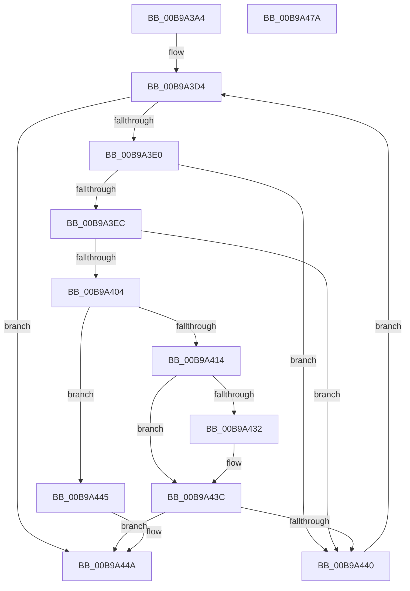

# VfDriverEnableVerifierForAll

- RVA: `0x00B9A3A4`–`0x00B9A47B` (길이 `215` bytes)
- VA: `0x0000000140B9A3A4`
- 실행 섹션: `PAGEVRFY`
- PDB 이름 있음: `예`; PDB Function 태그: `아니요`
- unwind 정보 RVA: `0x000C7F20`
- 디코드: `62`개 명령, `215/215` bytes 표시
- 미해석 바이트: `0` (있으면 어셈블리에 `.byte`로 보존)

> 이 문서는 커널 이미지의 기계어와 PDB 기호를 분석해 생성했습니다. 4번과 5번은 함수 원형과 자료형을 바이너리 사용 방식에서 추정한 C 해석이며 원본 소스 복구 결과는 아닙니다.

## 1. Dependencies

- 직접 호출 지점: **9**; 고유 호출 대상: **9**
- 직접 호출자로 확인된 함수: **1**
- RIP 상대 이미지 참조: **3**

### Outgoing calls
- `0x00B9A3BD` → [VfDriverLock](VfDriverLock_function_00B9A4A4.md) (function, `0x00B9A4A4`)
- `0x00B9A3C2` → [MmAcquireLoadLock](../../text/4D/MmAcquireLoadLock_function_004DC2A0.md) (function, `0x004DC2A0`)
- `0x00B9A3E3` → [VfUtilIsProtectedDriver](VfUtilIsProtectedDriver_function_00B9349C.md) (function, `0x00B9349C`)
- `0x00B9A3FB` → [RtlImageNtHeaderEx](../../text/41/RtlImageNtHeaderEx_function_0041EAA0.md) (function, `0x0041EAA0`)
- `0x00B9A407` → [VfSuspectDriversAllocateEntryEx](../BA/VfSuspectDriversAllocateEntryEx_function_00BAA72C.md) (function, `0x00BAA72C`)
- `0x00B9A424` → [VfDriverEnableVerifier](VfDriverEnableVerifier_function_00B9A240.md) (function, `0x00B9A240`)
- `0x00B9A437` → [ExFreePoolWithTag](../../poolcode/B8/ExFreePoolWithTag_function_00B82870.md) (function, `0x00B82870`)
- `0x00B9A44D` → [MmReleaseLoadLock](../../text/4D/MmReleaseLoadLock_function_004D36D0.md) (function, `0x004D36D0`)
- `0x00B9A466` → [KeReleaseMutex](../../text/39/KeReleaseMutex_function_00396810.md) (function, `0x00396810`)

### Direct callers
- [VfAddVerifierEntry](../BA/VfAddVerifierEntry_function_00BAC31C.md) at `0x00BAC3E3`

### Static image references
- `0x00B9A3CA` → RVA `0x00EF54C0` (`.data`; read)
- `0x00B9A454` → RVA `0x00F04938` (`.data`; write)
- `0x00B9A45F` → RVA `0x00F04900` (`.data`; read)

## 2. Other-region calls and transfers

- 다른 실행 섹션으로 향하는 call: **5**
  - `0x00B9A3C2` → [MmAcquireLoadLock](../../text/4D/MmAcquireLoadLock_function_004DC2A0.md) (`PAGEVRFY` → `.text`)
  - `0x00B9A3FB` → [RtlImageNtHeaderEx](../../text/41/RtlImageNtHeaderEx_function_0041EAA0.md) (`PAGEVRFY` → `.text`)
  - `0x00B9A437` → [ExFreePoolWithTag](../../poolcode/B8/ExFreePoolWithTag_function_00B82870.md) (`PAGEVRFY` → `POOLCODE`)
  - `0x00B9A44D` → [MmReleaseLoadLock](../../text/4D/MmReleaseLoadLock_function_004D36D0.md) (`PAGEVRFY` → `.text`)
  - `0x00B9A466` → [KeReleaseMutex](../../text/39/KeReleaseMutex_function_00396810.md) (`PAGEVRFY` → `.text`)
- 별도 외부 분기/꼬리 이동을 확인하지 못했습니다.

## 3. Assembly (complete function range)

```asm
00B9A3A4  48 89 5C 24 18                  mov qword ptr [rsp + 0x18], rbx
00B9A3A9  55                              push rbp
00B9A3AA  56                              push rsi
00B9A3AB  57                              push rdi
00B9A3AC  48 83 EC 20                     sub rsp, 0x20
00B9A3B0  48 83 64 24 48 00               and qword ptr [rsp + 0x48], 0
00B9A3B6  33 FF                           xor edi, edi
00B9A3B8  83 64 24 40 00                  and dword ptr [rsp + 0x40], 0
00B9A3BD  E8 E2 00 00 00                  call 0x140b9a4a4
00B9A3C2  E8 D9 1E 94 FF                  call 0x1404dc2a0
00B9A3C7  48 8B E8                        mov rbp, rax
00B9A3CA  48 8B 05 EF B0 35 00            mov rax, qword ptr [rip + 0x35b0ef]
00B9A3D1  48 8B 18                        mov rbx, qword ptr [rax]
00B9A3D4  48 8D 05 E5 B0 35 00            lea rax, [rip + 0x35b0e5]
00B9A3DB  48 3B D8                        cmp rbx, rax
00B9A3DE  74 6A                           je 0x140b9a44a
00B9A3E0  48 8B CB                        mov rcx, rbx
00B9A3E3  E8 B4 90 FF FF                  call 0x140b9349c
00B9A3E8  85 C0                           test eax, eax
00B9A3EA  75 54                           jne 0x140b9a440
00B9A3EC  48 8B 53 30                     mov rdx, qword ptr [rbx + 0x30]
00B9A3F0  4C 8D 4C 24 48                  lea r9, [rsp + 0x48]
00B9A3F5  45 33 C0                        xor r8d, r8d
00B9A3F8  8D 48 01                        lea ecx, [rax + 1]
00B9A3FB  E8 A0 46 88 FF                  call 0x14041eaa0
00B9A400  85 C0                           test eax, eax
00B9A402  78 3C                           js 0x140b9a440
00B9A404  48 8B CB                        mov rcx, rbx
00B9A407  E8 20 03 01 00                  call 0x140baa72c
00B9A40C  48 8B F0                        mov rsi, rax
00B9A40F  48 85 C0                        test rax, rax
00B9A412  74 31                           je 0x140b9a445
00B9A414  83 64 24 40 00                  and dword ptr [rsp + 0x40], 0
00B9A419  4C 8D 44 24 40                  lea r8, [rsp + 0x40]
00B9A41E  48 8B D3                        mov rdx, rbx
00B9A421  48 8B C8                        mov rcx, rax
00B9A424  E8 17 FE FF FF                  call 0x140b9a240
00B9A429  83 7C 24 40 00                  cmp dword ptr [rsp + 0x40], 0
00B9A42E  8B F8                           mov edi, eax
00B9A430  75 0A                           jne 0x140b9a43c
00B9A432  33 D2                           xor edx, edx
00B9A434  48 8B CE                        mov rcx, rsi
00B9A437  E8 34 84 FE FF                  call 0x140b82870
00B9A43C  85 FF                           test edi, edi
00B9A43E  78 0A                           js 0x140b9a44a
00B9A440  48 8B 1B                        mov rbx, qword ptr [rbx]
00B9A443  EB 8F                           jmp 0x140b9a3d4
00B9A445  BF 9A 00 00 C0                  mov edi, 0xc000009a
00B9A44A  48 8B CD                        mov rcx, rbp
00B9A44D  E8 7E 92 93 FF                  call 0x1404d36d0
00B9A452  33 D2                           xor edx, edx
00B9A454  48 C7 05 D9 A4 36 00 00 00 00 00  mov qword ptr [rip + 0x36a4d9], 0
00B9A45F  48 8D 0D 9A A4 36 00            lea rcx, [rip + 0x36a49a]
00B9A466  E8 A5 C3 7F FF                  call 0x140396810
00B9A46B  48 8B 5C 24 50                  mov rbx, qword ptr [rsp + 0x50]
00B9A470  8B C7                           mov eax, edi
00B9A472  48 83 C4 20                     add rsp, 0x20
00B9A476  5F                              pop rdi
00B9A477  5E                              pop rsi
00B9A478  5D                              pop rbp
00B9A479  C3                              ret
00B9A47A  CC                              int3
```

## 4. C-style interpretation (structured pseudocode)

```c
__int64 __fastcall VfDriverEnableVerifierForAll(__int64 a1, __int64 a2, int a3)
{
    __int64 result;
    __int64 v_rdi;
    __int64 v_rsp;
    unsigned __int64 v_stack_p10;
    unsigned __int64 v_stack_p18;
    unsigned int v_stack_p8;

    v_stack_p18 = v_rbx;
    v_rsp = (v_rsp) - (32);
    v_rdi = 0;
    result = VfDriverLock(a1, a2, a3, a4);
    result = MmAcquireLoadLock(a1, a2, a3, a4);
loc_00B9A3D4:
    if ((*(unsigned __int64 *)(*(unsigned __int64 *)(v_rip + 3518703))) == (v_rip + 3518693)) goto loc_00B9A44A;
    result = VfUtilIsProtectedDriver(*(unsigned __int64 *)(*(unsigned __int64 *)(v_rip + 3518703)), a2, a3, a4);
    if ((unsigned int)(result) != 0) goto loc_00B9A440;
    a3 = 0;
    result = RtlImageNtHeaderEx(result + 1, *(unsigned __int64 *)(*(unsigned __int64 *)(*(unsigned __int64 *)(v_rip + 3518703)) + 48), a3, v_stack_p10);
    if (sign_flag) goto loc_00B9A440;
    result = VfSuspectDriversAllocateEntryEx(*(unsigned __int64 *)(*(unsigned __int64 *)(v_rip + 3518703)), *(unsigned __int64 *)(*(unsigned __int64 *)(*(unsigned __int64 *)(v_rip + 3518703)) + 48), a3, v_stack_p10);
    if (result == 0) goto loc_00B9A445;
    result = VfDriverEnableVerifier(result, *(unsigned __int64 *)(*(unsigned __int64 *)(v_rip + 3518703)), v_stack_p8, v_stack_p10);
    if (v_stack_p8 == 0) {
        a2 = 0;
        a1 = result;
        result = ExFreePoolWithTag(a1, a2, v_stack_p8, v_stack_p10);
    }
    if (sign_flag) goto loc_00B9A44A;
loc_00B9A440:
    goto loc_00B9A3D4;
loc_00B9A445:
loc_00B9A44A:
    result = MmReleaseLoadLock(result, a2, v_stack_p8, v_stack_p10);
    a2 = 0;
    *(unsigned __int64 *)(v_rip + 3581145) = 0;
    result = KeReleaseMutex(v_rip + 3581082, a2, v_stack_p8, v_stack_p10);
    v_rsp = (v_rsp) + (32);
    return (unsigned int)((unsigned int)((unsigned int)(0xC000009AULL)));
}
```

## 5. (Beta) C Style

```c
int64_t VfDriverEnableVerifierForAll(int64_t Arg1, int64_t Arg2, int32_t Arg3)
{
    int64_t result;
    int64_t local_rdi;
    int64_t local_rsp;
    uint64_t v_stack_p10;
    uint64_t v_stack_p18;
    uint32_t v_stack_p8;

    v_stack_p18 = local_rbx;
    local_rsp = (local_rsp) - (32);
    local_rdi = 0;
    result = VfDriverLock(Arg1, Arg2, Arg3, a4);
    result = MmAcquireLoadLock(Arg1, Arg2, Arg3, a4);
loc_00B9A3D4:
    if ((*(uint64_t *)(*(uint64_t *)(v_rip + 0x35B0EF))) == (v_rip + 3518693)) goto loc_00B9A44A;
    result = VfUtilIsProtectedDriver(*(uint64_t *)(*(uint64_t *)(v_rip + 0x35B0EF)), Arg2, Arg3, a4);
    if ((uint32_t)(result) != 0) goto loc_00B9A440;
    Arg3 = 0;
    result = RtlImageNtHeaderEx(result + 1, *(uint64_t *)(*(uint64_t *)(*(uint64_t *)(v_rip + 0x35B0EF)) + 0x30), Arg3, v_stack_p10);
    if (sign_flag) goto loc_00B9A440;
    result = VfSuspectDriversAllocateEntryEx(*(uint64_t *)(*(uint64_t *)(v_rip + 0x35B0EF)), *(uint64_t *)(*(uint64_t *)(*(uint64_t *)(v_rip + 0x35B0EF)) + 0x30), Arg3, v_stack_p10);
    if (result == 0) goto loc_00B9A445;
    result = VfDriverEnableVerifier(result, *(uint64_t *)(*(uint64_t *)(v_rip + 0x35B0EF)), v_stack_p8, v_stack_p10);
    if (v_stack_p8 == 0) {
        Arg2 = 0;
        Arg1 = result;
        result = ExFreePoolWithTag(Arg1, Arg2, v_stack_p8, v_stack_p10);
    }
    if (sign_flag) goto loc_00B9A44A;
loc_00B9A440:
    goto loc_00B9A3D4;
loc_00B9A445:
loc_00B9A44A:
    result = MmReleaseLoadLock(result, Arg2, v_stack_p8, v_stack_p10);
    Arg2 = 0;
    *(uint64_t *)(v_rip + 0x36A4D9) = 0;
    result = KeReleaseMutex(v_rip + 3581082, Arg2, v_stack_p8, v_stack_p10);
    local_rsp = (local_rsp) + (32);
    return (uint32_t)((uint32_t)((uint32_t)(0xC000009AULL)));
}
```

## 6. Execution-region graph

[열기: 2D/3D 그래프와 함수 탐색 컨트롤 패널](../../../control-panel.html?section=pagevrfy&rva=0x00B9A3A4&view=graph)

- 2D 그래프는 위에서 아래로 흐르고, 3D 그래프는 빈 공간을 드래그해 회전합니다. Shift+드래그는 이동, 휠은 확대·축소, 함수 노드 선택은 대상 보고서 이동입니다.

### Static fallback


