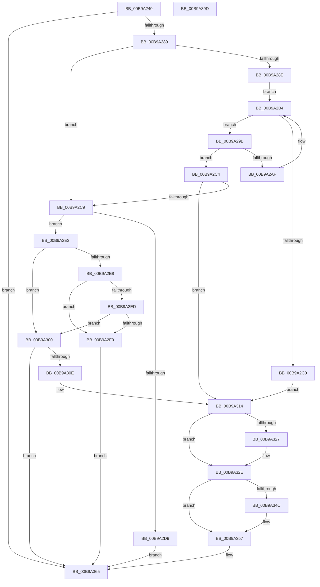

# VfDriverEnableVerifier

- RVA: `0x00B9A240`–`0x00B9A39E` (길이 `350` bytes)
- VA: `0x0000000140B9A240`
- 실행 섹션: `PAGEVRFY`
- PDB 이름 있음: `예`; PDB Function 태그: `아니요`
- unwind 정보 RVA: `0x000B0E24`
- 디코드: `99`개 명령, `350/350` bytes 표시
- 미해석 바이트: `0` (있으면 어셈블리에 `.byte`로 보존)

> 이 문서는 커널 이미지의 기계어와 PDB 기호를 분석해 생성했습니다. 4번과 5번은 함수 원형과 자료형을 바이너리 사용 방식에서 추정한 C 해석이며 원본 소스 복구 결과는 아닙니다.

## 1. Dependencies

- 직접 호출 지점: **7**; 고유 호출 대상: **7**
- 직접 호출자로 확인된 함수: **3**
- RIP 상대 이미지 참조: **10**

### Outgoing calls
- `0x00B9A273` → [VfDriverLock](VfDriverLock_function_00B9A4A4.md) (function, `0x00B9A4A4`)
- `0x00B9A27C` → [VfSuspectDriversLookupName](../BA/VfSuspectDriversLookupName_function_00BAAE74.md) (function, `0x00BAAE74`)
- `0x00B9A2A6` → [RtlEqualUnicodeString](../../page/93/RtlEqualUnicodeString_function_00932A20.md) (function, `0x00932A20`)
- `0x00B9A2F0` → [VfUtilIsProtectedDriver](VfUtilIsProtectedDriver_function_00B9349C.md) (function, `0x00B9349C`)
- `0x00B9A303` → [MmIsVerifierApplicableToImage](../../text/67/MmIsVerifierApplicableToImage_function_0067B5AC.md) (function, `0x0067B5AC`)
- `0x00B9A352` → [VfSuspectApplyDifVolatileVerification](../BA/VfSuspectApplyDifVolatileVerification_function_00BAA558.md) (function, `0x00BAA558`)
- `0x00B9A379` → [KeReleaseMutex](../../text/39/KeReleaseMutex_function_00396810.md) (function, `0x00396810`)

### Direct callers
- [VfDriverEnableDisableVerifier](VfDriverEnableDisableVerifier_function_00B9A1B0.md) at `0x00B9A1EA`
- [VfDriverEnableVerifierForAll](VfDriverEnableVerifierForAll_function_00B9A3A4.md) at `0x00B9A424`
- [VfAddVerifierEntry](../BA/VfAddVerifierEntry_function_00BAC31C.md) at `0x00BAC422`

### Static image references
- `0x00B9A28E` → RVA `0x00EF54C0` (`.data`; read)
- `0x00B9A2C9` → RVA `0x00F04384` (`.data`; read)
- `0x00B9A2D1` → RVA `0x00F04A20` (`.data`; reference)
- `0x00B9A314` → RVA `0x00F049E8` (`.data`; read)
- `0x00B9A31B` → RVA `0x00F049E0` (`.data`; read)
- `0x00B9A338` → RVA `0x00F049E8` (`.data`; write)
- `0x00B9A357` → RVA `0x00F04AA0` (`.data`; read)
- `0x00B9A35F` → RVA `0x00F04AA0` (`.data`; write)
- `0x00B9A367` → RVA `0x00F04938` (`.data`; write)
- `0x00B9A372` → RVA `0x00F04900` (`.data`; read)

## 2. Other-region calls and transfers

- 다른 실행 섹션으로 향하는 call: **3**
  - `0x00B9A2A6` → [RtlEqualUnicodeString](../../page/93/RtlEqualUnicodeString_function_00932A20.md) (`PAGEVRFY` → `PAGE`)
  - `0x00B9A303` → [MmIsVerifierApplicableToImage](../../text/67/MmIsVerifierApplicableToImage_function_0067B5AC.md) (`PAGEVRFY` → `.text`)
  - `0x00B9A379` → [KeReleaseMutex](../../text/39/KeReleaseMutex_function_00396810.md) (`PAGEVRFY` → `.text`)
- 별도 외부 분기/꼬리 이동을 확인하지 못했습니다.

## 3. Assembly (complete function range)

```asm
00B9A240  48 89 5C 24 08                  mov qword ptr [rsp + 8], rbx
00B9A245  48 89 6C 24 18                  mov qword ptr [rsp + 0x18], rbp
00B9A24A  48 89 74 24 20                  mov qword ptr [rsp + 0x20], rsi
00B9A24F  57                              push rdi
00B9A250  41 54                           push r12
00B9A252  41 55                           push r13
00B9A254  41 56                           push r14
00B9A256  41 57                           push r15
00B9A258  48 83 EC 20                     sub rsp, 0x20
00B9A25C  41 83 20 00                     and dword ptr [r8], 0
00B9A260  4D 8B E8                        mov r13, r8
00B9A263  48 8B DA                        mov rbx, rdx
00B9A266  48 8B F1                        mov rsi, rcx
00B9A269  45 33 FF                        xor r15d, r15d
00B9A26C  33 ED                           xor ebp, ebp
00B9A26E  33 FF                           xor edi, edi
00B9A270  45 33 F6                        xor r14d, r14d
00B9A273  E8 2C 02 00 00                  call 0x140b9a4a4
00B9A278  48 8D 4E 28                     lea rcx, [rsi + 0x28]
00B9A27C  E8 F3 0B 01 00                  call 0x140baae74
00B9A281  85 C0                           test eax, eax
00B9A283  0F 85 DC 00 00 00               jne 0x140b9a365
00B9A289  48 85 DB                        test rbx, rbx
00B9A28C  75 3B                           jne 0x140b9a2c9
00B9A28E  48 8B 1D 2B B2 35 00            mov rbx, qword ptr [rip + 0x35b22b]
00B9A295  45 8D 77 01                     lea r14d, [r15 + 1]
00B9A299  EB 19                           jmp 0x140b9a2b4
00B9A29B  48 8D 53 58                     lea rdx, [rbx + 0x58]
00B9A29F  45 8A C6                        mov r8b, r14b
00B9A2A2  48 8D 4E 28                     lea rcx, [rsi + 0x28]
00B9A2A6  E8 75 87 D9 FF                  call 0x140932a20
00B9A2AB  84 C0                           test al, al
00B9A2AD  75 15                           jne 0x140b9a2c4
00B9A2AF  48 8B 1B                        mov rbx, qword ptr [rbx]
00B9A2B2  FF C5                           inc ebp
00B9A2B4  48 8D 05 05 B2 35 00            lea rax, [rip + 0x35b205]
00B9A2BB  48 3B D8                        cmp rbx, rax
00B9A2BE  75 DB                           jne 0x140b9a29b
00B9A2C0  33 DB                           xor ebx, ebx
00B9A2C2  EB 50                           jmp 0x140b9a314
00B9A2C4  48 85 DB                        test rbx, rbx
00B9A2C7  74 4B                           je 0x140b9a314
00B9A2C9  8B 05 B5 A0 36 00               mov eax, dword ptr [rip + 0x36a0b5]
00B9A2CF  F7 D0                           not eax
00B9A2D1  85 05 49 A7 36 00               test dword ptr [rip + 0x36a749], eax
00B9A2D7  74 0A                           je 0x140b9a2e3
00B9A2D9  BF 0C 0C 00 C0                  mov edi, 0xc0000c0c
00B9A2DE  E9 82 00 00 00                  jmp 0x140b9a365
00B9A2E3  45 85 F6                        test r14d, r14d
00B9A2E6  74 18                           je 0x140b9a300
00B9A2E8  83 FD 01                        cmp ebp, 1
00B9A2EB  76 0C                           jbe 0x140b9a2f9
00B9A2ED  48 8B CB                        mov rcx, rbx
00B9A2F0  E8 A7 91 FF FF                  call 0x140b9349c
00B9A2F5  85 C0                           test eax, eax
00B9A2F7  74 07                           je 0x140b9a300
00B9A2F9  BF 0D 0C 00 C0                  mov edi, 0xc0000c0d
00B9A2FE  EB 65                           jmp 0x140b9a365
00B9A300  48 8B CB                        mov rcx, rbx
00B9A303  E8 A4 12 AE FF                  call 0x14067b5ac
00B9A308  8B F8                           mov edi, eax
00B9A30A  85 C0                           test eax, eax
00B9A30C  78 57                           js 0x140b9a365
00B9A30E  41 BF 01 00 00 00               mov r15d, 1
00B9A314  48 8B 05 CD A6 36 00            mov rax, qword ptr [rip + 0x36a6cd]
00B9A31B  48 8D 0D BE A6 36 00            lea rcx, [rip + 0x36a6be]
00B9A322  48 39 08                        cmp qword ptr [rax], rcx
00B9A325  74 07                           je 0x140b9a32e
00B9A327  B9 03 00 00 00                  mov ecx, 3
00B9A32C  CD 29                           int 0x29
00B9A32E  48 89 0E                        mov qword ptr [rsi], rcx
00B9A331  48 89 46 08                     mov qword ptr [rsi + 8], rax
00B9A335  48 89 30                        mov qword ptr [rax], rsi
00B9A338  48 89 35 A9 A6 36 00            mov qword ptr [rip + 0x36a6a9], rsi
00B9A33F  41 C7 45 00 01 00 00 00         mov dword ptr [r13], 1
00B9A347  45 85 FF                        test r15d, r15d
00B9A34A  74 0B                           je 0x140b9a357
00B9A34C  48 8B D6                        mov rdx, rsi
00B9A34F  48 8B CB                        mov rcx, rbx
00B9A352  E8 01 02 01 00                  call 0x140baa558
00B9A357  8B 05 43 A7 36 00               mov eax, dword ptr [rip + 0x36a743]
00B9A35D  FF C0                           inc eax
00B9A35F  89 05 3B A7 36 00               mov dword ptr [rip + 0x36a73b], eax
00B9A365  33 D2                           xor edx, edx
00B9A367  48 C7 05 C6 A5 36 00 00 00 00 00  mov qword ptr [rip + 0x36a5c6], 0
00B9A372  48 8D 0D 87 A5 36 00            lea rcx, [rip + 0x36a587]
00B9A379  E8 92 C4 7F FF                  call 0x140396810
00B9A37E  48 8B 5C 24 50                  mov rbx, qword ptr [rsp + 0x50]
00B9A383  8B C7                           mov eax, edi
00B9A385  48 8B 6C 24 60                  mov rbp, qword ptr [rsp + 0x60]
00B9A38A  48 8B 74 24 68                  mov rsi, qword ptr [rsp + 0x68]
00B9A38F  48 83 C4 20                     add rsp, 0x20
00B9A393  41 5F                           pop r15
00B9A395  41 5E                           pop r14
00B9A397  41 5D                           pop r13
00B9A399  41 5C                           pop r12
00B9A39B  5F                              pop rdi
00B9A39C  C3                              ret
00B9A39D  CC                              int3
```

## 4. C-style interpretation (structured pseudocode)

```c
__int64 __fastcall VfDriverEnableVerifier(__int64 a1, __int64 a2, __int64 a3)
{
    __int64 result;
    __int64 v_r14;
    __int64 v_r15;
    __int64 v_rbp;
    __int64 v_rbx;
    __int64 v_rdi;
    __int64 v_rsp;
    unsigned __int64 v_stack_p18;
    unsigned __int64 v_stack_p20;
    unsigned __int64 v_stack_p8;

    v_stack_p8 = v_rbx;
    v_stack_p18 = v_rbp;
    v_stack_p20 = v_rsi;
    v_rsp = (v_rsp) - (32);
    v_r15 = 0;
    v_rbp = 0;
    v_rdi = 0;
    v_r14 = 0;
    result = VfDriverLock(a1, a2, a3, a4);
    result = VfSuspectDriversLookupName(a1 + 40, a2, a3, a4);
    if ((unsigned int)(result) != 0) goto loc_00B9A365;
    if (a2 != 0) goto loc_00B9A2C9;
    goto loc_00B9A2B4;
loc_00B9A29B:
    result = RtlEqualUnicodeString(a1 + 40, *(unsigned __int64 *)(v_rip + 3519019) + 88, (unsigned __int8)(v_r15 + 1), a4);
    if ((unsigned __int8)(result) != 0) goto loc_00B9A2C4;
    v_rbp = (unsigned int)((v_rbp) + 1);
loc_00B9A2B4:
    if ((*(unsigned __int64 *)(*(unsigned __int64 *)(v_rip + 3519019))) != (v_rip + 3518981)) goto loc_00B9A29B;
    v_rbx = 0;
    goto loc_00B9A314;
loc_00B9A2C4:
    if (0 == 0) goto loc_00B9A314;
loc_00B9A2C9:
    result = (unsigned int)(~((unsigned int)(*(unsigned int *)(v_rip + 3580085))));
    if (((*(unsigned int *)(v_rip + 3581769)) & ((unsigned int)(result))) == 0) goto loc_00B9A2E3;
    goto loc_00B9A365;
loc_00B9A2E3:
    if ((unsigned int)(v_r15 + 1) == 0) goto loc_00B9A300;
    if (((unsigned int)(v_rbp)) <= 1) goto loc_00B9A2F9;
    result = VfUtilIsProtectedDriver(0, *(unsigned __int64 *)(v_rip + 3519019) + 88, (unsigned __int8)(v_r15 + 1), a4);
    if ((unsigned int)(result) == 0) goto loc_00B9A300;
loc_00B9A2F9:
    goto loc_00B9A365;
loc_00B9A300:
    result = MmIsVerifierApplicableToImage(0, *(unsigned __int64 *)(v_rip + 3519019) + 88, (unsigned __int8)(v_r15 + 1), a4);
    if (sign_flag) goto loc_00B9A365;
loc_00B9A314:
    if ((*(unsigned __int64 *)(*(unsigned __int64 *)(v_rip + 3581645))) != (v_rip + 3581630)) {
        a1 = 3;
    }
    *(unsigned __int64 *)(a1) = a1;
    *(unsigned __int64 *)(a1 + 8) = *(unsigned __int64 *)(v_rip + 3581645);
    *(unsigned __int64 *)(*(unsigned __int64 *)(v_rip + 3581645)) = a1;
    *(unsigned __int64 *)(v_rip + 3581609) = a1;
    *(unsigned int *)(a3) = 1;
    result = *(unsigned __int64 *)(v_rip + 3581645);
    if (1 != 0) {
        a2 = a1;
        a1 = 0;
        result = VfSuspectApplyDifVolatileVerification(a1, a2, (unsigned __int8)(v_r15 + 1), a4);
    }
    result = (unsigned int)(((unsigned int)(*(unsigned int *)(v_rip + 3581763))) + 1);
    *(unsigned int *)(v_rip + 3581755) = (unsigned int)(result);
loc_00B9A365:
    a2 = 0;
    *(unsigned __int64 *)(v_rip + 3581382) = 0;
    result = KeReleaseMutex(v_rip + 3581319, a2, (unsigned __int8)(v_r15 + 1), a4);
    v_rsp = (v_rsp) + (32);
    return (unsigned int)((unsigned int)((unsigned int)((unsigned int)(result))));
}
```

## 5. (Beta) C Style

```c
int64_t VfDriverEnableVerifier(void *Arg1, int64_t Arg2, void *Arg3)
{
    uint8_t *arg1 = (uint8_t *)Arg1;
    uint8_t *arg3 = (uint8_t *)Arg3;

    int64_t result;
    int64_t local_r14;
    int64_t local_r15;
    int64_t local_rbp;
    int64_t local_rbx;
    int64_t local_rdi;
    int64_t local_rsp;
    uint64_t v_stack_p18;
    uint64_t v_stack_p20;
    uint64_t v_stack_p8;

    v_stack_p8 = local_rbx;
    v_stack_p18 = local_rbp;
    v_stack_p20 = local_rsi;
    local_rsp = (local_rsp) - (32);
    local_r15 = 0;
    local_rbp = 0;
    local_rdi = 0;
    local_r14 = 0;
    result = VfDriverLock(Arg1, Arg2, Arg3, a4);
    result = VfSuspectDriversLookupName(Arg1 + 40, Arg2, Arg3, a4);
    if ((uint32_t)(result) != 0) goto loc_00B9A365;
    if (Arg2 != 0) goto loc_00B9A2C9;
    goto loc_00B9A2B4;
loc_00B9A29B:
    result = RtlEqualUnicodeString(Arg1 + 40, *(uint64_t *)(v_rip + 0x35B22B) + 88, (uint8_t)(local_r15 + 1), a4);
    if ((uint8_t)(result) != 0) goto loc_00B9A2C4;
    local_rbp = (uint32_t)((local_rbp) + 1);
loc_00B9A2B4:
    if ((*(uint64_t *)(*(uint64_t *)(v_rip + 0x35B22B))) != (v_rip + 3518981)) goto loc_00B9A29B;
    local_rbx = 0;
    goto loc_00B9A314;
loc_00B9A2C4:
    if (0 == 0) goto loc_00B9A314;
loc_00B9A2C9:
    result = (uint32_t)(~((uint32_t)(*(uint32_t *)(v_rip + 0x36A0B5))));
    if (((*(uint32_t *)(v_rip + 0x36A749)) & ((uint32_t)(result))) == 0) goto loc_00B9A2E3;
    goto loc_00B9A365;
loc_00B9A2E3:
    if ((uint32_t)(local_r15 + 1) == 0) goto loc_00B9A300;
    if (((uint32_t)(local_rbp)) <= 1) goto loc_00B9A2F9;
    result = VfUtilIsProtectedDriver(0, *(uint64_t *)(v_rip + 0x35B22B) + 88, (uint8_t)(local_r15 + 1), a4);
    if ((uint32_t)(result) == 0) goto loc_00B9A300;
loc_00B9A2F9:
    goto loc_00B9A365;
loc_00B9A300:
    result = MmIsVerifierApplicableToImage(0, *(uint64_t *)(v_rip + 0x35B22B) + 88, (uint8_t)(local_r15 + 1), a4);
    if (sign_flag) goto loc_00B9A365;
loc_00B9A314:
    if ((*(uint64_t *)(*(uint64_t *)(v_rip + 0x36A6CD))) != (v_rip + 3581630)) {
        Arg1 = 3;
    }
    *(void **)(arg1) = Arg1;
    *(uint64_t *)(arg1 + 0x8) = *(uint64_t *)(v_rip + 0x36A6CD);
    *(void **)(*(uint64_t *)(v_rip + 0x36A6CD)) = Arg1;
    *(void **)(v_rip + 0x36A6A9) = Arg1;
    *(uint32_t *)(arg3) = 1;
    result = *(uint64_t *)(v_rip + 0x36A6CD);
    if (1 != 0) {
        Arg2 = Arg1;
        Arg1 = 0;
        result = VfSuspectApplyDifVolatileVerification(Arg1, Arg2, (uint8_t)(local_r15 + 1), a4);
    }
    result = (uint32_t)(((uint32_t)(*(uint32_t *)(v_rip + 0x36A743))) + 1);
    *(uint32_t *)(v_rip + 0x36A73B) = (uint32_t)(result);
loc_00B9A365:
    Arg2 = 0;
    *(uint64_t *)(v_rip + 0x36A5C6) = 0;
    result = KeReleaseMutex(v_rip + 3581319, Arg2, (uint8_t)(local_r15 + 1), a4);
    local_rsp = (local_rsp) + (32);
    return (uint32_t)((uint32_t)((uint32_t)((uint32_t)(result))));
}
```

### 관측된 메모리 오프셋

구조체 형식이 확인되지 않은 접근은 인자 기준의 오프셋으로만 기록했습니다.

| 기준 인자 | 오프셋 표현 | 폭 (bit) | 접근 |
|---|---:|---:|---|
| `Arg1` | `+ 0x0` | `64` | `W` |
| `Arg1` | `+ 0x8` | `64` | `W` |
| `Arg1` | `+ 0x28` | `64` | `R` |
| `Arg3` | `+ 0x0` | `32` | `R/W` |
| `Arg3` | `+ 0x0` | `32` | `W` |

## 6. Execution-region graph

[열기: 2D/3D 그래프와 함수 탐색 컨트롤 패널](../../../control-panel.html?section=pagevrfy&rva=0x00B9A240&view=graph)

- 2D 그래프는 위에서 아래로 흐르고, 3D 그래프는 빈 공간을 드래그해 회전합니다. Shift+드래그는 이동, 휠은 확대·축소, 함수 노드 선택은 대상 보고서 이동입니다.

### Static fallback


