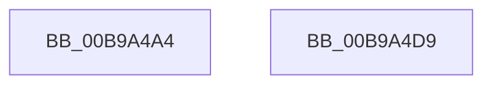

# VfDriverLock

- RVA: `0x00B9A4A4`–`0x00B9A4DA` (길이 `54` bytes)
- VA: `0x0000000140B9A4A4`
- 실행 섹션: `PAGEVRFY`
- PDB 이름 있음: `예`; PDB Function 태그: `아니요`
- unwind 정보 RVA: `0x0005D2F4`
- 디코드: `12`개 명령, `54/54` bytes 표시
- 미해석 바이트: `0` (있으면 어셈블리에 `.byte`로 보존)

> 이 문서는 커널 이미지의 기계어와 PDB 기호를 분석해 생성했습니다. 4번과 5번은 함수 원형과 자료형을 바이너리 사용 방식에서 추정한 C 해석이며 원본 소스 복구 결과는 아닙니다.

## 1. Dependencies

- 직접 호출 지점: **1**; 고유 호출 대상: **1**
- 직접 호출자로 확인된 함수: **20**
- RIP 상대 이미지 참조: **2**

### Outgoing calls
- `0x00B9A4BF` → [KeWaitForSingleObject](../../text/20/KeWaitForSingleObject_function_0020E6B0.md) (function, `0x0020E6B0`)

### Direct callers
- [VfIsVerificationEnabledForImage](../../text/61/VfIsVerificationEnabledForImage_function_006121D0.md) at `0x006121D9`
- [VfDriverRemoveAllDifVerification](../../text/61/VfDriverRemoveAllDifVerification_function_006130E4.md) at `0x006130F8`
- [MmIsDriverSuspectForVerifier](MmIsDriverSuspectForVerifier_function_00B92CE0.md) at `0x00B92CFD`
- [VfDriverApplyDifVerification](VfDriverApplyDifVerification_function_00B9A028.md) at `0x00B9A04F`
- [VfDriverEnableVerifier](VfDriverEnableVerifier_function_00B9A240.md) at `0x00B9A273`
- [VfDriverEnableVerifierForAll](VfDriverEnableVerifierForAll_function_00B9A3A4.md) at `0x00B9A3BD`
- [VfDriverRemoveDifVerification](VfDriverRemoveDifVerification_function_00B9A4E0.md) at `0x00B9A4F9`
- [ViDriverReApplyVerifierForAll](ViDriverReApplyVerifierForAll_function_00B9A8D4.md) at `0x00B9A92C`
- [VfThunkAddDriverThunks](../BA/VfThunkAddDriverThunks_function_00BA6E2C.md) at `0x00BA6E59`
- [VfThunkAddSpecialDriverThunks](../BA/VfThunkAddSpecialDriverThunks_function_00BA6EC4.md) at `0x00BA6F03`
- [VfSuspectApplyDifVolatileVerification](../BA/VfSuspectApplyDifVolatileVerification_function_00BAA558.md) at `0x00BAA576`
- [VfSuspectDriversGetVerifierInformation](../BA/VfSuspectDriversGetVerifierInformation_function_00BAA884.md) at `0x00BAA8CD`
- [VfSuspectDriversLoadCallback](../BA/VfSuspectDriversLoadCallback_function_00BAAB2C.md) at `0x00BAAB4E`
- [VfSuspectDriversRemove](../BA/VfSuspectDriversRemove_function_00BAAE94.md) at `0x00BAAEA3`
- [VfSuspectDriversUnloadCallback](../BA/VfSuspectDriversUnloadCallback_function_00BAAF34.md) at `0x00BAAF46`
- [VfAddVerifierEntry](../BA/VfAddVerifierEntry_function_00BAC31C.md) at `0x00BAC35D`
- [VfSetVerifierInformation](../BA/VfSetVerifierInformation_function_00BAC4EC.md) at `0x00BAC564`
- [VfSetVerifierInformationEx](../BA/VfSetVerifierInformationEx_function_00BAC624.md) at `0x00BAC6A1`
- [VfSuspectDriversParseRegistryString](../../init/C4/VfSuspectDriversParseRegistryString_function_00C4C820.md) at `0x00C4C94A`
- [VfSuspectDriversParseRegistryString](../../init/C4/VfSuspectDriversParseRegistryString_function_00C4C820.md) at `0x00C4C96B`
- [VfXdvExcludeParseRegistryString](../../init/C4/VfXdvExcludeParseRegistryString_function_00C4C9CC.md) at `0x00C4CAEC`

### Static image references
- `0x00B9A4AE` → RVA `0x00F04900` (`.data`; read)
- `0x00B9A4CD` → RVA `0x00F04938` (`.data`; write)

## 2. Other-region calls and transfers

- 다른 실행 섹션으로 향하는 call: **1**
  - `0x00B9A4BF` → [KeWaitForSingleObject](../../text/20/KeWaitForSingleObject_function_0020E6B0.md) (`PAGEVRFY` → `.text`)
- 별도 외부 분기/꼬리 이동을 확인하지 못했습니다.

## 3. Assembly (complete function range)

```asm
00B9A4A4  48 83 EC 38                     sub rsp, 0x38
00B9A4A8  48 83 64 24 20 00               and qword ptr [rsp + 0x20], 0
00B9A4AE  48 8D 0D 4B A4 36 00            lea rcx, [rip + 0x36a44b]
00B9A4B5  45 33 C9                        xor r9d, r9d
00B9A4B8  45 33 C0                        xor r8d, r8d
00B9A4BB  41 8D 51 12                     lea edx, [r9 + 0x12]
00B9A4BF  E8 EC 41 67 FF                  call 0x14020e6b0
00B9A4C4  65 48 8B 04 25 88 01 00 00      mov rax, qword ptr gs:[0x188]
00B9A4CD  48 89 05 64 A4 36 00            mov qword ptr [rip + 0x36a464], rax
00B9A4D4  48 83 C4 38                     add rsp, 0x38
00B9A4D8  C3                              ret
00B9A4D9  CC                              int3
```

## 4. C-style interpretation (structured pseudocode)

```c
__int64 __fastcall VfDriverLock(__int64 a1, __int64 a2, int a3, int a4)
{
    __int64 result;
    __int64 v_rsp;
    unsigned __int64 v_stack_m18;

    v_rsp = (v_rsp) - (56);
    a4 = 0;
    a3 = 0;
    result = KeWaitForSingleObject(v_rip + 3581003, a4 + 18, a3, a4);
    *(unsigned __int64 *)(v_rip + 3581028) = *(unsigned __int64 *)(gs_base + (0 + 392));
    v_rsp = (v_rsp) + (56);
    return *(unsigned __int64 *)(gs_base + (0 + 392));
}
```

## 5. (Beta) C Style

```c
int64_t VfDriverLock(int64_t Arg1, int64_t Arg2, int32_t Arg3, int32_t Arg4)
{
    int64_t result;
    int64_t local_rsp;
    uint64_t v_stack_m18;

    local_rsp = (local_rsp) - (56);
    Arg4 = 0;
    Arg3 = 0;
    result = KeWaitForSingleObject(v_rip + 3581003, Arg4 + 18, Arg3, Arg4);
    *(uint64_t *)(v_rip + 0x36A464) = *(uint64_t *)(gs_base + (0 + 0x188));
    local_rsp = (local_rsp) + (56);
    return *(uint64_t *)(gs_base + (0 + 0x188));
}
```

## 6. Execution-region graph

[열기: 2D/3D 그래프와 함수 탐색 컨트롤 패널](../../../control-panel.html?section=pagevrfy&rva=0x00B9A4A4&view=graph)

- 2D 그래프는 위에서 아래로 흐르고, 3D 그래프는 빈 공간을 드래그해 회전합니다. Shift+드래그는 이동, 휠은 확대·축소, 함수 노드 선택은 대상 보고서 이동입니다.

### Static fallback


