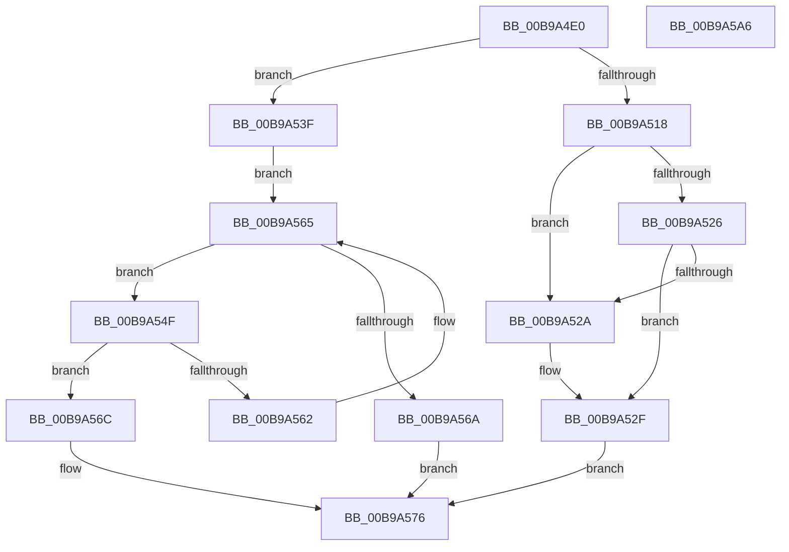

# VfDriverRemoveDifVerification

- RVA: `0x00B9A4E0`–`0x00B9A5A7` (길이 `199` bytes)
- VA: `0x0000000140B9A4E0`
- 실행 섹션: `PAGEVRFY`
- PDB 이름 있음: `예`; PDB Function 태그: `아니요`
- unwind 정보 RVA: `0x0005C954`
- 디코드: `54`개 명령, `199/199` bytes 표시
- 미해석 바이트: `0` (있으면 어셈블리에 `.byte`로 보존)

> 이 문서는 커널 이미지의 기계어와 PDB 기호를 분석해 생성했습니다. 4번과 5번은 함수 원형과 자료형을 바이너리 사용 방식에서 추정한 C 해석이며 원본 소스 복구 결과는 아닙니다.

## 1. Dependencies

- 직접 호출 지점: **7**; 고유 호출 대상: **6**
- 직접 호출자로 확인된 함수: **1**
- RIP 상대 이미지 참조: **6**

### Outgoing calls
- `0x00B9A4F9` → [VfDriverLock](VfDriverLock_function_00B9A4A4.md) (function, `0x00B9A4A4`)
- `0x00B9A50F` → [RtlEqualUnicodeString](../../page/93/RtlEqualUnicodeString_function_00932A20.md) (function, `0x00932A20`)
- `0x00B9A52A` → [ExClearPoolFlags](../../text/65/ExClearPoolFlags_function_00655E60.md) (function, `0x00655E60`)
- `0x00B9A532` → [VfSuspectDifRemoveEntry](../BA/VfSuspectDifRemoveEntry_function_00BAA630.md) (function, `0x00BAA630`)
- `0x00B9A559` → [RtlEqualUnicodeString](../../page/93/RtlEqualUnicodeString_function_00932A20.md) (function, `0x00932A20`)
- `0x00B9A56F` → [VfSuspectRemoveDifVolatileVerification](../BA/VfSuspectRemoveDifVolatileVerification_function_00BAB128.md) (function, `0x00BAB128`)
- `0x00B9A58A` → [KeReleaseMutex](../../text/39/KeReleaseMutex_function_00396810.md) (function, `0x00396810`)

### Direct callers
- [VfDriverEnableDisableVerifier](VfDriverEnableDisableVerifier_function_00B9A1B0.md) at `0x00B9A20D`

### Static image references
- `0x00B9A502` → RVA `0x00B8B038` (`VfKernelImageName`; read)
- `0x00B9A518` → RVA `0x00E681A0` (`.data`; read)
- `0x00B9A537` → RVA `0x00F04ABC` (`.data`; read/write)
- `0x00B9A53F` → RVA `0x00EF54C0` (`.data`; read)
- `0x00B9A578` → RVA `0x00F04938` (`.data`; write)
- `0x00B9A583` → RVA `0x00F04900` (`.data`; read)

## 2. Other-region calls and transfers

- 다른 실행 섹션으로 향하는 call: **4**
  - `0x00B9A50F` → [RtlEqualUnicodeString](../../page/93/RtlEqualUnicodeString_function_00932A20.md) (`PAGEVRFY` → `PAGE`)
  - `0x00B9A52A` → [ExClearPoolFlags](../../text/65/ExClearPoolFlags_function_00655E60.md) (`PAGEVRFY` → `.text`)
  - `0x00B9A559` → [RtlEqualUnicodeString](../../page/93/RtlEqualUnicodeString_function_00932A20.md) (`PAGEVRFY` → `PAGE`)
  - `0x00B9A58A` → [KeReleaseMutex](../../text/39/KeReleaseMutex_function_00396810.md) (`PAGEVRFY` → `.text`)
- 별도 외부 분기/꼬리 이동을 확인하지 못했습니다.

## 3. Assembly (complete function range)

```asm
00B9A4E0  48 89 5C 24 08                  mov qword ptr [rsp + 8], rbx
00B9A4E5  48 89 6C 24 10                  mov qword ptr [rsp + 0x10], rbp
00B9A4EA  48 89 74 24 18                  mov qword ptr [rsp + 0x18], rsi
00B9A4EF  57                              push rdi
00B9A4F0  48 83 EC 20                     sub rsp, 0x20
00B9A4F4  48 8B F9                        mov rdi, rcx
00B9A4F7  33 F6                           xor esi, esi
00B9A4F9  E8 A6 FF FF FF                  call 0x140b9a4a4
00B9A4FE  48 83 C7 28                     add rdi, 0x28
00B9A502  48 8D 0D 2F 0B FF FF            lea rcx, [rip - 0xf4d1]
00B9A509  48 8B D7                        mov rdx, rdi
00B9A50C  41 B0 01                        mov r8b, 1
00B9A50F  E8 0C 85 D9 FF                  call 0x140932a20
00B9A514  84 C0                           test al, al
00B9A516  74 27                           je 0x140b9a53f
00B9A518  48 8B 05 81 DC 2C 00            mov rax, qword ptr [rip + 0x2cdc81]
00B9A51F  8D 4E 08                        lea ecx, [rsi + 8]
00B9A522  84 C1                           test cl, al
00B9A524  75 04                           jne 0x140b9a52a
00B9A526  A8 01                           test al, 1
00B9A528  74 05                           je 0x140b9a52f
00B9A52A  E8 31 B9 AB FF                  call 0x140655e60
00B9A52F  48 8B CF                        mov rcx, rdi
00B9A532  E8 F9 00 01 00                  call 0x140baa630
00B9A537  21 35 7F A5 36 00               and dword ptr [rip + 0x36a57f], esi
00B9A53D  EB 37                           jmp 0x140b9a576
00B9A53F  48 8B 1D 7A AF 35 00            mov rbx, qword ptr [rip + 0x35af7a]
00B9A546  48 8D 2D 73 AF 35 00            lea rbp, [rip + 0x35af73]
00B9A54D  EB 16                           jmp 0x140b9a565
00B9A54F  48 8D 53 58                     lea rdx, [rbx + 0x58]
00B9A553  41 B0 01                        mov r8b, 1
00B9A556  48 8B CF                        mov rcx, rdi
00B9A559  E8 C2 84 D9 FF                  call 0x140932a20
00B9A55E  84 C0                           test al, al
00B9A560  75 0A                           jne 0x140b9a56c
00B9A562  48 8B 1B                        mov rbx, qword ptr [rbx]
00B9A565  48 3B DD                        cmp rbx, rbp
00B9A568  75 E5                           jne 0x140b9a54f
00B9A56A  EB 0A                           jmp 0x140b9a576
00B9A56C  48 8B CB                        mov rcx, rbx
00B9A56F  E8 B4 0B 01 00                  call 0x140bab128
00B9A574  8B F0                           mov esi, eax
00B9A576  33 D2                           xor edx, edx
00B9A578  48 C7 05 B5 A3 36 00 00 00 00 00  mov qword ptr [rip + 0x36a3b5], 0
00B9A583  48 8D 0D 76 A3 36 00            lea rcx, [rip + 0x36a376]
00B9A58A  E8 81 C2 7F FF                  call 0x140396810
00B9A58F  48 8B 5C 24 30                  mov rbx, qword ptr [rsp + 0x30]
00B9A594  8B C6                           mov eax, esi
00B9A596  48 8B 74 24 40                  mov rsi, qword ptr [rsp + 0x40]
00B9A59B  48 8B 6C 24 38                  mov rbp, qword ptr [rsp + 0x38]
00B9A5A0  48 83 C4 20                     add rsp, 0x20
00B9A5A4  5F                              pop rdi
00B9A5A5  C3                              ret
00B9A5A6  CC                              int3
```

## 4. C-style interpretation (structured pseudocode)

```c
__int64 __fastcall VfDriverRemoveDifVerification(__int64 a1)
{
    __int64 result;
    __int64 v_rdi;
    __int64 v_rsi;
    __int64 v_rsp;
    unsigned __int64 v_stack_p10;
    unsigned __int64 v_stack_p18;
    unsigned __int64 v_stack_p8;

    v_stack_p8 = v_rbx;
    v_stack_p10 = v_rbp;
    v_stack_p18 = v_rsi;
    v_rsp = (v_rsp) - (32);
    v_rsi = 0;
    result = VfDriverLock(a1, a2, a3, a4);
    v_rdi = (a1) + (40);
    result = RtlEqualUnicodeString(v_rip - 62673, v_rdi, 1, a4);
    if ((unsigned __int8)(result) == 0) goto loc_00B9A53F;
    if ((((unsigned __int8)(v_rsi + 8)) & ((unsigned __int8)(*(unsigned __int64 *)(v_rip + 2940033)))) != 0) goto loc_00B9A52A;
    result = *(unsigned __int64 *)(v_rip + 2940033);
    if ((((unsigned __int8)(*(unsigned __int64 *)(v_rip + 2940033))) & (1)) != 0) {
        result = ExClearPoolFlags(v_rsi + 8, v_rdi, 1, a4);
    }
    result = VfSuspectDifRemoveEntry(v_rdi, v_rdi, 1, a4);
    goto loc_00B9A576;
loc_00B9A53F:
    goto loc_00B9A565;
loc_00B9A54F:
    result = RtlEqualUnicodeString(v_rdi, *(unsigned __int64 *)(v_rip + 3518330) + 88, 1, a4);
    if ((unsigned __int8)(result) != 0) goto loc_00B9A56C;
loc_00B9A565:
    if ((*(unsigned __int64 *)(*(unsigned __int64 *)(v_rip + 3518330))) != (v_rip + 3518323)) goto loc_00B9A54F;
    goto loc_00B9A576;
loc_00B9A56C:
    result = VfSuspectRemoveDifVolatileVerification(*(unsigned __int64 *)(*(unsigned __int64 *)(v_rip + 3518330)), *(unsigned __int64 *)(v_rip + 3518330) + 88, 1, a4);
loc_00B9A576:
    a2 = 0;
    *(unsigned __int64 *)(v_rip + 3580853) = 0;
    result = KeReleaseMutex(v_rip + 3580790, a2, 1, a4);
    v_rsp = (v_rsp) + (32);
    return (unsigned int)((unsigned int)((unsigned int)((unsigned int)(result))));
}
```

## 5. (Beta) C Style

```c
int64_t VfDriverRemoveDifVerification(int64_t Arg1)
{
    int64_t result;
    int64_t local_rdi;
    int64_t local_rsi;
    int64_t local_rsp;
    uint64_t v_stack_p10;
    uint64_t v_stack_p18;
    uint64_t v_stack_p8;

    v_stack_p8 = local_rbx;
    v_stack_p10 = local_rbp;
    v_stack_p18 = local_rsi;
    local_rsp = (local_rsp) - (32);
    local_rsi = 0;
    result = VfDriverLock(Arg1, a2, a3, a4);
    local_rdi = (Arg1) + (40);
    result = RtlEqualUnicodeString(v_rip - 62673, local_rdi, 1, a4);
    if ((uint8_t)(result) == 0) goto loc_00B9A53F;
    if ((((uint8_t)(local_rsi + 8)) & ((uint8_t)(*(uint64_t *)(v_rip + 0x2CDC81)))) != 0) goto loc_00B9A52A;
    result = *(uint64_t *)(v_rip + 0x2CDC81);
    if ((((uint8_t)(*(uint64_t *)(v_rip + 0x2CDC81))) & (1)) != 0) {
        result = ExClearPoolFlags(local_rsi + 8, local_rdi, 1, a4);
    }
    result = VfSuspectDifRemoveEntry(local_rdi, local_rdi, 1, a4);
    goto loc_00B9A576;
loc_00B9A53F:
    goto loc_00B9A565;
loc_00B9A54F:
    result = RtlEqualUnicodeString(local_rdi, *(uint64_t *)(v_rip + 0x35AF7A) + 88, 1, a4);
    if ((uint8_t)(result) != 0) goto loc_00B9A56C;
loc_00B9A565:
    if ((*(uint64_t *)(*(uint64_t *)(v_rip + 0x35AF7A))) != (v_rip + 3518323)) goto loc_00B9A54F;
    goto loc_00B9A576;
loc_00B9A56C:
    result = VfSuspectRemoveDifVolatileVerification(*(uint64_t *)(*(uint64_t *)(v_rip + 0x35AF7A)), *(uint64_t *)(v_rip + 0x35AF7A) + 88, 1, a4);
loc_00B9A576:
    a2 = 0;
    *(uint64_t *)(v_rip + 0x36A3B5) = 0;
    result = KeReleaseMutex(v_rip + 3580790, a2, 1, a4);
    local_rsp = (local_rsp) + (32);
    return (uint32_t)((uint32_t)((uint32_t)((uint32_t)(result))));
}
```

## 6. Execution-region graph

[열기: 2D/3D 그래프와 함수 탐색 컨트롤 패널](../../../control-panel.html?section=pagevrfy&rva=0x00B9A4E0&view=graph)

- 2D 그래프는 위에서 아래로 흐르고, 3D 그래프는 빈 공간을 드래그해 회전합니다. Shift+드래그는 이동, 휠은 확대·축소, 함수 노드 선택은 대상 보고서 이동입니다.

### Static fallback


