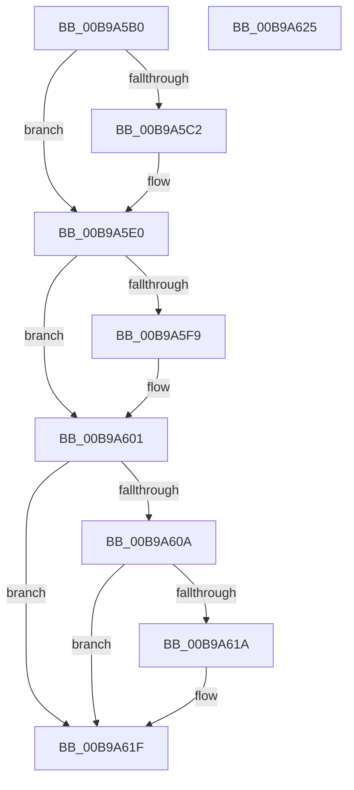

# VfDriverUnloadImage

- RVA: `0x00B9A5B0`–`0x00B9A626` (길이 `118` bytes)
- VA: `0x0000000140B9A5B0`
- 실행 섹션: `PAGEVRFY`
- PDB 이름 있음: `예`; PDB Function 태그: `아니요`
- unwind 정보 RVA: `0x0005CF00`
- 디코드: `32`개 명령, `118/118` bytes 표시
- 미해석 바이트: `0` (있으면 어셈블리에 `.byte`로 보존)

> 이 문서는 커널 이미지의 기계어와 PDB 기호를 분석해 생성했습니다. 4번과 5번은 함수 원형과 자료형을 바이너리 사용 방식에서 추정한 C 해석이며 원본 소스 복구 결과는 아닙니다.

## 1. Dependencies

- 직접 호출 지점: **7**; 고유 호출 대상: **7**
- 직접 호출자로 확인된 함수: **1**
- RIP 상대 이미지 참조: **2**

### Outgoing calls
- `0x00B9A5B9` → [VfIsVerifierEnabled](../../text/4C/VfIsVerifierEnabled_function_004C72F0.md) (function, `0x004C72F0`)
- `0x00B9A5CF` → [DifObjTrkQeuryInvokeDeleteRange](../../text/61/DifObjTrkQeuryInvokeDeleteRange_function_00619EA0.md) (function, `0x00619EA0`)
- `0x00B9A5DB` → [VfFreeMemoryNotification](../BB/VfFreeMemoryNotification_function_00BB7A6C.md) (function, `0x00BB7A6C`)
- `0x00B9A5E3` → [VfThunkCheckDriverUnloading](../BB/VfThunkCheckDriverUnloading_function_00BB8F04.md) (function, `0x00BB8F04`)
- `0x00B9A5EB` → [VfTargetDriversRemove](../../text/3E/VfTargetDriversRemove_function_003EEF9C.md) (function, `0x003EEF9C`)
- `0x00B9A5FC` → [VfSuspectDriversUnloadCallback](../BA/VfSuspectDriversUnloadCallback_function_00BAAF34.md) (function, `0x00BAAF34`)
- `0x00B9A61A` → [VfVolatileClearDifRuleClass](../../text/61/VfVolatileClearDifRuleClass_function_006168E0.md) (function, `0x006168E0`)

### Direct callers
- [MiUnloadSystemImage](../../page/AA/MiUnloadSystemImage_function_00AA2FD4.md) at `0x00AA3199`

### Static image references
- `0x00B9A601` → RVA `0x00F048B8` (`.data`; read)
- `0x00B9A60A` → RVA `0x00F049E0` (`.data`; read)

## 2. Other-region calls and transfers

- 다른 실행 섹션으로 향하는 call: **4**
  - `0x00B9A5B9` → [VfIsVerifierEnabled](../../text/4C/VfIsVerifierEnabled_function_004C72F0.md) (`PAGEVRFY` → `.text`)
  - `0x00B9A5CF` → [DifObjTrkQeuryInvokeDeleteRange](../../text/61/DifObjTrkQeuryInvokeDeleteRange_function_00619EA0.md) (`PAGEVRFY` → `.text`)
  - `0x00B9A5EB` → [VfTargetDriversRemove](../../text/3E/VfTargetDriversRemove_function_003EEF9C.md) (`PAGEVRFY` → `.text`)
  - `0x00B9A61A` → [VfVolatileClearDifRuleClass](../../text/61/VfVolatileClearDifRuleClass_function_006168E0.md) (`PAGEVRFY` → `.text`)
- 별도 외부 분기/꼬리 이동을 확인하지 못했습니다.

## 3. Assembly (complete function range)

```asm
00B9A5B0  40 53                           push rbx
00B9A5B2  48 83 EC 20                     sub rsp, 0x20
00B9A5B6  48 8B D9                        mov rbx, rcx
00B9A5B9  E8 32 CD 92 FF                  call 0x1404c72f0
00B9A5BE  85 C0                           test eax, eax
00B9A5C0  74 1E                           je 0x140b9a5e0
00B9A5C2  8B 53 40                        mov edx, dword ptr [rbx + 0x40]
00B9A5C5  45 33 C9                        xor r9d, r9d
00B9A5C8  48 8B 4B 30                     mov rcx, qword ptr [rbx + 0x30]
00B9A5CC  45 33 C0                        xor r8d, r8d
00B9A5CF  E8 CC F8 A7 FF                  call 0x140619ea0
00B9A5D4  8B 53 40                        mov edx, dword ptr [rbx + 0x40]
00B9A5D7  48 8B 4B 30                     mov rcx, qword ptr [rbx + 0x30]
00B9A5DB  E8 8C D4 01 00                  call 0x140bb7a6c
00B9A5E0  48 8B CB                        mov rcx, rbx
00B9A5E3  E8 1C E9 01 00                  call 0x140bb8f04
00B9A5E8  48 8B CB                        mov rcx, rbx
00B9A5EB  E8 AC 49 85 FF                  call 0x1403eef9c
00B9A5F0  F7 43 68 00 00 00 02            test dword ptr [rbx + 0x68], 0x2000000
00B9A5F7  74 08                           je 0x140b9a601
00B9A5F9  48 8B CB                        mov rcx, rbx
00B9A5FC  E8 33 09 01 00                  call 0x140baaf34
00B9A601  80 3D B0 A2 36 00 00            cmp byte ptr [rip + 0x36a2b0], 0
00B9A608  74 15                           je 0x140b9a61f
00B9A60A  48 8D 05 CF A3 36 00            lea rax, [rip + 0x36a3cf]
00B9A611  48 39 05 C8 A3 36 00            cmp qword ptr [rip + 0x36a3c8], rax
00B9A618  75 05                           jne 0x140b9a61f
00B9A61A  E8 C1 C2 A7 FF                  call 0x1406168e0
00B9A61F  48 83 C4 20                     add rsp, 0x20
00B9A623  5B                              pop rbx
00B9A624  C3                              ret
00B9A625  CC                              int3
```

## 4. C-style interpretation (structured pseudocode)

```c
__int64 __fastcall VfDriverUnloadImage(__int64 a1, __int64 a2, int a3, int a4)
{
    __int64 result;
    __int64 v_rsp;

    v_rsp = (v_rsp) - (32);
    result = VfIsVerifierEnabled(a1, a2, a3, a4);
    if ((unsigned int)(result) != 0) {
        a2 = *(unsigned int *)(a1 + 64);
        a4 = 0;
        a1 = *(unsigned __int64 *)(a1 + 48);
        a3 = 0;
        result = DifObjTrkQeuryInvokeDeleteRange(a1, a2, a3, a4);
        a2 = *(unsigned int *)(a1 + 64);
        a1 = *(unsigned __int64 *)(a1 + 48);
        result = VfFreeMemoryNotification(a1, a2, a3, a4);
    }
    result = VfThunkCheckDriverUnloading(a1, a2, a3, a4);
    result = VfTargetDriversRemove(a1, a2, a3, a4);
    if (((*(unsigned int *)(a1 + 104)) & (0x2000000ULL)) != 0) {
        a1 = a1;
        result = VfSuspectDriversUnloadCallback(a1, a2, a3, a4);
    }
    if ((*(unsigned __int8 *)(v_rip + 3580592)) == 0) goto loc_00B9A61F;
    result = v_rip + 3580879;
    if ((*(unsigned __int64 *)(v_rip + 3580872)) == (v_rip + 3580879)) {
        result = VfVolatileClearDifRuleClass(a1, a2, a3, a4);
    }
    v_rsp = (v_rsp) + (32);
    return result;
}
```

## 5. (Beta) C Style

```c
int64_t VfDriverUnloadImage(void *Arg1, int64_t Arg2, int32_t Arg3, int32_t Arg4)
{
    uint8_t *arg1 = (uint8_t *)Arg1;

    int64_t result;
    int64_t local_rsp;

    local_rsp = (local_rsp) - (32);
    result = VfIsVerifierEnabled(Arg1, Arg2, Arg3, Arg4);
    if ((uint32_t)(result) != 0) {
        Arg2 = *(uint32_t *)(arg1 + 0x40);
        Arg4 = 0;
        Arg1 = *(uint64_t *)(arg1 + 0x30);
        Arg3 = 0;
        result = DifObjTrkQeuryInvokeDeleteRange(Arg1, Arg2, Arg3, Arg4);
        Arg2 = *(uint32_t *)(arg1 + 0x40);
        Arg1 = *(uint64_t *)(arg1 + 0x30);
        result = VfFreeMemoryNotification(Arg1, Arg2, Arg3, Arg4);
    }
    result = VfThunkCheckDriverUnloading(Arg1, Arg2, Arg3, Arg4);
    result = VfTargetDriversRemove(Arg1, Arg2, Arg3, Arg4);
    if (((*(uint32_t *)(arg1 + 0x68)) & (0x2000000ULL)) != 0) {
        Arg1 = Arg1;
        result = VfSuspectDriversUnloadCallback(Arg1, Arg2, Arg3, Arg4);
    }
    if ((*(uint8_t *)(v_rip + 0x36A2B0)) == 0) goto loc_00B9A61F;
    result = v_rip + 3580879;
    if ((*(uint64_t *)(v_rip + 0x36A3C8)) == (v_rip + 3580879)) {
        result = VfVolatileClearDifRuleClass(Arg1, Arg2, Arg3, Arg4);
    }
    local_rsp = (local_rsp) + (32);
    return result;
}
```

### 관측된 메모리 오프셋

구조체 형식이 확인되지 않은 접근은 인자 기준의 오프셋으로만 기록했습니다.

| 기준 인자 | 오프셋 표현 | 폭 (bit) | 접근 |
|---|---:|---:|---|
| `Arg1` | `+ 0x30` | `64` | `R` |
| `Arg1` | `+ 0x40` | `32` | `R` |
| `Arg1` | `+ 0x68` | `32` | `R` |

## 6. Execution-region graph

[열기: 2D/3D 그래프와 함수 탐색 컨트롤 패널](../../../control-panel.html?section=pagevrfy&rva=0x00B9A5B0&view=graph)

- 2D 그래프는 위에서 아래로 흐르고, 3D 그래프는 빈 공간을 드래그해 회전합니다. Shift+드래그는 이동, 휠은 확대·축소, 함수 노드 선택은 대상 보고서 이동입니다.

### Static fallback


