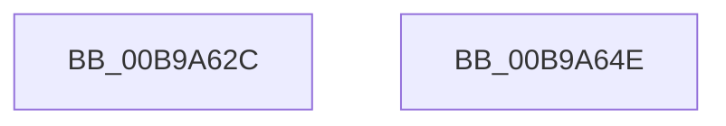

# VfDriverUnlock

- RVA: `0x00B9A62C`–`0x00B9A64F` (길이 `35` bytes)
- VA: `0x0000000140B9A62C`
- 실행 섹션: `PAGEVRFY`
- PDB 이름 있음: `예`; PDB Function 태그: `아니요`
- unwind 정보 RVA: `0x0005C788`
- 디코드: `8`개 명령, `35/35` bytes 표시
- 미해석 바이트: `0` (있으면 어셈블리에 `.byte`로 보존)

> 이 문서는 커널 이미지의 기계어와 PDB 기호를 분석해 생성했습니다. 4번과 5번은 함수 원형과 자료형을 바이너리 사용 방식에서 추정한 C 해석이며 원본 소스 복구 결과는 아닙니다.

## 1. Dependencies

- 직접 호출 지점: **1**; 고유 호출 대상: **1**
- 직접 호출자로 확인된 함수: **4**
- RIP 상대 이미지 참조: **2**

### Outgoing calls
- `0x00B9A644` → [KeReleaseMutex](../../text/39/KeReleaseMutex_function_00396810.md) (function, `0x00396810`)

### Direct callers
- [VfIsVerificationEnabledForImage](../../text/61/VfIsVerificationEnabledForImage_function_006121D0.md) at `0x006121E8`
- [VfDriverRemoveAllDifVerification](../../text/61/VfDriverRemoveAllDifVerification_function_006130E4.md) at `0x00613166`
- [VfSuspectDriversParseRegistryString](../../init/C4/VfSuspectDriversParseRegistryString_function_00C4C820.md) at `0x00C4C98D`
- [VfXdvExcludeParseRegistryString](../../init/C4/VfXdvExcludeParseRegistryString_function_00C4C9CC.md) at `0x00C4CB0E`

### Static image references
- `0x00B9A632` → RVA `0x00F04938` (`.data`; write)
- `0x00B9A63D` → RVA `0x00F04900` (`.data`; read)

## 2. Other-region calls and transfers

- 다른 실행 섹션으로 향하는 call: **1**
  - `0x00B9A644` → [KeReleaseMutex](../../text/39/KeReleaseMutex_function_00396810.md) (`PAGEVRFY` → `.text`)
- 별도 외부 분기/꼬리 이동을 확인하지 못했습니다.

## 3. Assembly (complete function range)

```asm
00B9A62C  48 83 EC 28                     sub rsp, 0x28
00B9A630  33 D2                           xor edx, edx
00B9A632  48 C7 05 FB A2 36 00 00 00 00 00  mov qword ptr [rip + 0x36a2fb], 0
00B9A63D  48 8D 0D BC A2 36 00            lea rcx, [rip + 0x36a2bc]
00B9A644  E8 C7 C1 7F FF                  call 0x140396810
00B9A649  48 83 C4 28                     add rsp, 0x28
00B9A64D  C3                              ret
00B9A64E  CC                              int3
```

## 4. C-style interpretation (structured pseudocode)

```c
__int64 __fastcall VfDriverUnlock(__int64 a1, int a2)
{
    __int64 result;
    __int64 v_rsp;

    v_rsp = (v_rsp) - (40);
    a2 = 0;
    *(unsigned __int64 *)(v_rip + 3580667) = 0;
    result = KeReleaseMutex(v_rip + 3580604, a2, a3, a4);
    v_rsp = (v_rsp) + (40);
    return result;
}
```

## 5. (Beta) C Style

```c
int64_t VfDriverUnlock(int64_t Arg1, int32_t Arg2)
{
    int64_t result;
    int64_t local_rsp;

    local_rsp = (local_rsp) - (40);
    Arg2 = 0;
    *(uint64_t *)(v_rip + 0x36A2FB) = 0;
    result = KeReleaseMutex(v_rip + 3580604, Arg2, a3, a4);
    local_rsp = (local_rsp) + (40);
    return result;
}
```

## 6. Execution-region graph

[열기: 2D/3D 그래프와 함수 탐색 컨트롤 패널](../../../control-panel.html?section=pagevrfy&rva=0x00B9A62C&view=graph)

- 2D 그래프는 위에서 아래로 흐르고, 3D 그래프는 빈 공간을 드래그해 회전합니다. Shift+드래그는 이동, 휠은 확대·축소, 함수 노드 선택은 대상 보고서 이동입니다.

### Static fallback


