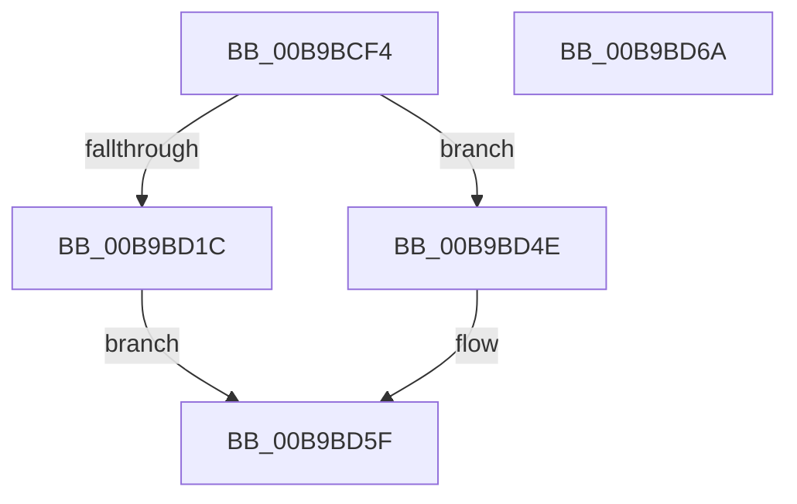

# VfFillAllocatedMemory

- RVA: `0x00B9BCF4`–`0x00B9BD6B` (길이 `119` bytes)
- VA: `0x0000000140B9BCF4`
- 실행 섹션: `PAGEVRFY`
- PDB 이름 있음: `예`; PDB Function 태그: `아니요`
- unwind 정보 RVA: `0x0005CAAC`
- 디코드: `37`개 명령, `119/119` bytes 표시
- 미해석 바이트: `0` (있으면 어셈블리에 `.byte`로 보존)

> 이 문서는 커널 이미지의 기계어와 PDB 기호를 분석해 생성했습니다. 4번과 5번은 함수 원형과 자료형을 바이너리 사용 방식에서 추정한 C 해석이며 원본 소스 복구 결과는 아닙니다.

## 1. Dependencies

- 직접 호출 지점: **2**; 고유 호출 대상: **2**
- 직접 호출자로 확인된 함수: **1**
- RIP 상대 이미지 참조: **0**

### Outgoing calls
- `0x00B9BD06` → [KeQueryPerformanceCounter](../../text/37/KeQueryPerformanceCounter_function_0037E7E0.md) (function, `0x0037E7E0`)
- `0x00B9BD5A` → [memset](../../text/6C/memset_function_006C6C40.md) (function, `0x006C6C40`)

### Direct callers
- [VfHandlePoolAlloc](../BB/VfHandlePoolAlloc_function_00BB8A90.md) at `0x00BB8ED7`

### Static image references
- 디코드된 RIP-relative 메모리 참조가 없습니다.

## 2. Other-region calls and transfers

- 다른 실행 섹션으로 향하는 call: **2**
  - `0x00B9BD06` → [KeQueryPerformanceCounter](../../text/37/KeQueryPerformanceCounter_function_0037E7E0.md) (`PAGEVRFY` → `.text`)
  - `0x00B9BD5A` → [memset](../../text/6C/memset_function_006C6C40.md) (`PAGEVRFY` → `.text`)
- 별도 외부 분기/꼬리 이동을 확인하지 못했습니다.

## 3. Assembly (complete function range)

```asm
00B9BCF4  48 89 5C 24 08                  mov qword ptr [rsp + 8], rbx
00B9BCF9  57                              push rdi
00B9BCFA  48 83 EC 20                     sub rsp, 0x20
00B9BCFE  48 8B D9                        mov rbx, rcx
00B9BD01  48 8B FA                        mov rdi, rdx
00B9BD04  33 C9                           xor ecx, ecx
00B9BD06  E8 D5 2A 7E FF                  call 0x14037e7e0
00B9BD0B  B9 00 01 00 00                  mov ecx, 0x100
00B9BD10  48 3B F9                        cmp rdi, rcx
00B9BD13  48 0F 43 F9                     cmovae rdi, rcx
00B9BD17  48 3B F9                        cmp rdi, rcx
00B9BD1A  75 32                           jne 0x140b9bd4e
00B9BD1C  0F B6 D0                        movzx edx, al
00B9BD1F  48 8B FB                        mov rdi, rbx
00B9BD22  48 83 CA 01                     or rdx, 1
00B9BD26  B9 20 00 00 00                  mov ecx, 0x20
00B9BD2B  48 8B C2                        mov rax, rdx
00B9BD2E  48 C1 E0 08                     shl rax, 8
00B9BD32  48 0B D0                        or rdx, rax
00B9BD35  48 8B C2                        mov rax, rdx
00B9BD38  48 C1 E0 10                     shl rax, 0x10
00B9BD3C  48 0B D0                        or rdx, rax
00B9BD3F  48 8B C2                        mov rax, rdx
00B9BD42  48 C1 E0 20                     shl rax, 0x20
00B9BD46  48 0B C2                        or rax, rdx
00B9BD49  F3 48 AB                        rep stosq qword ptr [rdi], rax
00B9BD4C  EB 11                           jmp 0x140b9bd5f
00B9BD4E  0F B6 D0                        movzx edx, al
00B9BD51  4C 8B C7                        mov r8, rdi
00B9BD54  83 CA 01                        or edx, 1
00B9BD57  48 8B CB                        mov rcx, rbx
00B9BD5A  E8 E1 AE B2 FF                  call 0x1406c6c40
00B9BD5F  48 8B 5C 24 30                  mov rbx, qword ptr [rsp + 0x30]
00B9BD64  48 83 C4 20                     add rsp, 0x20
00B9BD68  5F                              pop rdi
00B9BD69  C3                              ret
00B9BD6A  CC                              int3
```

## 4. C-style interpretation (structured pseudocode)

```c
__int64 __fastcall VfFillAllocatedMemory(__int64 a1, __int64 a2)
{
    __int64 result;
    __int64 v_rsp;
    unsigned __int64 v_stack_p8;

    v_stack_p8 = v_rbx;
    v_rsp = (v_rsp) - (32);
    a1 = 0;
    result = KeQueryPerformanceCounter(a1, a2, a3, a4);
    if (a2 >= 256) { a2 = 256; }
    if (a2 != 256) goto loc_00B9BD4E;
    a2 = ((unsigned __int8)(result)) | (1);
    result = (a2) << (8);
    a2 = (a2) | (result);
    result = (a2) << (16);
    a2 = (a2) | (result);
    result = (a2) << (32);
    result = (result) | (a2);
    goto loc_00B9BD5F;
loc_00B9BD4E:
    a2 = (unsigned int)(((unsigned __int8)(result)) | (1));
    result = memset(0, a2, 0, a4);
loc_00B9BD5F:
    v_rsp = (v_rsp) + (32);
    return result;
}
```

## 5. (Beta) C Style

```c
int64_t VfFillAllocatedMemory(void *Arg1, int64_t Arg2)
{
    uint8_t *arg1 = (uint8_t *)Arg1;

    int64_t result;
    int64_t local_rsp;
    uint64_t v_stack_p8;

    v_stack_p8 = local_rbx;
    local_rsp = (local_rsp) - (32);
    Arg1 = 0;
    result = KeQueryPerformanceCounter(Arg1, Arg2, a3, a4);
    if (Arg2 >= 256) { Arg2 = 256; }
    if (Arg2 != 256) goto loc_00B9BD4E;
    Arg2 = ((uint8_t)(result)) | (1);
    result = (Arg2) << (8);
    Arg2 = (Arg2) | (result);
    result = (Arg2) << (16);
    Arg2 = (Arg2) | (result);
    result = (Arg2) << (32);
    result = (result) | (Arg2);
    goto loc_00B9BD5F;
loc_00B9BD4E:
    Arg2 = (uint32_t)(((uint8_t)(result)) | (1));
    result = memset(0, Arg2, 0, a4);
loc_00B9BD5F:
    local_rsp = (local_rsp) + (32);
    return result;
}
```

### 관측된 메모리 오프셋

구조체 형식이 확인되지 않은 접근은 인자 기준의 오프셋으로만 기록했습니다.

| 기준 인자 | 오프셋 표현 | 폭 (bit) | 접근 |
|---|---:|---:|---|
| `Arg1` | `+ 0x0` | `64` | `W` |

## 6. Execution-region graph

[열기: 2D/3D 그래프와 함수 탐색 컨트롤 패널](../../../control-panel.html?section=pagevrfy&rva=0x00B9BCF4&view=graph)

- 2D 그래프는 위에서 아래로 흐르고, 3D 그래프는 빈 공간을 드래그해 회전합니다. Shift+드래그는 이동, 휠은 확대·축소, 함수 노드 선택은 대상 보고서 이동입니다.

### Static fallback


