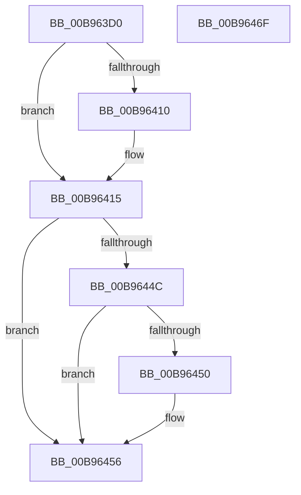

# VfFlushAdapterBuffersEx

- RVA: `0x00B963D0`–`0x00B96470` (길이 `160` bytes)
- VA: `0x0000000140B963D0`
- 실행 섹션: `PAGEVRFY`
- PDB 이름 있음: `예`; PDB Function 태그: `아니요`
- unwind 정보 RVA: `0x00093E28`
- 디코드: `46`개 명령, `160/160` bytes 표시
- 미해석 바이트: `0` (있으면 어셈블리에 `.byte`로 보존)

> 이 문서는 커널 이미지의 기계어와 PDB 기호를 분석해 생성했습니다. 4번과 5번은 함수 원형과 자료형을 바이너리 사용 방식에서 추정한 C 해석이며 원본 소스 복구 결과는 아닙니다.

## 1. Dependencies

- 직접 호출 지점: **4**; 고유 호출 대상: **4**
- 직접 호출자로 확인된 함수: **0**
- RIP 상대 이미지 참조: **0**

### Outgoing calls
- `0x00B963F4` → [ViGetRealDmaAdapter](ViGetRealDmaAdapter_function_00B990DC.md) (function, `0x00B990DC`)
- `0x00B96401` → [ViGetAdapterInformationInternal](ViGetAdapterInformationInternal_function_00B98E88.md) (function, `0x00B98E88`)
- `0x00B96410` → [VF_ASSERT_MAX_IRQL](VF_ASSERT_MAX_IRQL_function_00B94FB0.md) (function, `0x00B94FB0`)
- `0x00B96442` → [guard_dispatch_icall](../../text/6B/guard_dispatch_icall_function_006BAAD0.md) (function, `0x006BAAD0`)

### Direct callers
- 이 함수 시작 RVA로 연결되는 직접 call은 확인되지 않았습니다. 간접 호출은 완전히 역산할 수 없습니다.

### Static image references
- 디코드된 RIP-relative 메모리 참조가 없습니다.

## 2. Other-region calls and transfers

- 다른 실행 섹션으로 향하는 call: **1**
  - `0x00B96442` → [guard_dispatch_icall](../../text/6B/guard_dispatch_icall_function_006BAAD0.md) (`PAGEVRFY` → `.text`)
- 별도 외부 분기/꼬리 이동을 확인하지 못했습니다.

## 3. Assembly (complete function range)

```asm
00B963D0  48 89 5C 24 08                  mov qword ptr [rsp + 8], rbx
00B963D5  48 89 6C 24 10                  mov qword ptr [rsp + 0x10], rbp
00B963DA  48 89 74 24 18                  mov qword ptr [rsp + 0x18], rsi
00B963DF  57                              push rdi
00B963E0  41 56                           push r14
00B963E2  41 57                           push r15
00B963E4  48 83 EC 40                     sub rsp, 0x40
00B963E8  49 8B E9                        mov rbp, r9
00B963EB  4D 8B F0                        mov r14, r8
00B963EE  4C 8B FA                        mov r15, rdx
00B963F1  48 8B D9                        mov rbx, rcx
00B963F4  E8 E3 2C 00 00                  call 0x140b990dc
00B963F9  B2 01                           mov dl, 1
00B963FB  48 8B CB                        mov rcx, rbx
00B963FE  48 8B F0                        mov rsi, rax
00B96401  E8 82 2A 00 00                  call 0x140b98e88
00B96406  33 DB                           xor ebx, ebx
00B96408  48 8B F8                        mov rdi, rax
00B9640B  48 85 C0                        test rax, rax
00B9640E  74 05                           je 0x140b96415
00B96410  E8 9B EB FF FF                  call 0x140b94fb0
00B96415  48 8B 4E 08                     mov rcx, qword ptr [rsi + 8]
00B96419  4C 8B CD                        mov r9, rbp
00B9641C  4D 8B C6                        mov r8, r14
00B9641F  49 8B D7                        mov rdx, r15
00B96422  48 8B 81 D0 00 00 00            mov rax, qword ptr [rcx + 0xd0]
00B96429  8A 8C 24 88 00 00 00            mov cl, byte ptr [rsp + 0x88]
00B96430  88 4C 24 28                     mov byte ptr [rsp + 0x28], cl
00B96434  8B 8C 24 80 00 00 00            mov ecx, dword ptr [rsp + 0x80]
00B9643B  89 4C 24 20                     mov dword ptr [rsp + 0x20], ecx
00B9643F  48 8B CE                        mov rcx, rsi
00B96442  E8 89 46 B2 FF                  call 0x1406baad0
00B96447  48 85 FF                        test rdi, rdi
00B9644A  74 0A                           je 0x140b96456
00B9644C  85 C0                           test eax, eax
00B9644E  75 06                           jne 0x140b96456
00B96450  87 9F DC 00 00 00               xchg dword ptr [rdi + 0xdc], ebx
00B96456  48 8B 5C 24 60                  mov rbx, qword ptr [rsp + 0x60]
00B9645B  48 8B 6C 24 68                  mov rbp, qword ptr [rsp + 0x68]
00B96460  48 8B 74 24 70                  mov rsi, qword ptr [rsp + 0x70]
00B96465  48 83 C4 40                     add rsp, 0x40
00B96469  41 5F                           pop r15
00B9646B  41 5E                           pop r14
00B9646D  5F                              pop rdi
00B9646E  C3                              ret
00B9646F  CC                              int3
```

## 4. C-style interpretation (structured pseudocode)

```c
__int64 __fastcall VfFlushAdapterBuffersEx(__int64 a1, __int64 a2, __int64 a3, __int64 a4, unsigned int a5, unsigned __int8 a6)
{
    __int64 result;
    __int64 v_rbx;
    __int64 v_rsp;
    unsigned __int8 v_stack_m30;
    unsigned int v_stack_m38;
    unsigned __int64 v_stack_p10;
    unsigned __int64 v_stack_p18;
    unsigned __int64 v_stack_p8;

    v_stack_p8 = v_rbx;
    v_stack_p10 = v_rbp;
    v_stack_p18 = v_rsi;
    v_rsp = (v_rsp) - (64);
    result = ViGetRealDmaAdapter(a1, a2, a3, a4);
    result = ViGetAdapterInformationInternal(a1, 1, a3, a4);
    v_rbx = 0;
    if (result != 0) {
        result = VF_ASSERT_MAX_IRQL(a1, 1, a3, a4);
    }
    v_stack_m30 = a6;
    v_stack_m38 = (unsigned int)((unsigned int)(a5));
    result = guard_dispatch_icall(result, a2, a3, a4);
    if (result == 0) goto loc_00B96456;
    if ((unsigned int)(result) == 0) {
    }
    v_rsp = (v_rsp) + (64);
    return result;
}
```

## 5. (Beta) C Style

```c
int64_t VfFlushAdapterBuffersEx(int64_t Arg1, int64_t Arg2, int64_t Arg3, int64_t Arg4, uint32_t Arg5, uint8_t Arg6)
{
    int64_t result;
    int64_t local_rbx;
    int64_t local_rsp;
    uint8_t v_stack_m30;
    uint32_t v_stack_m38;
    uint64_t v_stack_p10;
    uint64_t v_stack_p18;
    uint64_t v_stack_p8;

    v_stack_p8 = local_rbx;
    v_stack_p10 = local_rbp;
    v_stack_p18 = local_rsi;
    local_rsp = (local_rsp) - (64);
    result = ViGetRealDmaAdapter(Arg1, Arg2, Arg3, Arg4);
    result = ViGetAdapterInformationInternal(Arg1, 1, Arg3, Arg4);
    local_rbx = 0;
    if (result != 0) {
        result = VF_ASSERT_MAX_IRQL(Arg1, 1, Arg3, Arg4);
    }
    v_stack_m30 = Arg6;
    v_stack_m38 = (uint32_t)((uint32_t)(Arg5));
    result = guard_dispatch_icall(result, Arg2, Arg3, Arg4);
    if (result == 0) goto loc_00B96456;
    if ((uint32_t)(result) == 0) {
    }
    local_rsp = (local_rsp) + (64);
    return result;
}
```

## 6. Execution-region graph

[열기: 2D/3D 그래프와 함수 탐색 컨트롤 패널](../../../control-panel.html?section=pagevrfy&rva=0x00B963D0&view=graph)

- 2D 그래프는 위에서 아래로 흐르고, 3D 그래프는 빈 공간을 드래그해 회전합니다. Shift+드래그는 이동, 휠은 확대·축소, 함수 노드 선택은 대상 보고서 이동입니다.

### Static fallback


