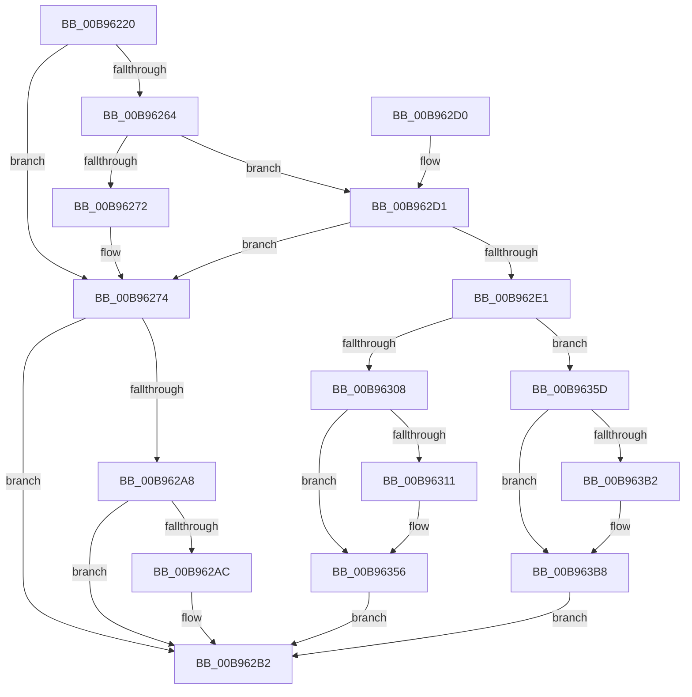

# VfFlushAdapterBuffers

- RVA: `0x00B96220`–`0x00B963C0` (길이 `416` bytes)
- VA: `0x0000000140B96220`
- 실행 섹션: `PAGEVRFY`
- PDB 이름 있음: `예`; PDB Function 태그: `아니요`
- unwind 정보 RVA: `0x000D2348`
- 디코드: `111`개 명령, `416/416` bytes 표시
- 미해석 바이트: `0` (있으면 어셈블리에 `.byte`로 보존)

> 이 문서는 커널 이미지의 기계어와 PDB 기호를 분석해 생성했습니다. 4번과 5번은 함수 원형과 자료형을 바이너리 사용 방식에서 추정한 C 해석이며 원본 소스 복구 결과는 아닙니다.

## 1. Dependencies

- 직접 호출 지점: **10**; 고유 호출 대상: **9**
- 직접 호출자로 확인된 함수: **0**
- RIP 상대 이미지 참조: **2**

### Outgoing calls
- `0x00B9624A` → [ViGetAdapterInformationInternal](ViGetAdapterInformationInternal_function_00B98E88.md) (function, `0x00B98E88`)
- `0x00B96255` → [ViGetRealDmaAdapter](ViGetRealDmaAdapter_function_00B990DC.md) (function, `0x00B990DC`)
- `0x00B96264` → [VF_ASSERT_MAX_IRQL](VF_ASSERT_MAX_IRQL_function_00B94FB0.md) (function, `0x00B94FB0`)
- `0x00B9629E` → [guard_dispatch_icall](../../text/6B/guard_dispatch_icall_function_006BAAD0.md) (function, `0x006BAAD0`)
- `0x00B962D4` → [ViGetMapRegisterFile](ViGetMapRegisterFile_function_00B98FA0.md) (function, `0x00B98FA0`)
- `0x00B962FF` → [ViSwap](ViSwap_function_00B99E54.md) (function, `0x00B99E54`)
- `0x00B96335` → [ViHalPreprocessOptions](ViHalPreprocessOptions_function_00B9920C.md) (function, `0x00B9920C`)
- `0x00B96351` → [VfReportIssueWithOptions](../../text/61/VfReportIssueWithOptions_function_00614444.md) (function, `0x00614444`)
- `0x00B9638F` → [guard_dispatch_icall](../../text/6B/guard_dispatch_icall_function_006BAAD0.md) (function, `0x006BAAD0`)
- `0x00B963A8` → [ViFlushDoubleBuffer](ViFlushDoubleBuffer_function_00B989D0.md) (function, `0x00B989D0`)

### Direct callers
- 이 함수 시작 RVA로 연결되는 직접 call은 확인되지 않았습니다. 간접 호출은 완전히 역산할 수 없습니다.

### Static image references
- `0x00B96319` → RVA `0x00E0E9F0` (`.data`; read)
- `0x00B96328` → RVA `0x00BB9D40` (` ?? ::JKADOLAD::`string'`; read)

## 2. Other-region calls and transfers

- 다른 실행 섹션으로 향하는 call: **3**
  - `0x00B9629E` → [guard_dispatch_icall](../../text/6B/guard_dispatch_icall_function_006BAAD0.md) (`PAGEVRFY` → `.text`)
  - `0x00B96351` → [VfReportIssueWithOptions](../../text/61/VfReportIssueWithOptions_function_00614444.md) (`PAGEVRFY` → `.text`)
  - `0x00B9638F` → [guard_dispatch_icall](../../text/6B/guard_dispatch_icall_function_006BAAD0.md) (`PAGEVRFY` → `.text`)
- 별도 외부 분기/꼬리 이동을 확인하지 못했습니다.

## 3. Assembly (complete function range)

```asm
00B96220  48 89 5C 24 08                  mov qword ptr [rsp + 8], rbx
00B96225  48 89 6C 24 10                  mov qword ptr [rsp + 0x10], rbp
00B9622A  48 89 74 24 18                  mov qword ptr [rsp + 0x18], rsi
00B9622F  57                              push rdi
00B96230  41 54                           push r12
00B96232  41 55                           push r13
00B96234  41 56                           push r14
00B96236  41 57                           push r15
00B96238  48 83 EC 60                     sub rsp, 0x60
00B9623C  4C 8B FA                        mov r15, rdx
00B9623F  4D 8B F1                        mov r14, r9
00B96242  B2 01                           mov dl, 1
00B96244  49 8B F8                        mov rdi, r8
00B96247  48 8B D9                        mov rbx, rcx
00B9624A  E8 39 2C 00 00                  call 0x140b98e88
00B9624F  48 8B CB                        mov rcx, rbx
00B96252  48 8B E8                        mov rbp, rax
00B96255  E8 82 2E 00 00                  call 0x140b990dc
00B9625A  33 F6                           xor esi, esi
00B9625C  4C 8B E8                        mov r13, rax
00B9625F  48 85 ED                        test rbp, rbp
00B96262  74 10                           je 0x140b96274
00B96264  E8 47 ED FF FF                  call 0x140b94fb0
00B96269  48 81 FF 0D F0 AD DE            cmp rdi, -0x21520ff3
00B96270  75 5F                           jne 0x140b962d1
00B96272  8B FE                           mov edi, esi
00B96274  8A 8C 24 B8 00 00 00            mov cl, byte ptr [rsp + 0xb8]
00B9627B  4D 8B CE                        mov r9, r14
00B9627E  49 8B 45 08                     mov rax, qword ptr [r13 + 8]
00B96282  4C 8B C7                        mov r8, rdi
00B96285  88 4C 24 28                     mov byte ptr [rsp + 0x28], cl
00B96289  49 8B D7                        mov rdx, r15
00B9628C  8B 8C 24 B0 00 00 00            mov ecx, dword ptr [rsp + 0xb0]
00B96293  89 4C 24 20                     mov dword ptr [rsp + 0x20], ecx
00B96297  49 8B CD                        mov rcx, r13
00B9629A  48 8B 40 28                     mov rax, qword ptr [rax + 0x28]
00B9629E  E8 2D 48 B2 FF                  call 0x1406baad0
00B962A3  48 85 ED                        test rbp, rbp
00B962A6  74 0A                           je 0x140b962b2
00B962A8  84 C0                           test al, al
00B962AA  74 06                           je 0x140b962b2
00B962AC  87 B5 DC 00 00 00               xchg dword ptr [rbp + 0xdc], esi
00B962B2  4C 8D 5C 24 60                  lea r11, [rsp + 0x60]
00B962B7  49 8B 5B 30                     mov rbx, qword ptr [r11 + 0x30]
00B962BB  49 8B 6B 38                     mov rbp, qword ptr [r11 + 0x38]
00B962BF  49 8B 73 40                     mov rsi, qword ptr [r11 + 0x40]
00B962C3  49 8B E3                        mov rsp, r11
00B962C6  41 5F                           pop r15
00B962C8  41 5E                           pop r14
00B962CA  41 5D                           pop r13
00B962CC  41 5C                           pop r12
00B962CE  5F                              pop rdi
00B962CF  C3                              ret
00B962D0  CC                              int3
00B962D1  48 8B CF                        mov rcx, rdi
00B962D4  E8 C7 2C 00 00                  call 0x140b98fa0
00B962D9  4C 8B E0                        mov r12, rax
00B962DC  48 85 C0                        test rax, rax
00B962DF  74 93                           je 0x140b96274
00B962E1  4C 8D 44 24 40                  lea r8, [rsp + 0x40]
00B962E6  4C 89 7C 24 50                  mov qword ptr [rsp + 0x50], r15
00B962EB  48 8D 54 24 50                  lea rdx, [rsp + 0x50]
00B962F0  4C 89 74 24 40                  mov qword ptr [rsp + 0x40], r14
00B962F5  48 8D 4C 24 48                  lea rcx, [rsp + 0x48]
00B962FA  48 89 7C 24 48                  mov qword ptr [rsp + 0x48], rdi
00B962FF  E8 50 3B 00 00                  call 0x140b99e54
00B96304  85 C0                           test eax, eax
00B96306  75 55                           jne 0x140b9635d
00B96308  39 B4 24 B0 00 00 00            cmp dword ptr [rsp + 0xb0], esi
00B9630F  74 45                           je 0x140b96356
00B96311  8D 70 20                        lea esi, [rax + 0x20]
00B96314  4C 89 7C 24 28                  mov qword ptr [rsp + 0x28], r15
00B96319  48 8D 1D D0 86 27 00            lea rbx, [rip + 0x2786d0]
00B96320  4C 89 74 24 20                  mov qword ptr [rsp + 0x20], r14
00B96325  44 8B C6                        mov r8d, esi
00B96328  48 8D 15 11 3A 02 00            lea rdx, [rip + 0x23a11]
00B9632F  48 8B CB                        mov rcx, rbx
00B96332  4C 8B CF                        mov r9, rdi
00B96335  E8 D2 2E 00 00                  call 0x140b9920c
00B9633A  4D 8B CE                        mov r9, r14
00B9633D  48 89 5C 24 28                  mov qword ptr [rsp + 0x28], rbx
00B96342  4C 8B C7                        mov r8, rdi
00B96345  4C 89 7C 24 20                  mov qword ptr [rsp + 0x20], r15
00B9634A  8B D6                           mov edx, esi
00B9634C  B9 E6 00 00 00                  mov ecx, 0xe6
00B96351  E8 EE E0 A7 FF                  call 0x140614444
00B96356  32 C0                           xor al, al
00B96358  E9 55 FF FF FF                  jmp 0x140b962b2
00B9635D  49 8B 45 08                     mov rax, qword ptr [r13 + 8]
00B96361  49 8B CD                        mov rcx, r13
00B96364  40 8A BC 24 B8 00 00 00         mov dil, byte ptr [rsp + 0xb8]
00B9636C  8B 9C 24 B0 00 00 00            mov ebx, dword ptr [rsp + 0xb0]
00B96373  4C 8B 4C 24 40                  mov r9, qword ptr [rsp + 0x40]
00B96378  48 8B 40 28                     mov rax, qword ptr [rax + 0x28]
00B9637C  4C 8B 44 24 48                  mov r8, qword ptr [rsp + 0x48]
00B96381  48 8B 54 24 50                  mov rdx, qword ptr [rsp + 0x50]
00B96386  40 88 7C 24 28                  mov byte ptr [rsp + 0x28], dil
00B9638B  89 5C 24 20                     mov dword ptr [rsp + 0x20], ebx
00B9638F  E8 3C 47 B2 FF                  call 0x1406baad0
00B96394  44 8B CB                        mov r9d, ebx
00B96397  40 88 7C 24 20                  mov byte ptr [rsp + 0x20], dil
00B9639C  4D 8B C6                        mov r8, r14
00B9639F  49 8B D7                        mov rdx, r15
00B963A2  49 8B CC                        mov rcx, r12
00B963A5  44 8A E8                        mov r13b, al
00B963A8  E8 23 26 00 00                  call 0x140b989d0
00B963AD  45 84 ED                        test r13b, r13b
00B963B0  74 06                           je 0x140b963b8
00B963B2  87 B5 DC 00 00 00               xchg dword ptr [rbp + 0xdc], esi
00B963B8  41 8A C5                        mov al, r13b
00B963BB  E9 F2 FE FF FF                  jmp 0x140b962b2
```

## 4. C-style interpretation (structured pseudocode)

```c
__int64 __fastcall VfFlushAdapterBuffers(__int64 a1, __int64 a2, __int64 a3, __int64 a4, unsigned int a5, unsigned __int8 a6)
{
    __int64 result;
    __int64 v_rbx;
    __int64 v_rsi;
    __int64 v_rsp;
    unsigned __int64 v_stack_m10;
    unsigned __int64 v_stack_m18;
    unsigned __int64 v_stack_m20;
    unsigned __int64 v_stack_m28;
    unsigned __int64 v_stack_m38;
    unsigned __int64 v_stack_m40;
    unsigned __int8 v_stack_m60;
    unsigned int v_stack_m68;
    unsigned __int64 v_stack_p10;
    unsigned __int64 v_stack_p18;
    unsigned __int64 v_stack_p8;

    v_stack_p8 = v_rbx;
    v_stack_p10 = v_rbp;
    v_stack_p18 = v_rsi;
    v_rsp = (v_rsp) - (96);
    result = ViGetAdapterInformationInternal(a1, 1, a3, a4);
    result = ViGetRealDmaAdapter(a1, 1, a3, a4);
    v_rsi = 0;
    if (result == 0) goto loc_00B96274;
    result = VF_ASSERT_MAX_IRQL(a1, 1, a3, a4);
    if (a3 != 0xFFFFFFFFDEADF00DULL) goto loc_00B962D1;
loc_00B96274:
    v_stack_m60 = a6;
    v_stack_m68 = (unsigned int)((unsigned int)(a5));
    result = guard_dispatch_icall(result, a2, 0, a4);
    if (result == 0) goto loc_00B962B2;
    if ((unsigned __int8)(result) != 0) {
    }
    return result;
loc_00B962D1:
    result = ViGetMapRegisterFile(0, a2, 0, a4);
    if (result == 0) goto loc_00B96274;
    v_stack_m10 = a2;
    v_stack_m20 = a4;
    v_stack_m18 = 0;
    result = ViSwap(v_stack_m18, v_stack_m10, v_stack_m20, a4);
    if ((unsigned int)(result) != 0) goto loc_00B9635D;
    v_rbx = *(unsigned __int64 *)(v_stack_m28 + 48);
    v_rsi = *(unsigned __int64 *)(v_stack_m28 + 64);
    if (a5 != ((unsigned int)(*(unsigned __int64 *)(v_stack_m28 + 64)))) {
        v_rsi = result + 32;
        v_stack_m38 = a2;
        v_rbx = v_rip + 2590416;
        v_stack_m40 = a4;
        a3 = (unsigned int)(v_rsi);
        a2 = v_rip + 145937;
        a1 = v_rbx;
        a4 = 0;
        result = ViHalPreprocessOptions(a1, a2, a3, a4);
        a4 = a4;
        v_stack_m38 = v_rbx;
        a3 = 0;
        v_stack_m40 = a2;
        a2 = (unsigned int)(v_rsi);
        a1 = 230;
        result = VfReportIssueWithOptions(a1, a2, a3, a4);
    }
    result = 0;
    goto loc_00B962B2;
loc_00B9635D:
    v_stack_m38 = a6;
    v_stack_m40 = (unsigned int)((unsigned int)(a5));
    result = guard_dispatch_icall(0, v_stack_m10, v_stack_m18, v_stack_m20);
    v_stack_m40 = a6;
    result = ViFlushDoubleBuffer(result, a2, a4, (unsigned int)((unsigned int)((unsigned int)(a5))));
    if ((unsigned __int8)((unsigned __int8)(result)) != 0) {
    }
    goto loc_00B962B2;
}
```

## 5. (Beta) C Style

```c
int64_t VfFlushAdapterBuffers(int64_t Arg1, int64_t Arg2, int64_t Arg3, int64_t Arg4, uint32_t Arg5, uint8_t Arg6)
{
    int64_t result;
    int64_t local_rbx;
    int64_t local_rsi;
    int64_t local_rsp;
    uint64_t v_stack_m10;
    uint64_t v_stack_m18;
    uint64_t v_stack_m20;
    uint64_t v_stack_m28;
    uint64_t v_stack_m38;
    uint64_t v_stack_m40;
    uint8_t v_stack_m60;
    uint32_t v_stack_m68;
    uint64_t v_stack_p10;
    uint64_t v_stack_p18;
    uint64_t v_stack_p8;

    v_stack_p8 = local_rbx;
    v_stack_p10 = local_rbp;
    v_stack_p18 = local_rsi;
    local_rsp = (local_rsp) - (96);
    result = ViGetAdapterInformationInternal(Arg1, 1, Arg3, Arg4);
    result = ViGetRealDmaAdapter(Arg1, 1, Arg3, Arg4);
    local_rsi = 0;
    if (result == 0) goto loc_00B96274;
    result = VF_ASSERT_MAX_IRQL(Arg1, 1, Arg3, Arg4);
    if (Arg3 != 0xFFFFFFFFDEADF00DULL) goto loc_00B962D1;
loc_00B96274:
    v_stack_m60 = Arg6;
    v_stack_m68 = (uint32_t)((uint32_t)(Arg5));
    result = guard_dispatch_icall(result, Arg2, 0, Arg4);
    if (result == 0) goto loc_00B962B2;
    if ((uint8_t)(result) != 0) {
    }
    return result;
loc_00B962D1:
    result = ViGetMapRegisterFile(0, Arg2, 0, Arg4);
    if (result == 0) goto loc_00B96274;
    v_stack_m10 = Arg2;
    v_stack_m20 = Arg4;
    v_stack_m18 = 0;
    result = ViSwap(v_stack_m18, v_stack_m10, v_stack_m20, Arg4);
    if ((uint32_t)(result) != 0) goto loc_00B9635D;
    local_rbx = *(uint64_t *)(v_stack_m28 + 0x30);
    local_rsi = *(uint64_t *)(v_stack_m28 + 0x40);
    if (Arg5 != ((uint32_t)(*(uint64_t *)(v_stack_m28 + 0x40)))) {
        local_rsi = result + 32;
        v_stack_m38 = Arg2;
        local_rbx = v_rip + 2590416;
        v_stack_m40 = Arg4;
        Arg3 = (uint32_t)(local_rsi);
        Arg2 = v_rip + 145937;
        Arg1 = local_rbx;
        Arg4 = 0;
        result = ViHalPreprocessOptions(Arg1, Arg2, Arg3, Arg4);
        Arg4 = Arg4;
        v_stack_m38 = local_rbx;
        Arg3 = 0;
        v_stack_m40 = Arg2;
        Arg2 = (uint32_t)(local_rsi);
        Arg1 = 230;
        result = VfReportIssueWithOptions(Arg1, Arg2, Arg3, Arg4);
    }
    result = 0;
    goto loc_00B962B2;
loc_00B9635D:
    v_stack_m38 = Arg6;
    v_stack_m40 = (uint32_t)((uint32_t)(Arg5));
    result = guard_dispatch_icall(0, v_stack_m10, v_stack_m18, v_stack_m20);
    v_stack_m40 = Arg6;
    result = ViFlushDoubleBuffer(result, Arg2, Arg4, (uint32_t)((uint32_t)((uint32_t)(Arg5))));
    if ((uint8_t)((uint8_t)(result)) != 0) {
    }
    goto loc_00B962B2;
}
```

## 6. Execution-region graph

[열기: 2D/3D 그래프와 함수 탐색 컨트롤 패널](../../../control-panel.html?section=pagevrfy&rva=0x00B96220&view=graph)

- 2D 그래프는 위에서 아래로 흐르고, 3D 그래프는 빈 공간을 드래그해 회전합니다. Shift+드래그는 이동, 휠은 확대·축소, 함수 노드 선택은 대상 보고서 이동입니다.

### Static fallback


