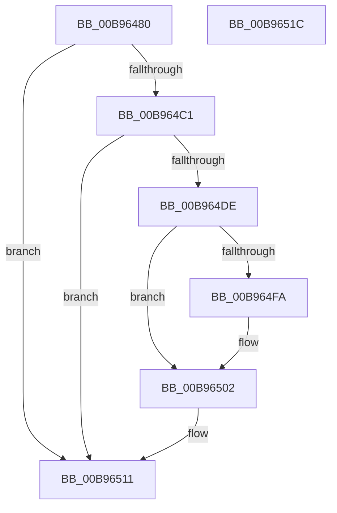

# VfFreeAdapterChannel

- RVA: `0x00B96480`–`0x00B9651D` (길이 `157` bytes)
- VA: `0x0000000140B96480`
- 실행 섹션: `PAGEVRFY`
- PDB 이름 있음: `예`; PDB Function 태그: `아니요`
- unwind 정보 RVA: `0x0005CAAC`
- 디코드: `46`개 명령, `157/157` bytes 표시
- 미해석 바이트: `0` (있으면 어셈블리에 `.byte`로 보존)

> 이 문서는 커널 이미지의 기계어와 PDB 기호를 분석해 생성했습니다. 4번과 5번은 함수 원형과 자료형을 바이너리 사용 방식에서 추정한 C 해석이며 원본 소스 복구 결과는 아닙니다.

## 1. Dependencies

- 직접 호출 지점: **9**; 고유 호출 대상: **9**
- 직접 호출자로 확인된 함수: **0**
- RIP 상대 이미지 참조: **1**

### Outgoing calls
- `0x00B9648F` → [VF_ASSERT_IRQL](VF_ASSERT_IRQL_function_00B94F30.md) (function, `0x00B94F30`)
- `0x00B96499` → [ViGetAdapterInformationInternal](ViGetAdapterInformationInternal_function_00B98E88.md) (function, `0x00B98E88`)
- `0x00B964A4` → [ViGetRealDmaAdapter](ViGetRealDmaAdapter_function_00B990DC.md) (function, `0x00B990DC`)
- `0x00B964B7` → [guard_dispatch_icall](../../text/6B/guard_dispatch_icall_function_006BAAD0.md) (function, `0x006BAAD0`)
- `0x00B964D1` → [ViRemoveChannelWcb](../../text/61/ViRemoveChannelWcb_function_00612E5C.md) (function, `0x00612E5C`)
- `0x00B964E1` → [DECREMENT_ADAPTER_CHANNELS](DECREMENT_ADAPTER_CHANNELS_function_00B94B14.md) (function, `0x00B94B14`)
- `0x00B964EC` → [SUBTRACT_MAP_REGISTERS](SUBTRACT_MAP_REGISTERS_function_00B94E10.md) (function, `0x00B94E10`)
- `0x00B964FD` → [ViFreeMapRegisterFile](ViFreeMapRegisterFile_function_00B98B8C.md) (function, `0x00B98B8C`)
- `0x00B9650C` → [ExFreeToNPagedLookasideList](../../text/38/ExFreeToNPagedLookasideList_function_0038D9D0.md) (function, `0x0038D9D0`)

### Direct callers
- 이 함수 시작 RVA로 연결되는 직접 call은 확인되지 않았습니다. 간접 호출은 완전히 역산할 수 없습니다.

### Static image references
- `0x00B96505` → RVA `0x00E28A80` (`.data`; read)

## 2. Other-region calls and transfers

- 다른 실행 섹션으로 향하는 call: **3**
  - `0x00B964B7` → [guard_dispatch_icall](../../text/6B/guard_dispatch_icall_function_006BAAD0.md) (`PAGEVRFY` → `.text`)
  - `0x00B964D1` → [ViRemoveChannelWcb](../../text/61/ViRemoveChannelWcb_function_00612E5C.md) (`PAGEVRFY` → `.text`)
  - `0x00B9650C` → [ExFreeToNPagedLookasideList](../../text/38/ExFreeToNPagedLookasideList_function_0038D9D0.md) (`PAGEVRFY` → `.text`)
- 별도 외부 분기/꼬리 이동을 확인하지 못했습니다.

## 3. Assembly (complete function range)

```asm
00B96480  48 89 5C 24 08                  mov qword ptr [rsp + 8], rbx
00B96485  57                              push rdi
00B96486  48 83 EC 20                     sub rsp, 0x20
00B9648A  48 8B D9                        mov rbx, rcx
00B9648D  B1 02                           mov cl, 2
00B9648F  E8 9C EA FF FF                  call 0x140b94f30
00B96494  B2 01                           mov dl, 1
00B96496  48 8B CB                        mov rcx, rbx
00B96499  E8 EA 29 00 00                  call 0x140b98e88
00B9649E  48 8B CB                        mov rcx, rbx
00B964A1  48 8B F8                        mov rdi, rax
00B964A4  E8 33 2C 00 00                  call 0x140b990dc
00B964A9  48 8B D0                        mov rdx, rax
00B964AC  48 8B 48 08                     mov rcx, qword ptr [rax + 8]
00B964B0  48 8B 41 30                     mov rax, qword ptr [rcx + 0x30]
00B964B4  48 8B CA                        mov rcx, rdx
00B964B7  E8 14 46 B2 FF                  call 0x1406baad0
00B964BC  48 85 FF                        test rdi, rdi
00B964BF  74 50                           je 0x140b96511
00B964C1  33 C0                           xor eax, eax
00B964C3  45 33 C0                        xor r8d, r8d
00B964C6  87 87 DC 00 00 00               xchg dword ptr [rdi + 0xdc], eax
00B964CC  33 D2                           xor edx, edx
00B964CE  48 8B CF                        mov rcx, rdi
00B964D1  E8 86 C9 A7 FF                  call 0x140612e5c
00B964D6  48 8B D8                        mov rbx, rax
00B964D9  48 85 C0                        test rax, rax
00B964DC  74 33                           je 0x140b96511
00B964DE  48 8B CF                        mov rcx, rdi
00B964E1  E8 2E E6 FF FF                  call 0x140b94b14
00B964E6  8B 53 30                        mov edx, dword ptr [rbx + 0x30]
00B964E9  48 8B CF                        mov rcx, rdi
00B964EC  E8 1F E9 FF FF                  call 0x140b94e10
00B964F1  48 8B 53 60                     mov rdx, qword ptr [rbx + 0x60]
00B964F5  48 85 D2                        test rdx, rdx
00B964F8  74 08                           je 0x140b96502
00B964FA  48 8B CF                        mov rcx, rdi
00B964FD  E8 8A 26 00 00                  call 0x140b98b8c
00B96502  48 8B D3                        mov rdx, rbx
00B96505  48 8D 0D 74 25 29 00            lea rcx, [rip + 0x292574]
00B9650C  E8 BF 74 7F FF                  call 0x14038d9d0
00B96511  48 8B 5C 24 30                  mov rbx, qword ptr [rsp + 0x30]
00B96516  48 83 C4 20                     add rsp, 0x20
00B9651A  5F                              pop rdi
00B9651B  C3                              ret
00B9651C  CC                              int3
```

## 4. C-style interpretation (structured pseudocode)

```c
__int64 __fastcall VfFreeAdapterChannel(__int64 a1, __int64 a2, int a3)
{
    __int64 result;
    __int64 v_rsp;
    unsigned __int64 v_stack_p8;

    v_stack_p8 = v_rbx;
    v_rsp = (v_rsp) - (32);
    result = VF_ASSERT_IRQL(2, a2, a3, a4);
    result = ViGetAdapterInformationInternal(a1, 1, a3, a4);
    result = ViGetRealDmaAdapter(a1, 1, a3, a4);
    result = guard_dispatch_icall(result, result, a3, a4);
    if (result == 0) goto loc_00B96511;
    result = 0;
    a3 = 0;
    a2 = 0;
    result = ViRemoveChannelWcb(0, a2, a3, a4);
    if (result == 0) goto loc_00B96511;
    result = DECREMENT_ADAPTER_CHANNELS(result, a2, a3, a4);
    result = SUBTRACT_MAP_REGISTERS(result, (unsigned int)(*(unsigned int *)(result + 48)), a3, a4);
    if (*(unsigned __int64 *)(result + 96) != 0) {
        a1 = result;
        result = ViFreeMapRegisterFile(a1, *(unsigned __int64 *)(result + 96), a3, a4);
    }
    result = ExFreeToNPagedLookasideList(v_rip + 2696564, result, a3, a4);
loc_00B96511:
    v_rsp = (v_rsp) + (32);
    return result;
}
```

## 5. (Beta) C Style

```c
int64_t VfFreeAdapterChannel(int64_t Arg1, int64_t Arg2, int32_t Arg3)
{
    int64_t result;
    int64_t local_rsp;
    uint64_t v_stack_p8;

    v_stack_p8 = local_rbx;
    local_rsp = (local_rsp) - (32);
    result = VF_ASSERT_IRQL(2, Arg2, Arg3, a4);
    result = ViGetAdapterInformationInternal(Arg1, 1, Arg3, a4);
    result = ViGetRealDmaAdapter(Arg1, 1, Arg3, a4);
    result = guard_dispatch_icall(result, result, Arg3, a4);
    if (result == 0) goto loc_00B96511;
    result = 0;
    Arg3 = 0;
    Arg2 = 0;
    result = ViRemoveChannelWcb(0, Arg2, Arg3, a4);
    if (result == 0) goto loc_00B96511;
    result = DECREMENT_ADAPTER_CHANNELS(result, Arg2, Arg3, a4);
    result = SUBTRACT_MAP_REGISTERS(result, (uint32_t)(*(uint32_t *)(result + 0x30)), Arg3, a4);
    if (*(uint64_t *)(result + 0x60) != 0) {
        Arg1 = result;
        result = ViFreeMapRegisterFile(Arg1, *(uint64_t *)(result + 0x60), Arg3, a4);
    }
    result = ExFreeToNPagedLookasideList(v_rip + 2696564, result, Arg3, a4);
loc_00B96511:
    local_rsp = (local_rsp) + (32);
    return result;
}
```

## 6. Execution-region graph

[열기: 2D/3D 그래프와 함수 탐색 컨트롤 패널](../../../control-panel.html?section=pagevrfy&rva=0x00B96480&view=graph)

- 2D 그래프는 위에서 아래로 흐르고, 3D 그래프는 빈 공간을 드래그해 회전합니다. Shift+드래그는 이동, 휠은 확대·축소, 함수 노드 선택은 대상 보고서 이동입니다.

### Static fallback


