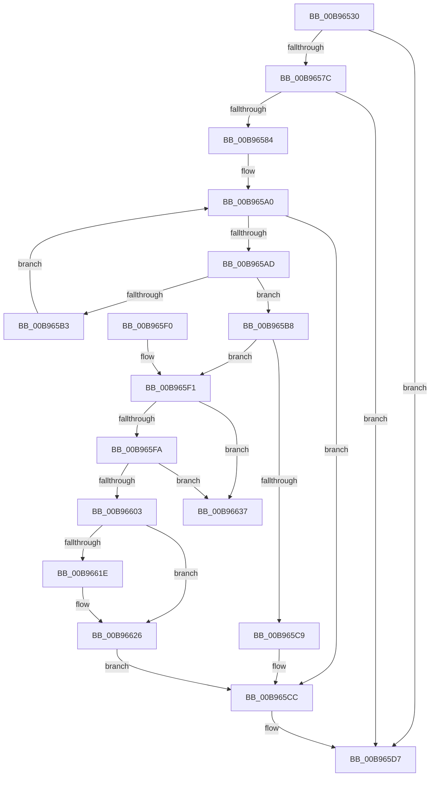

# VfFreeAdapterObject

- RVA: `0x00B96530`–`0x00B9663C` (길이 `268` bytes)
- VA: `0x0000000140B96530`
- 실행 섹션: `PAGEVRFY`
- PDB 이름 있음: `예`; PDB Function 태그: `아니요`
- unwind 정보 RVA: `0x00069B38`
- 디코드: `79`개 명령, `268/268` bytes 표시
- 미해석 바이트: `0` (있으면 어셈블리에 `.byte`로 보존)

> 이 문서는 커널 이미지의 기계어와 PDB 기호를 분석해 생성했습니다. 4번과 5번은 함수 원형과 자료형을 바이너리 사용 방식에서 추정한 C 해석이며 원본 소스 복구 결과는 아닙니다.

## 1. Dependencies

- 직접 호출 지점: **9**; 고유 호출 대상: **9**
- 직접 호출자로 확인된 함수: **0**
- RIP 상대 이미지 참조: **1**

### Outgoing calls
- `0x00B9654D` → [ViGetRealDmaAdapter](ViGetRealDmaAdapter_function_00B990DC.md) (function, `0x00B990DC`)
- `0x00B9655A` → [ViGetAdapterInformationInternal](ViGetAdapterInformationInternal_function_00B98E88.md) (function, `0x00B98E88`)
- `0x00B96572` → [guard_dispatch_icall](../../text/6B/guard_dispatch_icall_function_006BAAD0.md) (function, `0x006BAAD0`)
- `0x00B9658E` → [KeAcquireSpinLockRaiseToDpc](../../text/20/KeAcquireSpinLockRaiseToDpc_function_00208470.md) (function, `0x00208470`)
- `0x00B965BB` → [DECREMENT_ADAPTER_CHANNELS](DECREMENT_ADAPTER_CHANNELS_function_00B94B14.md) (function, `0x00B94B14`)
- `0x00B965D2` → [KeReleaseSpinLock](../../text/39/KeReleaseSpinLock_function_00392BA0.md) (function, `0x00392BA0`)
- `0x00B96610` → [SUBTRACT_MAP_REGISTERS](SUBTRACT_MAP_REGISTERS_function_00B94E10.md) (function, `0x00B94E10`)
- `0x00B96621` → [ViFreeMapRegisterFile](ViFreeMapRegisterFile_function_00B98B8C.md) (function, `0x00B98B8C`)
- `0x00B96630` → [ExFreeToNPagedLookasideList](../../text/38/ExFreeToNPagedLookasideList_function_0038D9D0.md) (function, `0x0038D9D0`)

### Direct callers
- 이 함수 시작 RVA로 연결되는 직접 call은 확인되지 않았습니다. 간접 호출은 완전히 역산할 수 없습니다.

### Static image references
- `0x00B96629` → RVA `0x00E28A80` (`.data`; read)

## 2. Other-region calls and transfers

- 다른 실행 섹션으로 향하는 call: **4**
  - `0x00B96572` → [guard_dispatch_icall](../../text/6B/guard_dispatch_icall_function_006BAAD0.md) (`PAGEVRFY` → `.text`)
  - `0x00B9658E` → [KeAcquireSpinLockRaiseToDpc](../../text/20/KeAcquireSpinLockRaiseToDpc_function_00208470.md) (`PAGEVRFY` → `.text`)
  - `0x00B965D2` → [KeReleaseSpinLock](../../text/39/KeReleaseSpinLock_function_00392BA0.md) (`PAGEVRFY` → `.text`)
  - `0x00B96630` → [ExFreeToNPagedLookasideList](../../text/38/ExFreeToNPagedLookasideList_function_0038D9D0.md) (`PAGEVRFY` → `.text`)
- 별도 외부 분기/꼬리 이동을 확인하지 못했습니다.

## 3. Assembly (complete function range)

```asm
00B96530  48 89 5C 24 08                  mov qword ptr [rsp + 8], rbx
00B96535  48 89 6C 24 10                  mov qword ptr [rsp + 0x10], rbp
00B9653A  48 89 74 24 18                  mov qword ptr [rsp + 0x18], rsi
00B9653F  57                              push rdi
00B96540  41 56                           push r14
00B96542  41 57                           push r15
00B96544  48 83 EC 20                     sub rsp, 0x20
00B96548  8B EA                           mov ebp, edx
00B9654A  48 8B D9                        mov rbx, rcx
00B9654D  E8 8A 2B 00 00                  call 0x140b990dc
00B96552  B2 01                           mov dl, 1
00B96554  48 8B CB                        mov rcx, rbx
00B96557  48 8B F8                        mov rdi, rax
00B9655A  E8 29 29 00 00                  call 0x140b98e88
00B9655F  48 8B 4F 08                     mov rcx, qword ptr [rdi + 8]
00B96563  48 8B F0                        mov rsi, rax
00B96566  8B D5                           mov edx, ebp
00B96568  48 8B 81 D8 00 00 00            mov rax, qword ptr [rcx + 0xd8]
00B9656F  48 8B CF                        mov rcx, rdi
00B96572  E8 59 45 B2 FF                  call 0x1406baad0
00B96577  48 85 F6                        test rsi, rsi
00B9657A  74 5B                           je 0x140b965d7
00B9657C  8D 4D FE                        lea ecx, [rbp - 2]
00B9657F  83 F9 01                        cmp ecx, 1
00B96582  77 53                           ja 0x140b965d7
00B96584  4C 8D B6 B0 00 00 00            lea r14, [rsi + 0xb0]
00B9658B  49 8B CE                        mov rcx, r14
00B9658E  E8 DD 1E 67 FF                  call 0x140208470
00B96593  48 8D 8E A0 00 00 00            lea rcx, [rsi + 0xa0]
00B9659A  44 8A F8                        mov r15b, al
00B9659D  48 8B 19                        mov rbx, qword ptr [rcx]
00B965A0  48 83 EB 48                     sub rbx, 0x48
00B965A4  48 8D 7B 48                     lea rdi, [rbx + 0x48]
00B965A8  48 3B CF                        cmp rcx, rdi
00B965AB  74 1F                           je 0x140b965cc
00B965AD  83 7B 34 01                     cmp dword ptr [rbx + 0x34], 1
00B965B1  74 05                           je 0x140b965b8
00B965B3  48 8B 1F                        mov rbx, qword ptr [rdi]
00B965B6  EB E8                           jmp 0x140b965a0
00B965B8  48 8B CE                        mov rcx, rsi
00B965BB  E8 54 E5 FF FF                  call 0x140b94b14
00B965C0  BA 03 00 00 00                  mov edx, 3
00B965C5  3B EA                           cmp ebp, edx
00B965C7  75 28                           jne 0x140b965f1
00B965C9  89 53 34                        mov dword ptr [rbx + 0x34], edx
00B965CC  41 8A D7                        mov dl, r15b
00B965CF  49 8B CE                        mov rcx, r14
00B965D2  E8 C9 C5 7F FF                  call 0x140392ba0
00B965D7  48 8B 5C 24 40                  mov rbx, qword ptr [rsp + 0x40]
00B965DC  48 8B 6C 24 48                  mov rbp, qword ptr [rsp + 0x48]
00B965E1  48 8B 74 24 50                  mov rsi, qword ptr [rsp + 0x50]
00B965E6  48 83 C4 20                     add rsp, 0x20
00B965EA  41 5F                           pop r15
00B965EC  41 5E                           pop r14
00B965EE  5F                              pop rdi
00B965EF  C3                              ret
00B965F0  CC                              int3
00B965F1  48 8B 0F                        mov rcx, qword ptr [rdi]
00B965F4  48 39 79 08                     cmp qword ptr [rcx + 8], rdi
00B965F8  75 3D                           jne 0x140b96637
00B965FA  48 8B 47 08                     mov rax, qword ptr [rdi + 8]
00B965FE  48 39 38                        cmp qword ptr [rax], rdi
00B96601  75 34                           jne 0x140b96637
00B96603  48 89 08                        mov qword ptr [rax], rcx
00B96606  48 89 41 08                     mov qword ptr [rcx + 8], rax
00B9660A  48 8B CE                        mov rcx, rsi
00B9660D  8B 53 30                        mov edx, dword ptr [rbx + 0x30]
00B96610  E8 FB E7 FF FF                  call 0x140b94e10
00B96615  48 8B 53 60                     mov rdx, qword ptr [rbx + 0x60]
00B96619  48 85 D2                        test rdx, rdx
00B9661C  74 08                           je 0x140b96626
00B9661E  48 8B CE                        mov rcx, rsi
00B96621  E8 66 25 00 00                  call 0x140b98b8c
00B96626  48 8B D3                        mov rdx, rbx
00B96629  48 8D 0D 50 24 29 00            lea rcx, [rip + 0x292450]
00B96630  E8 9B 73 7F FF                  call 0x14038d9d0
00B96635  EB 95                           jmp 0x140b965cc
00B96637  48 8B CA                        mov rcx, rdx
00B9663A  CD 29                           int 0x29
```

## 4. C-style interpretation (structured pseudocode)

```c
__int64 __fastcall VfFreeAdapterObject(__int64 a1, int a2)
{
    __int64 result;
    __int64 v_rbx;
    __int64 v_rsp;
    unsigned __int64 v_stack_p10;
    unsigned __int64 v_stack_p18;
    unsigned __int64 v_stack_p8;

    v_stack_p8 = v_rbx;
    v_stack_p10 = v_rbp;
    v_stack_p18 = v_rsi;
    v_rsp = (v_rsp) - (32);
    result = ViGetRealDmaAdapter(a1, a2, a3, a4);
    result = ViGetAdapterInformationInternal(a1, 1, a3, a4);
    result = guard_dispatch_icall(result, (unsigned int)((unsigned int)((unsigned int)(a2))), a3, a4);
    if (result == 0) goto loc_00B965D7;
    if (((unsigned int)((unsigned int)(a2) - 2)) > 1) goto loc_00B965D7;
    result = KeAcquireSpinLockRaiseToDpc(result + 176, (unsigned int)((unsigned int)((unsigned int)(a2))), a3, a4);
loc_00B965A0:
    v_rbx = (*(unsigned __int64 *)(result + 160)) - (72);
    if ((result + 160) == (v_rbx + 72)) goto loc_00B965CC;
    if ((*(unsigned int *)(v_rbx + 52)) == 1) goto loc_00B965B8;
    goto loc_00B965A0;
loc_00B965B8:
    result = DECREMENT_ADAPTER_CHANNELS(result, (unsigned int)((unsigned int)((unsigned int)(a2))), a3, a4);
    if (((unsigned int)((unsigned int)(a2))) != 3) goto loc_00B965F1;
    *(unsigned int *)(*(unsigned __int64 *)(v_rbx + 72) + 52) = 3;
loc_00B965CC:
    result = KeReleaseSpinLock(result + 176, (unsigned __int8)((unsigned __int8)(result)), a3, a4);
loc_00B965D7:
    v_rsp = (v_rsp) + (32);
    return result;
loc_00B965F1:
    if ((*(unsigned __int64 *)(*(unsigned __int64 *)(v_rbx + 72) + 8)) != (v_rbx + 72)) goto loc_00B96637;
    if ((*(unsigned __int64 *)(*(unsigned __int64 *)(v_rbx + 72 + 8))) != (v_rbx + 72)) goto loc_00B96637;
    *(unsigned __int64 *)(*(unsigned __int64 *)(v_rbx + 72 + 8)) = *(unsigned __int64 *)(v_rbx + 72);
    *(unsigned __int64 *)(*(unsigned __int64 *)(v_rbx + 72) + 8) = *(unsigned __int64 *)(v_rbx + 72 + 8);
    result = SUBTRACT_MAP_REGISTERS(v_stack_p18, (unsigned int)(*(unsigned int *)(v_stack_p8 + 48)), a3, a4);
    if (*(unsigned __int64 *)(v_stack_p8 + 96) != 0) {
        a1 = v_stack_p18;
        result = ViFreeMapRegisterFile(a1, *(unsigned __int64 *)(v_stack_p8 + 96), a3, a4);
    }
    result = ExFreeToNPagedLookasideList(v_rip + 2696272, v_stack_p8, a3, a4);
    goto loc_00B965CC;
loc_00B96637:
    return result;
}
```

## 5. (Beta) C Style

```c
int64_t VfFreeAdapterObject(int64_t Arg1, void *Arg2)
{
    uint8_t *arg2 = (uint8_t *)Arg2;

    int64_t result;
    int64_t local_rbx;
    int64_t local_rsp;
    uint64_t v_stack_p10;
    uint64_t v_stack_p18;
    uint64_t v_stack_p8;

    v_stack_p8 = local_rbx;
    v_stack_p10 = local_rbp;
    v_stack_p18 = local_rsi;
    local_rsp = (local_rsp) - (32);
    result = ViGetRealDmaAdapter(Arg1, Arg2, a3, a4);
    result = ViGetAdapterInformationInternal(Arg1, 1, a3, a4);
    result = guard_dispatch_icall(result, (uint32_t)((uint32_t)((uint32_t)(Arg2))), a3, a4);
    if (result == 0) goto loc_00B965D7;
    if (((uint32_t)((uint32_t)(Arg2) - 2)) > 1) goto loc_00B965D7;
    result = KeAcquireSpinLockRaiseToDpc(result + 176, (uint32_t)((uint32_t)((uint32_t)(Arg2))), a3, a4);
loc_00B965A0:
    local_rbx = (*(uint64_t *)(result + 0xA0)) - (72);
    if ((result + 160) == (local_rbx + 72)) goto loc_00B965CC;
    if ((*(uint32_t *)(local_rbx + 0x34)) == 1) goto loc_00B965B8;
    goto loc_00B965A0;
loc_00B965B8:
    result = DECREMENT_ADAPTER_CHANNELS(result, (uint32_t)((uint32_t)((uint32_t)(Arg2))), a3, a4);
    if (((uint32_t)((uint32_t)(Arg2))) != 3) goto loc_00B965F1;
    *(uint32_t *)(*(uint64_t *)(local_rbx + 0x48) + 0x34) = 3;
loc_00B965CC:
    result = KeReleaseSpinLock(result + 176, (uint8_t)((uint8_t)(result)), a3, a4);
loc_00B965D7:
    local_rsp = (local_rsp) + (32);
    return result;
loc_00B965F1:
    if ((*(uint64_t *)(*(uint64_t *)(local_rbx + 0x48) + 0x8)) != (local_rbx + 72)) goto loc_00B96637;
    if ((*(uint64_t *)(*(uint64_t *)(local_rbx + 0x48 + 0x8))) != (local_rbx + 72)) goto loc_00B96637;
    *(uint64_t *)(*(uint64_t *)(local_rbx + 0x48 + 0x8)) = *(uint64_t *)(local_rbx + 0x48);
    *(uint64_t *)(*(uint64_t *)(local_rbx + 0x48) + 0x8) = *(uint64_t *)(local_rbx + 0x48 + 0x8);
    result = SUBTRACT_MAP_REGISTERS(v_stack_p18, (uint32_t)(*(uint32_t *)(v_stack_p8 + 0x30)), a3, a4);
    if (*(uint64_t *)(v_stack_p8 + 0x60) != 0) {
        Arg1 = v_stack_p18;
        result = ViFreeMapRegisterFile(Arg1, *(uint64_t *)(v_stack_p8 + 0x60), a3, a4);
    }
    result = ExFreeToNPagedLookasideList(v_rip + 2696272, v_stack_p8, a3, a4);
    goto loc_00B965CC;
loc_00B96637:
    return result;
}
```

### 관측된 메모리 오프셋

구조체 형식이 확인되지 않은 접근은 인자 기준의 오프셋으로만 기록했습니다.

| 기준 인자 | 오프셋 표현 | 폭 (bit) | 접근 |
|---|---:|---:|---|
| `Arg2` | `- 0x2` | `32` | `R` |

## 6. Execution-region graph

[열기: 2D/3D 그래프와 함수 탐색 컨트롤 패널](../../../control-panel.html?section=pagevrfy&rva=0x00B96530&view=graph)

- 2D 그래프는 위에서 아래로 흐르고, 3D 그래프는 빈 공간을 드래그해 회전합니다. Shift+드래그는 이동, 휠은 확대·축소, 함수 노드 선택은 대상 보고서 이동입니다.

### Static fallback


