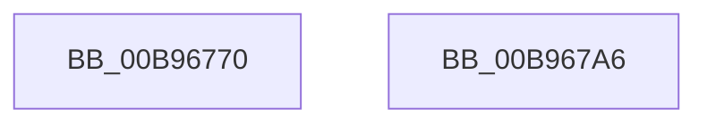

# VfFreeCommonBufferVector

- RVA: `0x00B96770`–`0x00B967A7` (길이 `55` bytes)
- VA: `0x0000000140B96770`
- 실행 섹션: `PAGEVRFY`
- PDB 이름 있음: `예`; PDB Function 태그: `아니요`
- unwind 정보 RVA: `0x0005CAAC`
- 디코드: `16`개 명령, `55/55` bytes 표시
- 미해석 바이트: `0` (있으면 어셈블리에 `.byte`로 보존)

> 이 문서는 커널 이미지의 기계어와 PDB 기호를 분석해 생성했습니다. 4번과 5번은 함수 원형과 자료형을 바이너리 사용 방식에서 추정한 C 해석이며 원본 소스 복구 결과는 아닙니다.

## 1. Dependencies

- 직접 호출 지점: **2**; 고유 호출 대상: **2**
- 직접 호출자로 확인된 함수: **0**
- RIP 상대 이미지 참조: **0**

### Outgoing calls
- `0x00B96780` → [ViGetRealDmaAdapter](ViGetRealDmaAdapter_function_00B990DC.md) (function, `0x00B990DC`)
- `0x00B96796` → [guard_dispatch_icall](../../text/6B/guard_dispatch_icall_function_006BAAD0.md) (function, `0x006BAAD0`)

### Direct callers
- 이 함수 시작 RVA로 연결되는 직접 call은 확인되지 않았습니다. 간접 호출은 완전히 역산할 수 없습니다.

### Static image references
- 디코드된 RIP-relative 메모리 참조가 없습니다.

## 2. Other-region calls and transfers

- 다른 실행 섹션으로 향하는 call: **1**
  - `0x00B96796` → [guard_dispatch_icall](../../text/6B/guard_dispatch_icall_function_006BAAD0.md) (`PAGEVRFY` → `.text`)
- 별도 외부 분기/꼬리 이동을 확인하지 못했습니다.

## 3. Assembly (complete function range)

```asm
00B96770  48 89 5C 24 08                  mov qword ptr [rsp + 8], rbx
00B96775  57                              push rdi
00B96776  48 83 EC 20                     sub rsp, 0x20
00B9677A  48 8B DA                        mov rbx, rdx
00B9677D  48 8B F9                        mov rdi, rcx
00B96780  E8 57 29 00 00                  call 0x140b990dc
00B96785  48 8B D3                        mov rdx, rbx
00B96788  48 8B CF                        mov rcx, rdi
00B9678B  4C 8B 40 08                     mov r8, qword ptr [rax + 8]
00B9678F  49 8B 80 30 01 00 00            mov rax, qword ptr [r8 + 0x130]
00B96796  E8 35 43 B2 FF                  call 0x1406baad0
00B9679B  48 8B 5C 24 30                  mov rbx, qword ptr [rsp + 0x30]
00B967A0  48 83 C4 20                     add rsp, 0x20
00B967A4  5F                              pop rdi
00B967A5  C3                              ret
00B967A6  CC                              int3
```

## 4. C-style interpretation (structured pseudocode)

```c
__int64 __fastcall VfFreeCommonBufferVector(__int64 a1, __int64 a2)
{
    __int64 result;
    __int64 v_rsp;
    unsigned __int64 v_stack_p8;

    v_stack_p8 = v_rbx;
    v_rsp = (v_rsp) - (32);
    result = ViGetRealDmaAdapter(a1, a2, a3, a4);
    result = guard_dispatch_icall(a1, a2, *(unsigned __int64 *)(result + 8), a4);
    v_rsp = (v_rsp) + (32);
    return result;
}
```

## 5. (Beta) C Style

```c
int64_t VfFreeCommonBufferVector(int64_t Arg1, int64_t Arg2)
{
    int64_t result;
    int64_t local_rsp;
    uint64_t v_stack_p8;

    v_stack_p8 = local_rbx;
    local_rsp = (local_rsp) - (32);
    result = ViGetRealDmaAdapter(Arg1, Arg2, a3, a4);
    result = guard_dispatch_icall(Arg1, Arg2, *(uint64_t *)(result + 0x8), a4);
    local_rsp = (local_rsp) + (32);
    return result;
}
```

## 6. Execution-region graph

[열기: 2D/3D 그래프와 함수 탐색 컨트롤 패널](../../../control-panel.html?section=pagevrfy&rva=0x00B96770&view=graph)

- 2D 그래프는 위에서 아래로 흐르고, 3D 그래프는 빈 공간을 드래그해 회전합니다. Shift+드래그는 이동, 휠은 확대·축소, 함수 노드 선택은 대상 보고서 이동입니다.

### Static fallback


