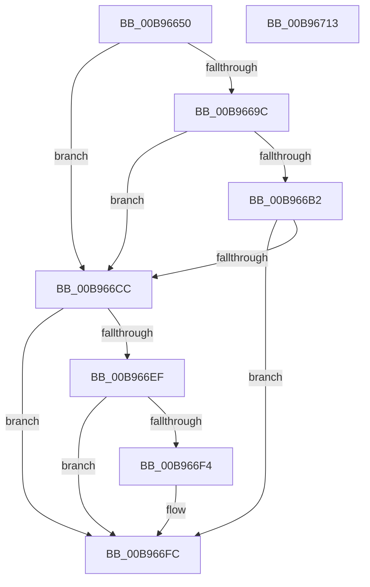

# VfFreeCommonBuffer

- RVA: `0x00B96650`–`0x00B96714` (길이 `196` bytes)
- VA: `0x0000000140B96650`
- 실행 섹션: `PAGEVRFY`
- PDB 이름 있음: `예`; PDB Function 태그: `아니요`
- unwind 정보 RVA: `0x000D232C`
- 디코드: `61`개 명령, `196/196` bytes 표시
- 미해석 바이트: `0` (있으면 어셈블리에 `.byte`로 보존)

> 이 문서는 커널 이미지의 기계어와 PDB 기호를 분석해 생성했습니다. 4번과 5번은 함수 원형과 자료형을 바이너리 사용 방식에서 추정한 C 해석이며 원본 소스 복구 결과는 아닙니다.

## 1. Dependencies

- 직접 호출 지점: **7**; 고유 호출 대상: **7**
- 직접 호출자로 확인된 함수: **0**
- RIP 상대 이미지 참조: **0**

### Outgoing calls
- `0x00B9667A` → [ViGetRealDmaAdapter](ViGetRealDmaAdapter_function_00B990DC.md) (function, `0x00B990DC`)
- `0x00B96687` → [ViGetAdapterInformationInternal](ViGetAdapterInformationInternal_function_00B98E88.md) (function, `0x00B98E88`)
- `0x00B9669C` → [VF_ASSERT_MAX_IRQL](VF_ASSERT_MAX_IRQL_function_00B94FB0.md) (function, `0x00B94FB0`)
- `0x00B966A6` → [ViHalFreeDomainCommonBuffer](ViHalFreeDomainCommonBuffer_function_00B99168.md) (function, `0x00B99168`)
- `0x00B966C3` → [ViSpecialFreeCommonBuffer](ViSpecialFreeCommonBuffer_function_00B99D2C.md) (function, `0x00B99D2C`)
- `0x00B966E5` → [guard_dispatch_icall](../../text/6B/guard_dispatch_icall_function_006BAAD0.md) (function, `0x006BAAD0`)
- `0x00B966F7` → [DECREMENT_COMMON_BUFFERS](DECREMENT_COMMON_BUFFERS_function_00B94BB0.md) (function, `0x00B94BB0`)

### Direct callers
- 이 함수 시작 RVA로 연결되는 직접 call은 확인되지 않았습니다. 간접 호출은 완전히 역산할 수 없습니다.

### Static image references
- 디코드된 RIP-relative 메모리 참조가 없습니다.

## 2. Other-region calls and transfers

- 다른 실행 섹션으로 향하는 call: **1**
  - `0x00B966E5` → [guard_dispatch_icall](../../text/6B/guard_dispatch_icall_function_006BAAD0.md) (`PAGEVRFY` → `.text`)
- 별도 외부 분기/꼬리 이동을 확인하지 못했습니다.

## 3. Assembly (complete function range)

```asm
00B96650  48 89 5C 24 08                  mov qword ptr [rsp + 8], rbx
00B96655  48 89 6C 24 10                  mov qword ptr [rsp + 0x10], rbp
00B9665A  4C 89 44 24 18                  mov qword ptr [rsp + 0x18], r8
00B9665F  56                              push rsi
00B96660  57                              push rdi
00B96661  41 54                           push r12
00B96663  41 56                           push r14
00B96665  41 57                           push r15
00B96667  48 83 EC 30                     sub rsp, 0x30
00B9666B  4D 8B F1                        mov r14, r9
00B9666E  49 8B D8                        mov rbx, r8
00B96671  44 8B E2                        mov r12d, edx
00B96674  48 8B F9                        mov rdi, rcx
00B96677  40 32 F6                        xor sil, sil
00B9667A  E8 5D 2A 00 00                  call 0x140b990dc
00B9667F  B2 01                           mov dl, 1
00B96681  48 8B CF                        mov rcx, rdi
00B96684  48 8B E8                        mov rbp, rax
00B96687  E8 FC 27 00 00                  call 0x140b98e88
00B9668C  44 8A BC 24 80 00 00 00         mov r15b, byte ptr [rsp + 0x80]
00B96694  48 8B F8                        mov rdi, rax
00B96697  48 85 C0                        test rax, rax
00B9669A  74 30                           je 0x140b966cc
00B9669C  E8 0F E9 FF FF                  call 0x140b94fb0
00B966A1  48 8D 4C 24 70                  lea rcx, [rsp + 0x70]
00B966A6  E8 BD 2A 00 00                  call 0x140b99168
00B966AB  40 8A F0                        mov sil, al
00B966AE  84 C0                           test al, al
00B966B0  75 1A                           jne 0x140b966cc
00B966B2  48 8B 4D 08                     mov rcx, qword ptr [rbp + 8]
00B966B6  45 8A CF                        mov r9b, r15b
00B966B9  4D 8B C6                        mov r8, r14
00B966BC  48 8B D7                        mov rdx, rdi
00B966BF  48 8B 49 18                     mov rcx, qword ptr [rcx + 0x18]
00B966C3  E8 64 36 00 00                  call 0x140b99d2c
00B966C8  85 C0                           test eax, eax
00B966CA  75 30                           jne 0x140b966fc
00B966CC  48 8B 45 08                     mov rax, qword ptr [rbp + 8]
00B966D0  4D 8B CE                        mov r9, r14
00B966D3  4C 8B C3                        mov r8, rbx
00B966D6  44 88 7C 24 20                  mov byte ptr [rsp + 0x20], r15b
00B966DB  41 8B D4                        mov edx, r12d
00B966DE  48 8B CD                        mov rcx, rbp
00B966E1  48 8B 40 18                     mov rax, qword ptr [rax + 0x18]
00B966E5  E8 E6 43 B2 FF                  call 0x1406baad0
00B966EA  48 85 FF                        test rdi, rdi
00B966ED  74 0D                           je 0x140b966fc
00B966EF  40 84 F6                        test sil, sil
00B966F2  75 08                           jne 0x140b966fc
00B966F4  48 8B CF                        mov rcx, rdi
00B966F7  E8 B4 E4 FF FF                  call 0x140b94bb0
00B966FC  48 8B 5C 24 60                  mov rbx, qword ptr [rsp + 0x60]
00B96701  48 8B 6C 24 68                  mov rbp, qword ptr [rsp + 0x68]
00B96706  48 83 C4 30                     add rsp, 0x30
00B9670A  41 5F                           pop r15
00B9670C  41 5E                           pop r14
00B9670E  41 5C                           pop r12
00B96710  5F                              pop rdi
00B96711  5E                              pop rsi
00B96712  C3                              ret
00B96713  CC                              int3
```

## 4. C-style interpretation (structured pseudocode)

```c
__int64 __fastcall VfFreeCommonBuffer(__int64 a1, int a2, __int64 a3, __int64 a4, unsigned __int8 a5)
{
    __int64 result;
    __int64 v_rsi;
    __int64 v_rsp;
    unsigned __int8 v_stack_m38;
    unsigned __int64 v_stack_p10;
    unsigned __int64 v_stack_p18;
    unsigned __int64 v_stack_p8;

    v_stack_p8 = v_rbx;
    v_stack_p10 = v_rbp;
    v_stack_p18 = a3;
    v_rsp = (v_rsp) - (48);
    v_rsi = 0;
    result = ViGetRealDmaAdapter(a1, a2, a3, a4);
    result = ViGetAdapterInformationInternal(a1, 1, a3, a4);
    if (result == 0) goto loc_00B966CC;
    result = VF_ASSERT_MAX_IRQL(a1, 1, a3, a4);
    result = ViHalFreeDomainCommonBuffer(v_stack_p18, 1, a3, a4);
    if ((unsigned __int8)(result) != 0) goto loc_00B966CC;
    result = ViSpecialFreeCommonBuffer(*(unsigned __int64 *)(*(unsigned __int64 *)(result + 8) + 24), result, a4, a5);
    if ((unsigned int)(result) != 0) goto loc_00B966FC;
loc_00B966CC:
    v_stack_m38 = a5;
    result = guard_dispatch_icall(result, (unsigned int)((unsigned int)((unsigned int)(a2))), a3, a4);
    if (result == 0) goto loc_00B966FC;
    if ((unsigned __int8)((unsigned __int8)(result)) == 0) {
        a1 = result;
        result = DECREMENT_COMMON_BUFFERS(a1, (unsigned int)((unsigned int)((unsigned int)(a2))), a3, a4);
    }
    v_rsp = (v_rsp) + (48);
    return result;
}
```

## 5. (Beta) C Style

```c
int64_t VfFreeCommonBuffer(int64_t Arg1, int32_t Arg2, int64_t Arg3, int64_t Arg4, uint8_t Arg5)
{
    int64_t result;
    int64_t local_rsi;
    int64_t local_rsp;
    uint8_t v_stack_m38;
    uint64_t v_stack_p10;
    uint64_t v_stack_p18;
    uint64_t v_stack_p8;

    v_stack_p8 = local_rbx;
    v_stack_p10 = local_rbp;
    v_stack_p18 = Arg3;
    local_rsp = (local_rsp) - (48);
    local_rsi = 0;
    result = ViGetRealDmaAdapter(Arg1, Arg2, Arg3, Arg4);
    result = ViGetAdapterInformationInternal(Arg1, 1, Arg3, Arg4);
    if (result == 0) goto loc_00B966CC;
    result = VF_ASSERT_MAX_IRQL(Arg1, 1, Arg3, Arg4);
    result = ViHalFreeDomainCommonBuffer(v_stack_p18, 1, Arg3, Arg4);
    if ((uint8_t)(result) != 0) goto loc_00B966CC;
    result = ViSpecialFreeCommonBuffer(*(uint64_t *)(*(uint64_t *)(result + 0x8) + 0x18), result, Arg4, Arg5);
    if ((uint32_t)(result) != 0) goto loc_00B966FC;
loc_00B966CC:
    v_stack_m38 = Arg5;
    result = guard_dispatch_icall(result, (uint32_t)((uint32_t)((uint32_t)(Arg2))), Arg3, Arg4);
    if (result == 0) goto loc_00B966FC;
    if ((uint8_t)((uint8_t)(result)) == 0) {
        Arg1 = result;
        result = DECREMENT_COMMON_BUFFERS(Arg1, (uint32_t)((uint32_t)((uint32_t)(Arg2))), Arg3, Arg4);
    }
    local_rsp = (local_rsp) + (48);
    return result;
}
```

## 6. Execution-region graph

[열기: 2D/3D 그래프와 함수 탐색 컨트롤 패널](../../../control-panel.html?section=pagevrfy&rva=0x00B96650&view=graph)

- 2D 그래프는 위에서 아래로 흐르고, 3D 그래프는 빈 공간을 드래그해 회전합니다. Shift+드래그는 이동, 휠은 확대·축소, 함수 노드 선택은 대상 보고서 이동입니다.

### Static fallback


