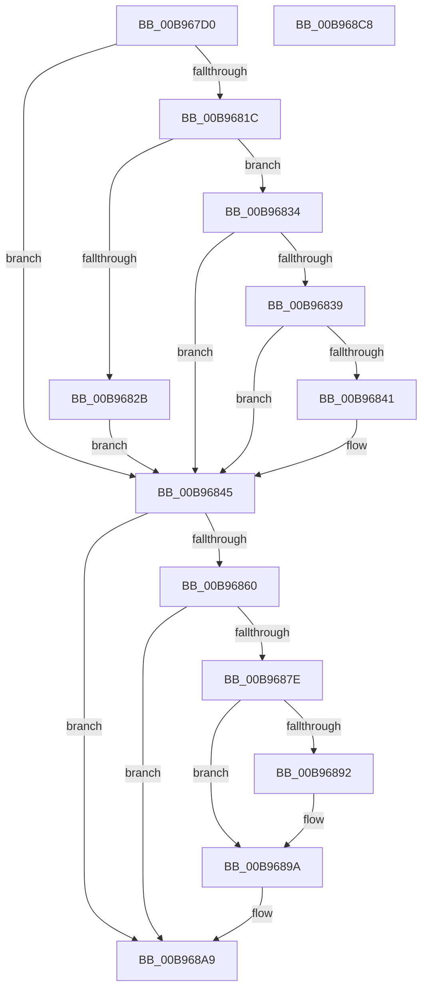

# VfFreeMapRegisters

- RVA: `0x00B967D0`–`0x00B968C9` (길이 `249` bytes)
- VA: `0x0000000140B967D0`
- 실행 섹션: `PAGEVRFY`
- PDB 이름 있음: `예`; PDB Function 태그: `아니요`
- unwind 정보 RVA: `0x0005FEF8`
- 디코드: `75`개 명령, `249/249` bytes 표시
- 미해석 바이트: `0` (있으면 어셈블리에 `.byte`로 보존)

> 이 문서는 커널 이미지의 기계어와 PDB 기호를 분석해 생성했습니다. 4번과 5번은 함수 원형과 자료형을 바이너리 사용 방식에서 추정한 C 해석이며 원본 소스 복구 결과는 아닙니다.

## 1. Dependencies

- 직접 호출 지점: **8**; 고유 호출 대상: **8**
- 직접 호출자로 확인된 함수: **0**
- RIP 상대 이미지 참조: **1**

### Outgoing calls
- `0x00B967FD` → [ViGetAdapterInformationInternal](ViGetAdapterInformationInternal_function_00B98E88.md) (function, `0x00B98E88`)
- `0x00B96808` → [ViGetRealDmaAdapter](ViGetRealDmaAdapter_function_00B990DC.md) (function, `0x00B990DC`)
- `0x00B9681E` → [VF_ASSERT_IRQL](VF_ASSERT_IRQL_function_00B94F30.md) (function, `0x00B94F30`)
- `0x00B96856` → [guard_dispatch_icall](../../text/6B/guard_dispatch_icall_function_006BAAD0.md) (function, `0x006BAAD0`)
- `0x00B96871` → [ViRemoveChannelWcb](../../text/61/ViRemoveChannelWcb_function_00612E5C.md) (function, `0x00612E5C`)
- `0x00B96884` → [SUBTRACT_MAP_REGISTERS](SUBTRACT_MAP_REGISTERS_function_00B94E10.md) (function, `0x00B94E10`)
- `0x00B96895` → [ViFreeMapRegisterFile](ViFreeMapRegisterFile_function_00B98B8C.md) (function, `0x00B98B8C`)
- `0x00B968A4` → [ExFreeToNPagedLookasideList](../../text/38/ExFreeToNPagedLookasideList_function_0038D9D0.md) (function, `0x0038D9D0`)

### Direct callers
- 이 함수 시작 RVA로 연결되는 직접 call은 확인되지 않았습니다. 간접 호출은 완전히 역산할 수 없습니다.

### Static image references
- `0x00B9689D` → RVA `0x00E28A80` (`.data`; read)

## 2. Other-region calls and transfers

- 다른 실행 섹션으로 향하는 call: **3**
  - `0x00B96856` → [guard_dispatch_icall](../../text/6B/guard_dispatch_icall_function_006BAAD0.md) (`PAGEVRFY` → `.text`)
  - `0x00B96871` → [ViRemoveChannelWcb](../../text/61/ViRemoveChannelWcb_function_00612E5C.md) (`PAGEVRFY` → `.text`)
  - `0x00B968A4` → [ExFreeToNPagedLookasideList](../../text/38/ExFreeToNPagedLookasideList_function_0038D9D0.md) (`PAGEVRFY` → `.text`)
- 별도 외부 분기/꼬리 이동을 확인하지 못했습니다.

## 3. Assembly (complete function range)

```asm
00B967D0  48 8B C4                        mov rax, rsp
00B967D3  48 89 58 08                     mov qword ptr [rax + 8], rbx
00B967D7  48 89 68 10                     mov qword ptr [rax + 0x10], rbp
00B967DB  48 89 70 18                     mov qword ptr [rax + 0x18], rsi
00B967DF  48 89 78 20                     mov qword ptr [rax + 0x20], rdi
00B967E3  41 54                           push r12
00B967E5  41 56                           push r14
00B967E7  41 57                           push r15
00B967E9  48 83 EC 20                     sub rsp, 0x20
00B967ED  48 8B FA                        mov rdi, rdx
00B967F0  45 8B F8                        mov r15d, r8d
00B967F3  B2 01                           mov dl, 1
00B967F5  48 8B D9                        mov rbx, rcx
00B967F8  33 ED                           xor ebp, ebp
00B967FA  45 32 F6                        xor r14b, r14b
00B967FD  E8 86 26 00 00                  call 0x140b98e88
00B96802  48 8B CB                        mov rcx, rbx
00B96805  48 8B F0                        mov rsi, rax
00B96808  E8 CF 28 00 00                  call 0x140b990dc
00B9680D  48 8B D8                        mov rbx, rax
00B96810  49 C7 C4 0D F0 AD DE            mov r12, 0xffffffffdeadf00d
00B96817  48 85 F6                        test rsi, rsi
00B9681A  74 29                           je 0x140b96845
00B9681C  B1 02                           mov cl, 2
00B9681E  E8 0D E7 FF FF                  call 0x140b94f30
00B96823  48 8B EF                        mov rbp, rdi
00B96826  49 3B FC                        cmp rdi, r12
00B96829  75 09                           jne 0x140b96834
00B9682B  33 FF                           xor edi, edi
00B9682D  41 B6 01                        mov r14b, 1
00B96830  33 ED                           xor ebp, ebp
00B96832  EB 11                           jmp 0x140b96845
00B96834  48 85 FF                        test rdi, rdi
00B96837  74 0C                           je 0x140b96845
00B96839  81 3F 0D D0 EF AC               cmp dword ptr [rdi], 0xacefd00d
00B9683F  75 04                           jne 0x140b96845
00B96841  48 8B 7F 30                     mov rdi, qword ptr [rdi + 0x30]
00B96845  48 8B 43 08                     mov rax, qword ptr [rbx + 8]
00B96849  45 8B C7                        mov r8d, r15d
00B9684C  48 8B D7                        mov rdx, rdi
00B9684F  48 8B CB                        mov rcx, rbx
00B96852  48 8B 40 38                     mov rax, qword ptr [rax + 0x38]
00B96856  E8 75 42 B2 FF                  call 0x1406baad0
00B9685B  48 85 F6                        test rsi, rsi
00B9685E  74 49                           je 0x140b968a9
00B96860  41 80 FE 01                     cmp r14b, 1
00B96864  48 8B CE                        mov rcx, rsi
00B96867  49 0F 44 EC                     cmove rbp, r12
00B9686B  45 33 C0                        xor r8d, r8d
00B9686E  48 8B D5                        mov rdx, rbp
00B96871  E8 E6 C5 A7 FF                  call 0x140612e5c
00B96876  48 8B D8                        mov rbx, rax
00B96879  48 85 C0                        test rax, rax
00B9687C  74 2B                           je 0x140b968a9
00B9687E  8B 50 30                        mov edx, dword ptr [rax + 0x30]
00B96881  48 8B CE                        mov rcx, rsi
00B96884  E8 87 E5 FF FF                  call 0x140b94e10
00B96889  48 8B 53 60                     mov rdx, qword ptr [rbx + 0x60]
00B9688D  48 85 D2                        test rdx, rdx
00B96890  74 08                           je 0x140b9689a
00B96892  48 8B CE                        mov rcx, rsi
00B96895  E8 F2 22 00 00                  call 0x140b98b8c
00B9689A  48 8B D3                        mov rdx, rbx
00B9689D  48 8D 0D DC 21 29 00            lea rcx, [rip + 0x2921dc]
00B968A4  E8 27 71 7F FF                  call 0x14038d9d0
00B968A9  48 8B 5C 24 40                  mov rbx, qword ptr [rsp + 0x40]
00B968AE  48 8B 6C 24 48                  mov rbp, qword ptr [rsp + 0x48]
00B968B3  48 8B 74 24 50                  mov rsi, qword ptr [rsp + 0x50]
00B968B8  48 8B 7C 24 58                  mov rdi, qword ptr [rsp + 0x58]
00B968BD  48 83 C4 20                     add rsp, 0x20
00B968C1  41 5F                           pop r15
00B968C3  41 5E                           pop r14
00B968C5  41 5C                           pop r12
00B968C7  C3                              ret
00B968C8  CC                              int3
```

## 4. C-style interpretation (structured pseudocode)

```c
__int64 __fastcall VfFreeMapRegisters(__int64 a1, __int64 a2, int a3)
{
    __int64 result;
    __int64 v_r14;
    __int64 v_rbp;
    __int64 v_rdi;
    __int64 v_rsp;
    unsigned __int64 v_stack_p10;
    unsigned __int64 v_stack_p18;
    unsigned __int64 v_stack_p20;
    unsigned __int64 v_stack_p8;

    *(unsigned __int64 *)(v_rsp + 8) = v_rbx;
    *(unsigned __int64 *)(v_rsp + 16) = v_rbp;
    *(unsigned __int64 *)(v_rsp + 24) = v_rsi;
    *(unsigned __int64 *)(v_rsp + 32) = v_rdi;
    v_rsp = (v_rsp) - (32);
    v_rbp = 0;
    v_r14 = 0;
    result = ViGetAdapterInformationInternal(a1, 1, a3, a4);
    result = ViGetRealDmaAdapter(a1, 1, a3, a4);
    if (result == 0) goto loc_00B96845;
    result = VF_ASSERT_IRQL(2, 1, a3, a4);
    if (a2 != 0xFFFFFFFFDEADF00DULL) goto loc_00B96834;
    v_rdi = 0;
    v_rbp = 0;
    goto loc_00B96845;
loc_00B96834:
    if (0 == 0) goto loc_00B96845;
    if ((*(unsigned int *)(v_rdi)) == 0xACEFD00DULL) {
        v_rdi = *(unsigned __int64 *)(v_rdi + 48);
    }
    result = guard_dispatch_icall(result, v_rdi, (unsigned int)((unsigned int)((unsigned int)(a3))), a4);
    if (result == 0) goto loc_00B968A9;
    if (1 == 1) { v_rbp = 0xFFFFFFFFDEADF00DULL; }
    a3 = 0;
    result = ViRemoveChannelWcb(result, v_rbp, a3, a4);
    if (result == 0) goto loc_00B968A9;
    result = SUBTRACT_MAP_REGISTERS(result, (unsigned int)(*(unsigned int *)(result + 48)), a3, a4);
    if (*(unsigned __int64 *)(result + 96) != 0) {
        a1 = result;
        result = ViFreeMapRegisterFile(a1, *(unsigned __int64 *)(result + 96), a3, a4);
    }
    result = ExFreeToNPagedLookasideList(v_rip + 2695644, result, a3, a4);
loc_00B968A9:
    v_rsp = (v_rsp) + (32);
    return result;
}
```

## 5. (Beta) C Style

```c
int64_t VfFreeMapRegisters(int64_t Arg1, int64_t Arg2, int32_t Arg3)
{
    int64_t result;
    int64_t local_r14;
    int64_t local_rbp;
    int64_t local_rdi;
    int64_t local_rsp;
    uint64_t v_stack_p10;
    uint64_t v_stack_p18;
    uint64_t v_stack_p20;
    uint64_t v_stack_p8;

    *(uint64_t *)(local_rsp + 0x8) = local_rbx;
    *(uint64_t *)(local_rsp + 0x10) = local_rbp;
    *(uint64_t *)(local_rsp + 0x18) = local_rsi;
    *(uint64_t *)(local_rsp + 0x20) = local_rdi;
    local_rsp = (local_rsp) - (32);
    local_rbp = 0;
    local_r14 = 0;
    result = ViGetAdapterInformationInternal(Arg1, 1, Arg3, a4);
    result = ViGetRealDmaAdapter(Arg1, 1, Arg3, a4);
    if (result == 0) goto loc_00B96845;
    result = VF_ASSERT_IRQL(2, 1, Arg3, a4);
    if (Arg2 != 0xFFFFFFFFDEADF00DULL) goto loc_00B96834;
    local_rdi = 0;
    local_rbp = 0;
    goto loc_00B96845;
loc_00B96834:
    if (0 == 0) goto loc_00B96845;
    if ((*(uint32_t *)(local_rdi)) == 0xACEFD00DULL) {
        local_rdi = *(uint64_t *)(local_rdi + 0x30);
    }
    result = guard_dispatch_icall(result, local_rdi, (uint32_t)((uint32_t)((uint32_t)(Arg3))), a4);
    if (result == 0) goto loc_00B968A9;
    if (1 == 1) { local_rbp = 0xFFFFFFFFDEADF00DULL; }
    Arg3 = 0;
    result = ViRemoveChannelWcb(result, local_rbp, Arg3, a4);
    if (result == 0) goto loc_00B968A9;
    result = SUBTRACT_MAP_REGISTERS(result, (uint32_t)(*(uint32_t *)(result + 0x30)), Arg3, a4);
    if (*(uint64_t *)(result + 0x60) != 0) {
        Arg1 = result;
        result = ViFreeMapRegisterFile(Arg1, *(uint64_t *)(result + 0x60), Arg3, a4);
    }
    result = ExFreeToNPagedLookasideList(v_rip + 2695644, result, Arg3, a4);
loc_00B968A9:
    local_rsp = (local_rsp) + (32);
    return result;
}
```

## 6. Execution-region graph

[열기: 2D/3D 그래프와 함수 탐색 컨트롤 패널](../../../control-panel.html?section=pagevrfy&rva=0x00B967D0&view=graph)

- 2D 그래프는 위에서 아래로 흐르고, 3D 그래프는 빈 공간을 드래그해 회전합니다. Shift+드래그는 이동, 휠은 확대·축소, 함수 노드 선택은 대상 보고서 이동입니다.

### Static fallback


