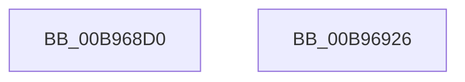

# VfGetCommonBufferFromVectorByIndex

- RVA: `0x00B968D0`–`0x00B96927` (길이 `87` bytes)
- VA: `0x0000000140B968D0`
- 실행 섹션: `PAGEVRFY`
- PDB 이름 있음: `예`; PDB Function 태그: `아니요`
- unwind 정보 RVA: `0x000794E0`
- 디코드: `24`개 명령, `87/87` bytes 표시
- 미해석 바이트: `0` (있으면 어셈블리에 `.byte`로 보존)

> 이 문서는 커널 이미지의 기계어와 PDB 기호를 분석해 생성했습니다. 4번과 5번은 함수 원형과 자료형을 바이너리 사용 방식에서 추정한 C 해석이며 원본 소스 복구 결과는 아닙니다.

## 1. Dependencies

- 직접 호출 지점: **2**; 고유 호출 대상: **2**
- 직접 호출자로 확인된 함수: **0**
- RIP 상대 이미지 참조: **0**

### Outgoing calls
- `0x00B968E8` → [ViGetRealDmaAdapter](ViGetRealDmaAdapter_function_00B990DC.md) (function, `0x00B990DC`)
- `0x00B96911` → [guard_dispatch_icall](../../text/6B/guard_dispatch_icall_function_006BAAD0.md) (function, `0x006BAAD0`)

### Direct callers
- 이 함수 시작 RVA로 연결되는 직접 call은 확인되지 않았습니다. 간접 호출은 완전히 역산할 수 없습니다.

### Static image references
- 디코드된 RIP-relative 메모리 참조가 없습니다.

## 2. Other-region calls and transfers

- 다른 실행 섹션으로 향하는 call: **1**
  - `0x00B96911` → [guard_dispatch_icall](../../text/6B/guard_dispatch_icall_function_006BAAD0.md) (`PAGEVRFY` → `.text`)
- 별도 외부 분기/꼬리 이동을 확인하지 못했습니다.

## 3. Assembly (complete function range)

```asm
00B968D0  48 89 5C 24 08                  mov qword ptr [rsp + 8], rbx
00B968D5  48 89 74 24 10                  mov qword ptr [rsp + 0x10], rsi
00B968DA  57                              push rdi
00B968DB  48 83 EC 30                     sub rsp, 0x30
00B968DF  49 8B D9                        mov rbx, r9
00B968E2  41 8B F8                        mov edi, r8d
00B968E5  48 8B F2                        mov rsi, rdx
00B968E8  E8 EF 27 00 00                  call 0x140b990dc
00B968ED  4C 8B D0                        mov r10, rax
00B968F0  4C 8B CB                        mov r9, rbx
00B968F3  44 8B C7                        mov r8d, edi
00B968F6  48 8B D6                        mov rdx, rsi
00B968F9  48 8B 48 08                     mov rcx, qword ptr [rax + 8]
00B968FD  48 8B 81 20 01 00 00            mov rax, qword ptr [rcx + 0x120]
00B96904  48 8B 4C 24 60                  mov rcx, qword ptr [rsp + 0x60]
00B96909  48 89 4C 24 20                  mov qword ptr [rsp + 0x20], rcx
00B9690E  49 8B CA                        mov rcx, r10
00B96911  E8 BA 41 B2 FF                  call 0x1406baad0
00B96916  48 8B 5C 24 40                  mov rbx, qword ptr [rsp + 0x40]
00B9691B  48 8B 74 24 48                  mov rsi, qword ptr [rsp + 0x48]
00B96920  48 83 C4 30                     add rsp, 0x30
00B96924  5F                              pop rdi
00B96925  C3                              ret
00B96926  CC                              int3
```

## 4. C-style interpretation (structured pseudocode)

```c
__int64 __fastcall VfGetCommonBufferFromVectorByIndex(__int64 a1, __int64 a2, int a3, __int64 a4, __int64 a5)
{
    __int64 result;
    __int64 v_rsp;
    unsigned __int64 v_stack_m18;
    unsigned __int64 v_stack_p10;
    unsigned __int64 v_stack_p8;

    v_stack_p8 = v_rbx;
    v_stack_p10 = v_rsi;
    v_rsp = (v_rsp) - (48);
    result = ViGetRealDmaAdapter(a1, a2, a3, a4);
    v_stack_m18 = a5;
    result = guard_dispatch_icall(result, a2, (unsigned int)((unsigned int)((unsigned int)(a3))), a4);
    v_rsp = (v_rsp) + (48);
    return result;
}
```

## 5. (Beta) C Style

```c
int64_t VfGetCommonBufferFromVectorByIndex(int64_t Arg1, int64_t Arg2, int32_t Arg3, int64_t Arg4, int64_t Arg5)
{
    int64_t result;
    int64_t local_rsp;
    uint64_t v_stack_m18;
    uint64_t v_stack_p10;
    uint64_t v_stack_p8;

    v_stack_p8 = local_rbx;
    v_stack_p10 = local_rsi;
    local_rsp = (local_rsp) - (48);
    result = ViGetRealDmaAdapter(Arg1, Arg2, Arg3, Arg4);
    v_stack_m18 = Arg5;
    result = guard_dispatch_icall(result, Arg2, (uint32_t)((uint32_t)((uint32_t)(Arg3))), Arg4);
    local_rsp = (local_rsp) + (48);
    return result;
}
```

## 6. Execution-region graph

[열기: 2D/3D 그래프와 함수 탐색 컨트롤 패널](../../../control-panel.html?section=pagevrfy&rva=0x00B968D0&view=graph)

- 2D 그래프는 위에서 아래로 흐르고, 3D 그래프는 빈 공간을 드래그해 회전합니다. Shift+드래그는 이동, 휠은 확대·축소, 함수 노드 선택은 대상 보고서 이동입니다.

### Static fallback


